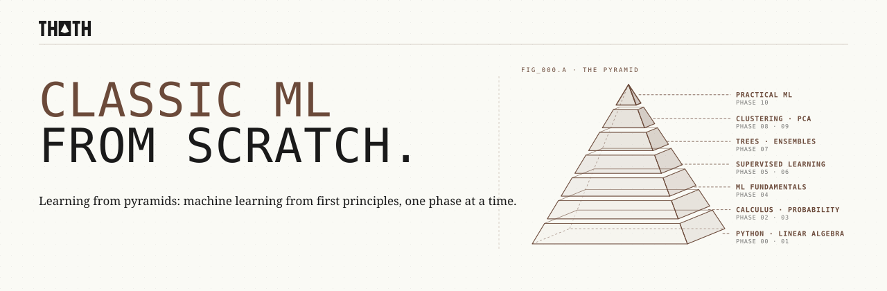

<p align="center">
  <picture>
    <source media="(prefers-color-scheme: dark)" srcset="assets/readme/header-dark.svg">
    
  </picture>
</p>

Build every classic machine learning algorithm yourself. Start from plain Python and the math underneath, implement each model by hand in NumPy, then check your answer against scikit-learn.

> 78 lessons. 11 phases. Python.

<p align="center">
  <a href="LICENSE"></a>
  <a href="#contents"></a>
  <a href="#contents"></a>
</p>

## Phases

| # | Phase | Lessons | What it is about |
|---|---|---|---|
| 00 | [Python Foundations](phases/00-python-foundations/) | 8 | The tools you will hold for the rest of the course: a reproducible environment, plain Python, NumPy, pandas, matplotlib, and notebooks. |
| 01 | [Linear Algebra](phases/01-linear-algebra/) | 8 | Every dataset is a matrix and every model is a transformation. Learn to see what matrices do to space, and the rest of machine learning becomes geometry. |
| 02 | [Calculus and Optimization](phases/02-calculus-and-optimization/) | 7 | Training a model means walking downhill on a loss surface. This phase teaches you to find the slope and take the step. |
| 03 | [Probability and Statistics](phases/03-probability-and-statistics/) | 7 | Every model makes assumptions about randomness. This phase teaches you to read them. |
| 04 | [ML Fundamentals](phases/04-ml-fundamentals/) | 8 | Before you learn any algorithm, learn how to tell whether it works. |
| 05 | [Supervised Regression](phases/05-supervised-regression/) | 6 | Predicting a number is where machine learning starts: one matrix equation, then everything you need to make it robust. |
| 06 | [Supervised Classification](phases/06-supervised-classification/) | 8 | Draw the boundary between classes, then learn how to bend it. |
| 07 | [Trees and Ensembles](phases/07-trees-and-ensembles/) | 8 | One tree is easy to read and easy to fool. Hundreds of them, combined the right way, are the strongest models for tabular data. |
| 08 | [Unsupervised Clustering](phases/08-unsupervised-clustering/) | 6 | No labels, no target, just geometry. Clustering finds the groups your data already has. |
| 09 | [Dimensionality Reduction and Anomalies](phases/09-dimensionality-reduction-and-anomalies/) | 6 | Fewer dimensions, clearer pictures, and a sharp eye for what does not belong. |
| 10 | [Practical ML](phases/10-practical-ml/) | 6 | Knowing the algorithms gets you a model. Knowing the practice gets you a model you can trust. |

## Every lesson has the same shape

```
NN-lesson-name/
├── code/main.py   from-scratch implementation, runnable from the repo root
├── docs/en.md     The Problem · The Concept · Build It · Use It · Exercises · Key Terms
└── quiz.json      questions to check yourself before and after
```

## Local setup

```bash
git clone https://github.com/Fer14/classic-ml-from-scratch.git
cd classic-ml-from-scratch
uv sync
uv run python phases/00-python-foundations/01-dev-environment/code/main.py
```

No uv? `python -m venv .venv && source .venv/bin/activate && pip install -r requirements.txt` works too.

Check that every lesson runs: `uv run python scripts/check.py`

<a id="contents"></a>

## Contents

<a id="phase-00"></a>
<details>
<summary><strong>Phase 00 · Python Foundations</strong> · 8 lessons</summary>

> The tools you will hold for the rest of the course: a reproducible environment, plain Python, NumPy, pandas, matplotlib, and notebooks.

| # | Lesson |
|---|---|
| 01 | [Dev Environment](phases/00-python-foundations/01-dev-environment/) |
| 02 | [Python Basics](phases/00-python-foundations/02-python-basics/) |
| 03 | [Data Structures](phases/00-python-foundations/03-data-structures/) |
| 04 | [Functions and Classes](phases/00-python-foundations/04-functions-and-classes/) |
| 05 | [NumPy](phases/00-python-foundations/05-numpy/) |
| 06 | [Pandas](phases/00-python-foundations/06-pandas/) |
| 07 | [Plotting with Matplotlib](phases/00-python-foundations/07-plotting-with-matplotlib/) |
| 08 | [Jupyter Notebooks](phases/00-python-foundations/08-jupyter-notebooks/) |

</details>

<a id="phase-01"></a>
<details>
<summary><strong>Phase 01 · Linear Algebra</strong> · 8 lessons</summary>

> Every dataset is a matrix and every model is a transformation. Learn to see what matrices do to space, and the rest of machine learning becomes geometry.

| # | Lesson |
|---|---|
| 01 | [Vectors](phases/01-linear-algebra/01-vectors/) |
| 02 | [Dot Product and Projections](phases/01-linear-algebra/02-dot-product-and-projections/) |
| 03 | [Matrices as Transformations](phases/01-linear-algebra/03-matrices-as-transformations/) |
| 04 | [Matrix Multiplication](phases/01-linear-algebra/04-matrix-multiplication/) |
| 05 | [Linear Systems and the Inverse](phases/01-linear-algebra/05-linear-systems-and-inverse/) |
| 06 | [Determinant](phases/01-linear-algebra/06-determinant/) |
| 07 | [Eigenvalues and Eigenvectors](phases/01-linear-algebra/07-eigenvalues-and-eigenvectors/) |
| 08 | [Norms and Distances](phases/01-linear-algebra/08-norms-and-distances/) |

</details>

<a id="phase-02"></a>
<details>
<summary><strong>Phase 02 · Calculus and Optimization</strong> · 7 lessons</summary>

> Training a model means walking downhill on a loss surface. This phase teaches you to find the slope and take the step.

| # | Lesson |
|---|---|
| 01 | [Derivatives](phases/02-calculus-and-optimization/01-derivatives/) |
| 02 | [Partial Derivatives and Gradients](phases/02-calculus-and-optimization/02-partial-derivatives-and-gradients/) |
| 03 | [The Chain Rule](phases/02-calculus-and-optimization/03-chain-rule/) |
| 04 | [Gradient Descent](phases/02-calculus-and-optimization/04-gradient-descent/) |
| 05 | [The Learning Rate](phases/02-calculus-and-optimization/05-learning-rate/) |
| 06 | [Convexity](phases/02-calculus-and-optimization/06-convexity/) |
| 07 | [SGD and Momentum](phases/02-calculus-and-optimization/07-sgd-and-momentum/) |

</details>

<a id="phase-03"></a>
<details>
<summary><strong>Phase 03 · Probability and Statistics</strong> · 7 lessons</summary>

> Every model makes assumptions about randomness. This phase teaches you to read them.

| # | Lesson |
|---|---|
| 01 | [Probability Basics](phases/03-probability-and-statistics/01-probability-basics/) |
| 02 | [Random Variables and Distributions](phases/03-probability-and-statistics/02-random-variables-and-distributions/) |
| 03 | [Expectation and Variance](phases/03-probability-and-statistics/03-expectation-and-variance/) |
| 04 | [Bayes' Theorem](phases/03-probability-and-statistics/04-bayes-theorem/) |
| 05 | [Maximum Likelihood Estimation](phases/03-probability-and-statistics/05-maximum-likelihood/) |
| 06 | [Sampling and the Central Limit Theorem](phases/03-probability-and-statistics/06-sampling-and-central-limit-theorem/) |
| 07 | [Hypothesis Testing](phases/03-probability-and-statistics/07-hypothesis-testing/) |

</details>

<a id="phase-04"></a>
<details>
<summary><strong>Phase 04 · ML Fundamentals</strong> · 8 lessons</summary>

> Before you learn any algorithm, learn how to tell whether it works.

| # | Lesson |
|---|---|
| 01 | [What Is Machine Learning](phases/04-ml-fundamentals/01-what-is-machine-learning/) |
| 02 | [Train, Validation, and Test Sets](phases/04-ml-fundamentals/02-train-validation-test/) |
| 03 | [Loss Functions](phases/04-ml-fundamentals/03-loss-functions/) |
| 04 | [Overfitting and Regularization](phases/04-ml-fundamentals/04-overfitting-and-regularization/) |
| 05 | [The Bias-Variance Tradeoff](phases/04-ml-fundamentals/05-bias-variance/) |
| 06 | [Cross-Validation](phases/04-ml-fundamentals/06-cross-validation/) |
| 07 | [Evaluation Metrics](phases/04-ml-fundamentals/07-metrics/) |
| 08 | [Feature Scaling and Encoding](phases/04-ml-fundamentals/08-feature-scaling-and-encoding/) |

</details>

<a id="phase-05"></a>
<details>
<summary><strong>Phase 05 · Supervised Regression</strong> · 6 lessons</summary>

> Predicting a number is where machine learning starts: one matrix equation, then everything you need to make it robust.

| # | Lesson |
|---|---|
| 01 | [Linear Regression: The Closed Form](phases/05-supervised-regression/01-linear-regression-closed-form/) |
| 02 | [Linear Regression with Gradient Descent](phases/05-supervised-regression/02-linear-regression-gradient-descent/) |
| 03 | [Polynomial Regression](phases/05-supervised-regression/03-polynomial-regression/) |
| 04 | [Ridge Regression](phases/05-supervised-regression/04-ridge-regression/) |
| 05 | [Lasso and Elastic Net](phases/05-supervised-regression/05-lasso-and-elastic-net/) |
| 06 | [Regression Diagnostics](phases/05-supervised-regression/06-regression-diagnostics/) |

</details>

<a id="phase-06"></a>
<details>
<summary><strong>Phase 06 · Supervised Classification</strong> · 8 lessons</summary>

> Draw the boundary between classes, then learn how to bend it.

| # | Lesson |
|---|---|
| 01 | [Logistic Regression](phases/06-supervised-classification/01-logistic-regression/) |
| 02 | [K-Nearest Neighbors](phases/06-supervised-classification/02-k-nearest-neighbors/) |
| 03 | [Naive Bayes](phases/06-supervised-classification/03-naive-bayes/) |
| 04 | [LDA and QDA](phases/06-supervised-classification/04-lda-and-qda/) |
| 05 | [The Perceptron](phases/06-supervised-classification/05-perceptron/) |
| 06 | [Support Vector Machines](phases/06-supervised-classification/06-support-vector-machines/) |
| 07 | [The Kernel Trick](phases/06-supervised-classification/07-kernel-trick/) |
| 08 | [Multiclass Strategies](phases/06-supervised-classification/08-multiclass-strategies/) |

</details>

<a id="phase-07"></a>
<details>
<summary><strong>Phase 07 · Trees and Ensembles</strong> · 8 lessons</summary>

> One tree is easy to read and easy to fool. Hundreds of them, combined the right way, are the strongest models for tabular data.

| # | Lesson |
|---|---|
| 01 | [Decision Trees](phases/07-trees-and-ensembles/01-decision-trees/) |
| 02 | [Entropy and Gini](phases/07-trees-and-ensembles/02-entropy-and-gini/) |
| 03 | [Pruning](phases/07-trees-and-ensembles/03-pruning/) |
| 04 | [Bagging](phases/07-trees-and-ensembles/04-bagging/) |
| 05 | [Random Forests](phases/07-trees-and-ensembles/05-random-forests/) |
| 06 | [AdaBoost](phases/07-trees-and-ensembles/06-adaboost/) |
| 07 | [Gradient Boosting](phases/07-trees-and-ensembles/07-gradient-boosting/) |
| 08 | [XGBoost and LightGBM in Practice](phases/07-trees-and-ensembles/08-xgboost-and-lightgbm-in-practice/) |

</details>

<a id="phase-08"></a>
<details>
<summary><strong>Phase 08 · Unsupervised Clustering</strong> · 6 lessons</summary>

> No labels, no target, just geometry. Clustering finds the groups your data already has.

| # | Lesson |
|---|---|
| 01 | [K-Means](phases/08-unsupervised-clustering/01-k-means/) |
| 02 | [K-Means++ and Choosing K](phases/08-unsupervised-clustering/02-k-means-plus-plus-and-choosing-k/) |
| 03 | [Hierarchical Clustering](phases/08-unsupervised-clustering/03-hierarchical-clustering/) |
| 04 | [DBSCAN](phases/08-unsupervised-clustering/04-dbscan/) |
| 05 | [Gaussian Mixtures and EM](phases/08-unsupervised-clustering/05-gaussian-mixtures-and-em/) |
| 06 | [Cluster Evaluation](phases/08-unsupervised-clustering/06-cluster-evaluation/) |

</details>

<a id="phase-09"></a>
<details>
<summary><strong>Phase 09 · Dimensionality Reduction and Anomalies</strong> · 6 lessons</summary>

> Fewer dimensions, clearer pictures, and a sharp eye for what does not belong.

| # | Lesson |
|---|---|
| 01 | [Principal Component Analysis](phases/09-dimensionality-reduction-and-anomalies/01-pca/) |
| 02 | [Singular Value Decomposition](phases/09-dimensionality-reduction-and-anomalies/02-svd/) |
| 03 | [t-SNE](phases/09-dimensionality-reduction-and-anomalies/03-t-sne/) |
| 04 | [UMAP Intuition](phases/09-dimensionality-reduction-and-anomalies/04-umap-intuition/) |
| 05 | [Anomaly Detection](phases/09-dimensionality-reduction-and-anomalies/05-anomaly-detection/) |
| 06 | [Association Rules](phases/09-dimensionality-reduction-and-anomalies/06-association-rules/) |

</details>

<a id="phase-10"></a>
<details>
<summary><strong>Phase 10 · Practical ML</strong> · 6 lessons</summary>

> Knowing the algorithms gets you a model. Knowing the practice gets you a model you can trust.

| # | Lesson |
|---|---|
| 01 | [Imbalanced Data](phases/10-practical-ml/01-imbalanced-data/) |
| 02 | [Feature Selection](phases/10-practical-ml/02-feature-selection/) |
| 03 | [Hyperparameter Tuning](phases/10-practical-ml/03-hyperparameter-tuning/) |
| 04 | [Scikit-learn Pipelines](phases/10-practical-ml/04-sklearn-pipelines/) |
| 05 | [Interpretability](phases/10-practical-ml/05-interpretability/) |
| 06 | [End-to-End Project](phases/10-practical-ml/06-end-to-end-project/) |

</details>

## Contributing

New lessons follow [LESSON_TEMPLATE.md](LESSON_TEMPLATE.md). Run `uv run python scripts/check.py` before opening a pull request.

## License

[MIT](LICENSE). Structure and style inspired by [AI Engineering from Scratch](https://github.com/rohitg00/ai-engineering-from-scratch).
