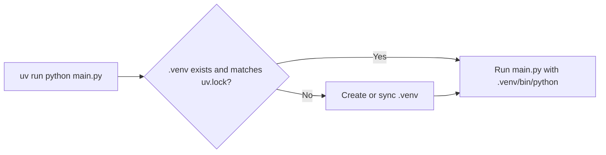

# Dev Environment

> Every bug you avoid by having a reproducible environment is a bug you never have to explain.

**Type:** Build
**Languages:** Python
**Prerequisites:** None. A terminal and an internet connection.
**Time:** ~30 minutes

## Learning Objectives

- Install `uv` and use it to create a project-local virtual environment with pinned dependencies
- Explain the difference between the system Python, a virtual environment, and a lockfile
- Run any script in this course with `uv run` and know which interpreter actually executed it
- Build a small environment checker that verifies Python version, venv status, and package versions

## The Problem

You copy a machine learning script from a tutorial. It fails with `ModuleNotFoundError: No module named 'sklearn'`. You run `pip install scikit-learn`. Now it fails with a deprecation error because the tutorial was written for an older NumPy. You downgrade NumPy. Another project on your machine that needed the new NumPy breaks.

This is dependency hell, and it is the most common reason beginners give up before writing a single model. The fix is not more care. The fix is isolation and pinning: each project gets its own Python environment, and the exact versions of every package are written down in a file that anyone can reproduce.

This course uses `uv`, a fast Python package and project manager. One command installs Python, creates the environment, and installs the exact versions the course was tested with.

## The Concept

### Three layers

```
+-----------------------------------------------------+
| Your operating system                               |
|   system Python  (/usr/bin/python3)  <- do not touch |
|                                                     |
|   +---------------------------------------------+   |
|   | Project folder: classic-ml-from-scratch/    |   |
|   |   pyproject.toml   what you depend on       |   |
|   |   uv.lock          exact resolved versions  |   |
|   |   .venv/           private Python + packages|   |
|   +---------------------------------------------+   |
+-----------------------------------------------------+
```

- **System Python** belongs to the operating system. Installing packages into it can break OS tools. Leave it alone.
- **Virtual environment (venv)** is a folder (`.venv/`) containing a Python interpreter link and its own `site-packages`. Packages installed here are visible only to this project.
- **Lockfile** (`uv.lock`) records the exact version and hash of every package, including transitive dependencies. Two people running `uv sync` on the same lockfile get identical environments.

### How Python knows it is in a venv

When Python starts it sets two values:

```
sys.base_prefix  -> where the base interpreter is installed
sys.prefix       -> where packages are loaded from
```

Outside a venv they are equal. Inside a venv `sys.prefix` points to `.venv/`. That one comparison is all you need to detect a venv.

### What `uv run` does



You never have to "activate" anything. `uv run` guarantees the command runs inside the project environment, synced to the lockfile.

### The commands you will use

```
uv python install 3.12        install a Python version managed by uv
uv sync                       create .venv and install everything in uv.lock
uv run python path/main.py    run a script inside the project environment
uv add requests               add a dependency (updates pyproject.toml and uv.lock)
uv remove requests            remove a dependency
uv run jupyter lab            start Jupyter inside the environment
```

The older equivalent with only the standard library is:

```
python -m venv .venv
source .venv/bin/activate          (Windows: .venv\Scripts\activate)
pip install -r requirements.txt
python path/main.py
```

Both work. `uv` is faster and resolves a lockfile for you; `venv` + `pip` is what you will find on servers without `uv`. This repo ships both a `uv.lock` and a `requirements.txt`.

## Build It

You will build an environment checker: a script that answers "is my setup correct?" before you waste an hour debugging a model.

### Step 1: Inspect the interpreter

```python
import platform
import sys

MINIMUM_PYTHON = (3, 12)


def python_report():
    version = sys.version_info
    return {
        "version": f"{version.major}.{version.minor}.{version.micro}",
        "executable": sys.executable,
        "implementation": platform.python_implementation(),
        "platform": f"{platform.system()} {platform.machine()}",
        "meets_minimum": (version.major, version.minor) >= MINIMUM_PYTHON,
    }
```

`sys.executable` is the single most useful debugging value in Python. If it does not point into `.venv/`, you are not running the interpreter you think you are.

### Step 2: Detect the virtual environment

```python
def virtual_env_report():
    inside_venv = sys.prefix != sys.base_prefix
    return {
        "inside_venv": inside_venv,
        "env_prefix": sys.prefix,
        "base_prefix": sys.base_prefix,
    }
```

### Step 3: Check installed package versions

`importlib.metadata` reads the metadata of installed distributions without importing them, which is fast and safe even for broken packages.

```python
import importlib.metadata

REQUIRED_PACKAGES = ["numpy", "pandas", "matplotlib", "scikit-learn", "scipy"]


def package_report(package_names):
    report = {}
    for name in package_names:
        try:
            report[name] = importlib.metadata.version(name)
        except importlib.metadata.PackageNotFoundError:
            report[name] = None
    return report
```

Note that the distribution name (`scikit-learn`) differs from the import name (`sklearn`). Metadata uses the distribution name.

### Step 4: Compare against the pinned versions

```python
from pathlib import Path


def find_project_root(start):
    for folder in [start, *start.parents]:
        if (folder / "pyproject.toml").exists():
            return folder
    return None


def read_pinned_requirements(requirements_path):
    pins = {}
    if not requirements_path.exists():
        return pins
    for line in requirements_path.read_text().splitlines():
        line = line.strip()
        if not line or line.startswith("#") or "==" not in line:
            continue
        name, version = line.split("==", 1)
        pins[name.strip().lower()] = version.strip()
    return pins
```

Walking up from the script's folder until you find `pyproject.toml` is the same trick tools like `uv`, `git`, and `pytest` use to locate the project root.

### Step 5: Report

```python
installed = package_report(REQUIRED_PACKAGES)
pinned = read_pinned_requirements(project_root / "requirements.txt") if project_root else {}
for name, version in installed.items():
    expected = pinned.get(name)
    if version is None:
        status = "MISSING"
    elif expected is not None and expected != version:
        status = f"differs from pin {expected}"
    else:
        status = "ok"
    print(f"  {name:<14} {str(version):<10} {status}")
```

Run it from the repo root:

```
uv run python phases/00-python-foundations/01-dev-environment/code/main.py
```

Then try it with the system interpreter (`python3 phases/.../main.py`) and watch `inside_venv` flip to `False` and the packages go `MISSING`.

## Use It

The real test of an environment is running real code. The last part of `main.py` fits a tiny scikit-learn model:

```python
import numpy as np
from sklearn.linear_model import LinearRegression

rng = np.random.default_rng(0)
x = rng.uniform(0, 10, size=(50, 1))
y = 2.0 * x[:, 0] + 1.0 + rng.normal(0, 0.1, size=50)
model = LinearRegression().fit(x, y)
print(f"  fitted slope     {model.coef_[0]:.3f} (true 2.0)")
```

If you see a slope close to 2.0, NumPy, SciPy, and scikit-learn are installed and their compiled extensions load correctly. You will build `LinearRegression` yourself in Phase 05.

In practice you will rarely write a checker like this. You will run `uv sync` and `uv run`, and when something is off you will reach for `uv pip list`, `uv tree`, and `python -c "import sys; print(sys.executable)"`.

## Exercises

1. **Easy.** Add `jupyter` to `REQUIRED_PACKAGES` and rerun. Then run the script with your system `python3` and explain every line that changed.
2. **Medium.** Extend the checker to parse `pyproject.toml` with the standard-library `tomllib` module and print the `dependencies` list next to the installed versions.
3. **Hard.** Create a throwaway project in your scratch folder with `uv init`, add `numpy==1.26.4` with `uv add`, and inspect the diff in `uv.lock`. Then explain why two projects on the same machine can use different NumPy versions without conflict.

## Key Terms

| Term | What people say | What it actually means |
|------|----------------|----------------------|
| Virtual environment | "The venv" | A folder with its own interpreter link and `site-packages`, so packages installed there are isolated from other projects |
| `sys.prefix` | "Where Python lives" | The directory Python loads packages from; differs from `sys.base_prefix` exactly when a venv is active |
| `pyproject.toml` | "The project file" | Standard file declaring the project's name, Python version, and direct dependencies (with version ranges) |
| Lockfile | "uv.lock" | Machine-generated file pinning every direct and transitive dependency to an exact version and hash |
| `uv run` | "Run it with uv" | Sync `.venv` to the lockfile if needed, then execute the command with the project interpreter |
| Distribution name | "The pip name" | The name a package is published under (`scikit-learn`), which can differ from its import name (`sklearn`) |
| Transitive dependency | "A dependency of a dependency" | A package you did not ask for but that one of your dependencies requires, such as `joblib` for scikit-learn |

## Further Reading

- [uv documentation](https://docs.astral.sh/uv/) -- official guide to projects, `uv run`, `uv sync`, and Python version management
- [Python tutorial: Virtual Environments and Packages](https://docs.python.org/3/tutorial/venv.html) -- the standard-library `venv` + `pip` workflow explained by the Python docs
- [Python Packaging User Guide: Writing your pyproject.toml](https://packaging.python.org/en/latest/guides/writing-pyproject-toml/) -- what every field in `pyproject.toml` means
