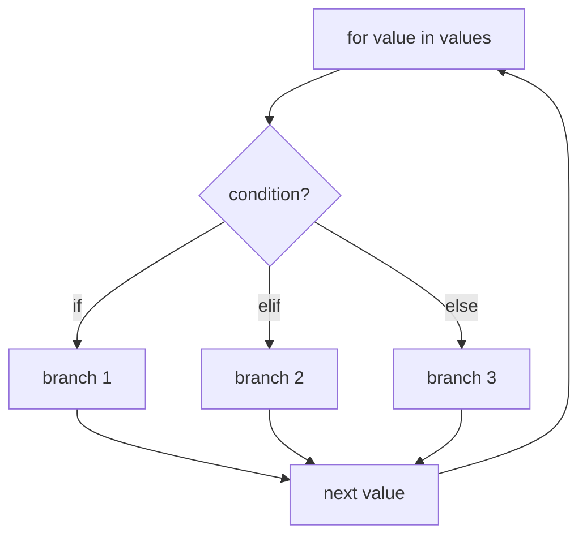

# Python Basics

> Every machine learning library is, at the bottom, loops and arithmetic. Learn to write them yourself first.

**Type:** Build
**Languages:** Python
**Prerequisites:** Phase 00 Lesson 01 (Dev Environment)
**Time:** ~45 minutes

## Learning Objectives

- Use Python's core value types (`int`, `float`, `str`, `bool`) and arithmetic operators, including integer division and modulo
- Write `for` loops, `while` loops, and `if/elif/else` branches to process a list of numbers
- Compute mean, median, variance, and standard deviation from scratch and verify them against the `statistics` module
- Explain why `0.1 + 0.2 == 0.3` is `False` and how to compare floats safely

## The Problem

You have two weeks of daily temperatures and want a summary: average, spread, the coldest and hottest day, and a label for each day. In Phase 03 you will compute exactly these quantities (mean, variance, standard deviation) on every dataset you touch, and in Phase 04 you will standardize features with them.

Libraries compute these in one call. But if you cannot write the loop yourself, you cannot debug the library when it surprises you, and you cannot implement the algorithms in later phases where no library function does exactly what you need. This lesson is the minimum Python you need for everything that follows.

## The Concept

### Values and types

Every value in Python has a type. The four you will use constantly:

```
42          int     whole numbers, unlimited size
22.5        float   64-bit floating point (about 15-16 significant digits)
"Madrid"    str     text
True        bool    True or False (a subclass of int: True + True == 2)
```

Arithmetic operators:

```
7 / 2   = 3.5     true division always returns float
7 // 2  = 3       floor division
7 % 2   = 1       remainder (modulo)
2 ** 10 = 1024    exponent
```

### Floats are approximations

`0.1` cannot be represented exactly in binary, just as 1/3 cannot be written exactly in decimal. So:

```
0.1 + 0.2 == 0.3          -> False
0.1 + 0.2                 -> 0.30000000000000004
math.isclose(0.1 + 0.2, 0.3) -> True
```

Never compare floats with `==`. Use `math.isclose` (or `np.isclose` later) with a tolerance. Every "from scratch vs library" comparison in this course does this.

### Control flow



- `for x in collection:` runs the body once per element. Use it when you know what you are iterating over.
- `while condition:` runs until the condition is false. Use it for iterative algorithms that stop on convergence, such as Newton's method here and gradient descent in Phase 02.
- `break` exits the loop early; `continue` skips to the next iteration.
- `enumerate(values, start=1)` gives you `(index, value)` pairs without manual counters.

### The statistics you will build

For values $x_1, \dots, x_n$:

```
mean      = (x_1 + ... + x_n) / n
variance  = sum((x_i - mean)^2) / (n - 1)        sample variance
std       = sqrt(variance)
median    = middle value after sorting (average of the two middle values if n is even)
```

Dividing by `n - 1` instead of `n` gives the *sample* variance, the unbiased estimate when your data is a sample of a larger population. You will see why in Phase 03.

### Newton's method for square roots

To compute `sqrt(a)` with only arithmetic, start with a guess `g` and repeat:

```
g = (g + a / g) / 2
```

If `g` is too big, `a / g` is too small, and their average is closer to the truth. This roughly doubles the number of correct digits each step. It is your first iterative optimizer: a `while` loop that refines a guess until an error is below a tolerance.

## Build It

### Step 1: Values and types

```python
import math
import random

random.seed(7)

city = "Madrid"
days_recorded = 14
temperatures_celsius = [round(random.gauss(22.0, 4.0), 1) for _ in range(days_recorded)]
is_summer = True

print(f"  7 / 2 = {7 / 2}   7 // 2 = {7 // 2}   7 % 2 = {7 % 2}   2 ** 10 = {2 ** 10}")
print(f"  0.1 + 0.2 == 0.3 -> {0.1 + 0.2 == 0.3}   math.isclose -> {math.isclose(0.1 + 0.2, 0.3)}")
```

`random.seed(7)` makes the "random" temperatures identical every run. Every script in this course fixes its seed so you can compare your output with the docs.

The `f"..."` strings are f-strings: anything in `{}` is evaluated, and the part after `:` is a format spec. `{average:.3f}` means "3 decimals", `{name:<9}` means "left-align in 9 characters".

### Step 2: Summary statistics with loops

```python
def mean_of(values):
    total = 0.0
    for value in values:
        total += value
    return total / len(values)


def min_and_max(values):
    smallest = values[0]
    largest = values[0]
    for value in values[1:]:
        if value < smallest:
            smallest = value
        if value > largest:
            largest = value
    return smallest, largest


def variance_of(values):
    center = mean_of(values)
    squared_deviation_sum = 0.0
    for value in values:
        squared_deviation_sum += (value - center) ** 2
    return squared_deviation_sum / (len(values) - 1)


def median_of(values):
    ordered = sorted(values)
    middle = len(ordered) // 2
    if len(ordered) % 2 == 1:
        return ordered[middle]
    return (ordered[middle - 1] + ordered[middle]) / 2
```

Notice `min_and_max` returns two values. Python packs them into a tuple and you unpack them with `lowest, highest = min_and_max(...)`.

### Step 3: A while loop that converges

```python
def square_root(number, tolerance=1e-12):
    guess = number if number > 1 else 1.0
    iterations = 0
    while abs(guess * guess - number) > tolerance:
        guess = 0.5 * (guess + number / guess)
        iterations += 1
    return guess, iterations
```

On the sample variance of about 9.24 this converges in 6 iterations.

### Step 4: Branching to label each day

```python
def describe_temperature(celsius):
    if celsius < 18:
        return "cold"
    elif celsius < 25:
        return "mild"
    else:
        return "hot"


label_counts = {"cold": 0, "mild": 0, "hot": 0}
for day_number, celsius in enumerate(temperatures_celsius, start=1):
    label = describe_temperature(celsius)
    label_counts[label] += 1

first_hot_day = None
for day_number, celsius in enumerate(temperatures_celsius, start=1):
    if celsius >= 25:
        first_hot_day = day_number
        break
```

Turning a continuous number into a category with thresholds is called *binning* or *discretization*. A decision tree (Phase 07) learns exactly these thresholds from data.

Expected output:

```
  mean     22.314
  median   22.850
  min/max  15.3 / 26.4
  variance 9.244
  std      3.040  (Newton's method, 6 iterations)
  counts: {'cold': 1, 'mild': 10, 'hot': 3}
  first hot day: 7
```

## Use It

Python's standard library already ships these functions in the `statistics` module, plus the built-ins `min`, `max`, and `sorted`:

```python
import statistics

library_results = {
    "mean": (average, statistics.mean(temperatures_celsius)),
    "median": (middle_value, statistics.median(temperatures_celsius)),
    "variance": (sample_variance, statistics.variance(temperatures_celsius)),
    "std": (standard_deviation, statistics.stdev(temperatures_celsius)),
    "min": (lowest, min(temperatures_celsius)),
    "max": (highest, max(temperatures_celsius)),
}
for name, (ours, theirs) in library_results.items():
    match = "match" if math.isclose(ours, theirs, rel_tol=1e-9) else "MISMATCH"
    print(f"  {name:<9} ours={ours:9.4f}  library={theirs:9.4f}  {match}")
```

All six match. `statistics.variance` uses `n - 1`; `statistics.pvariance` uses `n`. NumPy's `np.var` defaults to `n` (population) unless you pass `ddof=1`. This mismatch between libraries trips up many people; now you know where it comes from.

For large arrays you will use NumPy (Lesson 05), which runs the same loops in compiled C, roughly 50 to 100 times faster.

## Exercises

1. **Easy.** Add a function `range_of(values)` that returns `max - min` using your `min_and_max`. Print it next to the other statistics.
2. **Medium.** Rewrite `square_root` to stop when the *relative* change between two guesses is below `1e-12`, and test it on `1e-10`, `2.0`, and `1e10`. Why can an absolute tolerance on `guess * guess - number` fail for very large numbers?
3. **Hard.** Compute the variance in a single pass using Welford's online algorithm (update a running mean and a running sum of squared deviations as each value arrives). Compare it to `variance_of` on the list `[1e9 + 4, 1e9 + 7, 1e9 + 13, 1e9 + 16]` and to the naive formula `mean(x^2) - mean(x)^2`. Which one loses precision and why?

## Key Terms

| Term | What people say | What it actually means |
|------|----------------|----------------------|
| float | "A decimal number" | A 64-bit IEEE 754 binary approximation of a real number, with about 15-16 significant digits |
| f-string | "Formatted string" | A string literal prefixed with `f` where `{expression:format}` is evaluated and formatted inline |
| Floor division | "Integer division" | `a // b`, division rounded down toward negative infinity |
| Sample variance | "Variance" | Average squared deviation from the mean, dividing by `n - 1` to give an unbiased estimate of the population variance |
| Median | "The middle value" | The value that splits sorted data in half; robust to outliers, unlike the mean |
| Seed | "Fix the randomness" | An initial value for a pseudo-random generator so the same "random" sequence is produced every run |
| Convergence | "It stopped changing" | An iterative algorithm reaching a point where further steps change the result by less than a tolerance |

## Further Reading

- [The Python Tutorial](https://docs.python.org/3/tutorial/) -- the official tutorial; chapters 3-5 cover everything in this lesson
- [Floating-Point Arithmetic: Issues and Limitations](https://docs.python.org/3/tutorial/floatingpoint.html) -- why `0.1 + 0.2 != 0.3`, from the Python docs
- [statistics module documentation](https://docs.python.org/3/library/statistics.html) -- the standard-library reference implementations used in "Use It"
