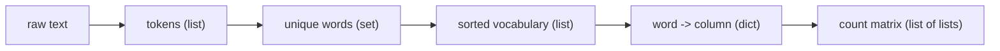

# Data Structures

> Choosing the right container is half the algorithm: lists for order, sets for membership, dicts for lookup, tuples for records.

**Type:** Build
**Languages:** Python
**Prerequisites:** Phase 00 Lesson 02 (Python Basics)
**Time:** ~45 minutes

## Learning Objectives

- Choose between `list`, `tuple`, `set`, and `dict` based on ordering, mutability, and lookup cost
- Use comprehensions, slicing, `sorted(..., key=...)`, and set operations fluently
- Build a bag-of-words count matrix from raw text using only built-in data structures
- Verify your implementation against `collections.Counter` and scikit-learn's `CountVectorizer`

## The Problem

Machine learning models need numbers, but much of the world's data is text. Before any model can classify a review as positive or negative, someone has to turn sentences into rows of numbers. The oldest and still widely used way to do that is the *bag of words*: build a vocabulary, assign each word a column, and count how often each word appears in each document.

Building it requires every core Python container. Lists to keep tokens in order. A set to find the unique words. A dict to map each word to its column. Tuples to carry small records around. If you can build a bag of words by hand, you understand the four data structures well enough for the rest of this course. You will feed exactly this kind of matrix into Naive Bayes in Phase 06.

## The Concept

### The four containers

| Container | Literal | Ordered | Mutable | Duplicates | `x in c` cost |
|-----------|---------|---------|---------|------------|---------------|
| list | `[1, 2, 2]` | yes | yes | yes | O(n) scan |
| tuple | `(1, 2, 2)` | yes | no | yes | O(n) scan |
| set | `{1, 2}` | no | yes | no | O(1) hash lookup |
| dict | `{"a": 1}` | insertion order | yes | unique keys | O(1) on keys |

Rules of thumb:

- Need a sequence you will append to? **list**.
- Need a fixed record like `(doc_id, length, first_word)`, or a dict key made of several values? **tuple** (immutable, so hashable).
- Need "have I seen this?" or unique values? **set**.
- Need "given X, find Y"? **dict**.

### Why sets and dicts are fast

Sets and dict keys are stored in a hash table. Python computes `hash(key)`, which points almost directly to a slot in memory. Checking `"cat" in vocabulary_set` costs about the same for 10 words or 10 million. Checking `"cat" in vocabulary_list` walks the list element by element. In a loop over a large corpus, that difference is seconds versus hours.

### Set algebra

```
A = {the, cat, sat, on, mat}
B = {the, dog, sat, on, log}

A & B   intersection   {on, sat, the}
A | B   union          {cat, dog, log, mat, on, sat, the}
A - B   difference     {cat, mat}
```

The *Jaccard similarity* `|A & B| / |A | B|` measures overlap between two sets, from 0 (disjoint) to 1 (identical). Here it is 3/7 = 0.429.

### From text to a matrix



Each document becomes one row. Each vocabulary word becomes one column. Cell `(i, j)` counts word `j` in document `i`. Word order is thrown away, hence "bag".

## Build It

### Step 1: Lists of tokens

```python
import re

documents = [
    "The cat sat on the mat.",
    "The dog sat on the log.",
    "Cats and dogs are friends, and the cat likes the dog.",
    "A model learns patterns from data.",
]


def tokenize(text):
    return re.findall(r"\b\w\w+\b", text.lower())


tokenized_documents = [tokenize(document) for document in documents]
```

The regular expression keeps runs of two or more word characters, which drops punctuation and one-letter words like "a". The `[... for ... in ...]` syntax is a *list comprehension*: a compact loop that builds a list.

Indexing and slicing: `tokens[0]` is the first element, `tokens[-1]` the last, `tokens[1:3]` the elements at positions 1 and 2 (the end is exclusive).

### Step 2: A set for the vocabulary

```python
vocabulary_set = set()
for tokens in tokenized_documents:
    vocabulary_set.update(tokens)
vocabulary = sorted(vocabulary_set)


def jaccard_similarity(first_words, second_words):
    union = first_words | second_words
    if not union:
        return 0.0
    return len(first_words & second_words) / len(union)
```

Sets have no order, so you sort them to get a stable column order. The result: 18 unique words.

### Step 3: Dicts for lookup and counting

```python
word_to_index = {word: index for index, word in enumerate(vocabulary)}

word_frequencies = {}
for tokens in tokenized_documents:
    for token in tokens:
        word_frequencies[token] = word_frequencies.get(token, 0) + 1
top_words = sorted(word_frequencies.items(), key=lambda pair: (-pair[1], pair[0]))[:5]
```

`dict.get(key, default)` returns `default` if the key is missing, which makes counting a one-liner. The `key=` argument of `sorted` decides what to sort by; the tuple `(-count, word)` sorts by count descending and breaks ties alphabetically.

```
top 5 words [('the', 6), ('and', 2), ('cat', 2), ('dog', 2), ('on', 2)]
```

### Step 4: The bag-of-words matrix

```python
def bag_of_words(tokenized, index_of_word):
    matrix = []
    for tokens in tokenized:
        row = [0] * len(index_of_word)
        for token in tokens:
            if token in index_of_word:
                row[index_of_word[token]] += 1
        matrix.append(row)
    return matrix


count_matrix = bag_of_words(tokenized_documents, word_to_index)
```

The `if token in index_of_word` check matters at prediction time: words never seen during training have no column and are ignored.

```
          and  are  cat cats data  dog dogs frie from lear ...
  doc 0:    0    0    1    0    0    0    0    0    0    0 ...
  doc 2:    2    1    1    1    0    1    1    1    0    0 ...
```

Notice "cat" and "cats" are different columns. Normalizing word forms (stemming, lemmatization) is a separate preprocessing step.

### Step 5: Tuples as records

```python
document_records = [(index, len(tokens), tokens[0]) for index, tokens in enumerate(tokenized_documents)]
for doc_id, length, first_word in document_records:
    print(f"  doc {doc_id}: {length} tokens, starts with {first_word!r}")
longest = max(document_records, key=lambda record: record[1])
```

## Use It

The standard library and scikit-learn do this for you:

```python
from collections import Counter
from sklearn.feature_extraction.text import CountVectorizer

counter = Counter(token for tokens in tokenized_documents for token in tokens)
print(counter.most_common(5))
print(dict(counter) == word_frequencies)

vectorizer = CountVectorizer()
sparse_counts = vectorizer.fit_transform(documents)
print(list(vectorizer.get_feature_names_out()) == vocabulary)
print(sparse_counts.toarray().tolist() == count_matrix)
```

Both checks print `True`. Our tokenizer uses the same default pattern as `CountVectorizer` (`\b\w\w+\b`, lowercased), and both sort the vocabulary alphabetically, so the matrices are identical.

Two differences worth noticing:

- `Counter.most_common` breaks ties by first appearance, not alphabetically, so its top 5 lists `cat, sat, on, dog` in a different order than ours.
- `CountVectorizer` returns a *sparse* matrix: it stores only the 24 non-zero cells out of 72. With a real vocabulary of 50,000 words, almost every cell is zero, and dense lists of lists would not fit in memory.

## Exercises

1. **Easy.** Add a fifth document and rerun. Which new columns appear? Confirm the sklearn checks still print `True`.
2. **Medium.** Write `bag_of_words_transform(new_documents)` that reuses the training `word_to_index` and ignores unknown words. Test it on `"The bird and the cat"`. Compare with `vectorizer.transform`.
3. **Hard.** Implement a sparse representation yourself: each document becomes a dict `{column_index: count}` containing only non-zero entries. Write a function that computes the dot product of two such sparse rows, and use it to find which pair of documents shares the most words.

## Key Terms

| Term | What people say | What it actually means |
|------|----------------|----------------------|
| List comprehension | "One-line loop" | `[expr for x in iterable if cond]`, an expression that builds a new list |
| Hashable | "Can be a dict key" | An object whose hash never changes during its lifetime (ints, strings, tuples of hashables), required for set elements and dict keys |
| Tokenization | "Splitting text into words" | Converting a string into a list of units (tokens) according to a rule such as a regular expression |
| Vocabulary | "The word list" | The set of distinct tokens seen in training, each assigned a fixed column index |
| Bag of words | "Word counts" | A representation where each document is a vector of token counts over the vocabulary, ignoring order |
| Jaccard similarity | "Overlap" | Size of the intersection divided by size of the union of two sets |
| Sparse matrix | "Mostly zeros" | A matrix stored as only its non-zero entries and their positions, saving memory when most cells are zero |

## Further Reading

- [Python Tutorial: Data Structures](https://docs.python.org/3/tutorial/datastructures.html) -- official chapter on lists, tuples, sets, dicts, and comprehensions
- [Python Time Complexity wiki](https://wiki.python.org/moin/TimeComplexity) -- the cost of every operation on built-in containers
- [scikit-learn: Text feature extraction](https://scikit-learn.org/stable/modules/feature_extraction.html#text-feature-extraction) -- how `CountVectorizer` and `TfidfVectorizer` build bag-of-words matrices
