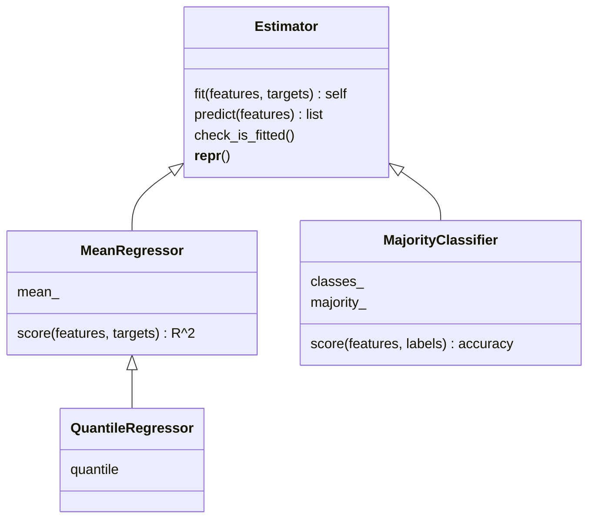

# Functions and Classes

> scikit-learn's whole API is one idea: an object with `fit` and `predict`. Build that idea yourself and every library model will feel familiar.

**Type:** Build
**Languages:** Python
**Prerequisites:** Phase 00 Lesson 03 (Data Structures)
**Time:** ~60 minutes

## Learning Objectives

- Write functions with default arguments, keyword arguments, `*args`, `**kwargs`, and lambdas
- Use closures (functions that return functions) to build configurable loss functions
- Design a class hierarchy with `fit`, `predict`, and `score` that mirrors scikit-learn's estimator API
- Explain the trailing-underscore convention for learned attributes and why `fit` returns `self`

## The Problem

Every model in this course does the same three things: learn something from training data, use what it learned to make predictions, and report how good those predictions are. If you write each model as a loose collection of functions and global variables, you will drown in bookkeeping: which mean belongs to which dataset, did I train this yet, which function goes with which model?

Classes solve this by bundling state (what the model learned) with behavior (how it predicts). scikit-learn standardized one particular design so that every model, from linear regression to random forests, is used the same way. You will build the simplest possible models, *baselines* that ignore the features entirely, with that exact design. Baselines are not toys: any real model you train in Phase 04 onward must beat them, or it learned nothing.

## The Concept

### Functions are values

In Python a function is an object like any other. You can pass it as an argument, store it in a dict, and return it from another function.

```
def evaluate(actual, predicted, *metrics, decimals=3, **named_metrics)
                                 ^          ^          ^
                 any number of positional   keyword    any number of
                 metric functions           with       extra keyword
                                            default    arguments
```

- `*metrics` collects extra positional arguments into a tuple.
- `decimals=3` has a default, and because it comes after `*metrics` it can only be passed by keyword.
- `**named_metrics` collects extra keyword arguments into a dict.
- `lambda a, p: ...` creates a small anonymous function inline.

### Closures

A closure is an inner function that remembers variables from the function that created it:

```
make_power_loss(3)  -->  power_loss(actual, predicted)   remembers power = 3
make_power_loss(2)  -->  power_loss(actual, predicted)   remembers power = 2 (this is MSE)
```

This is how you build families of functions from one template, a pattern you will use for learning-rate schedules and kernels later.

### The estimator contract



The conventions, all copied from scikit-learn:

1. **Hyperparameters go in `__init__`** and are stored unchanged (`self.quantile = quantile`). No learning happens there.
2. **`fit` learns from data** and stores results in attributes ending with an underscore (`mean_`, `classes_`). The underscore signals "this exists only after fitting".
3. **`fit` returns `self`**, so you can chain: `QuantileRegressor(0.5).fit(X, y).predict(X)`.
4. **`predict` refuses to run before `fit`**, raising a clear error instead of returning garbage.
5. **`score` returns a single number** where higher is better: R^2 for regressors, accuracy for classifiers.

### Why a constant model has R^2 = 0

```
R^2 = 1 - sum((y - y_hat)^2) / sum((y - mean(y))^2)
```

If you always predict `mean(y)`, the numerator equals the denominator and R^2 is exactly 0. That is the definition of "no better than a baseline", and it is why R^2 is read as "how much better than predicting the mean".

## Build It

### Step 1: Metric functions and flexible arguments

```python
def mean_squared_error(actual, predicted):
    return sum((a - p) ** 2 for a, p in zip(actual, predicted)) / len(actual)


def mean_absolute_error(actual, predicted):
    return sum(abs(a - p) for a, p in zip(actual, predicted)) / len(actual)


def accuracy(actual, predicted):
    return sum(a == p for a, p in zip(actual, predicted)) / len(actual)


def evaluate(actual, predicted, *metrics, decimals=3, **named_metrics):
    results = {metric.__name__: metric(actual, predicted) for metric in metrics}
    results.update({name: metric(actual, predicted) for name, metric in named_metrics.items()})
    return {name: round(value, decimals) for name, value in results.items()}
```

`zip(actual, predicted)` walks two lists in lockstep. In `accuracy`, `a == p` is a bool, and summing bools counts the `True`s.

### Step 2: A closure

```python
def make_power_loss(power):
    def power_loss(actual, predicted):
        return sum(abs(a - p) ** power for a, p in zip(actual, predicted)) / len(actual)
    power_loss.__name__ = f"power_loss_{power}"
    return power_loss
```

`make_power_loss(2)` reproduces MSE exactly; the script checks this with `math.isclose`.

### Step 3: The base class

```python
class NotFittedError(Exception):
    pass


class Estimator:
    def fit(self, features, targets):
        raise NotImplementedError

    def predict(self, features):
        raise NotImplementedError

    def check_is_fitted(self):
        fitted = [name for name in vars(self) if name.endswith("_") and not name.startswith("_")]
        if not fitted:
            raise NotFittedError(f"{type(self).__name__} is not fitted yet. Call fit first.")

    def __repr__(self):
        params = ", ".join(f"{name}={value!r}" for name, value in vars(self).items() if not name.endswith("_"))
        return f"{type(self).__name__}({params})"
```

`vars(self)` is the instance's attribute dict. The base class uses it to find learned attributes (trailing underscore) and hyperparameters (everything else) without knowing anything about the subclass. `__repr__` controls what `print(model)` shows. Methods with double underscores on both sides ("dunder methods") hook into Python's built-in behavior.

### Step 4: Concrete models

```python
class MeanRegressor(Estimator):
    def fit(self, features, targets):
        self.mean_ = sum(targets) / len(targets)
        return self

    def predict(self, features):
        self.check_is_fitted()
        return [self.mean_ for _ in features]

    def score(self, features, targets):
        predictions = self.predict(features)
        target_mean = sum(targets) / len(targets)
        residual = sum((t - p) ** 2 for t, p in zip(targets, predictions))
        total = sum((t - target_mean) ** 2 for t in targets)
        return 1 - residual / total


class QuantileRegressor(MeanRegressor):
    def __init__(self, quantile=0.5):
        self.quantile = quantile

    def fit(self, features, targets):
        ordered = sorted(targets)
        position = self.quantile * (len(ordered) - 1)
        lower = math.floor(position)
        upper = math.ceil(position)
        fraction = position - lower
        self.mean_ = ordered[lower] + fraction * (ordered[upper] - ordered[lower])
        return self


class MajorityClassifier(Estimator):
    def fit(self, features, labels):
        counts = {}
        for label in labels:
            counts[label] = counts.get(label, 0) + 1
        self.classes_ = sorted(counts)
        self.majority_ = max(self.classes_, key=lambda label: counts[label])
        return self

    def predict(self, features):
        self.check_is_fitted()
        return [self.majority_ for _ in features]

    def score(self, features, labels):
        return accuracy(labels, self.predict(features))
```

`QuantileRegressor` inherits `predict` and `score` from `MeanRegressor` and only overrides `fit`. It interpolates linearly between the two nearest sorted values, the same rule NumPy's `np.quantile` uses by default. Reusing `mean_` as the attribute name is a shortcut so `predict` works unchanged; Exercise 2 asks you to clean that up.

Output:

```
  repr before fit: MeanRegressor()
  predict before fit raises: MeanRegressor is not fitted yet. Call fit first.
  learned mean_ = 351.605
  R^2 on training data = 0.000
  QuantileRegressor(quantile=0.5) learned 357.250
  MajorityClassifier() classes_=['ham', 'spam'] majority_='ham'
  accuracy = 0.775
```

That last number matters: a "spam filter" that always says "ham" is 77.5% accurate on this data. Any real classifier must beat 0.775, not 0.5. You will revisit this trap in Phase 10 (Imbalanced Data).

## Use It

scikit-learn ships these baselines as `DummyRegressor` and `DummyClassifier`, with the same API:

```python
from sklearn.dummy import DummyClassifier, DummyRegressor

sklearn_mean = DummyRegressor(strategy="mean").fit(house_sizes, house_prices)
sklearn_median = DummyRegressor(strategy="median").fit(house_sizes, house_prices)
sklearn_majority = DummyClassifier(strategy="most_frequent").fit(house_sizes, spam_labels)
```

```
  mean:     ours=351.605  sklearn=351.605
  median:   ours=357.250  sklearn=357.250
  majority: ours='ham'  sklearn='ham'
  R^2:      ours=0.000  sklearn=0.000
  accuracy: ours=0.775  sklearn=0.775
```

Everything matches. Because both follow the same contract, you could drop your `MeanRegressor` into code written for scikit-learn models and it would mostly work. scikit-learn's real `BaseEstimator` adds `get_params`/`set_params` (used by grid search in Phase 10) by inspecting the `__init__` signature.

## Exercises

1. **Easy.** Add a `ConstantRegressor(value=0.0)` whose `fit` stores `self.constant_ = self.value`. What R^2 does it get on the house prices? Why is it negative?
2. **Medium.** Refactor so `MeanRegressor` and `QuantileRegressor` both store `constant_` instead of `mean_`, and move `predict` and `score` into a shared `ConstantModel` base class.
3. **Hard.** Implement `get_params()` on `Estimator` using `inspect.signature(type(self).__init__)` so it returns only the constructor arguments, and `set_params(**params)` that updates them and returns `self`. Test that `QuantileRegressor().set_params(quantile=0.9).fit(X, y)` learns the 90th percentile.

## Key Terms

| Term | What people say | What it actually means |
|------|----------------|----------------------|
| `*args` / `**kwargs` | "Variable arguments" | Syntax that collects extra positional arguments into a tuple and extra keyword arguments into a dict |
| Lambda | "Anonymous function" | A single-expression function created inline with `lambda params: expression` |
| Closure | "A function factory" | An inner function that captures variables from the enclosing function's scope after it returns |
| Class / instance | "Object" | A class is a template bundling data and methods; an instance is one concrete object built from it |
| Inheritance | "Subclassing" | Defining a class that reuses and selectively overrides the methods of a parent class |
| Dunder method | "Magic method" | A method like `__init__` or `__repr__` that Python calls automatically for built-in operations |
| Estimator | "A model" | In scikit-learn, any object with `fit`; predictors add `predict`, and learned attributes end in `_` |
| Baseline | "Dumb model" | A model that ignores features (predict mean, median, or majority class) and sets the score any real model must beat |

## Further Reading

- [Python Tutorial: Classes](https://docs.python.org/3/tutorial/classes.html) -- official explanation of classes, instances, inheritance, and scopes
- [scikit-learn: Developing scikit-learn estimators](https://scikit-learn.org/stable/developers/develop.html) -- the exact API contract (`fit` returns `self`, trailing underscores, `get_params`) used in this lesson
- [scikit-learn: Dummy estimators](https://scikit-learn.org/stable/modules/model_evaluation.html#dummy-estimators) -- why and how to use baselines
- *Fluent Python*, 2nd edition, by Luciano Ramalho -- chapters on first-class functions, closures, and the Python data model
