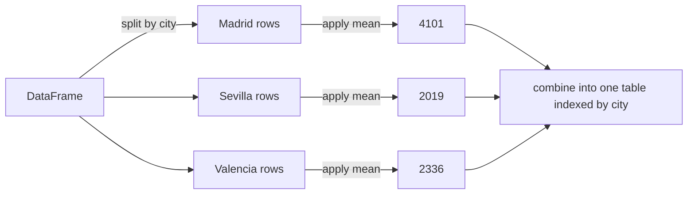

# Pandas

> NumPy gives you fast numbers. Pandas gives those numbers names, types, and an index, which is what real tabular data needs.

**Type:** Build
**Languages:** Python
**Prerequisites:** Phase 00 Lesson 05 (NumPy)
**Time:** ~60 minutes

## Learning Objectives

- Load a CSV into a DataFrame and inspect it with `shape`, `dtypes`, `head`, `describe`, and `isna`
- Select columns, filter rows with boolean conditions, and create derived columns
- Implement fill-missing, group-by-mean, and left-join in plain Python, then reproduce them with `fillna`, `groupby().agg()`, and `merge`
- Hand a clean feature matrix from pandas to NumPy with `to_numpy()`

## The Problem

Real datasets are not clean grids of floats. A housing listings file has a text column (city), integer columns (rooms), float columns (price), and holes where an agent forgot to fill in the size. You need to answer questions like "what is the average price per square meter in each city?" and "attach the region name from another table", then hand a numeric matrix to a model.

NumPy arrays hold one dtype and have no column names, so they cannot represent this directly. Pandas can. Before you lean on it, you will implement its three most important operations by hand so that `groupby` and `merge` are not magic, and so you can recognize when their output is wrong.

## The Concept

### DataFrame anatomy

```
             columns (each one a Series with its own dtype)
             +------------+----------+---------+-------+-----------+
   index     | listing_id | city     | size_m2 | rooms | price_eur |
             |   int64    |   str    | float64 | int64 |  float64  |
             +------------+----------+---------+-------+-----------+
     0       |      1     | Valencia |  127.0  |   4   |  323000.0 |
     1       |      2     | Valencia |   85.0  |   2   |  216000.0 |
     3       |      4     | Sevilla  |   NaN   |   3   |  183000.0 |   <- missing value
             +------------+----------+---------+-------+-----------+
```

- A **Series** is a 1-D labeled array: values plus an index.
- A **DataFrame** is a dict of Series that share one index.
- Each column has its own dtype. Under the hood numeric columns are NumPy arrays.
- Missing values show up as `NaN` (Not a Number). Pandas 3 stores text in a dedicated `str` dtype.

### Split, apply, combine

`groupby` is the most important pandas operation, and it does three things:



In plain Python this is two dicts: one accumulating sums per group, one accumulating counts.

### Joins

A *left join* keeps every row of the left table and attaches matching columns from the right table using a shared key. Rows without a match get missing values. In plain Python: index the right table by key in a dict, then look up each left row.

### Missing values

You have three choices: drop rows with missing values, fill them (mean, median, a constant), or use a model that handles them. Filling with the mean is the simplest *imputation*. It keeps all rows but shrinks the column's variance. In Phase 04 you will learn to compute that mean on the training split only.

## Build It

### Step 1: Read CSV rows into records

The script generates a 30-row listings CSV in memory (seeded, so always identical), with sizes missing for listings 4 and 17. A plain-Python reader turns each row into a dict with proper types:

```python
def read_records(text):
    records = []
    for row in csv.DictReader(io.StringIO(text)):
        records.append({
            "listing_id": int(row["listing_id"]),
            "city": row["city"],
            "size_m2": float(row["size_m2"]) if row["size_m2"] else None,
            "rooms": int(row["rooms"]),
            "price_eur": float(row["price_eur"]),
        })
    return records
```

CSV files contain only text. Every type conversion and every decision about empty strings is yours.

### Step 2: Fill missing values

```python
def fill_missing_with_mean(records, column):
    present = [record[column] for record in records if record[column] is not None]
    column_mean = sum(present) / len(present)
    return [{**record, column: column_mean if record[column] is None else record[column]} for record in records]
```

`{**record, column: new_value}` copies a dict and overrides one key, so the original records are not mutated.

### Step 3: Group by and aggregate

```python
def group_mean(records, key, value):
    sums = {}
    counts = {}
    for record in records:
        group = record[key]
        sums[group] = sums.get(group, 0.0) + record[value]
        counts[group] = counts.get(group, 0) + 1
    return {group: sums[group] / counts[group] for group in sorted(sums)}
```

### Step 4: Left join

```python
def left_join(left_records, right_records, key):
    right_by_key = {record[key]: record for record in right_records}
    return [{**left, **right_by_key.get(left[key], {})} for left in left_records]
```

Building the dict first makes the join O(n + m) instead of the O(n x m) of comparing every pair. Databases and pandas use the same hash-join idea.

```
  listings with missing size: [4, 17]
  mean price per m2 by city: {'Madrid': 4101, 'Sevilla': 2019, 'Valencia': 2336}
  joined first record region: Comunitat Valenciana
```

## Use It

Now the same pipeline in pandas.

```python
listings = pd.read_csv(io.StringIO(CSV_TEXT))
print(listings.dtypes)
print(listings.head(5))
print(listings[["size_m2", "rooms", "price_eur"]].describe())
print(listings.isna().sum())
```

`read_csv` infers types for you: the empty cells become `NaN`, which forces `size_m2` to `float64` even though the sizes are whole numbers (integers have no NaN). `describe` reports `count 28` for `size_m2`, the quickest way to spot missing data.

Clean, derive, filter:

```python
listings["size_m2"] = listings["size_m2"].fillna(listings["size_m2"].mean())
listings["price_per_m2"] = listings["price_eur"] / listings["size_m2"]

big_in_madrid = listings[(listings["city"] == "Madrid") & (listings["size_m2"] > 100)]
```

Combine conditions with `&` and `|` (not `and`/`or`), and wrap each condition in parentheses. This is the boolean-mask indexing from Lesson 05, with column names.

Group, merge, pivot:

```python
summary = listings.groupby("city").agg(
    listings=("listing_id", "count"),
    mean_price=("price_eur", "mean"),
    mean_price_per_m2=("price_per_m2", "mean"),
).round(0)

merged = listings.merge(city_table, on="city", how="left")

pivot = listings.pivot_table(index="city", columns="rooms", values="price_eur", aggfunc="mean")
```

```
          listings  mean_price  mean_price_per_m2
city
Madrid          10    362500.0             4101.0
Sevilla          9    161778.0             2019.0
Valencia        11    219091.0             2336.0
```

The pivot table shows `NaN` for Madrid with 4 rooms: there is no such listing, so there is nothing to average. Missing values appear not only in raw data but also as a result of reshaping.

Finally, both plain-Python results match pandas, and the cleaned features go to NumPy for a model:

```python
feature_matrix = merged[["size_m2", "rooms"]].to_numpy()
```

Use pandas for loading, cleaning, joining, and exploring. Use NumPy arrays for the math inside models. scikit-learn accepts DataFrames directly and converts them for you.

## Exercises

1. **Easy.** Compute the median price per city with `groupby("city")["price_eur"].median()`. Which city has the largest gap between mean and median, and what does that suggest about its price distribution?
2. **Medium.** Replace mean imputation with *per-city* median imputation using `groupby("city")["size_m2"].transform("median")`. Implement the same thing in plain Python and verify they match.
3. **Hard.** Implement `group_aggregate(records, key, value, functions)` in plain Python that accepts a dict like `{"count": len, "mean": statistics.mean, "max": max}` and returns the same table as `groupby(...).agg(...)`. Compare against pandas for all three cities.

## Key Terms

| Term | What people say | What it actually means |
|------|----------------|----------------------|
| DataFrame | "A table" | A 2-D labeled data structure: a collection of same-length Series sharing one index, each with its own dtype |
| Series | "A column" | A 1-D array of values with an index of labels |
| Index | "Row labels" | The labels that identify rows; used to align data in operations and joins |
| NaN | "Missing" | A floating-point value meaning "not a number", used by pandas to mark missing data |
| Imputation | "Filling in blanks" | Replacing missing values with estimates such as the column mean or median |
| groupby | "Split-apply-combine" | Partition rows by key, apply a function to each group, and combine the results into a new table |
| Merge / join | "VLOOKUP" | Combine two tables by matching values in key columns; a left join keeps every row of the left table |
| Pivot table | "Cross-tab" | Reshape data so one key becomes rows, another becomes columns, and cells hold an aggregate |

## Further Reading

- [10 minutes to pandas](https://pandas.pydata.org/docs/user_guide/10min.html) -- the official quick tour of selection, missing data, groupby, and merge
- [pandas: Group by: split-apply-combine](https://pandas.pydata.org/docs/user_guide/groupby.html) -- the full user guide for `groupby`, `agg`, and `transform`
- [Python for Data Analysis, 3rd edition](https://wesmckinney.com/book/) -- free online book by Wes McKinney, the creator of pandas
