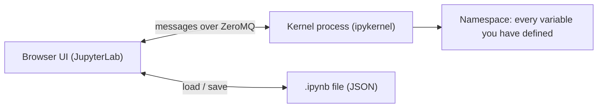

# Jupyter Notebooks

> A notebook is a JSON file plus a Python process that remembers everything you ever ran. Both facts explain all of its magic and all of its bugs.

**Type:** Build
**Languages:** Python
**Prerequisites:** Phase 00 Lesson 01 (Dev Environment), Phase 00 Lesson 04 (Functions and Classes)
**Time:** ~40 minutes

## Learning Objectives

- Start Jupyter inside the project environment with `uv run jupyter lab` and know which interpreter the kernel uses
- Describe the `.ipynb` format: a JSON document of markdown and code cells with stored outputs
- Build a minimal kernel that executes cells in a shared namespace and displays the last expression
- Explain hidden state from out-of-order execution and why "Restart and Run All" is the only trustworthy test

## The Problem

Notebooks are the default tool for exploring data: run a cell, look at a plot, tweak, rerun. That fast feedback loop is why nearly every data scientist uses them. It is also why notebooks are notorious for results that nobody, including their author, can reproduce.

The typical failure: you define `threshold = 10`, compute something, change the cell to `threshold = 15`, and never rerun the computation. The notebook now *displays* code that says 15 next to a result computed with 10. You share it, someone runs it top to bottom, and gets a different number.

Understanding what a notebook actually is (a file format and a separate long-running process) makes this failure obvious and avoidable. In this course every lesson is a script (`code/main.py`) precisely so it runs the same way every time; notebooks are for your own exploration on top.

## The Concept

### Two halves



- The **frontend** (JupyterLab, VS Code, Colab) edits the document and shows outputs.
- The **kernel** is a separate Python process. It receives code, executes it, and sends back outputs. It keeps one namespace alive for the whole session.
- The **`.ipynb` file** stores the cells *and* the last outputs. Saving a notebook does not save the kernel's state.

### The file format

```
{
  "nbformat": 4, "nbformat_minor": 5,
  "metadata": {"kernelspec": {"name": "python3", ...}},
  "cells": [
    {"id": "cell-0", "cell_type": "markdown", "source": "# Tiny analysis ..."},
    {"id": "cell-1", "cell_type": "code", "source": "import numpy as np ...",
     "execution_count": 1, "outputs": [ ... ]}
  ]
}
```

Outputs have types: `stream` (anything printed), `execute_result` (the value of the cell's last expression, shown as `Out[n]`), `display_data` (plots, HTML), and `error`.

### Execution count is history, not position

The `[n]` next to a cell is the order in which the kernel ran it, not its position on the page. If the numbers are not increasing from top to bottom, the outputs on screen were produced by a different program than the one you are reading.

```
  as displayed                 as actually executed
  [1] threshold = 10           1. threshold = 10
  [4] threshold = 15           2. count = ... > threshold     -> uses 10
  [2] count = ...              3. threshold = 15 (edited)
  [5] count   -> 9             4. count                       -> 9, stale
```

The fix is cheap: **Kernel -> Restart Kernel and Run All Cells** before you trust or share a result.

### Running Jupyter in this project

```
uv run jupyter lab
```

Because `uv run` starts Jupyter inside `.venv`, the default `python3` kernel uses the project interpreter and sees NumPy, pandas, and scikit-learn at the locked versions. If you ever see `ModuleNotFoundError` in a notebook but not in a script, check `import sys; sys.executable` in a cell; the kernel is probably a different Python.

## Build It

### Step 1: A notebook is just JSON

```python
def make_notebook(cell_sources):
    cells = []
    for index, (cell_type, source) in enumerate(cell_sources):
        cell = {"id": f"cell-{index}", "cell_type": cell_type, "metadata": {}, "source": source}
        if cell_type == "code":
            cell.update({"execution_count": None, "outputs": []})
        cells.append(cell)
    return {
        "nbformat": 4,
        "nbformat_minor": 5,
        "metadata": {"kernelspec": {"name": "python3", "display_name": "Python 3", "language": "python"}},
        "cells": cells,
    }
```

That dict, passed through `json.dumps`, is a complete notebook that JupyterLab can open.

### Step 2: A kernel is a long-lived namespace

```python
class MiniKernel:
    def __init__(self):
        self.namespace = {}
        self.execution_count = 0

    def run(self, source):
        self.execution_count += 1
        tree = ast.parse(source)
        last_expression = None
        if tree.body and isinstance(tree.body[-1], ast.Expr):
            last_expression = ast.Expression(tree.body.pop().value)
        captured = io.StringIO()
        result = None
        with contextlib.redirect_stdout(captured):
            exec(compile(tree, "<cell>", "exec"), self.namespace)
            if last_expression is not None:
                result = eval(compile(last_expression, "<cell>", "eval"), self.namespace)
        outputs = []
        if captured.getvalue():
            outputs.append({"output_type": "stream", "name": "stdout", "text": captured.getvalue()})
        if result is not None:
            outputs.append({
                "output_type": "execute_result",
                "execution_count": self.execution_count,
                "data": {"text/plain": repr(result)},
                "metadata": {},
            })
        return outputs
```

Three ideas, and they are exactly how IPython behaves:

1. **One dict, `self.namespace`, is shared by every cell.** That is why a variable defined in cell 1 exists in cell 5, and why it keeps existing after you delete cell 1.
2. **The last expression is evaluated separately** using the `ast` module: if the cell ends in an expression (like `y.shape`), it is split off and its value becomes the `execute_result`. That is why a notebook "prints" a bare variable on the last line but not on the others.
3. **`print` output is captured** by temporarily redirecting `stdout` into a string buffer.

### Step 3: Execute the notebook

```python
def execute_notebook(notebook, kernel):
    for cell in notebook["cells"]:
        if cell["cell_type"] != "code":
            continue
        cell["outputs"] = kernel.run(cell["source"])
        cell["execution_count"] = kernel.execution_count
    return notebook
```

```
  [2] stream          mean of y: 15.542
  [2] execute_result  (10,)
  [3] execute_result  (2.968, 2.185)
```

### Step 4: Reproduce the hidden-state bug

```python
kernel = MiniKernel()
kernel.run("threshold = 10")
kernel.run("count = sum(1 for value in range(20) if value > threshold)")
kernel.run("threshold = 15")
stale_count = kernel.run("count")[0]["data"]["text/plain"]
```

```
  cell order 1,2,3 then read count -> 9 (computed with the OLD threshold)
  restart and run all with threshold 15 -> 4
```

A fresh `MiniKernel` is the equivalent of "Restart Kernel".

## Use It

The official tools: `nbformat` reads, writes, and validates the format; `nbclient` executes a notebook top to bottom in a real `ipykernel`, which is how notebooks are tested in CI.

```python
import nbformat
from jupyter_client import KernelManager
from nbclient import NotebookClient

real_notebook = nbformat.from_dict(make_notebook(CELL_SOURCES))
nbformat.validate(real_notebook)
with tempfile.TemporaryDirectory() as folder:
    notebook_path = Path(folder) / "tiny_analysis.ipynb"
    kernel_manager = KernelManager(kernel_name="python3", transport="ipc", ip=str(Path(folder) / "kernel"))
    NotebookClient(real_notebook, km=kernel_manager, timeout=60).execute()
    kernel_manager.shutdown_kernel()
    nbformat.write(real_notebook, notebook_path)
    reloaded = nbformat.read(notebook_path, as_version=4)
```

The real kernel produces exactly the same outputs as `MiniKernel`. (The `transport="ipc"` option makes the kernel talk over local socket files instead of TCP ports, which is all a single-machine script needs.)

The command-line equivalents you will actually use:

```
uv run jupyter lab                                              interactive work
uv run jupyter nbconvert --to notebook --execute nb.ipynb       run all cells headless, like nbclient
uv run jupyter nbconvert --to script nb.ipynb                   turn a notebook into a .py file
```

A good workflow: explore in a notebook, then move code that works into functions in a `.py` file and import it. Notebooks for questions, scripts for answers.

## Exercises

1. **Easy.** Change `notebook_path` to `Path(__file__).parent / "tiny_analysis.ipynb"`, run the script, and open the file with `uv run jupyter lab`. Check that the stored outputs appear before you run anything. Delete the file afterwards.
2. **Medium.** Extend `MiniKernel.run` to catch exceptions and return an output of type `error` with `ename`, `evalue`, and `traceback` fields instead of crashing. Test it with a cell that divides by zero.
3. **Hard.** Write `audit_notebook(path)` that loads a `.ipynb` with plain `json`, reports any code cells whose `execution_count` values are not strictly increasing from top to bottom, and flags cells with `execution_count` of `None` that come before executed ones. Run it on a notebook where you deliberately ran cells out of order.

## Key Terms

| Term | What people say | What it actually means |
|------|----------------|----------------------|
| Notebook | "A Jupyter file" | A JSON document (`.ipynb`) containing an ordered list of markdown and code cells, with code outputs stored inline |
| Kernel | "The Python behind the notebook" | A separate process that executes code sent by the frontend and keeps one namespace alive between cells |
| Namespace | "The variables" | The dictionary mapping names to objects; in a notebook it persists until the kernel restarts |
| execute_result | "Out[n]" | The output produced by the value of the last expression in a code cell |
| Execution count | "The number in brackets" | The order in which the kernel ran a cell, which may differ from the cell's position |
| Hidden state | "It worked on my machine" | Variables in the kernel that no longer match the visible code because cells were edited or run out of order |
| Restart and Run All | "Clean run" | Discarding the kernel namespace and executing every cell top to bottom, the only way to verify a notebook |

## Further Reading

- [Project Jupyter documentation](https://docs.jupyter.org/en/latest/) -- architecture of frontends, kernels, and the messaging protocol
- [The Jupyter Notebook format (nbformat)](https://nbformat.readthedocs.io/en/latest/format_description.html) -- the official specification of the JSON structure built in this lesson
- [Joel Grus, "I don't like notebooks" (JupyterCon 2018)](https://www.youtube.com/watch?v=7jiPeIFXb6U) -- a famous, funny talk on hidden state and reproducibility problems
