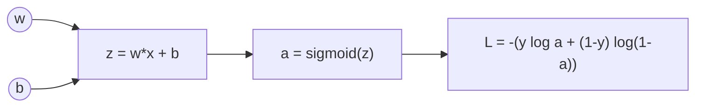

# The Chain Rule

> To differentiate a pipeline, multiply the local slopes of each stage. That is all backpropagation is.

**Type:** Build
**Languages:** Python
**Prerequisites:** Phase 02 Lessons 01-02 (Derivatives, Partial Derivatives and Gradients)
**Time:** ~75 minutes

## Learning Objectives

- Apply the chain rule to nested functions and verify the result numerically
- Draw a computation graph for the logistic loss and backpropagate through it by hand
- Build a minimal reverse-mode automatic differentiation engine (a `Value` class) that handles reused variables
- Train logistic regression with chain-rule gradients and match scikit-learn's coefficients

## The Problem

Real ML losses are never a single textbook function. Logistic regression computes a linear score, squashes it with a sigmoid, then feeds the probability to a log loss. A neural network stacks dozens of such stages. To train any of them, you need the derivative of the final loss with respect to parameters buried at the very start of the pipeline.

Differentiating the whole expression at once is error-prone and grows explosively. The chain rule lets you break the pipeline into small stages, differentiate each stage locally, and multiply. Done systematically from output to input, it is called backpropagation, and it is how every gradient in modern ML is computed.

## The Concept

### One composition

If `y = f(g(x))`, let `u = g(x)`. Then:

```
dy/dx = dy/du * du/dx = f'(g(x)) * g'(x)
```

Intuition: if `u` changes 3 times as fast as `x`, and `y` changes 2 times as fast as `u`, then `y` changes 6 times as fast as `x`. Rates multiply.

Example: `y = sin(x^2 + 1)`. Outer `sin`, inner `x^2 + 1`:

```
dy/dx = cos(x^2 + 1) * 2x
```

At `x = 0.7` this is `0.11299183`, and a central difference gives the same number.

### Computation graphs

Write a function as a graph of elementary operations. For logistic regression on one sample:



The **forward pass** computes values left to right. The **backward pass** computes derivatives right to left, each node multiplying the gradient arriving from downstream by its own local derivative:

```
dL/da = -y/a + (1-y)/(1-a)
da/dz = a (1 - a)
dL/dz = dL/da * da/dz = a - y          (the famous simplification)
dL/dw = dL/dz * dz/dw = (a - y) * x
dL/db = dL/dz * dz/db = (a - y)
```

`dL/dz = a - y` is worth remembering: the gradient of log loss through a sigmoid is just "prediction minus label". The same thing happens with softmax plus cross-entropy.

### Multiple paths: add them up

If a variable feeds into several places, its gradient is the sum of the gradients along every path. For `r = q^2 + q * e^q`, `q` appears three times:

```
dr/dq = 2q          (from q^2)
      + e^q * q     (from e^q, through the product)
      + e^q         (from the q multiplying e^q)
```

This is the multivariable chain rule: `dr/dq = sum over paths of the product of local derivatives`. In code it means gradients are **accumulated** with `+=`, never overwritten.

### Reverse mode automatic differentiation

Autodiff mechanizes the backward pass:

1. During the forward pass, every operation records its inputs (parents) and its local derivative with respect to each input.
2. Sort the graph topologically so every node comes after its inputs.
3. Set `dL/dL = 1` at the output, walk the nodes in reverse order, and for each node push `local_derivative * node.grad` into each parent's `grad`.

One backward pass gives the derivative of the output with respect to **every** input, at a cost of a small constant times the forward pass. That is why training a model with millions of weights is feasible, while numerical gradients (one or two forward passes per weight) are not.

### Vectorized chain rule

For a batch of samples, the scalar derivations become matrix products. With `p = sigmoid(Xw + b)`:

```
dL/dz = (p - y) / n          (one entry per sample)
dL/dw = X^T dL/dz = X^T (p - y) / n
dL/db = sum(dL/dz) = mean(p - y)
```

The `X^T` appears for the same reason as in the MSE gradient: each weight collects error from every sample through its own feature column.

## Build It

### Step 1: Check the chain rule numerically

```python
x0 = 0.7
chain = math.cos(x0**2 + 1) * (2 * x0)
numeric = central_difference(lambda x: math.sin(x**2 + 1), x0)
```

Both print `0.11299183`.

### Step 2: Backprop by hand through logistic loss

```python
def logistic_loss_manual(w, b, x, y):
    z = w * x + b
    a = 1 / (1 + math.exp(-z))
    loss = -(y * math.log(a) + (1 - y) * math.log(1 - a))
    dloss_da = -(y / a) + (1 - y) / (1 - a)
    da_dz = a * (1 - a)
    dz_dw = x
    dz_db = 1.0
    dloss_dz = dloss_da * da_dz
    return loss, z, a, dloss_da, da_dz, dloss_dz, dloss_dz * dz_dw, dloss_dz * dz_db
```

With `w = 0.5, b = -0.2, x = 2, y = 1`:

```
forward:  z = 0.8000, a = 0.6900, loss = 0.3711
backward: dL/da = -1.4493, da/dz = 0.2139
          dL/dz = -0.3100 (a - y = -0.3100)
          dL/dw = -0.6201, dL/db = -0.3100
numerical dL/dw = -0.6201
```

### Step 3: A tiny autodiff engine

```python
class Value:
    def __init__(self, data, parents=(), local_grads=()):
        self.data = data
        self.grad = 0.0
        self.parents = parents
        self.local_grads = local_grads

    def __add__(self, other):
        other = other if isinstance(other, Value) else Value(other)
        return Value(self.data + other.data, (self, other), (1.0, 1.0))

    def __mul__(self, other):
        other = other if isinstance(other, Value) else Value(other)
        return Value(self.data * other.data, (self, other), (other.data, self.data))

    def log(self):
        return Value(math.log(self.data), (self,), (1.0 / self.data,))

    def sigmoid(self):
        s = 1.0 / (1.0 + math.exp(-self.data))
        return Value(s, (self,), (s * (1 - s),))

    def backward(self):
        ordered, visited = [], set()

        def visit(node):
            if id(node) not in visited:
                visited.add(id(node))
                for parent in node.parents:
                    visit(parent)
                ordered.append(node)

        visit(self)
        self.grad = 1.0
        for node in reversed(ordered):
            for parent, local in zip(node.parents, node.local_grads):
                parent.grad += local * node.grad
```

The full class in `code/main.py` also has `__neg__`, `__sub__`, `__rsub__`, `__radd__`, `__rmul__` and `exp`, all one-liners built on the same pattern. Each operation stores only its local derivatives: `1` for addition, the *other* operand for multiplication, `1/x` for log, `s(1-s)` for sigmoid. `backward` does the rest.

```python
w_node, b_node = Value(0.5), Value(-0.2)
a_node = (w_node * x + b_node).sigmoid()
loss_node = -(y * a_node.log() + (1 - y) * (1 - a_node).log())
loss_node.backward()
```

It prints `dL/dw = -0.6201, dL/db = -0.3100`, the same numbers as the manual derivation, with no calculus written by you.

### Step 4: Reused variables accumulate

```python
q = Value(3.0)
r = q * q + q.exp() * q
r.backward()
```

Autodiff gives `86.342148`, matching `2q + e^q + q e^q`. If `backward` used `=` instead of `+=`, it would keep only one path and get the wrong answer.

### Step 5: Train logistic regression

```python
def logistic_gradients(weights, bias, features, labels):
    probabilities = sigmoid(features @ weights + bias)
    error = probabilities - labels
    return features.T @ error / len(labels), error.mean()


weights, bias = np.zeros(4), 0.0
for epoch in range(3001):
    grad_w, grad_b = logistic_gradients(weights, bias, features, labels)
    weights -= 0.5 * grad_w
    bias -= 0.5 * grad_b
```

On 500 samples from `make_classification`, the loss drops from `0.548` after the first step to `0.32895` and stays there. The learned weights are `[0.897, 1.835, 0.0, -0.044]`.

## Use It

```python
from sklearn.linear_model import LogisticRegression

model = LogisticRegression(C=np.inf, max_iter=5000).fit(features, labels)
print(model.coef_, model.intercept_)
```

`C=np.inf` turns off regularization so the objective is the same pure log loss you minimized. scikit-learn's `lbfgs` solver finds `[0.898, 1.835, 0.0, -0.044]` and bias `0.491`, with the same loss `0.32895` and 100% prediction agreement. Internally it uses the exact gradient `X^T (p - y) / n` you derived with the chain rule.

For deep models, PyTorch's `loss.backward()` and JAX's `jax.grad` are industrial versions of your `Value` class: they record a graph during the forward pass and run reverse-mode accumulation over tensors instead of scalars.

## Exercises

1. **Easy.** Add a `tanh` method to `Value` with local derivative `1 - tanh(x)^2`. Check `d/dx tanh(x^2)` at `x = 0.5` against a central difference.
2. **Medium.** Add `__pow__` for constant exponents and `__truediv__`. Use them to build MSE for a linear model on 5 samples entirely from `Value` objects and confirm the gradient matches `2/n X^T (Xw - y)`.
3. **Hard.** Build a 2-input, 3-hidden-unit, 1-output network with tanh hidden units and sigmoid output entirely out of `Value` nodes. Train it on XOR (4 samples) with plain gradient descent until all 4 predictions are on the correct side of 0.5.

## Key Terms

| Term | What people say | What it actually means |
|------|----------------|----------------------|
| Chain rule | "Multiply the derivatives" | `d f(g(x))/dx = f'(g(x)) g'(x)`; with many paths, sum the products along each path |
| Computation graph | "The model as a diagram" | A directed graph of elementary operations; nodes hold values, edges carry dependencies |
| Forward pass | "Run the model" | Evaluating the graph from inputs to output and storing intermediate values |
| Backward pass | "Backprop" | Propagating `dL/dnode` from the output back to every input by multiplying local derivatives |
| Local derivative | "The derivative of one step" | The derivative of a single operation's output with respect to one of its inputs |
| Reverse-mode autodiff | "What PyTorch does" | Mechanical backprop over a recorded graph; one backward pass yields all input gradients |
| Gradient accumulation | "Add, do not overwrite" | Summing gradient contributions when a variable feeds several downstream operations |

## Further Reading

- [3Blue1Brown, Visualizing the chain rule and product rule](https://www.youtube.com/watch?v=YG15m2VwSjA) -- Essence of Calculus chapter 4
- [3Blue1Brown, Backpropagation calculus](https://www.youtube.com/watch?v=tIeHLnjs5U8) -- the chain rule applied to a neural network, step by step
- [Andrej Karpathy, micrograd](https://github.com/karpathy/micrograd) -- a ~100-line scalar autodiff engine that the `Value` class here is modeled on
- [CS231n, Backpropagation, Intuitions](https://cs231n.github.io/optimization-2/) -- computation graphs, local gradients and patterns in backward flow
