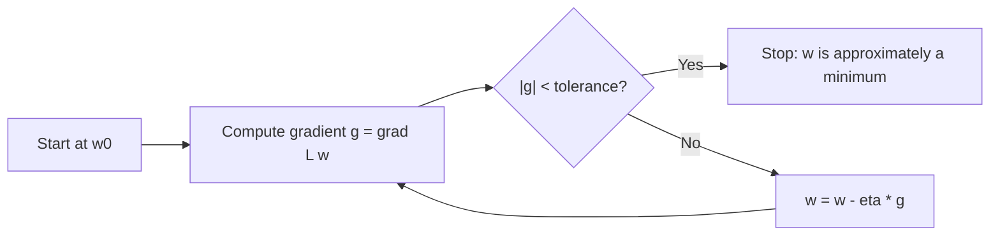

# Gradient Descent

> Stand on the loss surface, find the steepest way down, take a small step, repeat.

**Type:** Build
**Languages:** Python
**Prerequisites:** Phase 02 Lessons 01-03 (Derivatives, Partial Derivatives and Gradients, Chain Rule)
**Time:** ~60 minutes

## Learning Objectives

- Write the gradient descent update rule and implement a general optimizer that works for any gradient function
- Trace gradient descent step by step on a 1D parabola and a 2D elongated bowl, and explain the zig-zag-free but slow convergence along shallow directions
- Train linear regression by gradient descent and confirm the result matches the closed-form solution
- Choose a stopping criterion based on the gradient norm and compare against SciPy's BFGS and CG optimizers

## The Problem

You know how to compute the gradient of a loss. The gradient tells you the direction of steepest increase. But knowing the direction does not give you the minimum. For linear regression there happens to be a formula (the normal equation), but for logistic regression, neural networks, and most models in this course there is no closed form. Setting the gradient to zero gives equations you cannot solve by hand.

You need an iterative procedure: start somewhere, improve a little, and keep improving until you cannot. Gradient descent is the simplest such procedure, and almost every other optimizer (SGD, momentum, Adam) is a variation on it.

## The Concept

### The update rule

```
w_new = w_old - learning_rate * grad L(w_old)
```

- `grad L(w_old)` points uphill. The minus sign flips it downhill.
- `learning_rate` (often written `eta` or `alpha`) scales the step.
- The step is automatically large where the surface is steep and small where it is flat, because the gradient's magnitude shrinks near a minimum.



### Why it works

From the derivatives lesson, near the current point the loss behaves like its linear approximation:

```
L(w - eta g) ~ L(w) - eta * (g . g) = L(w) - eta |g|^2
```

As long as `eta` is small enough for the linear approximation to hold, each step lowers the loss by about `eta |g|^2`, which is positive unless `g = 0`. The process stops making progress exactly where the gradient vanishes: at a critical point.

### A worked example in 1D

`f(x) = (x - 3)^2 + 1`, gradient `2(x - 3)`, learning rate `0.2`, starting at `x = -4`:

```
x1 = -4   - 0.2 * (-14)   = -1.2
x2 = -1.2 - 0.2 * (-8.4)  =  0.48
x3 =  0.48 - 0.2 * (-5.04) = 1.488
```

Each step closes 40% of the remaining gap to `3`, because `x - 0.2 * 2(x - 3) - 3 = 0.6 (x - 3)`. Geometric shrinkage like this is called linear convergence.

### Elongated valleys

For `f(x, y) = x^2 + 10 y^2` the gradient is `(2x, 20y)`. The `y` direction is 10 times steeper. With one shared learning rate:

```
x_new = (1 - 2 eta) x
y_new = (1 - 20 eta) y
```

With `eta = 0.04`, `y` shrinks by a factor `0.2` per step (fast) and `x` only by `0.92` (slow). The optimizer quickly drops to the valley floor, then crawls along it. You cannot just raise `eta`: above `0.1`, the factor `1 - 20 eta` drops below `-1` and `y` explodes. The steepest direction limits the step size; the flattest direction sets how many steps you need. The ratio of the two curvatures (here 10) is the condition number, and it governs how hard a problem is for gradient descent. This is also why feature scaling helps so much (Phase 04).

### Stopping criteria

Common choices, often combined:

- **Gradient norm:** stop when `|grad L| < tolerance`. Directly measures "flat enough".
- **Loss change:** stop when the loss improves by less than some threshold between steps.
- **Max iterations:** a safety net so a bad learning rate does not loop forever.

## Build It

### Step 1: A general gradient descent function

```python
def gradient_descent(gradient_fn, start, learning_rate, max_steps=10_000, tolerance=1e-8):
    position = np.array(start, dtype=float)
    path = [position.copy()]
    for step in range(max_steps):
        gradient = gradient_fn(position)
        if np.linalg.norm(gradient) < tolerance:
            break
        position = position - learning_rate * gradient
        path.append(position.copy())
    return position, np.array(path), step
```

It knows nothing about the function, only its gradient. The returned `path` lets you inspect and plot the trajectory.

On the 1D parabola, the script prints the first steps:

```
step 0: x =  -4.0000  f(x) =  50.0000  gradient = -14.0000
step 1: x =  -1.2000  f(x) =  18.6400  gradient =  -8.4000
step 2: x =   0.4800  f(x) =   7.3504  gradient =  -5.0400
...
converged to x = 3.000000 after 42 steps
```

Note how the gradient shrinks by `0.6` each step, and so do the steps.

### Step 2: The elongated bowl

```python
def elongated_bowl_gradient(point):
    x, y = point
    return np.array([2 * x, 20 * y])


final, path, steps = gradient_descent(elongated_bowl_gradient, [8.0, 2.0], 0.04)
```

```
step   0: ( 8.0000,  2.0000) f = 104.000000
step   1: ( 7.3600,  0.4000) f = 55.769600
step   2: ( 6.7712,  0.0800) f = 45.913149
step  10: ( 3.4751,  0.0000) f = 12.076373
step 100: ( 0.0019,  0.0000) f = 0.000004
```

`y` is gone after a few steps; `x` takes 255 steps to reach the tolerance. The script saves `gradient_descent_path.png` showing this L-shaped path over the contours.

### Step 3: Linear regression by gradient descent

```python
def add_bias_column(features):
    return np.column_stack([np.ones(len(features)), features])


def mse_gradient(weights, design, targets):
    return 2 * design.T @ (design @ weights - targets) / len(targets)


rng = np.random.default_rng(42)
features = rng.uniform(-2, 2, size=(300, 2))
true_weights = np.array([4.0, 2.5, -1.5])
design = add_bias_column(features)
targets = design @ true_weights + rng.normal(scale=0.5, size=300)

weights = np.zeros(3)
for epoch in range(101):
    weights = weights - 0.1 * mse_gradient(weights, design, targets)
```

Adding a column of ones folds the bias into the weight vector, so a single gradient formula updates everything.

```
epoch   0: loss = 24.51709 weights = [0. 0. 0.]
epoch   5: loss = 2.83078 weights = [ 2.5554  1.8383 -1.0114]
epoch  10: loss = 0.55316 weights = [ 3.472   2.2928 -1.3381]
epoch  50: loss = 0.26444 weights = [ 3.9645  2.4661 -1.4933]
```

The loss levels off at `0.264`, close to the noise variance `0.5^2 = 0.25`. That is the best any model can do: the remaining error is the noise itself.

### Step 4: Stop on a small gradient and compare to the closed form

```python
learned, _, steps = gradient_descent(lambda w: mse_gradient(w, design, targets), np.zeros(3), 0.1, tolerance=1e-6)
closed_form = np.linalg.solve(design.T @ design, design.T @ targets)
```

Gradient descent stops after 75 steps. The largest difference from the normal-equation solution is `4.4e-7`. Two very different methods, one answer.

## Use It

```python
from scipy.optimize import minimize
from sklearn.linear_model import LinearRegression

model = LinearRegression().fit(features, targets)
result = minimize(mse, np.zeros(3), args=(design, targets), jac=mse_gradient, method="BFGS")
result_cg = minimize(mse, np.zeros(3), args=(design, targets), jac=mse_gradient, method="CG")
```

- `LinearRegression` solves the least-squares problem directly (via an SVD-based solver), giving intercept `3.9646` and coefficients `[2.4661, -1.4933]`.
- `scipy.optimize.minimize` with `method="BFGS"` takes 10 iterations; `method="CG"` takes 3. Both use your gradient through `jac=`. They are smarter than plain gradient descent: BFGS builds an approximation of the curvature, and conjugate gradient picks directions that do not undo previous progress. On a quadratic with 3 parameters, CG is guaranteed to finish in at most 3 steps.

In scikit-learn, `LogisticRegression` uses L-BFGS by default, a memory-limited cousin of BFGS. Plain gradient descent is rarely the best optimizer, but it is the one every other optimizer is measured against, and the stochastic version (lesson 07) is what trains large models.

## Exercises

1. **Easy.** Run gradient descent on `f(x) = x^4 - 3x^2 + x` from `x = 2` and from `x = -2` with learning rate `0.01`. Do you reach the same point? Why not?
2. **Medium.** Add a "loss change" stopping criterion to `gradient_descent` and return the reason it stopped. Compare the number of steps it needs with the gradient-norm criterion on the linear regression problem.
3. **Hard.** Scale the second feature by 100 (`features[:, 1] *= 100`) and rerun Step 3. Find the largest learning rate that does not diverge and count the steps to converge. Then standardize both features and repeat. Explain the difference using the condition number of `design.T @ design`.

## Key Terms

| Term | What people say | What it actually means |
|------|----------------|----------------------|
| Gradient descent | "Walk downhill" | Iterating `w <- w - eta * grad L(w)` until the gradient is close to zero |
| Learning rate | "Step size" | The scalar `eta` multiplying the gradient; controls how far each step goes |
| Iteration / epoch | "One step" | One update of the weights; in full-batch GD each iteration uses all the data, so iteration = epoch |
| Convergence | "It found the answer" | The iterates settle at a point where the gradient (nearly) vanishes |
| Linear convergence | "Fast at first, then steady" | The distance to the minimum shrinks by a constant factor each step |
| Condition number | "How stretched the bowl is" | Ratio of largest to smallest curvature; large values force small steps and slow progress |
| Design matrix | "X with a ones column" | The feature matrix with a constant column added so the bias is just another weight |

## Further Reading

- [3Blue1Brown, Gradient descent, how neural networks learn](https://www.youtube.com/watch?v=IHZwWFHWa-w) -- visual intuition for descending a cost surface
- [Stanford CS229 Lecture Notes, Part I](https://cs229.stanford.edu/main_notes.pdf) -- Andrew Ng's derivation of batch gradient descent for least squares
- [Boyd and Vandenberghe, Convex Optimization, section 9.3](https://web.stanford.edu/~boyd/cvxbook/) -- free book; the gradient method and its dependence on the condition number
- [SciPy `minimize` documentation](https://docs.scipy.org/doc/scipy/reference/generated/scipy.optimize.minimize.html) -- BFGS, CG, L-BFGS-B and the `jac` argument
