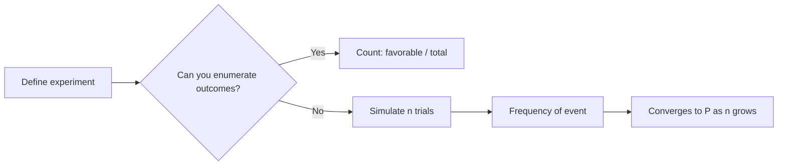

# Probability Basics

> Probability is counting done carefully: favorable outcomes over possible outcomes, and a few rules for combining them.

**Type:** Learn
**Languages:** Python
**Prerequisites:** Phase 00 (Python Foundations), Phase 01 (Linear Algebra)
**Time:** ~45 minutes

## Learning Objectives

- Define sample spaces and events, and compute exact probabilities by enumeration
- Estimate probabilities by Monte Carlo simulation and see how the estimate improves with more trials
- Apply the complement, addition, and multiplication rules, and compute conditional probabilities
- Test whether two events are independent using P(A and B) = P(A) P(B)

## The Problem

A spam filter says an email is 92% likely to be spam. A classifier outputs `predict_proba = 0.7`. A model "generalizes" because training and test data are drawn from the same distribution. Every one of these sentences is a probability statement, and almost every algorithm in this course (Naive Bayes, logistic regression, Gaussian mixtures, random forests) is built on top of them.

If you cannot tell the difference between P(A | B) and P(B | A), or you assume two features are independent when they are not, you will misread model outputs and build models on false assumptions. This lesson gives you the vocabulary and the rules, using the simplest system that has all of them: two dice.

## The Concept

### Sample Space and Events

The **sample space** Ω is the set of all possible outcomes of an experiment. Rolling two dice gives 36 ordered pairs:

```
(1,1) (1,2) (1,3) (1,4) (1,5) (1,6)
(2,1) (2,2) ...                (2,6)
...
(6,1) (6,2) ...                (6,6)
```

An **event** is a subset of the sample space. "The sum is 7" is the subset {(1,6), (2,5), (3,4), (4,3), (5,2), (6,1)}.

When all outcomes are equally likely:

```
P(A) = |A| / |Ω|
P(sum = 7) = 6 / 36 = 1/6
```

### The Axioms

Every probability system obeys three rules (Kolmogorov's axioms):

```
1. P(A) >= 0 for every event A
2. P(Ω) = 1
3. If A and B cannot happen together, P(A or B) = P(A) + P(B)
```

Everything else follows from these.

### Derived Rules

```
Complement:     P(not A)   = 1 - P(A)
Addition:       P(A or B)  = P(A) + P(B) - P(A and B)
Multiplication: P(A and B) = P(A | B) * P(B)
```

The addition rule subtracts the overlap because it was counted twice:

```
  +-----------+
  |  A   +----+------+
  |      | A&B|      |
  +------+----+  B   |
         +-----------+
```

### Conditional Probability

P(A | B) is the probability of A once you know B happened. Knowing B shrinks the sample space to B:

```
P(A | B) = P(A and B) / P(B)
```

Example: P(sum >= 10) = 6/36 = 0.167. But if you know at least one die shows a 6, the sample space shrinks to 11 outcomes, 5 of which have sum >= 10, so P(sum >= 10 | has a 6) = 5/11 = 0.455.

Note: P(A | B) is not P(B | A). P(has a 6 | sum >= 10) = 5/6. Confusing the two is the most common probability mistake, and Bayes' theorem (lesson 04) is the tool for flipping them.

### Independence

A and B are **independent** if knowing one tells you nothing about the other:

```
P(A | B) = P(A)   <=>   P(A and B) = P(A) * P(B)
```

"Sum is 7" and "first die is even" are independent: 1/6 * 1/2 = 1/12, and exactly 3 of 36 outcomes satisfy both. "Sum >= 10" and "has a 6" are dependent.

Naive Bayes assumes features are independent given the class. That is rarely exactly true, which is why it is called naive.

### Frequentist Estimation

When you cannot enumerate outcomes, you simulate. Repeat the experiment n times and count:

```
P(A) ≈ (number of times A happened) / n
```

The **law of large numbers** says this ratio converges to the true probability as n grows. The error shrinks roughly like 1/sqrt(n): 100x more trials gives 10x more precision. You will see why in lesson 06.



## Build It

### Step 1: Enumerate the sample space

```python
from itertools import product

sample_space = list(product(range(1, 7), repeat=2))
print(f"Sample space size: {len(sample_space)}")
```

Events are plain functions that return True or False for an outcome:

```python
def sum_is_seven(outcome):
    return outcome[0] + outcome[1] == 7


def first_is_even(outcome):
    return outcome[0] % 2 == 0


def sum_at_least_ten(outcome):
    return outcome[0] + outcome[1] >= 10


def has_a_six(outcome):
    return 6 in outcome
```

### Step 2: Exact probability vs simulation

```python
def exact_probability(sample_space, event):
    favorable = [outcome for outcome in sample_space if event(outcome)]
    return len(favorable) / len(sample_space)


def simulate_probability(rng, n_trials, event):
    rolls = rng.integers(1, 7, size=(n_trials, 2))
    hits = np.array([event(tuple(row)) for row in rolls])
    return hits.mean()
```

Running both for n = 100, 10,000, and 200,000 trials:

```
P(sum == 7       ) exact=0.1667  sim(n=    100)=0.1700
P(sum == 7       ) exact=0.1667  sim(n=  10000)=0.1644
P(sum == 7       ) exact=0.1667  sim(n= 200000)=0.1686
P(first die even ) exact=0.5000  sim(n=    100)=0.4700
P(first die even ) exact=0.5000  sim(n= 200000)=0.5022
```

With 100 trials the estimate can be off by several percentage points. With 200,000 it is within a fraction of a point.

### Step 3: Check the addition rule

```python
p_seven = exact_probability(sample_space, sum_is_seven)
p_even = exact_probability(sample_space, first_is_even)
p_both = exact_probability(sample_space, lambda o: sum_is_seven(o) and first_is_even(o))
p_either = exact_probability(sample_space, lambda o: sum_is_seven(o) or first_is_even(o))
print(f"P(A or B) direct      = {p_either:.4f}")
print(f"P(A)+P(B)-P(A and B)  = {p_seven + p_even - p_both:.4f}")
```

Both print 0.5833. The rule is not an approximation; it is exact bookkeeping.

### Step 4: Conditional probability and independence

```python
def conditional_probability(sample_space, event_a, event_b):
    in_b = [outcome for outcome in sample_space if event_b(outcome)]
    in_a_and_b = [outcome for outcome in in_b if event_a(outcome)]
    return len(in_a_and_b) / len(in_b)
```

The implementation is literally "restrict the sample space to B, then count A inside it".

```
P(sum>=10)            = 0.1667
P(sum>=10 | has a 6)  = 0.4545  -> dependent
P(A and B)            = 0.0833
P(A) * P(B)           = 0.0833  -> independent
```

## Use It

In practice you never loop over outcomes in Python. You generate all trials as one NumPy array and use boolean masks:

```python
rolls = rng.integers(1, 7, size=(1_000_000, 2))
totals = rolls.sum(axis=1)
counts = np.bincount(totals, minlength=13)[2:]
has_six_mask = (rolls == 6).any(axis=1)
print((totals[has_six_mask] >= 10).mean())
```

A boolean mask is conditioning: `totals[has_six_mask]` keeps only the rows where B happened, and `.mean()` on a boolean array is a frequency. One million trials take milliseconds, and the simulated distribution of the sum matches the exact triangle 1/36, 2/36, ..., 6/36, ..., 1/36 to three decimals. This mask-and-mean pattern is how you will compute accuracy, precision, and recall in Phase 04.

## Exercises

1. (Easy) Compute P(both dice show the same number) by enumeration and by simulation with 50,000 trials.
2. (Medium) The birthday problem: simulate how likely it is that at least two people in a room of 23 share a birthday (365 equally likely days). Compare with the exact formula 1 - prod((365 - k) / 365 for k in range(23)).
3. (Hard) Plot the absolute error of the simulated P(sum == 7) against n on a log-log scale for n from 10 to 10^6, averaging over 20 seeds per n. Fit a line and check that the slope is close to -0.5.

## Key Terms

| Term | What people say | What it actually means |
|------|----------------|----------------------|
| Sample space | "All possibilities" | The set Ω of every outcome the experiment can produce |
| Event | "Something happening" | A subset of the sample space |
| Probability | "How likely" | A function from events to [0, 1] obeying the three Kolmogorov axioms |
| Conditional probability | "Given that" | P(A and B) / P(B): the probability of A inside the reduced sample space B |
| Independence | "Unrelated" | P(A and B) = P(A) P(B); knowing B does not change the probability of A |
| Complement | "The opposite" | The event "not A", with P(not A) = 1 - P(A) |
| Monte Carlo | "Just simulate it" | Estimating a probability by the frequency of an event over many random trials |
| Law of large numbers | "It averages out" | The sample frequency converges to the true probability as the number of trials grows |

## Further Reading

- [Introduction to Probability, Blitzstein and Hwang](https://projects.iq.harvard.edu/stat110/home) -- free textbook for Harvard Stat 110; chapters 1-2 cover exactly this lesson
- [Seeing Theory: Basic Probability](https://seeing-theory.brown.edu/basic-probability/index.html) -- interactive visualizations of sample spaces, events, and the law of large numbers
- [3Blue1Brown: Bayes theorem, the geometry of changing beliefs](https://www.youtube.com/watch?v=HZGCoVF3YvM) -- a visual introduction to conditional probability as shrinking the sample space
- [NumPy random Generator documentation](https://numpy.org/doc/stable/reference/random/generator.html) -- reference for `default_rng`, `integers`, and seeded reproducible simulations
