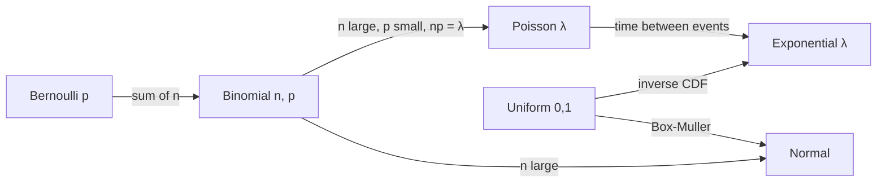

# Random Variables and Distributions

> A random variable turns outcomes into numbers. A distribution tells you how likely each number is.

**Type:** Build
**Languages:** Python
**Prerequisites:** Phase 00 (Python Foundations), Phase 03 Lesson 01 (Probability Basics)
**Time:** ~60 minutes

## Learning Objectives

- Distinguish discrete random variables (PMF) from continuous ones (PDF) and explain why a density can exceed 1
- Implement the Bernoulli, binomial, Poisson, uniform, normal, and exponential distributions from their formulas
- Build a CDF by accumulating a PDF and read probabilities and quantiles from it
- Generate samples from scratch with inverse transform sampling and the Box-Muller method, then verify them against `scipy.stats`

## The Problem

In lesson 01 you worked with events like "the sum is 7". Machine learning works with numbers: a house price, a click count, a pixel intensity, a residual. You need a way to describe the full range of values a quantity can take and how likely each one is.

That description is a distribution, and choosing one is a modeling decision you make constantly. Linear regression with MSE secretly assumes normally distributed errors. Logistic regression assumes a Bernoulli target. Poisson regression models counts. Gaussian Naive Bayes and Gaussian mixtures put a normal distribution on every feature. If you know the shapes and their formulas, these models stop being black boxes.

## The Concept

### Random Variables

A **random variable** X is a function from outcomes to numbers. Rolling two dice, X = sum of the faces maps (3, 4) to 7.

- **Discrete**: X takes countable values (0, 1, 2, ...). Described by a probability mass function (PMF): P(X = k).
- **Continuous**: X takes values in an interval. Described by a probability density function (PDF) f(x). The probability of any single exact value is 0; probabilities come from areas.

```
Discrete:    P(X = k) = pmf(k)                sum over k of pmf(k) = 1
Continuous:  P(a <= X <= b) = ∫ f(x) dx       ∫ f(x) dx over all x = 1
```

A density is not a probability. A Normal(0, 0.1) has a peak density of about 3.99. That is fine: the curve is tall but narrow, and its area is still 1.

### The CDF

The **cumulative distribution function** works for both kinds:

```
F(x) = P(X <= x)
```

It rises from 0 to 1 and never decreases. For a continuous variable, F is the running integral of the PDF, so `F(b) - F(a)` is the area between a and b. Its inverse, the **quantile function**, answers "below which value lies 97.5% of the mass?" For the standard normal that is 1.96, a number you will see again in confidence intervals.

### The Distributions You Need

| Distribution | Type | Parameters | Models | Formula |
|---|---|---|---|---|
| Bernoulli | discrete | p | one yes/no trial (a click, a label) | P(1) = p, P(0) = 1 - p |
| Binomial | discrete | n, p | number of successes in n trials | C(n, k) p^k (1-p)^(n-k) |
| Poisson | discrete | λ | counts per interval (visits per hour) | λ^k e^(-λ) / k! |
| Uniform | continuous | a, b | "anything in [a, b] equally likely" | 1 / (b - a) on [a, b] |
| Normal | continuous | μ, σ | sums of many small effects, noise | exp(-(x-μ)^2 / 2σ^2) / (σ sqrt(2π)) |
| Exponential | continuous | λ | waiting time between events | λ e^(-λx) for x >= 0 |

How they relate:



### Sampling From Scratch

Your computer gives you uniform random numbers. Every other distribution is built from them.

**Inverse transform sampling**: if U ~ Uniform(0, 1) and F is a CDF, then F^-1(U) has distribution F. For the exponential, F(x) = 1 - e^(-λx), so:

```
x = -ln(1 - u) / λ
```

**Box-Muller**: two independent uniforms produce a standard normal:

```
z = sqrt(-2 ln(u1)) * cos(2π u2)
```

Then `μ + σ z` gives any Normal(μ, σ).

## Build It

### Step 1: Discrete PMFs

```python
from math import comb, factorial


def bernoulli_pmf(k, p):
    return p if k == 1 else 1 - p


def binomial_pmf(k, n, p):
    return comb(n, k) * p**k * (1 - p) ** (n - k)


def poisson_pmf(k, rate):
    return rate**k * np.exp(-rate) / factorial(k)
```

The binomial PMF for 10 fair coin flips is symmetric and peaks at 5 heads with probability 0.2461. Summing all 11 values gives exactly 1.

### Step 2: Continuous PDFs

```python
def uniform_pdf(x, low, high):
    return np.where((x >= low) & (x <= high), 1.0 / (high - low), 0.0)


def normal_pdf(x, mean, std):
    return np.exp(-0.5 * ((x - mean) / std) ** 2) / (std * np.sqrt(2 * np.pi))


def exponential_pdf(x, rate):
    return np.where(x >= 0, rate * np.exp(-rate * x), 0.0)
```

Integrating each one numerically with `np.trapezoid` over a fine grid gives an area of 1.000 (up to grid error). The exponential with rate 1.5 has a maximum density of 1.5, larger than 1, and the Normal(0, 0.1) peaks at 3.989.

### Step 3: CDF by accumulating the PDF

```python
def numeric_cdf(pdf_values, grid):
    step = grid[1] - grid[0]
    return np.cumsum(pdf_values) * step
```

```
P(Z <= -1.96) = 0.0250
P(Z <= -1.00) = 0.1588
P(Z <=  0.00) = 0.5002
P(Z <=  1.00) = 0.8415
P(Z <=  1.96) = 0.9750
```

So P(-1 <= Z <= 1) ≈ 0.68 and P(-1.96 <= Z <= 1.96) ≈ 0.95. These are the 68-95 rules of thumb.

### Step 4: Sampling

```python
def sample_exponential_inverse_transform(rng, rate, size):
    uniforms = rng.uniform(0, 1, size)
    return -np.log(1 - uniforms) / rate


def sample_normal_box_muller(rng, size):
    u1 = rng.uniform(0, 1, size)
    u2 = rng.uniform(0, 1, size)
    return np.sqrt(-2 * np.log(1 - u1)) * np.cos(2 * np.pi * u2)
```

`1 - u1` is used instead of `u1` because `rng.uniform` can return exactly 0 but never exactly 1, and `log(0)` is infinite. With 100,000 samples the exponential mean is 0.6676 (theory 1/1.5 = 0.6667) and the normal samples have mean ≈ 0, std ≈ 1, with 68.4% inside one standard deviation.

The script saves `distributions.png` with the binomial PMF and histograms of your samples overlaid on the true PDFs.

## Use It

`scipy.stats` packages every distribution as an object with the same methods: `pmf`/`pdf`, `cdf`, `ppf` (quantile), `rvs` (sample), `mean`, `var`.

```python
from scipy import stats

stats.binom.pmf(5, 10, 0.5)
stats.poisson.pmf(2, 3.0)
stats.norm.pdf(0.5)
stats.norm.cdf(1.96)
stats.norm.ppf(0.975)
stats.kstest(exponential_samples, stats.expon(scale=1 / 1.5).cdf)
```

```
binom.pmf(5, 10, 0.5)  scratch=0.246094  scipy=0.246094
poisson.pmf(2, 3)      scratch=0.224042  scipy=0.224042
norm.pdf(0.5)          scratch=0.352065  scipy=0.352065
norm.cdf(1.96)         scratch=0.975031  scipy=0.975002
norm.ppf(0.975)        scipy=1.959964
```

Your CDF differs from scipy in the fifth decimal because of the Riemann sum; scipy uses the exact error function. Watch out for parameterization: scipy's exponential uses `scale = 1 / rate`, not the rate. The Kolmogorov-Smirnov test compares your samples to scipy's CDF; a large p-value means no evidence that they differ (lesson 07 explains p-values).

## Exercises

1. (Easy) Compute the binomial PMF for n = 100, p = 0.03 and compare it with Poisson(λ = 3) for k = 0..10. How large is the biggest difference?
2. (Medium) Implement inverse transform sampling for a discrete distribution: given a PMF array, build its CDF with `np.cumsum` and use `np.searchsorted` on uniform numbers. Sample a loaded die and check the frequencies.
3. (Hard) Implement the Laplace distribution PDF and its inverse CDF sampler. Plot it next to a normal with the same variance and explain why Laplace noise relates to L1 loss the same way normal noise relates to L2 loss.

## Key Terms

| Term | What people say | What it actually means |
|------|----------------|----------------------|
| Random variable | "A random number" | A function that maps each outcome of an experiment to a number |
| PMF | "The probabilities" | P(X = k) for a discrete variable; values sum to 1 |
| PDF | "The bell curve" | A density f(x) for a continuous variable; probabilities are areas under it, and it can exceed 1 |
| CDF | "Cumulative probability" | F(x) = P(X <= x), non-decreasing from 0 to 1 |
| Quantile (ppf) | "Percentile" | The inverse of the CDF: the value x where F(x) = q |
| Parameter | "The knobs" | The numbers (p, λ, μ, σ) that pick one member of a distribution family |
| Inverse transform sampling | "Sampling trick" | Feeding uniform numbers through F^-1 to get samples from F |
| Box-Muller | "How randn works" | A transform that turns two uniforms into two independent standard normals |

## Further Reading

- [Introduction to Probability, Blitzstein and Hwang](https://projects.iq.harvard.edu/stat110/home) -- chapters 3-5 cover discrete and continuous random variables in depth
- [scipy.stats documentation](https://docs.scipy.org/doc/scipy/reference/stats.html) -- the full list of distributions and their common interface
- [StatQuest: The Normal Distribution, Clearly Explained](https://www.youtube.com/watch?v=rzFX5NWojp0) -- short visual explanation of the normal curve and its parameters
- [Seeing Theory: Probability Distributions](https://seeing-theory.brown.edu/probability-distributions/index.html) -- interactive plots of every distribution in this lesson
