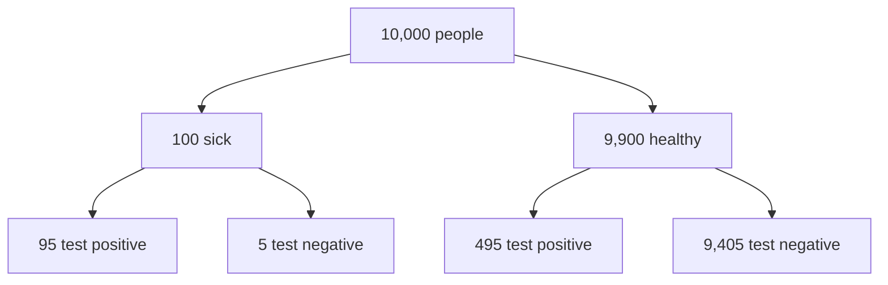

# Bayes' Theorem

> Bayes' theorem tells you how to change your mind: start with a belief, look at evidence, end with a better belief.

**Type:** Build
**Languages:** Python
**Prerequisites:** Phase 03 Lesson 01 (Probability Basics), Phase 03 Lesson 02 (Random Variables and Distributions)
**Time:** ~60 minutes

## Learning Objectives

- Derive Bayes' theorem from the definition of conditional probability and name its four parts: prior, likelihood, evidence, posterior
- Explain the base rate fallacy with a medical test, and confirm the answer by simulating a population
- Update beliefs sequentially, using each posterior as the next prior
- Compute a posterior distribution over a continuous parameter on a grid and match it with the conjugate Beta posterior in `scipy.stats`

## The Problem

A disease affects 1% of people. A test catches 95% of sick people and gives a false positive for 5% of healthy people. You test positive. How likely is it that you are sick?

Most people, including many doctors in published studies, answer around 95%. The real answer is about 16%. The test's accuracy is P(positive | sick); you want P(sick | positive). Those are different numbers, and the difference is driven by how rare the disease is.

The same structure appears all over machine learning. A fraud classifier with 99% accuracy on a dataset with 0.1% fraud flags mostly legitimate transactions. Naive Bayes (Phase 06) is Bayes' theorem applied to features. Gaussian mixtures (Phase 08) compute posterior cluster memberships with it. Ridge and Lasso regression turn out to be Bayesian priors on the weights.

## The Concept

### Derivation

Start from the multiplication rule written both ways:

```
P(A and B) = P(A | B) P(B) = P(B | A) P(A)
```

Divide by P(B):

```
            P(B | A) P(A)
P(A | B) = ---------------
                P(B)
```

In modeling language, with H a hypothesis and D the data:

```
posterior = likelihood * prior / evidence

P(H | D) = P(D | H) P(H) / P(D)
```

| Part | Symbol | Meaning |
|---|---|---|
| Prior | P(H) | What you believed before seeing the data |
| Likelihood | P(D \| H) | How probable the data is if H were true |
| Evidence | P(D) | How probable the data is overall, a normalizing constant |
| Posterior | P(H \| D) | What you believe after seeing the data |

The evidence is computed with the law of total probability:

```
P(D) = P(D | H) P(H) + P(D | not H) P(not H)
```

### The Medical Test, Worked Out

Imagine 10,000 people:



There are 95 + 495 = 590 positives, and only 95 of them are sick: 95 / 590 = 16.1%. The false positives win because the healthy group is 99 times larger. That is the **base rate fallacy**: ignoring the prior.

```
P(sick | +) = 0.95 * 0.01 / (0.95 * 0.01 + 0.05 * 0.99) = 0.161
```

### Sequential Updating

After one positive test, your belief is 16%. If you take a second, independent test, the 16% becomes the new prior. Two positives give 78%, three give 98.6%. Evidence accumulates; the prior matters less and less as data grows.

### Bayes for Continuous Parameters

Now the hypothesis is not yes/no but a number. A coin has unknown probability θ of heads. You observe h heads and t tails:

```
likelihood:  P(D | θ) = θ^h (1 - θ)^t
posterior:   p(θ | D) ∝ θ^h (1 - θ)^t * p(θ)
```

The ∝ means "proportional to": compute the right side on a grid of θ values, then divide by its area so it integrates to 1. That is the grid approximation, and it works for any prior.

Two summaries of the posterior:

- **Posterior mean**: E[θ | D]
- **MAP** (maximum a posteriori): the θ with the highest posterior density

With a uniform prior, MAP equals the maximum likelihood estimate h / (h + t) from lesson 05. With an informative prior, the estimate is pulled toward the prior. This pull is exactly what regularization does (a Gaussian prior on weights gives Ridge).

### Conjugate Priors

If the prior is Beta(α, β), the posterior is Beta(α + h, β + t). A uniform prior is Beta(1, 1). A family where prior and posterior have the same form is called **conjugate**, and it lets you skip the grid entirely.

## Build It

### Step 1: Bayes' theorem as a function

```python
def bayes_posterior(prior, likelihood_if_true, likelihood_if_false):
    evidence = likelihood_if_true * prior + likelihood_if_false * (1 - prior)
    return likelihood_if_true * prior / evidence
```

```
P(sick)              = 0.010
P(+ | sick)          = 0.950
P(+ | healthy)       = 0.050
P(sick | +)          = 0.1610
```

### Step 2: Confirm by simulation

```python
def simulate_screening(rng, n_people, prevalence, sensitivity, false_positive_rate):
    is_sick = rng.random(n_people) < prevalence
    test_random = rng.random(n_people)
    tests_positive = np.where(is_sick, test_random < sensitivity, test_random < false_positive_rate)
    return is_sick, tests_positive
```

Among one million simulated people, 58,843 test positive: 9,511 true positives and 49,332 false positives. The fraction that is sick is 0.1616, matching the formula.

### Step 3: Sequential updating

```python
belief = prevalence
for test_number in range(1, 4):
    belief = bayes_posterior(belief, sensitivity, false_positive_rate)
```

```
After positive test 1: P(sick) = 0.1610
After positive test 2: P(sick) = 0.7848
After positive test 3: P(sick) = 0.9858
Prior 0.001 -> posterior after one positive 0.0187
Prior 0.500 -> posterior after one positive 0.9500
```

The same test result means very different things depending on the prior.

### Step 4: Grid posterior for a coin

```python
def grid_posterior(grid, prior_weights, heads, tails):
    likelihood = grid**heads * (1 - grid) ** tails
    unnormalized = likelihood * prior_weights
    return unnormalized / np.trapezoid(unnormalized, grid)
```

With 41 heads and 9 tails from a coin whose true bias is 0.7:

```
uniform   prior: posterior mean=0.8077  MAP=0.820
skeptical prior: posterior mean=0.6103  MAP=0.610
```

The skeptical prior (a narrow normal around 0.5) pulls the estimate strongly toward a fair coin. With 50 flips, the prior still has a big effect; with 5,000 it would not.

For many observations, `grid**heads` underflows to 0. Real implementations work in log space: add log-likelihood and log-prior, subtract the maximum, then exponentiate.

## Use It

```python
from scipy import stats

exact_posterior = stats.beta(1 + heads, 1 + tails)
exact_posterior.mean()
exact_posterior.ppf([0.025, 0.975])
exact_posterior.sf(0.75)
```

```
Beta(42, 10) mean=0.8077
Max |grid - scipy beta pdf| = 0.000000
95% credible interval for bias: [0.691, 0.902]
P(bias > 0.75 | data) = 0.8543
```

Your grid posterior with a uniform prior matches the conjugate Beta exactly. The posterior answers questions directly: "there is a 95% probability that θ is between 0.691 and 0.902" and "there is an 85% probability that the bias exceeds 0.75". In scikit-learn, Bayes' theorem runs inside `GaussianNB`, `MultinomialNB`, and `BayesianRidge`; you will build Naive Bayes from scratch in Phase 06.

## Exercises

1. (Easy) A spam filter sees the word "free" in 60% of spam and 5% of ham. 30% of email is spam. Compute P(spam | "free").
2. (Medium) Rewrite `grid_posterior` in log space and show that it still works with 4,100 heads and 900 tails, where the original version returns NaN.
3. (Hard) Plot the posterior after 0, 1, 2, 5, 10, 50, and 500 flips for the uniform and skeptical priors on the same axes. At what sample size do the two posterior means differ by less than 0.01?

## Key Terms

| Term | What people say | What it actually means |
|------|----------------|----------------------|
| Prior | "What you assumed" | P(H), the probability of a hypothesis before seeing the data |
| Likelihood | "How well it fits" | P(D \| H), the probability of the observed data under the hypothesis, viewed as a function of H |
| Evidence | "The denominator" | P(D), the total probability of the data, which normalizes the posterior |
| Posterior | "Updated belief" | P(H \| D), the probability of the hypothesis after seeing the data |
| Base rate fallacy | "Ignoring prevalence" | Treating P(D \| H) as if it were P(H \| D), forgetting how rare H is |
| MAP | "Most probable value" | The parameter value that maximizes the posterior density |
| Conjugate prior | "Closed-form update" | A prior whose posterior belongs to the same family, like Beta for a coin |
| Credible interval | "Bayesian confidence interval" | An interval that contains the parameter with a stated posterior probability |

## Further Reading

- [3Blue1Brown: Bayes theorem, the geometry of changing beliefs](https://www.youtube.com/watch?v=HZGCoVF3YvM) -- the best visual explanation of the medical test problem
- [Think Bayes, Allen Downey](https://allendowney.github.io/ThinkBayes2/) -- free book that uses grid approximations in Python throughout
- [Statistical Rethinking, Richard McElreath](https://xcelab.net/rm/) -- chapter 2 builds grid posteriors for a globe-tossing example; lectures are free on YouTube
- [scipy.stats.beta documentation](https://docs.scipy.org/doc/scipy/reference/generated/scipy.stats.beta.html) -- the Beta distribution used for conjugate coin updates
