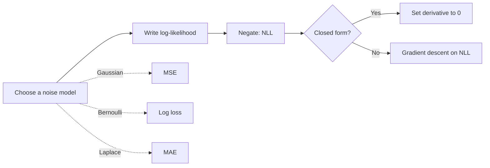

# Maximum Likelihood Estimation

> Pick the parameters that make the data you actually saw as probable as possible. Most loss functions are this idea in disguise.

**Type:** Build
**Languages:** Python
**Prerequisites:** Phase 02 (Calculus and Optimization), Phase 03 Lesson 02 (Random Variables and Distributions), Phase 03 Lesson 04 (Bayes' Theorem)
**Time:** ~75 minutes

## Learning Objectives

- Write the likelihood and log-likelihood of a dataset under Bernoulli, normal, and Poisson models
- Find maximum likelihood estimates three ways: grid search, closed form via derivatives, and gradient ascent
- Show that minimizing mean squared error is the same as maximum likelihood under Gaussian noise, and that log loss is Bernoulli maximum likelihood
- Fit distributions with `scipy.stats.<dist>.fit` and `scipy.optimize.minimize` and match your from-scratch results

## The Problem

You have 200 ad impressions and 23 clicks. What is the click-through rate? You would say 23/200 = 0.115 without thinking. But why the sample proportion? And what is the equivalent answer when the model is a normal distribution, a Poisson, or a linear regression with millions of parameters?

Maximum likelihood estimation (MLE) is the general recipe that produces "the obvious answer" in simple cases and a principled loss function in complex ones. When you train logistic regression with log loss or linear regression with MSE, you are doing MLE whether you know it or not. Understanding this tells you what assumptions your loss function makes about your data.

## The Concept

### Likelihood

Assume the data x_1, ..., x_n are independent draws from a distribution with parameter θ. The **likelihood** is the probability (or density) of the whole dataset, viewed as a function of θ:

```
L(θ) = p(x_1 | θ) * p(x_2 | θ) * ... * p(x_n | θ)
```

It is the same formula as the joint probability, but you hold the data fixed and vary θ. It is not a probability distribution over θ (it does not integrate to 1 over θ). That would require a prior, as in lesson 04.

The **maximum likelihood estimate** is:

```
θ_MLE = argmax_θ L(θ)
```

### Why Logs

A product of 200 numbers smaller than 1 underflows quickly. The likelihood at the best p for the click data is about 10^-31; with 10,000 points it would be 0.0 in floating point. Take the log:

```
log L(θ) = sum_i log p(x_i | θ)
```

The log is monotonic, so the argmax does not move. Products become sums, which are numerically stable and easy to differentiate. In practice you minimize the **negative log-likelihood** (NLL), which turns MLE into the same minimization problem as Phase 02.

### Closed-Form Examples

Set the derivative of the log-likelihood to zero.

**Bernoulli** (x_i in {0, 1}):

```
log L(p) = sum [x_i log p + (1 - x_i) log(1 - p)]
d/dp = k/p - (n - k)/(1 - p) = 0     =>     p_MLE = k / n
```

**Normal**:

```
log L(μ, σ) = sum [ -1/2 log(2πσ^2) - (x_i - μ)^2 / (2σ^2) ]

μ_MLE = (1/n) sum x_i
σ^2_MLE = (1/n) sum (x_i - μ_MLE)^2        (divides by n: biased, see lesson 03)
```

**Poisson**: λ_MLE = sample mean. **Exponential**: λ_MLE = 1 / sample mean.

### MLE and Loss Functions

Assume y = f(x; w) + ε with Gaussian noise ε ~ Normal(0, σ). The NLL is:

```
NLL(w) = n/2 log(2πσ^2) + (1/(2σ^2)) sum (y_i - f(x_i; w))^2
```

The first term does not depend on w. Minimizing NLL over w is minimizing the sum of squared errors. **MSE is Gaussian MLE.**

For a binary label with predicted probability p_i, the Bernoulli NLL is:

```
NLL = - sum [ y_i log p_i + (1 - y_i) log(1 - p_i) ]
```

That is **log loss** (binary cross-entropy), the loss of logistic regression.



### MLE vs MAP

MAP from lesson 04 maximizes likelihood times prior. In log space that is log-likelihood plus log-prior. A Gaussian prior on weights adds a λ||w||^2 term: Ridge regression. A Laplace prior gives Lasso. MLE is MAP with a flat prior.

## Build It

### Step 1: Bernoulli MLE by scanning

```python
def bernoulli_log_likelihood(p, data):
    return np.sum(data * np.log(p) + (1 - data) * np.log(1 - p))


candidate_p = np.linspace(0.01, 0.99, 981)
log_likelihoods = np.array([bernoulli_log_likelihood(p, clicks) for p in candidate_p])
best_p = candidate_p[np.argmax(log_likelihoods)]
```

```
23 clicks out of 200 views
Grid argmax p = 0.115   closed form mean = 0.115
Raw likelihood at best p = 1.012e-31  (why we use logs)
```

### Step 2: Normal MLE in closed form

```python
def normal_log_likelihood(mean, std, data):
    return np.sum(-0.5 * np.log(2 * np.pi * std**2) - (data - mean) ** 2 / (2 * std**2))


def normal_mle(data):
    mean = data.mean()
    std = np.sqrt(np.mean((data - mean) ** 2))
    return mean, std
```

The MLE gives log-likelihood -3500.81. Any other guess, such as (168, 10), scores lower (-3560.19).

### Step 3: Normal MLE by gradient ascent

When there is no closed form, you climb the log-likelihood. Optimize log σ instead of σ so that σ stays positive no matter how big the step:

```python
def fit_normal_gradient_ascent(data, learning_rate=0.1, n_steps=500):
    mean, log_std = 0.0, 0.0
    n = len(data)
    for _ in range(n_steps):
        std = np.exp(log_std)
        residuals = data - mean
        gradient_mean = np.sum(residuals) / std**2
        gradient_log_std = -n + np.sum(residuals**2) / std**2
        mean += learning_rate * gradient_mean / n
        log_std += learning_rate * gradient_log_std / n
    return mean, np.exp(log_std)
```

Run on standardized heights, then map back: mean = 169.8497, std = 8.0195, identical to the closed form.

### Step 4: Poisson MLE

```python
def poisson_log_likelihood(rate, data):
    log_factorials = np.array([np.sum(np.log(np.arange(1, k + 1))) for k in data])
    return np.sum(data * np.log(rate) - rate - log_factorials)
```

The grid argmax is 4.240 and the sample mean is 4.237: the same answer, up to grid resolution.

### Step 5: Least squares is maximum likelihood

```python
def gaussian_negative_log_likelihood_line(params, x, y, noise_std):
    slope, intercept = params
    predictions = slope * x + intercept
    return -normal_log_likelihood(predictions, noise_std, y)


result = optimize.minimize(gaussian_negative_log_likelihood_line, x0=[0.0, 0.0], args=(x, y, 1.5))
least_squares_slope, least_squares_intercept = np.polyfit(x, y, 1)
```

```
Max likelihood line: slope=2.4311 intercept=1.2636
Least squares line : slope=2.4311 intercept=1.2636
```

## Use It

Every continuous distribution in `scipy.stats` has a `.fit` method that runs MLE:

```python
scipy_mean, scipy_std = stats.norm.fit(heights)
_, scipy_scale = stats.expon.fit(waiting_times, floc=0)
optimize.minimize_scalar(lambda p: -bernoulli_log_likelihood(p, clicks), bounds=(0.001, 0.999), method="bounded")
```

```
stats.norm.fit     mean=169.8497 std=8.0195
stats.expon.fit    rate=0.7816  scratch 1/mean=0.7816  (true 0.8)
minimize_scalar Bernoulli p=0.1150
```

`floc=0` fixes the location parameter; without it, scipy also estimates a shift. Note that `stats.norm.fit` returns the MLE standard deviation (divide by n), not `np.std(ddof=1)`. In scikit-learn, `LinearRegression` and `LogisticRegression` are MLE under Gaussian and Bernoulli models; `LogisticRegression`'s default L2 penalty makes it MAP.

## Exercises

1. (Easy) Fit an exponential distribution to 1,000 samples by scanning the log-likelihood over a grid of rates, and confirm the argmax equals 1 / mean.
2. (Medium) Derive the gradient of the Bernoulli NLL with respect to p and fit p by gradient descent. Then reparameterize with p = sigmoid(z) and fit z instead. Which version needs clipping, and why?
3. (Hard) Generate y = 2x + 1 + Laplace noise with a few large outliers. Fit the line by minimizing Gaussian NLL and Laplace NLL with `scipy.optimize.minimize`. Show that the Laplace fit equals least absolute deviations and is more robust to the outliers.

## Key Terms

| Term | What people say | What it actually means |
|------|----------------|----------------------|
| Likelihood | "Probability of the parameters" | The probability of the observed data as a function of the parameters; not a distribution over parameters |
| Log-likelihood | "Log L" | The sum of log-probabilities of each data point; same argmax as the likelihood, numerically stable |
| MLE | "Best-fitting parameters" | The parameter value that maximizes the likelihood of the observed data |
| Negative log-likelihood | "NLL loss" | The negated log-likelihood, minimized as a loss function |
| Log loss | "Binary cross-entropy" | The Bernoulli negative log-likelihood of predicted probabilities |
| MAP | "MLE with a prior" | Maximizing log-likelihood plus log-prior; regularized MLE |
| Reparameterization | "Optimize log sigma" | Optimizing a transformed parameter so constraints like σ > 0 hold automatically |

## Further Reading

- [StatQuest: Maximum Likelihood, Clearly Explained](https://www.youtube.com/watch?v=XepXtl9YKwc) -- a short visual introduction to the idea
- [Pattern Recognition and Machine Learning, Christopher Bishop](https://www.microsoft.com/en-us/research/publication/pattern-recognition-machine-learning/) -- sections 1.2.4-1.2.5 and 3.1.1 connect Gaussian MLE to least squares
- [Stanford CS229 Lecture Notes](https://cs229.stanford.edu/main_notes.pdf) -- the probabilistic interpretation of linear and logistic regression
- [scipy.stats rv_continuous.fit](https://docs.scipy.org/doc/scipy/reference/generated/scipy.stats.rv_continuous.fit.html) -- how scipy fits distributions by MLE, including fixed parameters like `floc`
