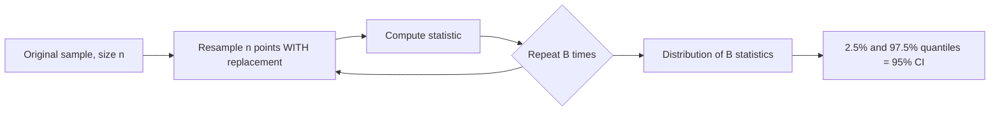

# Sampling and the Central Limit Theorem

> Averages of almost anything look normal, and their spread shrinks like 1/sqrt(n). That single fact powers error bars, A/B tests, and cross-validation scores.

**Type:** Build
**Languages:** Python
**Prerequisites:** Phase 00 (Python Foundations), Phase 03 Lesson 03 (Expectation and Variance), Phase 03 Lesson 05 (Maximum Likelihood)
**Time:** ~60 minutes

## Learning Objectives

- Simulate the sampling distribution of the mean and verify that its standard deviation is σ / sqrt(n)
- State the central limit theorem and watch a skewed distribution's sample means become normal as n grows
- Build a 95% confidence interval from the standard error and measure its actual coverage by simulation
- Implement the bootstrap from scratch for any statistic and compare it with `scipy.stats.bootstrap` and the t-interval

## The Problem

Your model scores 0.842 accuracy on a test set of 500 examples. Is that meaningfully better than the 0.830 of the previous model? Your cross-validation gives five scores; what is the uncertainty on their mean? Your average order value from 60 customers is 10.1; where is the true value likely to be?

Every one of these questions is about a **sample**: you see a finite slice of an underlying population and compute a number from it. Draw a different slice and you get a different number. To make decisions you need to know how much that number moves around. The central limit theorem gives you the answer for averages, and the bootstrap gives you an answer for almost anything else.

## The Concept

### Population, Sample, Statistic

- **Population**: the full distribution you care about (all customers, all future emails).
- **Sample**: n draws from it, ideally independent and identically distributed (i.i.d.).
- **Statistic**: any number computed from the sample (mean, median, accuracy).
- **Sampling distribution**: the distribution of that statistic across all the samples you could have drawn.

You only ever see one sample, so you never observe the sampling distribution directly. Simulation lets you see it.

### Standard Error

If the population has mean μ and standard deviation σ, the sample mean x̄ of n i.i.d. draws has:

```
E[x̄] = μ                      (unbiased)
SD(x̄) = σ / sqrt(n)            (the standard error)
```

This follows from lesson 03: Var(sum of n independent copies) = n σ^2, and dividing by n scales the variance by 1/n^2. Quadrupling the sample size halves the error.

### The Central Limit Theorem

For i.i.d. samples from any distribution with finite variance:

```
x̄  ≈  Normal(μ, σ / sqrt(n))      as n grows
```

The population can be skewed, discrete, or bimodal; the average still becomes bell-shaped. How fast depends on the shape. A symmetric population needs n of about 5; a heavily skewed one like the exponential needs 30 or more. Heavy-tailed distributions without finite variance (like the Cauchy) break the theorem entirely.

```
population (exponential)     means of n=5         means of n=30
|█                           |   ▃█▅              |      ▂█▂
|██                          |  ▅███▆▂            |     ▅███▅
|███▅▂                       | ▃██████▅▂▁         |   ▂██████▂
|██████▅▃▂▁▁                 |▂█████████▆▃▂▁      |  ▃████████▃
+-----------------           +-----------------   +-----------------
```

### Confidence Intervals

If x̄ is approximately normal with standard error SE, then 95% of samples give an x̄ within 1.96 SE of μ. Flip it around:

```
95% CI = x̄ ± 1.96 * s / sqrt(n)
```

where s is the sample standard deviation. The interpretation is about the procedure: if you repeated the sampling many times, 95% of the intervals built this way would contain μ. It is not a 95% probability statement about μ for one interval (that is a Bayesian credible interval, lesson 04).

For small n, replacing σ with s adds uncertainty, and the t distribution with n - 1 degrees of freedom replaces 1.96 with a slightly larger number.

### The Bootstrap

What is the standard error of a median, a correlation, or an F1 score? There is often no formula. The **bootstrap** treats your sample as a stand-in for the population:



Sampling with replacement is the key. Each resample has the same size as the original but repeats some points and omits others (about 36.8% of points are left out each time). Bagging and random forests (Phase 07) use exactly this resampling.

## Build It

### Step 1: A skewed population

```python
population = rng.exponential(scale=10.0, size=1_000_000)
```

```
Population mean=9.9980 std=9.9980 skewness=2.002
Median=6.9270 (mean > median: right-skewed)
```

### Step 2: The sampling distribution of the mean

```python
def sampling_distribution_of_mean(rng, population, sample_size, n_repeats):
    indices = rng.integers(0, len(population), size=(n_repeats, sample_size))
    return population[indices].mean(axis=1)


def skewness(values):
    centered = values - values.mean()
    return np.mean(centered**3) / np.mean(centered**2) ** 1.5
```

Draw 20,000 samples for each sample size:

```
 n    mean of means   std of means   sigma/sqrt(n)   skewness
  1        10.0336        10.0569          9.9980      2.073
  2        10.0128         7.0687          7.0696      1.396
  5         9.9681         4.4647          4.4712      0.917
 30         9.9988         1.8197          1.8254      0.364
100         9.9998         1.0004          0.9998      0.207
```

Three facts appear at once: the mean of the means is always μ, their spread matches σ / sqrt(n), and the skewness drops toward 0 (a normal has skewness 0). The script saves `clt.png` with histograms and the predicted normal curve.

### Step 3: Does the 95% interval really cover 95%?

```python
def normal_confidence_interval(sample, z=1.96):
    standard_error = sample.std(ddof=1) / np.sqrt(len(sample))
    return sample.mean() - z * standard_error, sample.mean() + z * standard_error
```

```
n=   5: interval contains true mean in 0.813 of samples
n=  30: interval contains true mean in 0.913 of samples
n= 200: interval contains true mean in 0.940 of samples
```

The nominal 95% is only reached for large n. With skewed data and small samples, the normal approximation is too optimistic. This is why you should be careful with error bars on five cross-validation folds.

### Step 4: The bootstrap

```python
def bootstrap_confidence_interval(rng, sample, statistic, n_resamples=5000, level=0.95):
    indices = rng.integers(0, len(sample), size=(n_resamples, len(sample)))
    replicates = statistic(sample[indices], axis=1)
    tail = (1 - level) / 2
    return np.quantile(replicates, [tail, 1 - tail])
```

```
Bootstrap 95% CI for mean:   [7.679, 12.773]  (true 9.998)
Bootstrap 95% CI for median: [4.694, 10.510]  (true 6.927)
Normal 95% CI for mean:      [7.529, 12.684]
```

The same function handles the median with no new math. Note how the bootstrap interval for the mean is slightly shifted right compared to the symmetric normal interval: it picks up the skew of the data.

## Use It

```python
from scipy import stats

stats.sem(sample)
stats.t.interval(0.95, df=len(sample) - 1, loc=sample.mean(), scale=stats.sem(sample))
stats.bootstrap((sample,), np.mean, n_resamples=5000, method="percentile", random_state=42)
stats.skew(values)
```

```
stats.sem=1.3150  scratch=1.3150
t interval:             [7.475, 12.738]
stats.bootstrap (mean): [7.687, 12.841]
```

`stats.sem` uses `ddof=1` by default. `stats.bootstrap` defaults to the BCa method, which corrects for bias and skew; `method="percentile"` reproduces your version. Note the tuple: scipy expects a sequence of samples. In scikit-learn, `sklearn.utils.resample` performs one bootstrap resample, and `BaggingClassifier` uses it internally.

## Exercises

1. (Easy) Repeat Step 2 with a uniform population on [0, 1]. At what n does the skewness of the mean drop below 0.05?
2. (Medium) Train a classifier, then bootstrap the test set to get a 95% CI for its accuracy. Compare the width with the formula sqrt(p (1 - p) / n).
3. (Hard) Sample from a Cauchy distribution (`rng.standard_cauchy`) and plot the running mean as n goes from 1 to 100,000. Explain why the CLT does not apply, and show that the running median does converge.

## Key Terms

| Term | What people say | What it actually means |
|------|----------------|----------------------|
| Population | "All the data" | The full distribution the sample is drawn from |
| Sample | "The data we have" | n draws from the population, ideally i.i.d. |
| Sampling distribution | "How much it varies" | The distribution of a statistic over all possible samples of size n |
| Standard error | "Error bar" | The standard deviation of a statistic's sampling distribution; σ / sqrt(n) for the mean |
| Central limit theorem | "Everything is normal" | Sample means of i.i.d. finite-variance data approach a normal distribution as n grows |
| Confidence interval | "95% range" | An interval from a procedure that contains the true parameter in 95% of repeated samples |
| Bootstrap | "Resampling" | Estimating a sampling distribution by resampling the observed data with replacement |
| Coverage | "Does the CI work" | The actual fraction of intervals that contain the true value |

## Further Reading

- [3Blue1Brown: But what is the Central Limit Theorem?](https://www.youtube.com/watch?v=zeJD6dqJ5lo) -- a visual derivation of why sums become normal
- [StatQuest: Bootstrapping Main Ideas](https://www.youtube.com/watch?v=Xz0x-8-cgaQ) -- the bootstrap explained step by step
- [An Introduction to Statistical Learning (ISLR)](https://www.statlearning.com/) -- section 5.2 covers the bootstrap for estimating uncertainty
- [scipy.stats.bootstrap documentation](https://docs.scipy.org/doc/scipy/reference/generated/scipy.stats.bootstrap.html) -- percentile, basic, and BCa intervals
