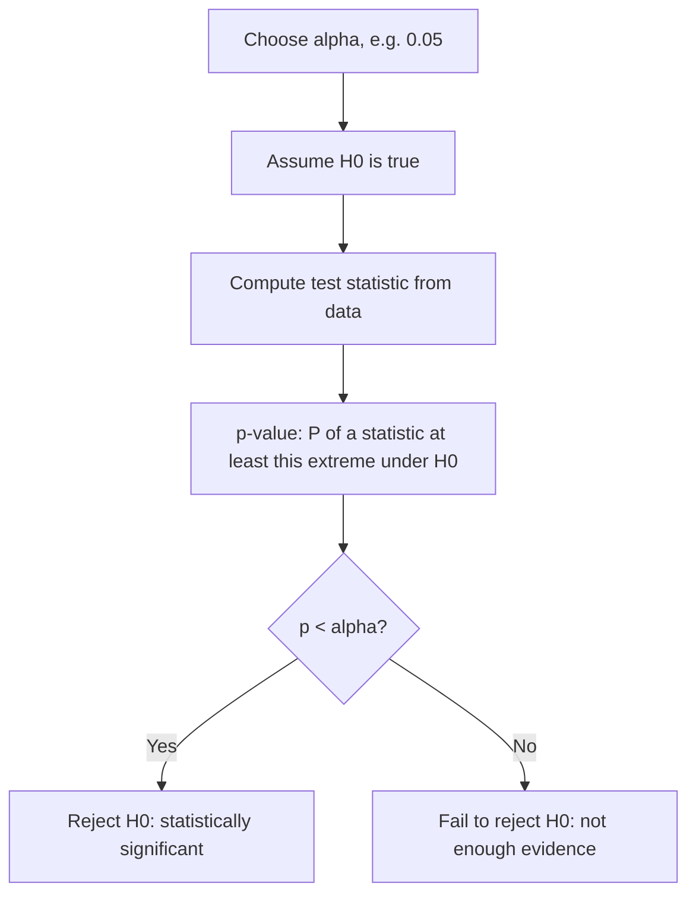

# Hypothesis Testing

> A p-value answers one narrow question: if nothing were going on, how surprising would this data be?

**Type:** Build
**Languages:** Python
**Prerequisites:** Phase 03 Lesson 01 (Probability Basics), Phase 03 Lesson 06 (Sampling and the Central Limit Theorem)
**Time:** ~75 minutes

## Learning Objectives

- Set up null and alternative hypotheses and explain what a p-value is and is not
- Implement a two-proportion z-test, a Welch t statistic, and a permutation test from scratch for an A/B test
- Measure type I error and statistical power by simulation, and see how power depends on sample size
- Explain the multiple testing problem, apply a Bonferroni correction, and reproduce your results with `scipy.stats`

## The Problem

You ship a new checkout page. Conversion goes from 10.0% to 11.3% over 5,000 visitors each. Is the new page better, or did you just get a lucky week? Your new model beats the old one by 0.4 points on one test split. Real improvement or noise?

Random variation produces differences even when nothing changed. Hypothesis testing is the standard way to ask whether an observed difference is larger than what chance alone would plausibly produce. You will meet it in A/B tests, in comparing models across cross-validation folds, in feature selection (chi-squared and ANOVA F-tests in Phase 10), and in every paper that reports a "significant" result. You also need to know how it fails: small samples, many comparisons, and misread p-values.

## The Concept

### The Setup

```
H0 (null):         no effect. Both groups have the same conversion rate.
H1 (alternative):  there is an effect. The rates differ.
```

You never prove H1 directly. You assume H0 is true, compute how unusual your data would be under it, and reject H0 if the data is unusual enough.



### The p-value

```
p-value = P(test statistic at least as extreme as observed | H0 is true)
```

What it is not:

- It is not P(H0 is true). That would need a prior (lesson 04).
- It is not the probability that the result is a fluke.
- A large p-value does not show that there is no effect; it may only show your sample was too small.
- A small p-value does not mean the effect is large or important. With a million users, a 0.01% lift can be "significant".

### Test Statistics

Most tests share one shape: (observed difference) / (standard error of that difference under H0). By the CLT (lesson 06) this ratio is approximately standard normal for large samples.

**Two-proportion z-test** (conversion rates):

```
p_pool = (x_a + x_b) / (n_a + n_b)
SE = sqrt(p_pool (1 - p_pool) (1/n_a + 1/n_b))
z = (p_b - p_a) / SE
two-sided p = 2 * (1 - Φ(|z|))
```

**Welch's t-test** (means with possibly unequal variances):

```
t = (x̄_b - x̄_a) / sqrt(s_a^2/n_a + s_b^2/n_b)
```

Under H0, t follows a t distribution whose degrees of freedom come from the Welch-Satterthwaite formula. For large samples it is close to the standard normal.

**Permutation test**: if H0 is true, the group labels are arbitrary. Shuffle the labels many times, recompute the difference each time, and count how often the shuffled difference is at least as large as the observed one. No normality assumption needed, only exchangeability.

### Two Kinds of Errors

| | H0 true (no effect) | H0 false (real effect) |
|---|---|---|
| Reject H0 | Type I error (false positive), rate = α | Correct, rate = power |
| Fail to reject | Correct | Type II error (false negative), rate = β |

α is chosen by you (usually 0.05). Power = 1 - β depends on effect size, noise, and sample size. Underpowered experiments miss real effects most of the time. A common target is 80% power, decided before collecting data.

### Multiple Testing

Run 20 independent tests where H0 is true in all of them, each at α = 0.05. The chance that at least one is "significant":

```
1 - 0.95^20 = 0.64
```

Testing many metrics, many segments, or many features and reporting the best one guarantees false discoveries. The **Bonferroni correction** divides α by the number of tests: use 0.05 / 20 = 0.0025 for each. It is conservative but simple. (Benjamini-Hochberg controls the false discovery rate and is less strict.)

## Build It

### Step 1: Two-proportion z-test

```python
def standard_normal_cdf(z):
    return 0.5 * (1 + erf(z / sqrt(2)))


def two_proportion_z_test(successes_a, n_a, successes_b, n_b):
    rate_a, rate_b = successes_a / n_a, successes_b / n_b
    pooled = (successes_a + successes_b) / (n_a + n_b)
    standard_error = sqrt(pooled * (1 - pooled) * (1 / n_a + 1 / n_b))
    z = (rate_b - rate_a) / standard_error
    p_value = 2 * (1 - standard_normal_cdf(abs(z)))
    return z, p_value
```

```
A: 10.000%  B: 11.300%
z = 2.1071   two-sided p-value = 0.0351
Reject H0 at alpha=0.05
```

### Step 2: Welch's t statistic

```python
def welch_t_statistic(sample_a, sample_b):
    variance_a, variance_b = sample_a.var(ddof=1), sample_b.var(ddof=1)
    n_a, n_b = len(sample_a), len(sample_b)
    standard_error = np.sqrt(variance_a / n_a + variance_b / n_b)
    t = (sample_b.mean() - sample_a.mean()) / standard_error
    degrees_of_freedom = (variance_a / n_a + variance_b / n_b) ** 2 / (
        (variance_a / n_a) ** 2 / (n_a - 1) + (variance_b / n_b) ** 2 / (n_b - 1)
    )
    return t, degrees_of_freedom
```

Session times are simulated with a true difference of 0.8 minutes, but this particular sample shows only 0.40:

```
t = 1.2262   df = 116.83   p (normal approx) = 0.2201
```

You fail to reject H0 even though a real effect exists. That is a type II error, and Step 4 shows how common it is at this sample size.

### Step 3: Permutation test

```python
def permutation_test(rng, sample_a, sample_b, n_permutations=10_000):
    observed = sample_b.mean() - sample_a.mean()
    pooled = np.concatenate([sample_a, sample_b])
    n_a = len(sample_a)
    count_extreme = 0
    for _ in range(n_permutations):
        shuffled = rng.permutation(pooled)
        difference = shuffled[n_a:].mean() - shuffled[:n_a].mean()
        count_extreme += abs(difference) >= abs(observed)
    return observed, (count_extreme + 1) / (n_permutations + 1)
```

The permutation p-value is 0.2027, close to the t-test. The +1 in numerator and denominator counts the observed labeling as one of the permutations, so the p-value is never exactly 0.

### Step 4: Type I error and power

```python
def simulate_rejection_rate(rng, true_difference, n_per_group, n_experiments, alpha=0.05):
    rejections = 0
    for _ in range(n_experiments):
        control = rng.normal(0, 1, n_per_group)
        treatment = rng.normal(true_difference, 1, n_per_group)
        t, _ = welch_t_statistic(control, treatment)
        p_value = 2 * (1 - standard_normal_cdf(abs(t)))
        rejections += p_value < alpha
    return rejections / n_experiments
```

```
No real effect, n=50: rejected H0 in 0.052 of experiments (alpha=0.05)
Effect 0.3 sd, n= 20 per group: power = 0.174
Effect 0.3 sd, n= 50 per group: power = 0.337
Effect 0.3 sd, n=100 per group: power = 0.559
Effect 0.3 sd, n=200 per group: power = 0.850
```

When H0 is true, the test is wrong about 5% of the time, as designed. When the effect is real but small, 20 users per group detects it only 17% of the time.

### Step 5: Multiple testing

```
20 null tests: P(at least one p<0.05) = 0.652  (theory 0.642)
With Bonferroni (p < 0.05/20):        = 0.070
```

Bonferroni brings the family-wise error back close to 0.05. It lands slightly above because the normal approximation is a bit optimistic with 40 samples per group; the exact t distribution would fix that.

## Use It

```python
from scipy import stats

stats.ttest_ind(new_design, old_design, equal_var=False)
stats.permutation_test((new_design, old_design), lambda x, y: np.mean(x) - np.mean(y), n_resamples=10_000, random_state=42)
stats.chi2_contingency(counts, correction=False)
stats.mannwhitneyu(new_design, old_design)
```

```
ttest_ind Welch: t=1.2262 p=0.2226 df=116.83
scratch t with exact t-distribution p: 0.2226
permutation_test p=0.2178
chi2_contingency: chi2=4.4400 (z^2=4.4400) p=0.0351
mannwhitneyu (rank-based): p=0.3227
```

Your t statistic and degrees of freedom match scipy exactly; using `stats.t.sf` instead of the normal tail closes the small p-value gap. The chi-squared test on the 2x2 table is the same test as the two-proportion z-test (χ² = z²). `equal_var=False` selects Welch; the default Student's t-test assumes equal variances. Mann-Whitney U is a rank-based alternative when data is heavily skewed. `statsmodels` adds power calculators and multiple-testing corrections if you need them.

## Exercises

1. (Easy) Rerun the A/B test with 500 visitors per group and roughly the same conversion rates (50 vs 57 conversions). What is the p-value now? What does this say about the sample size needed to detect a lift of about 1.3 points?
2. (Medium) Use `simulate_rejection_rate` to find the smallest n per group that gives 80% power for an effect of 0.3 standard deviations. Compare with the rule of thumb n ≈ 16 / d², where d is the effect size.
3. (Hard) Implement the Benjamini-Hochberg procedure. Simulate 100 tests where 10 have a real effect of 0.5 sd and 90 are null. Compare the number of true and false discoveries under no correction, Bonferroni, and Benjamini-Hochberg.

## Key Terms

| Term | What people say | What it actually means |
|------|----------------|----------------------|
| Null hypothesis | "No effect" | The default assumption H0 that the test tries to find evidence against |
| p-value | "Probability it is random" | P(a statistic at least as extreme as observed \| H0 true); not the probability that H0 is true |
| Significance level α | "The 0.05 threshold" | The type I error rate you accept; reject H0 when p < α |
| Type I error | "False positive" | Rejecting H0 when it is true |
| Type II error | "False negative" | Failing to reject H0 when there is a real effect |
| Power | "Chance of detecting it" | P(reject H0 \| a real effect of a given size exists), 1 - β |
| Welch's t-test | "t-test" | Comparison of two means that does not assume equal variances |
| Permutation test | "Shuffle test" | Building the null distribution by randomly reassigning group labels |
| Bonferroni correction | "Divide alpha" | Testing each of m hypotheses at α/m to control the chance of any false positive |

## Further Reading

- [StatQuest: p-values, clearly explained](https://www.youtube.com/watch?v=vemZtEM63GY) -- what a p-value means and what it does not
- [The ASA Statement on p-Values (Wasserstein and Lazar, 2016)](https://www.tandfonline.com/doi/full/10.1080/00031305.2016.1154108) -- six principles on interpreting p-values from the American Statistical Association
- [Trustworthy Online Controlled Experiments, Kohavi, Tang, Xu](https://experimentguide.com/) -- the practical reference for A/B testing at scale
- [scipy.stats hypothesis tests](https://docs.scipy.org/doc/scipy/reference/stats.html#hypothesis-tests-and-related-functions) -- `ttest_ind`, `permutation_test`, `chi2_contingency`, `mannwhitneyu`, and more
