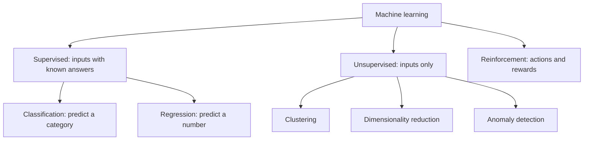

# What Is Machine Learning

> Traditional programming turns rules and data into answers. Machine learning turns data and answers into rules.

**Type:** Learn
**Languages:** Python
**Prerequisites:** Phase 00 (Python Foundations), Phase 01 (Linear Algebra), Phase 03 (Probability and Statistics)
**Time:** ~45 minutes

## Learning Objectives

- Explain the difference between writing rules by hand and learning them from labeled examples
- Name the three main families of machine learning (supervised, unsupervised, reinforcement) and the two supervised tasks (classification and regression)
- Describe every learning algorithm as model + loss + optimizer, and identify each part in a simple example
- Build two tiny classifiers (a threshold "stump" and a nearest-centroid model) and a least-squares regressor from scratch, then match them against scikit-learn

## The Problem

You are asked to sort fruit on a conveyor belt into apples and oranges. You have a scale and a sugar sensor. The obvious first attempt is to write a rule: "if it weighs more than 190 grams, it is an orange." You pick 190 because it feels right.

That rule works some of the time. Then the supplier changes, the apples get bigger, and your rule silently breaks. You tweak the number. Then someone asks you to use the sugar reading too, and now you are tuning two thresholds that interact. Then you need to sort ten fruit types. Hand-written rules do not scale, and you have no principled way to know whether 190 is a good number.

What you do have is a pile of fruit that someone already labeled. Machine learning is the idea that you should let the data pick the rule: search over a family of possible rules and keep the one that makes the fewest mistakes on examples whose answer you already know. Then check it on examples it has never seen.

## The Concept

### Rules versus learning

```
Traditional programming:
    rules + data  ------------>  answers

Machine learning (training):
    data + answers  ---------->  rules (a model)

Machine learning (inference):
    model + new data  -------->  answers
```

The "rules" a learning algorithm produces are not hand-readable `if` statements in general. They are numbers: a threshold, a set of centroids, a weight vector. The algorithm fixes the *shape* of the rule (a line, a tree, a set of prototypes), and training fills in the numbers.

### The three ingredients

Every algorithm in this course, from linear regression to gradient boosting, is three choices:

| Ingredient | Question it answers | Example in this lesson |
|---|---|---|
| Model (hypothesis class) | What shapes of rule am I allowed to learn? | "one feature compared with one threshold" |
| Loss | How do I score a candidate rule on labeled data? | fraction of misclassified fruit |
| Optimizer | How do I search for the best-scoring rule? | try every threshold between sorted values |

Change any one of them and you get a different algorithm. Logistic regression is a linear model + log loss + gradient descent. A decision tree is a tree model + impurity + greedy splitting.

### Families of machine learning



- **Supervised learning**: every training example is a pair `(x, y)`. You learn `f(x) ≈ y`. Spam filters, price prediction, medical diagnosis.
- **Unsupervised learning**: you only have `x`. You look for structure: groups, directions of variation, outliers. Customer segmentation, compression.
- **Reinforcement learning**: an agent acts, receives rewards, and learns a policy. Out of scope for this course.

This course spends Phases 05-07 and 10 on supervised learning and Phases 08-09 on unsupervised learning.

### Vocabulary

```
              features (X)                 label (y)
           weight   sugar                  fruit
sample 1   152.3    10.1       ------>     apple (0)
sample 2   208.9     7.4       ------>     orange (1)
...
```

- A **sample** (row, example, observation) is one item.
- A **feature** (column, attribute, input variable) is one measured property.
- The **label** (target, output) is the answer you want to predict.
- `X` has shape `(n_samples, n_features)`; `y` has shape `(n_samples,)`.

### Generalization is the real goal

Memorizing the training data is trivial: store every example in a dictionary. The hard part is doing well on fruit you have not seen. That is why you always evaluate on a separate **test set**. A model that is 100% accurate on training data and 60% on new data has learned nothing useful. The next lessons in this phase are all about measuring and controlling that gap.

### When not to use machine learning

- The rule is known, exact, and stable (tax brackets, unit conversion). Write the code.
- You have no labeled data and cannot get any.
- A wrong answer is unacceptable and you cannot tolerate any error rate.

Machine learning is the right tool when the rule is fuzzy, changes over time, or has too many interacting parts to write by hand, and you can collect examples.

## Build It

### Step 1: Generate labeled data

Two features (weight in grams, sugar in degrees Brix) for two classes. Apples are lighter and sweeter on average, but the distributions overlap, so no rule can be perfect.

```python
def make_fruit_data(n_per_class, rng):
    apple_weight = rng.normal(150, 20, n_per_class)
    apple_sugar = rng.normal(10, 1.5, n_per_class)
    orange_weight = rng.normal(200, 25, n_per_class)
    orange_sugar = rng.normal(8, 1.5, n_per_class)
    features = np.vstack([
        np.column_stack([apple_weight, apple_sugar]),
        np.column_stack([orange_weight, orange_sugar]),
    ])
    labels = np.array([0] * n_per_class + [1] * n_per_class)
    order = rng.permutation(len(labels))
    return features[order], labels[order]
```

You generate a training set and an independent test set with the same function.

### Step 2: The hand-written baseline

```python
def hand_written_rule(features):
    return (features[:, 0] > 190).astype(int)
```

On the test set this gets about 0.805 accuracy. That is the number to beat.

### Step 3: Learn the threshold (a decision stump)

The model family: "pick one feature, compare it with one threshold, choose a direction." The loss: accuracy on the training set. The optimizer: brute force over every midpoint between consecutive sorted values.

```python
class ThresholdClassifier:
    def fit(self, features, labels):
        best_accuracy = -1.0
        for column in range(features.shape[1]):
            values = np.sort(np.unique(features[:, column]))
            candidates = (values[:-1] + values[1:]) / 2
            for threshold in candidates:
                for direction in (1, -1):
                    predictions = (direction * (features[:, column] - threshold) > 0).astype(int)
                    score = accuracy(labels, predictions)
                    if score > best_accuracy:
                        best_accuracy = score
                        self.column = column
                        self.threshold = threshold
                        self.direction = direction
        return self

    def predict(self, features):
        return (self.direction * (features[:, self.column] - self.threshold) > 0).astype(int)
```

The learned rule is "weight > 164.03 means orange", with test accuracy 0.860. The data moved the threshold far from your guess of 190.

### Step 4: A different model family (nearest centroid)

Same data, different hypothesis class. Store the mean of each class; predict the class whose mean is closest.

```python
class NearestCentroidClassifier:
    def fit(self, features, labels):
        self.classes = np.unique(labels)
        self.centroids = np.array([features[labels == c].mean(axis=0) for c in self.classes])
        return self

    def predict(self, features):
        distances = np.linalg.norm(features[:, None, :] - self.centroids[None, :, :], axis=2)
        return self.classes[np.argmin(distances, axis=1)]
```

It uses both features and reaches 0.880 test accuracy. Notice that "training" here is just two averages: learning does not have to involve gradient descent.

### Step 5: Regression with least squares

When the label is a number, the loss changes from "count mistakes" to "measure distance", and the model can be a line fitted by least squares (Phase 01).

```python
class LeastSquaresRegressor:
    def fit(self, features, targets):
        design = np.column_stack([np.ones(len(features)), features])
        self.coefficients = np.linalg.lstsq(design, targets, rcond=None)[0]
        return self

    def predict(self, features):
        return self.coefficients[0] + features @ self.coefficients[1:]
```

On house sizes generated with `price = 2.5 * size + 30 + noise`, it recovers `price = 2.560 * size + 26.637` with a test mean absolute error around 16.

## Use It

scikit-learn has a standard interface: every model has `fit(X, y)` and `predict(X)`. A depth-1 decision tree is exactly the stump you built.

```python
from sklearn.tree import DecisionTreeClassifier
from sklearn.neighbors import NearestCentroid
from sklearn.linear_model import LinearRegression

sk_stump = DecisionTreeClassifier(max_depth=1, random_state=0).fit(train_x, train_y)
sk_centroid = NearestCentroid().fit(train_x, train_y)
sk_linear = LinearRegression().fit(sizes[:150, None], prices[:150])
```

Run `code/main.py` and you will see the sklearn stump picks the same feature and threshold (164.03) and gets the same 0.860 accuracy; `NearestCentroid` gets 0.880; `LinearRegression` returns the same slope and intercept as your least-squares solver. Same three ingredients, better engineering.

## Exercises

1. **Easy.** Change the hand-written threshold to every integer from 150 to 220 and record test accuracy. Is the best one close to the learned 164? Why might the best test threshold differ from the best training threshold?
2. **Medium.** Extend `ThresholdClassifier` to minimize a weighted error where misclassifying an orange as an apple costs 5 and the reverse costs 1. How does the learned threshold move?
3. **Hard.** Add a third class (lemons: weight ~120 g, sugar ~3) and make `NearestCentroidClassifier` handle it. Then design a "two-stump" model (a stump for each feature, combined with AND/OR) and compare it against nearest centroid on the three-class problem.

## Key Terms

| Term | What people say | What it actually means |
|---|---|---|
| Machine learning | "The computer figures it out" | Choosing a rule from a family of candidates by optimizing a score on example data |
| Model | "The AI" | A function with parameters, chosen from a fixed hypothesis class, that maps features to predictions |
| Training | "Teaching the model" | Running an optimizer to find parameters that minimize a loss on labeled data |
| Feature | "An input" | One measured column of `X` used to make the prediction |
| Label | "The answer" | The target value `y` the model is supposed to predict |
| Supervised learning | "Learning with a teacher" | Learning `f(x) ≈ y` from pairs of inputs and known outputs |
| Classification | "Putting things in buckets" | Supervised learning where `y` is a category |
| Regression | "Predicting a number" | Supervised learning where `y` is a continuous value |
| Generalization | "Working on new data" | Performance on samples drawn from the same distribution but not used for training |

## Further Reading

- [An Introduction to Statistical Learning (ISLR)](https://www.statlearning.com/) -- chapter 2, "Statistical Learning", is the clearest short introduction to the ideas in this lesson
- [Pedro Domingos, "A Few Useful Things to Know About Machine Learning"](https://homes.cs.washington.edu/~pedrod/papers/cacm12.pdf) -- a short paper that frames learning as representation + evaluation + optimization
- [scikit-learn: Getting Started](https://scikit-learn.org/stable/getting_started.html) -- the fit/predict API you will use for the rest of the course
- [StatQuest: A Gentle Introduction to Machine Learning](https://www.youtube.com/watch?v=Gv9_4yMHFhI) -- a 12-minute visual overview of training versus testing
