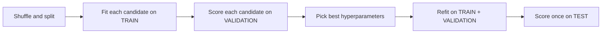

# Train, Validation, and Test Sets

> Train on one set, tune on another, report on a third. Touch the third exactly once.

**Type:** Build
**Languages:** Python
**Prerequisites:** Phase 00 (Python Foundations), Phase 01 (Linear Algebra), Phase 04 Lesson 01 (What Is Machine Learning)
**Time:** ~50 minutes

## Learning Objectives

- Split a dataset into non-overlapping train, validation, and test sets with a fixed seed
- Use the validation set to choose a hyperparameter and the test set only for the final report
- Demonstrate how selecting a model on the test set produces an optimistic, misleading score
- Apply stratified splits for imbalanced labels and time-ordered splits for temporal data

## The Problem

You train a polynomial model and it fits your data with a tiny error. Is that good? You cannot tell, because the model saw those exact points while fitting. You need data it has never seen.

So you hold out a test set. Then you try degree 1, 2, 3, ... 12 and keep whichever has the lowest test error. Now the test error is no longer honest either: you used it to make a decision. If you try enough models, one of them will look good on the test set by luck alone.

The fix is a discipline, not an algorithm: three disjoint sets, each with a single job.

## The Concept

### Three sets, three jobs

```
full dataset (shuffled once, fixed seed)
|---------------- 60% ----------------|---- 20% ----|---- 20% ----|
              TRAIN                     VALIDATION       TEST
     fit parameters (weights)        pick hyper-       final, single
                                     parameters         estimate
```

| Set | Used for | Can it influence the model? |
|---|---|---|
| Train | Fitting parameters (weights, thresholds, centroids) | Yes, directly |
| Validation | Comparing models, choosing hyperparameters, early stopping | Yes, indirectly through your choices |
| Test | Reporting expected performance on new data | No, never |

**Parameters** are learned by the optimizer (polynomial coefficients). **Hyperparameters** are chosen by you before training (polynomial degree, regularization strength, tree depth). The validation set is how you choose them without cheating.

### The workflow



Refitting on train + validation before the final test is optional but common: once the hyperparameters are fixed, more data gives better parameters.

### Why peeking at the test set breaks it

Every time you pick the best of `k` candidates by their score on a set, you are taking a maximum of `k` noisy numbers. The maximum of noisy numbers is biased upward. With 500 random-guess "models" on 50 test samples, the best one scores around 0.68 accuracy even though every model is a coin flip. On fresh data it falls back to about 0.5. The more candidates you compare, the larger the optimism.

This is also called **test-set leakage** or **overfitting to the test set**. It happens in research too: benchmarks reused for years accumulate it.

### Stratification

With 10% positives and a 200-sample test set, a random split might give you 15 or 25 positives just by chance. With rare classes this changes the metrics noticeably. A **stratified split** splits each class separately so that every set keeps the overall class proportions.

### Time-ordered data

If your rows are days, shuffling lets the model train on Friday and predict Wednesday, which is impossible in production. For temporal data, split by time: train on the past, validate on the next window, test on the most recent window. Never shuffle across the cutoff.

### Typical ratios

- Small datasets (hundreds of rows): 60/20/20 or use cross-validation (Lesson 06) instead of a fixed validation set.
- Medium datasets: 70/15/15 or 80/10/10.
- Huge datasets (millions of rows): a 1% test set can already have tens of thousands of examples, which is plenty.

## Build It

### Step 1: A three-way split by index

You shuffle indices once, then slice. Working with indices keeps features and labels aligned.

```python
def split_indices(n_samples, fractions, rng):
    order = rng.permutation(n_samples)
    train_end = int(fractions[0] * n_samples)
    val_end = train_end + int(fractions[1] * n_samples)
    return order[:train_end], order[train_end:val_end], order[val_end:]

train_idx, val_idx, test_idx = split_indices(len(x), (0.6, 0.2), rng)
```

With 300 samples you get 180/60/60, and the intersection of any two sets is empty.

### Step 2: Choose the degree on validation

The data is `y = sin(x) + 0.3x + noise`. You fit polynomials of degree 1 to 12 with least squares and compare errors.

```python
def polynomial_design(x, degree):
    return np.vander(x, degree + 1, increasing=True)


def fit_polynomial(x, y, degree):
    return np.linalg.lstsq(polynomial_design(x, degree), y, rcond=None)[0]


for degree in range(1, 13):
    coefficients = fit_polynomial(x[train_idx], y[train_idx], degree)
    train_error = mse(y[train_idx], polynomial_design(x[train_idx], degree) @ coefficients)
    val_error = mse(y[val_idx], polynomial_design(x[val_idx], degree) @ coefficients)
```

Output (abridged):

```
degree  1 | train MSE 0.2562 | val MSE 0.2128
degree  3 | train MSE 0.0920 | val MSE 0.0918
degree  4 | train MSE 0.0910 | val MSE 0.0903
degree  9 | train MSE 0.0858 | val MSE 0.0985
degree 12 | train MSE 0.0846 | val MSE 0.1037
```

Training error always goes down as the degree grows. Validation error goes down, bottoms out at degree 4, then climbs. Training error alone would push you toward degree 12.

### Step 3: Refit and test once

```python
final_idx = np.concatenate([train_idx, val_idx])
final_coefficients = fit_polynomial(x[final_idx], y[final_idx], best_degree)
test_error = mse(y[test_idx], polynomial_design(x[test_idx], best_degree) @ final_coefficients)
```

This single number (about 0.109) is what you report. Note that it is a bit worse than the validation error: the validation score was the winner of a 12-way comparison, so it was slightly optimistic.

### Step 4: Show the cost of peeking

Labels are pure noise. You generate 500 random predictors, pick the best by accuracy on a 50-sample test set, then check it on 5000 fresh samples.

```python
small_test_labels = rng.integers(0, 2, 50)
fresh_labels = rng.integers(0, 2, 5000)
candidate_scores = []
for candidate in range(500):
    candidate_rng = np.random.default_rng(candidate)
    test_guess = candidate_rng.integers(0, 2, 50)
    fresh_guess = candidate_rng.integers(0, 2, 5000)
    candidate_scores.append((np.mean(test_guess == small_test_labels), np.mean(fresh_guess == fresh_labels)))
best_test, best_fresh = max(candidate_scores, key=lambda row: row[0])
```

```
accuracy on the test set used to pick it: 0.680
accuracy on 5000 fresh points:            0.485
```

Nothing was learned, yet the reported score looks like a real model.

### Step 5: Stratified split

```python
def stratified_split(labels, test_fraction, rng):
    train_parts, test_parts = [], []
    for label in np.unique(labels):
        members = rng.permutation(np.flatnonzero(labels == label))
        n_test = int(round(test_fraction * len(members)))
        test_parts.append(members[:n_test])
        train_parts.append(members[n_test:])
    return np.concatenate(train_parts), np.concatenate(test_parts)
```

With an overall positive rate of 0.094, the plain random split gives a test rate of 0.075; the stratified split gives 0.095.

## Use It

scikit-learn's `train_test_split` does one split at a time, so you call it twice for three sets. `test_size=0.25` of the remaining 80% is 20% of the total.

```python
from sklearn.model_selection import train_test_split

indices = np.arange(len(x))
temp_idx, sk_test_idx = train_test_split(indices, test_size=0.2, random_state=42)
sk_train_idx, sk_val_idx = train_test_split(temp_idx, test_size=0.25, random_state=42)

_, sk_strat_test = train_test_split(np.arange(1000), test_size=0.2, stratify=labels, random_state=42)
```

The result is the same 180/60/60 split and a stratified positive rate of 0.095. For time series use `sklearn.model_selection.TimeSeriesSplit`, which always validates on rows after the training rows.

## Exercises

1. **Easy.** Change the split to 80/10/10 and rerun the degree search. Does the chosen degree change? How much does the test MSE move?
2. **Medium.** Repeat Step 4 with 10, 100, 1000 and 5000 candidates and with test sets of 50, 500 and 5000 samples. Plot the best test accuracy against the number of candidates for each test size. What do you conclude about small benchmarks?
3. **Hard.** Write `time_split(timestamps, train_end, val_end)` that returns index arrays based on dates, generate a trending time series (`y = 0.05 * t + sin(t / 5) + noise`), and compare test error from a shuffled split against a time-ordered split for a degree-3 polynomial in `t`. Explain why the shuffled score is misleading.

## Key Terms

| Term | What people say | What it actually means |
|---|---|---|
| Training set | "The data the model learns from" | Samples used by the optimizer to fit parameters |
| Validation set | "The dev set" | Held-out samples used to compare models and choose hyperparameters |
| Test set | "The holdout" | Samples used once, at the end, to estimate performance on new data |
| Hyperparameter | "A setting" | A value chosen outside the optimizer (degree, depth, lambda) that controls the model |
| Data leakage | "The model cheated" | Any path by which information from evaluation data influences training or model selection |
| Stratified split | "Keep the class balance" | Splitting each class separately so every subset has the original label proportions |
| Temporal split | "Don't shuffle time series" | Splitting by time so the model only trains on data that precedes its evaluation data |

## Further Reading

- [scikit-learn: Cross-validation: evaluating estimator performance](https://scikit-learn.org/stable/modules/cross_validation.html) -- starts with `train_test_split` and explains why a separate test set is needed
- [An Introduction to Statistical Learning (ISLR)](https://www.statlearning.com/) -- section 5.1 covers the validation-set approach and its weaknesses
- [Google: Rules of Machine Learning](https://developers.google.com/machine-learning/guides/rules-of-ml) -- practical advice on training/serving skew and keeping evaluation data honest
- [Sebastian Raschka, "Model Evaluation, Model Selection, and Algorithm Selection in Machine Learning"](https://arxiv.org/abs/1811.12808) -- a thorough survey of holdout methods and their biases
