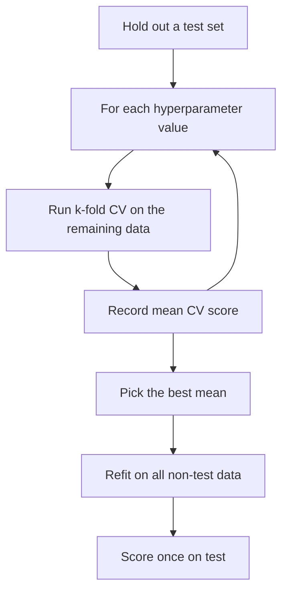

# Cross-Validation

> One split gives you one noisy number. K splits give you an average and an error bar.

**Type:** Build
**Languages:** Python
**Prerequisites:** Phase 03 (Probability and Statistics), Phase 04 Lessons 02 and 04 (Train/Validation/Test, Overfitting and Regularization)
**Time:** ~60 minutes

## Learning Objectives

- Implement k-fold, leave-one-out, and stratified k-fold splitting from scratch
- Show empirically that a single train/validation split gives a much noisier estimate than k-fold cross-validation
- Use cross-validation to choose a hyperparameter and interpret the spread across folds
- Avoid the most common cross-validation leak: fitting preprocessing on the full dataset

## The Problem

In Lesson 02 you held out a fixed validation set. On a dataset of 442 patients, that means 88 patients decide which model you ship. Run the code for this lesson and you will see what happens when you change only the random seed of that split: the R^2 of the same ridge model ranges from 0.31 to 0.55.

That spread is not about the model. It is about which 88 patients landed in validation. If you compare two models on one split, the difference you see can easily be smaller than this noise. Small datasets also make you choose between using data for training and using it for validation; you can't afford to waste either.

Cross-validation fixes both problems: every sample is used for validation exactly once and for training `k - 1` times, and you get `k` scores instead of one.

## The Concept

### K-fold cross-validation

```
data (shuffled)  [ A ][ B ][ C ][ D ][ E ]

fold 1:          [val][ train............ ]   -> score 1
fold 2:          [tr ][val][ train....... ]   -> score 2
fold 3:          [ train ][val][ train... ]   -> score 3
fold 4:          [ train.......][val][ tr ]   -> score 4
fold 5:          [ train............][val ]   -> score 5

CV estimate = mean(score 1..5)    spread = std(score 1..5)
```

1. Shuffle and cut the data into `k` folds of nearly equal size.
2. For each fold: train on the other `k - 1` folds, score on this one.
3. Report the mean (your estimate) and the standard deviation (how much it depends on the split).

Common choices are `k = 5` or `k = 10`. Each model trains on `(k - 1)/k` of the data, so the estimate is slightly pessimistic compared with a model trained on everything.

### Variants

| Method | Folds | When to use |
|---|---|---|
| K-fold | `k` | Default for regression and balanced classification |
| Stratified k-fold | `k`, class proportions preserved | Classification, especially with imbalanced labels |
| Leave-one-out (LOO) | `n` | Very small datasets; expensive, high-variance estimate |
| Repeated k-fold | `k * r` | When you need a more stable estimate and can afford it |
| Group k-fold | `k`, groups never split | Several rows per patient, user, or session |
| Time-series split | expanding window | Temporal data; always validate on later rows |

Group k-fold matters more than people expect. If one patient contributes ten scans and some land in training while others land in validation, the model can recognize the patient instead of the disease and the score is inflated.

### Model selection with CV



CV replaces the fixed validation set, not the test set. The CV score of the winning configuration is still optimistically biased (it won a competition), so you still need a final test, or **nested cross-validation** (an outer CV loop around the whole selection procedure) when data is too scarce for a test set.

### Reading the spread

If two settings differ by less than about one standard deviation of their fold scores, treat them as tied. A common rule is the **one-standard-error rule**: choose the simplest model whose mean score is within one standard error of the best.

### The preprocessing leak

Anything learned from data (scaler means and standard deviations, imputation values, selected features, target encodings) must be learned *inside* each fold from the training part only. If you standardize the full dataset first and then cross-validate, the validation fold has already influenced the training data. This is why the ridge class in this lesson computes its own mean and standard deviation in `fit`, and why scikit-learn pipelines exist (Phase 10).

## Build It

### Step 1: K-fold indices

```python
def k_fold_indices(n_samples, n_folds, rng=None):
    indices = np.arange(n_samples) if rng is None else rng.permutation(n_samples)
    fold_sizes = np.full(n_folds, n_samples // n_folds)
    fold_sizes[: n_samples % n_folds] += 1
    folds, start = [], 0
    for size in fold_sizes:
        validation = indices[start:start + size]
        train = np.concatenate([indices[:start], indices[start + size:]])
        folds.append((train, validation))
        start += size
    return folds
```

The first `n % k` folds get one extra sample, which is also what scikit-learn does. For the 442-sample diabetes dataset and `k = 5` you get folds of 89, 89, 88, 88, 88.

### Step 2: A model that fits its own preprocessing

```python
class StandardizedRidge:
    def __init__(self, penalty):
        self.penalty = penalty

    def fit(self, features, targets):
        self.mean = features.mean(axis=0)
        self.std = features.std(axis=0)
        scaled = (features - self.mean) / self.std
        self.intercept = targets.mean()
        gram = scaled.T @ scaled + self.penalty * np.eye(features.shape[1])
        self.weights = np.linalg.solve(gram, scaled.T @ (targets - self.intercept))
        return self

    def predict(self, features):
        return ((features - self.mean) / self.std) @ self.weights + self.intercept


def cross_validate(features, targets, penalty, folds):
    scores = []
    for train, validation in folds:
        model = StandardizedRidge(penalty).fit(features[train], targets[train])
        scores.append(r2_score(targets[validation], model.predict(features[validation])))
    return np.array(scores)
```

### Step 3: Single split versus CV

You repeat each procedure with 20 different seeds:

```
20 random 80/20 splits: R^2 range [0.310, 0.548], std 0.067
20 shuffled 5-fold CVs: R^2 range [0.474, 0.495], std 0.006
```

The CV estimate is about ten times more stable. Any model comparison you make on a single split must beat a noise level of roughly 0.07 R^2.

### Step 4: Choose lambda

```
lambda    0.01 | mean R^2 0.4875 | std 0.0751
lambda    1.00 | mean R^2 0.4875 | std 0.0761
lambda   30.00 | mean R^2 0.4872 | std 0.0725
lambda  100.00 | mean R^2 0.4813 | std 0.0622
lambda 1000.00 | mean R^2 0.3391 | std 0.0309
```

Everything from 0.01 to 30 is tied within a tiny fraction of the fold standard deviation. The data is telling you this model barely needs regularization; only very large penalties clearly hurt. The standard error of the best mean is about `0.075 / sqrt(5) = 0.034`, so the one-standard-error rule accepts any mean above `0.4875 - 0.034 = 0.454` and picks the most regularized such value, `lambda = 100`.

### Step 5: Leave-one-out and stratification

LOO is k-fold with `k = n`: `k_fold_indices(len(targets), len(targets))` gives 442 fits. For stratification, you deal each class's shuffled members into folds round-robin:

```python
def stratified_k_fold_indices(labels, n_folds, rng):
    fold_members = [[] for _ in range(n_folds)]
    for label in np.unique(labels):
        members = rng.permutation(np.flatnonzero(labels == label))
        for position, index in enumerate(members):
            fold_members[position % n_folds].append(index)
    all_indices = np.arange(len(labels))
    folds = []
    for members in fold_members:
        validation = np.array(sorted(members))
        folds.append((np.setdiff1d(all_indices, validation), validation))
    return folds
```

With a 14.9% positive class, unshuffled folds have positive rates from 0.10 to 0.20; stratified folds are all 0.148 to 0.156.

## Use It

```python
from sklearn.linear_model import Ridge
from sklearn.model_selection import KFold, StratifiedKFold, cross_val_score, GridSearchCV
from sklearn.pipeline import make_pipeline
from sklearn.preprocessing import StandardScaler

pipeline = make_pipeline(StandardScaler(), Ridge(alpha=1.0))
sk_scores = cross_val_score(pipeline, features, targets, cv=KFold(5, shuffle=False), scoring="r2")

search = GridSearchCV(pipeline, {"ridge__alpha": penalties}, cv=KFold(5, shuffle=True, random_state=0), scoring="r2")
search.fit(features, targets)
```

With the same unshuffled folds, `cross_val_score` returns exactly your five scores `[0.428, 0.5216, 0.4856, 0.4272, 0.5486]`. The pipeline refits the scaler inside each fold, so there is no leak. `GridSearchCV` runs the full sweep and refits the best model on all the data; with its own shuffled folds it picks `alpha = 1.0`, a different winner from the same tied group. Other splitters: `StratifiedKFold`, `GroupKFold`, `TimeSeriesSplit`, `RepeatedKFold`, `LeaveOneOut`.

## Exercises

1. **Easy.** Run 5-fold, 10-fold and LOO on the diabetes data with `lambda = 1`. Compare the mean MSE and the time each takes.
2. **Medium.** Demonstrate the preprocessing leak: on a dataset with 50 samples and 5000 random-noise features, select the 20 features most correlated with the target using *all* data, then cross-validate a ridge model on them. Repeat with the selection done inside each fold. Explain the difference in R^2.
3. **Hard.** Implement nested cross-validation: an outer 5-fold loop for evaluation and an inner 5-fold loop to choose `lambda`. Report the outer mean and compare it with the best inner CV score from a non-nested search.

## Key Terms

| Term | What people say | What it actually means |
|---|---|---|
| Cross-validation | "CV" | Repeatedly training on part of the data and scoring on the rest, then averaging the scores |
| Fold | "A chunk" | One of the `k` disjoint subsets; each serves as the validation set once |
| Leave-one-out | "LOOCV" | K-fold with `k = n`; each validation set is a single sample |
| Stratified k-fold | "Balanced folds" | K-fold where each fold keeps the overall class proportions |
| Group k-fold | "Don't split a patient" | K-fold where all rows from the same group go to the same fold |
| Nested CV | "CV inside CV" | An outer CV loop that evaluates a whole model-selection procedure run in an inner CV loop |
| One-standard-error rule | "Pick the simpler tie" | Choose the simplest model whose mean CV score is within one standard error of the best |

## Further Reading

- [scikit-learn: Cross-validation: evaluating estimator performance](https://scikit-learn.org/stable/modules/cross_validation.html) -- every splitter, with diagrams of how each one assigns folds
- [An Introduction to Statistical Learning (ISLR)](https://www.statlearning.com/) -- chapter 5 covers k-fold and LOO and their bias-variance properties
- [The Elements of Statistical Learning (ESL)](https://hastie.su.domains/ElemStatLearn/) -- section 7.10.2, "The Wrong and Right Way to Do Cross-validation", is the canonical description of the selection leak
- [StatQuest: Machine Learning Fundamentals: Cross Validation](https://www.youtube.com/watch?v=fSytzGwwBVw) -- a 6-minute visual walk-through
