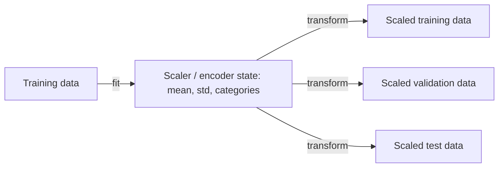

# Feature Scaling and Encoding

> Models see numbers, not meaning. Put every feature on a fair scale and turn categories into numbers that do not lie.

**Type:** Build
**Languages:** Python
**Prerequisites:** Phase 01 (Linear Algebra: norms and distances), Phase 02 (Calculus and Optimization: gradient descent), Phase 04 Lessons 02 and 06 (Train/Validation/Test, Cross-Validation)
**Time:** ~50 minutes

## Learning Objectives

- Implement standard, min-max, and robust scaling from scratch and explain how each responds to outliers
- Show how unscaled features break distance-based models and slow gradient descent
- Encode nominal categories with one-hot encoding and ordered categories with ordinal encoding, including unseen categories
- Fit every transformation on training data only and apply it unchanged to validation and test data

## The Problem

You predict whether a customer buys a product from two features: income (around 60,000) and age (18 to 70). The label depends only on age. You run k-nearest neighbors and get 0.485 accuracy, worse than a coin flip.

The reason is arithmetic. Euclidean distance adds squared differences. A 1,000-unit income difference contributes 1,000,000; a 30-year age difference contributes 900. Income decides every neighbor, and income is irrelevant. Standardize both columns and accuracy jumps to 0.885 with no other change.

Then there is the column `city` with values like `"madrid"` and `"tokyo"`. NumPy cannot multiply a string by a weight. If you map them to 0, 1, 2, 3 you have told the model that Tokyo is "three times" Paris and that Lima sits halfway between two other cities. Encoding is about converting categories into numbers without inventing structure that is not there.

## The Concept

### Which models care about scale

| Model family | Scale-sensitive? | Why |
|---|---|---|
| k-NN, k-means, SVM with RBF kernel | Yes, a lot | They use distances |
| Linear/logistic regression with gradient descent | Yes | Convergence speed depends on the conditioning of `X^T X` |
| Ridge, lasso, any weight penalty | Yes | The penalty compares weights across features |
| PCA | Yes | It finds directions of largest variance |
| Decision trees, random forests, gradient boosting | No | Splits compare one feature with a threshold; any monotonic rescaling gives the same splits |
| Naive Bayes (Gaussian) | No | Each feature is modeled separately |

### Three scalers

```
standard:  z = (x - mean) / std                       mean 0, std 1
min-max:   z = (x - min) / (max - min)                range [0, 1]
robust:    z = (x - median) / (Q3 - Q1)               median 0, IQR 1
```

How they treat the column `[1, 2, 3, 4, 5, 100]`:

```
standard: [-0.502 -0.475 -0.447 -0.419 -0.392  2.235]
min-max : [0.     0.01   0.02   0.03   0.04   1.   ]
robust  : [-1.    -0.6   -0.2   0.2    0.6    38.6 ]
```

- **Standard** scaling is the default for linear models, SVMs, PCA and k-NN. The outlier inflates the standard deviation and squeezes the normal points together.
- **Min-max** keeps values in a fixed range, useful for features that must be non-negative or bounded. A single outlier crushes every other value into a tiny interval.
- **Robust** scaling uses the median and interquartile range, which ignore extremes, so the normal points keep a sensible spread and the outlier stays obviously far away.

None of these removes outliers. They only decide whether outliers distort the scale of everything else.

### Scaling and gradient descent

For linear regression the loss surface is a bowl whose shape is set by `X^T X`. When one feature is in the tens of thousands and another in the tens, the bowl becomes an extremely narrow valley (condition number around 300,000 in this lesson's data). A learning rate small enough to be stable along the steep direction barely moves along the flat one. Standardizing makes the bowl nearly round (condition number about 1) and gradient descent converges in a few dozen steps.

### Encoding categorical features

```
nominal (no order):  city   = madrid, paris, tokyo, lima
ordinal (ordered):   size   = small < medium < large
```

**One-hot encoding** creates one binary column per category:

```
city      lima madrid paris tokyo
madrid      0     1     0     0
paris       0     0     1     0
tokyo       0     0     0     1
lima        1     0     0     0
```

No category is "bigger" than another, and a linear model gets one weight per city. Two practical concerns:

- **Unseen categories.** A test row with `"berlin"` has no column. The usual choice is to encode it as all zeros ("none of the known cities").
- **High cardinality.** A column with 50,000 zip codes produces 50,000 sparse columns. Alternatives: group rare categories into "other", hash them, or use target encoding (with cross-fitting to avoid leakage).

With a linear model plus intercept, the full set of one-hot columns sums to 1 and is collinear with the intercept. Regularization handles this; otherwise drop one column (`drop="first"`).

**Ordinal encoding** maps ordered categories to integers that respect the order: small=0, medium=1, large=2. Use it only when the order is real. Tree models are an exception: they can use arbitrary integer codes for nominal features because they only split, but linear models cannot.

### Fit on train, transform everything



The mean, standard deviation, min, max, median, IQR and category list are all parameters learned from data. Learn them from the training set only. As a consequence, the scaled test set will *not* have mean exactly 0, and that is correct: it reflects how new data actually looks relative to what the model was trained on.

## Build It

### Step 1: Scalers as fit/transform classes

```python
class StandardScalerScratch:
    def fit(self, features):
        self.mean = features.mean(axis=0)
        self.scale = features.std(axis=0)
        self.scale[self.scale == 0] = 1.0
        return self

    def transform(self, features):
        return (features - self.mean) / self.scale


class RobustScalerScratch:
    def fit(self, features):
        self.median = np.median(features, axis=0)
        self.iqr = np.percentile(features, 75, axis=0) - np.percentile(features, 25, axis=0)
        self.iqr[self.iqr == 0] = 1.0
        return self

    def transform(self, features):
        return (features - self.median) / self.iqr
```

`MinMaxScalerScratch` follows the same pattern with `min` and `max - min`. Replacing a zero scale with 1 avoids dividing by zero on constant columns.

### Step 2: The k-NN failure and fix

```python
def knn_predict(train_x, train_y, query_x, k=5):
    distances = np.linalg.norm(query_x[:, None, :] - train_x[None, :, :], axis=2)
    neighbors = np.argsort(distances, axis=1)[:, :k]
    return (train_y[neighbors].mean(axis=1) > 0.5).astype(int)


scaler = StandardScalerScratch().fit(train_x)
scaled_accuracy = np.mean(knn_predict(scaler.transform(train_x), train_y, scaler.transform(test_x)) == test_y)
```

```
income std 14450, age std 15.5
kNN accuracy raw features:    0.485
kNN accuracy scaled features: 0.885
```

### Step 3: Gradient descent before and after

```python
def gradient_descent_mse(features, targets, learning_rate, steps=1000):
    weights = np.zeros(features.shape[1])
    intercept = 0.0
    for _ in range(steps):
        residual = features @ weights + intercept - targets
        weights -= learning_rate * 2 * features.T @ residual / len(targets)
        intercept -= learning_rate * 2 * residual.mean()
    return np.mean((features @ weights + intercept - targets) ** 2)
```

```
condition number raw:          304112
condition number standardized: 1.03
raw features, lr=1e-10 (lr=1e-9 diverges), 1000 steps: MSE 86.864
standardized features, lr=0.1, 1000 steps:            MSE 1.113
```

The raw problem cannot use a learning rate larger than about `1e-10` without diverging, and at that rate the age and intercept weights barely move. The exact least-squares solution also has MSE 1.113, so the standardized run has reached the optimum.

### Step 4: Encoders

```python
class OneHotEncoderScratch:
    def fit(self, column):
        self.categories = np.unique(column)
        return self

    def transform(self, column):
        return (column[:, None] == self.categories[None, :]).astype(float)


class OrdinalEncoderScratch:
    def __init__(self, order):
        self.mapping = {category: index for index, category in enumerate(order)}

    def transform(self, column):
        return np.array([self.mapping[value] for value in column], dtype=float)
```

Broadcasting `column[:, None] == categories[None, :]` builds the whole indicator matrix in one line, and an unseen value like `"berlin"` matches nothing, giving an all-zero row. The ordinal encoder takes the order explicitly, because alphabetical order (`large < medium < small`) would be wrong.

## Use It

```python
from sklearn.compose import ColumnTransformer
from sklearn.pipeline import make_pipeline
from sklearn.preprocessing import StandardScaler, MinMaxScaler, RobustScaler, OneHotEncoder, OrdinalEncoder
from sklearn.neighbors import KNeighborsClassifier

encoder = OneHotEncoder(handle_unknown="ignore").fit(cities[:, None])
ordinal = OrdinalEncoder(categories=[["small", "medium", "large"]])
pipeline = make_pipeline(StandardScaler(), KNeighborsClassifier(n_neighbors=5)).fit(train_x, train_y)

transformer = ColumnTransformer([
    ("city", OneHotEncoder(), [0]),
    ("size", OrdinalEncoder(categories=[["small", "medium", "large"]]), [1]),
    ("age", StandardScaler(), [2]),
])
```

All three sklearn scalers reproduce your outputs exactly, `OneHotEncoder(handle_unknown="ignore")` maps `"berlin"` to zeros like yours, and the pipeline reaches the same 0.885 accuracy. `ColumnTransformer` applies a different transformer to each column group (4 one-hot columns + 1 ordinal + 1 scaled = 6 columns). Putting it inside a `Pipeline` guarantees every transformer is fitted only on the training fold during cross-validation; Phase 10 (sklearn Pipelines) builds on this.

## Exercises

1. **Easy.** Rerun the k-NN experiment with `MinMaxScalerScratch` and `RobustScalerScratch`. Then add a single customer with income 5,000,000 to the training set and compare the three scalers again.
2. **Medium.** Implement `inverse_transform` for all three scalers and for the one-hot encoder (return the category with the 1, or `None` for an all-zero row). Verify that `inverse_transform(transform(x))` returns `x`.
3. **Hard.** Implement target (mean) encoding for a high-cardinality feature with smoothing: `encoded = (count * category_mean + m * global_mean) / (count + m)`. Show on synthetic data that computing it on the full training set leaks the label and inflates training accuracy, then fix it with 5-fold out-of-fold encoding.

## Key Terms

| Term | What people say | What it actually means |
|---|---|---|
| Standardization | "Z-scoring" | Subtracting the mean and dividing by the standard deviation of each feature |
| Normalization | "Scaling to 0-1" | Usually min-max scaling to a fixed range; the word is used inconsistently, so check |
| Robust scaling | "Outlier-proof scaling" | Centering on the median and dividing by the interquartile range |
| One-hot encoding | "Dummy variables" | One binary indicator column per category |
| Ordinal encoding | "Label encoding" | Mapping ordered categories to integers that respect their order |
| Cardinality | "Number of levels" | How many distinct values a categorical feature has |
| Condition number | "How stretched the problem is" | Ratio of largest to smallest singular value; large values mean slow, unstable optimization |
| Fit/transform | "Learn then apply" | Learning preprocessing parameters on training data, then applying them unchanged to any data |

## Further Reading

- [scikit-learn: Preprocessing data](https://scikit-learn.org/stable/modules/preprocessing.html) -- every scaler and encoder, with guidance on when to use each
- [scikit-learn: Compare the effect of different scalers on data with outliers](https://scikit-learn.org/stable/auto_examples/preprocessing/plot_all_scaling.html) -- side-by-side plots of every scaler on real data
- [Alice Zheng and Amanda Casari, Feature Engineering for Machine Learning (O'Reilly)](https://www.oreilly.com/library/view/feature-engineering-for/9781491953235/) -- chapters 2 and 5 cover scaling and categorical encoding in depth
- [Andrew Ng, CS229 Lecture Notes](https://cs229.stanford.edu/main_notes.pdf) -- the gradient descent sections explain why feature scaling speeds convergence
