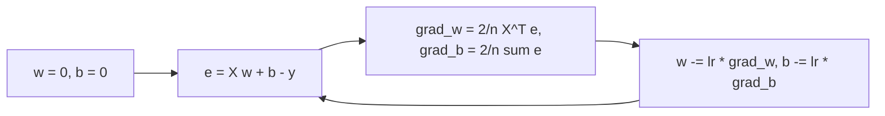

# Linear Regression with Gradient Descent

> When the matrix is too big to solve, walk downhill instead. Same answer, different road.

**Type:** Build
**Languages:** Python
**Prerequisites:** Phase 02 (Calculus and Optimization: gradient descent, learning rate, SGD & momentum), Phase 04 (ML Fundamentals: feature scaling & encoding), Lesson 05.01 (Linear Regression: The Closed Form)
**Time:** ~60 minutes

## Learning Objectives

- Derive the vectorized MSE gradient `(2/n) X^T (X w + b - y)` and implement batch gradient descent in NumPy
- Explain why unscaled features force a tiny learning rate and how standardization fixes it
- Implement mini-batch gradient descent and compare it with the closed-form solution
- Convert weights learned on standardized features back to original units

## The Problem

In the last lesson you solved `X^T X beta = X^T y` in one shot. That costs `O(n p^2 + p^3)` time and needs `X^T X` in memory. With a million rows and fifty thousand sparse features (word counts, one-hot categories), forming and factorizing a 50,000 x 50,000 matrix is out of the question. With data that streams in and never fits in RAM, it is impossible.

Gradient descent only needs to compute `X^T e` for an error vector `e`, which is one pass over the data and `O(np)` per step. Mini-batch gradient descent does not even need all the data at once. It is also the exact same training loop you will use for logistic regression, neural networks and almost everything else, so it is worth getting right on the simplest possible case.

## The Concept

### The gradient of MSE

Keep the bias separate this time (it is how most iterative solvers are written):

```
y_hat = X w + b
L(w, b) = (1/n) * sum((y_hat_i - y_i)^2) = (1/n) ||X w + b - y||^2
```

With the error vector `e = X w + b - y`:

```
dL/dw = (2/n) X^T e        (one number per feature)
dL/db = (2/n) sum(e)
```

Each feature's gradient is the correlation between that feature and the current errors. If errors are large wherever `x_j` is large, `w_j` should go up or down to compensate.

### The update loop



Because MSE for a linear model is convex, there is one minimum and gradient descent reaches it with any learning rate below a threshold.

### Why scaling matters so much

The largest safe learning rate is `lr < 2 / lambda_max`, where `lambda_max` is the largest eigenvalue of the Hessian `(2/n) X^T X`. Convergence speed along the slowest direction is governed by the smallest eigenvalue. Their ratio is the condition number.

```
raw features:   size in [40, 220], bedrooms in [1, 5]  -> long thin valley
                lambda_max is huge (size^2 ~ 10^4)  -> lr must be ~1e-5
                bedrooms direction barely moves     -> thousands of epochs

standardized:   every feature has mean 0, std 1     -> nearly round bowl
                lr ~ 0.1 to 0.5 works               -> tens of epochs
```

```
   raw                     standardized
  _________                  _____
 /  ___    \               /  _   \
|  (___)    |  zig-zag     | ( * )  |  straight in
 \_________/               \_____/
```

Standardize with the training set's mean and std, and reuse those exact numbers on the test set.

### Batch, stochastic and mini-batch

- **Batch:** the gradient over all `n` samples. Smooth, deterministic, one step per epoch.
- **Stochastic (SGD):** gradient from one sample. Noisy, cheap, many steps per epoch.
- **Mini-batch:** gradient from `B` samples (32-512 typical). The practical default: vectorized and still many updates per epoch.

Noisy gradients mean SGD hovers around the minimum instead of landing on it. A decaying learning rate (as `SGDRegressor` uses) shrinks the hovering over time.

### Getting back to original units

If you trained on `z = (x - mean) / std`, then `w_z . z + b_z = (w_z / std) . x + (b_z - sum(w_z * mean / std))`. So the original-unit weights are `w_z / std` and the intercept is `b_z - sum(w_z * mean / std)`.

## Build It

### Step 1: Gradient and batch descent

```python
def gradients(features, targets, weights, bias):
    n_samples = features.shape[0]
    errors = features @ weights + bias - targets
    grad_weights = (2 / n_samples) * features.T @ errors
    grad_bias = (2 / n_samples) * errors.sum()
    return grad_weights, grad_bias


def batch_gradient_descent(features, targets, learning_rate, epochs):
    weights = np.zeros(features.shape[1])
    bias = 0.0
    history = []
    for _ in range(epochs):
        grad_weights, grad_bias = gradients(features, targets, weights, bias)
        weights -= learning_rate * grad_weights
        bias -= learning_rate * grad_bias
        history.append(mse(features, targets, weights, bias))
    return weights, bias, history
```

### Step 2: Feel the pain of raw features

On the same house data as Lesson 01 (400 rows, 320 for training):

```
MSE after 200 epochs on raw features: 823.1
With lr=1e-3 on raw features MSE after 5 epochs: 9.967e+20 (diverging)
```

`lr = 1e-5` is stable but stuck far from the optimum (the best training MSE is about 204). `lr = 1e-3` explodes in five steps.

### Step 3: Standardize and sweep the learning rate

```python
def standardize(train, test):
    mean = train.mean(axis=0)
    std = train.std(axis=0)
    return (train - mean) / std, (test - mean) / std, mean, std
```

```
lr=0.01  MSE after 10:     98635.01   after 200:       249.23
lr=0.1   MSE after 10:      1901.01   after 200:       203.73
lr=0.5   MSE after 10:       203.73   after 200:       203.73
lr=1.05  MSE after 10:   1020693.95   after 200: 4.5e+27
```

Too small is slow, a good value converges in a handful of epochs, and just above the stability limit it diverges. Here `lr = 0.5` is almost Newton's method: with standardized, nearly uncorrelated features the Hessian is close to `2 I`, so a step of `1/2` jumps straight to the minimum.

### Step 4: Mini-batch descent

```python
def minibatch_gradient_descent(features, targets, learning_rate, epochs, batch_size, rng):
    weights = np.zeros(features.shape[1])
    bias = 0.0
    history = []
    n_samples = features.shape[0]
    for _ in range(epochs):
        order = rng.permutation(n_samples)
        for start in range(0, n_samples, batch_size):
            batch = order[start:start + batch_size]
            grad_weights, grad_bias = gradients(features[batch], targets[batch], weights, bias)
            weights -= learning_rate * grad_weights
            bias -= learning_rate * grad_bias
        history.append(mse(features, targets, weights, bias))
    return weights, bias, history
```

With batches of 32 and `lr = 0.05`, MSE reaches `203.86` after 50 epochs, within noise of the exact optimum. Shuffling every epoch matters: without it, any order in the data becomes a bias in the updates.

### Step 5: Compare with the closed form and unscale

```python
def unscale(weights, bias, mean, std):
    raw_weights = weights / std
    raw_bias = bias - np.sum(weights * mean / std)
    return raw_weights, raw_bias
```

```
GD     bias  360.442 weights [130.578  16.766 -12.604]
exact  bias  360.442 weights [130.578  16.766 -12.604]
in original units: intercept 23.557, coefs [ 2.536 11.666 -0.701]
```

Gradient descent and `lstsq` agree to three decimals. In standardized units the bias is the mean price, and each weight is "price change per one standard deviation of the feature", which makes the weights directly comparable as importance.

## Use It

`SGDRegressor` is scikit-learn's stochastic gradient descent linear model. It expects scaled features, so pair it with `StandardScaler`.

```python
from sklearn.linear_model import SGDRegressor, LinearRegression
from sklearn.preprocessing import StandardScaler

scaler = StandardScaler().fit(train_x)
sgd = SGDRegressor(max_iter=1000, tol=1e-6, eta0=0.01, random_state=0)
sgd.fit(scaler.transform(train_x), train_y)
ols = LinearRegression().fit(scaler.transform(train_x), train_y)
```

```
SGDRegressor     bias  360.440 weights [130.579  16.777 -12.623]
LinearRegression bias  360.442 weights [130.578  16.766 -12.604]
```

The small differences are the SGD noise floor. Use `LinearRegression` when the data fits in memory; use `SGDRegressor` (or its `partial_fit` method for streaming) when it does not. Note that sklearn's loss is `(1/2) * MSE` plus an optional penalty, so its learning rates are not directly interchangeable with yours.

## Exercises

1. **Easy.** Plot `history` for learning rates 0.01, 0.1 and 0.5 on a log-scale y-axis. Save it to a PNG next to the script.
2. **Medium.** Compute the eigenvalues of `(2/n) X^T X` for the standardized design (with a ones column for the bias). Predict the largest stable learning rate as `2 / lambda_max` and verify it experimentally.
3. **Hard.** Add momentum (Phase 02) to the mini-batch loop. Then reproduce Step 2 with raw features: how many epochs does momentum save at the largest stable learning rate?

## Key Terms

| Term | What people say | What it actually means |
|------|----------------|----------------------|
| Batch gradient descent | "Full GD" | Each update uses the gradient over every training sample |
| Mini-batch gradient descent | "SGD" in practice | Each update uses the gradient over a random subset of `B` samples |
| Epoch | "One pass" | One full sweep over the training set, however many updates that contains |
| Learning rate | "Step size" | Multiplier on the gradient; must stay below `2 / lambda_max` of the Hessian for convergence |
| Standardization | "Scaling" | `z = (x - mean) / std` using training statistics, which rounds out the loss bowl |
| Condition number | "How stretched the bowl is" | `lambda_max / lambda_min` of the Hessian; controls how many steps GD needs |
| Divergence | "Loss exploded" | The learning rate is too large, so each step overshoots further than the last |

## Further Reading

- [Stanford CS229 Lecture Notes, Part I](https://cs229.stanford.edu/main_notes.pdf) - LMS rule, batch vs stochastic gradient descent
- [Distill: Why Momentum Really Works](https://distill.pub/2017/momentum/) - interactive explanation of conditioning and step sizes
- [scikit-learn: Stochastic Gradient Descent](https://scikit-learn.org/stable/modules/sgd.html) - practical tips, learning-rate schedules, `partial_fit`
- [StatQuest: Gradient Descent, Step-by-Step](https://www.youtube.com/watch?v=sDv4f4s2SB8) - visual walkthrough on a regression line
