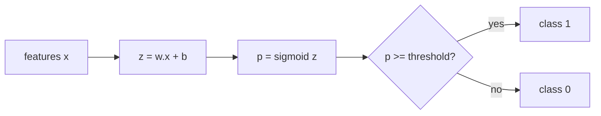

# Logistic Regression

> Linear regression with a squashing function on top: a straight line that outputs probabilities instead of numbers.

**Type:** Build
**Languages:** Python
**Prerequisites:** Phase 02 (Calculus and Optimization), Phase 03 (Probability and Statistics: Maximum Likelihood), Phase 04 (ML Fundamentals: Loss Functions, Metrics), Phase 05 (Supervised Regression: Linear Regression Gradient Descent)
**Time:** ~75 minutes

## Learning Objectives

- Explain why a sigmoid on top of a linear score turns regression into a probabilistic classifier
- Derive the binary cross-entropy loss from maximum likelihood and its gradient `X^T (p - y) / n`
- Implement logistic regression with batch gradient descent in NumPy and read its linear decision boundary
- Move the decision threshold to trade precision against recall, and match your model against scikit-learn

## The Problem

You want to predict a yes/no outcome: will this customer churn, is this email spam, is this tumor malignant. Your labels are 0 and 1. You could fit linear regression to them, but the line happily predicts -0.4 or 1.7, which are not probabilities, and a few extreme points drag the line around and move the boundary where you cut at 0.5.

What you actually want is a model that outputs a number between 0 and 1 that you can read as "the probability this is class 1", and a loss that punishes confident wrong answers hard. Logistic regression gives you exactly that. It is still the default baseline for binary classification in industry: fast, convex, calibrated out of the box, and every weight has a clean interpretation as a change in log-odds.

## The Concept

### From score to probability

Start with the same linear score as linear regression:

```
z = w^T x + b
```

Then squash it with the sigmoid (logistic) function:

```
sigma(z) = 1 / (1 + e^(-z))
```

```
 p
1.0 |                        ..........
    |                   ..'
0.5 |- - - - - - - - -*- - - - - - - -
    |              .'
0.0 |.........''
    +-----------------+----------------- z
                      0
```

- `z = 0` gives `p = 0.5`
- large positive `z` gives `p -> 1`
- large negative `z` gives `p -> 0`

Inverting the sigmoid shows what the linear part really models, the log-odds:

```
log( p / (1 - p) ) = w^T x + b
```

So increasing feature `x_j` by one unit adds `w_j` to the log-odds, which multiplies the odds by `e^(w_j)`.

### The loss: binary cross-entropy

Treat each label as a Bernoulli draw with probability `p_i = sigma(w^T x_i + b)`. The likelihood of the data is the product of `p_i^(y_i) (1 - p_i)^(1 - y_i)`. Taking the negative log and averaging gives binary cross-entropy (log loss):

```
L(w, b) = -(1/n) * sum[ y_i log(p_i) + (1 - y_i) log(1 - p_i) ]
```

If the truth is 1 and you say `p = 0.01`, you pay `-log(0.01) = 4.6`. If you say `p = 0.99`, you pay `0.01`. Confident mistakes are expensive.

Why not MSE? Composed with a sigmoid, MSE is non-convex in `w` and its gradient vanishes when the sigmoid saturates. Cross-entropy is convex, so gradient descent finds the global minimum.

### The gradient

The sigmoid's derivative is `sigma(z)(1 - sigma(z))`, and it cancels neatly against the log terms. The result looks exactly like linear regression's gradient:

```
dL/dw = (1/n) * X^T (p - y)
dL/db = (1/n) * sum(p - y)
```

The only difference from linear regression is that `p` comes through a sigmoid.

### The decision boundary

You predict class 1 when `p >= 0.5`, which is the same as `w^T x + b >= 0`. That set is a hyperplane. In 2D it is a line:

```
w1 x1 + w2 x2 + b = 0   =>   x2 = -(w1/w2) x1 - b/w2
```

Logistic regression is a linear classifier. To get curved boundaries you add features (polynomials, interactions), exactly as in Phase 05 (Polynomial Regression).

### The threshold is a separate decision

The model gives probabilities. Where you cut them is a business decision:



Lower threshold: more positives, higher recall, lower precision. Higher threshold: the reverse.

### Regularization

With separable data, the unregularized loss keeps shrinking as `||w||` grows, so the weights drift toward infinity. Adding an L2 penalty `lambda/2 * ||w||^2` (gradient `lambda * w`) keeps them finite. scikit-learn applies L2 by default with `C = 1 / lambda`.

## Build It

### Step 1: Data and the sigmoid

Two Gaussian blobs, 200 points each, split 75/25.

```python
def make_two_blobs(n_per_class, seed):
    rng = np.random.default_rng(seed)
    class_zero = rng.normal(loc=[-1.5, -1.0], scale=1.2, size=(n_per_class, 2))
    class_one = rng.normal(loc=[1.5, 1.0], scale=1.2, size=(n_per_class, 2))
    X = np.vstack([class_zero, class_one])
    y = np.concatenate([np.zeros(n_per_class), np.ones(n_per_class)])
    order = rng.permutation(len(y))
    return X[order], y[order]


def sigmoid(z):
    return 1.0 / (1.0 + np.exp(-z))


def binary_cross_entropy(y_true, p, eps=1e-12):
    p = np.clip(p, eps, 1 - eps)
    return -np.mean(y_true * np.log(p) + (1 - y_true) * np.log(1 - p))
```

The clip avoids `log(0)` when the model becomes very confident.

### Step 2: The model

```python
class LogisticRegressionScratch:
    def __init__(self, learning_rate=0.1, epochs=2000, l2=0.0):
        self.learning_rate = learning_rate
        self.epochs = epochs
        self.l2 = l2
        self.weights = None
        self.bias = 0.0
        self.loss_history = []

    def predict_proba(self, X):
        return sigmoid(X @ self.weights + self.bias)

    def predict(self, X, threshold=0.5):
        return (self.predict_proba(X) >= threshold).astype(int)

    def fit(self, X, y, print_every=500):
        n_samples, n_features = X.shape
        self.weights = np.zeros(n_features)
        self.bias = 0.0
        for epoch in range(self.epochs):
            p = self.predict_proba(X)
            error = p - y
            grad_w = X.T @ error / n_samples + self.l2 * self.weights
            grad_b = error.mean()
            self.weights -= self.learning_rate * grad_w
            self.bias -= self.learning_rate * grad_b
            loss = binary_cross_entropy(y, p)
            self.loss_history.append(loss)
            if epoch % print_every == 0:
                print(f"  epoch {epoch:4d} | loss {loss:.4f}")
        return self
```

At epoch 0 all weights are zero, every `p = 0.5`, and the loss is `log 2 = 0.6931`. Run it and the loss drops to about 0.17 within 500 epochs.

### Step 3: Evaluate

```python
y_pred = model.predict(X_test)
p_test = model.predict_proba(X_test)
tp, tn, fp, fn = confusion_counts(y_test, y_pred)
print(f"  test accuracy = {accuracy(y_test, y_pred):.4f}")
print(f"  test log loss = {binary_cross_entropy(y_test, p_test):.4f}")
```

You should see about 0.92 accuracy. The blobs overlap, so no linear boundary can be perfect.

### Step 4: Read the boundary

```python
w1, w2 = model.weights
print(f"  as a line: x2 = {-w1 / w2:.3f}*x1 + {-model.bias / w2:.3f}")
```

The learned weights are roughly `[2.10, 1.20]`: `x1` matters more because the class centers are further apart along it (3.0 vs 2.0).

### Step 5: Move the threshold

```python
for threshold in [0.3, 0.5, 0.7]:
    y_t = model.predict(X_test, threshold)
    tp, tn, fp, fn = confusion_counts(y_test, y_t)
    precision = tp / (tp + fp) if tp + fp else 0.0
    recall = tp / (tp + fn) if tp + fn else 0.0
```

Precision rises and recall falls as the threshold goes from 0.3 to 0.7. The weights did not change, only the cut.

## Use It

```python
from sklearn.linear_model import LogisticRegression
from sklearn.metrics import accuracy_score, log_loss

sk_model = LogisticRegression(C=1e6, max_iter=1000)
sk_model.fit(X_train, y_train)
sk_proba = sk_model.predict_proba(X_test)[:, 1]
print(sk_model.coef_, sk_model.intercept_)
print(accuracy_score(y_test, sk_model.predict(X_test)), log_loss(y_test, sk_proba))
```

`C=1e6` effectively turns off regularization so the result matches your unregularized model. The weights agree to three decimals and the predictions agree 100%. In practice keep the default `C=1.0` and tune it with cross-validation. scikit-learn uses second-order solvers (`lbfgs` by default) instead of plain gradient descent, which is why it converges in a handful of iterations. For more than two classes it fits a multinomial (softmax) model directly; you will see the alternatives in the Multiclass Strategies lesson.

## Exercises

1. **Easy.** Set `l2=1.0` in `LogisticRegressionScratch` and compare the weight norm and test accuracy with `l2=0`. Then fit scikit-learn with `C=1.0` and check which `l2` value matches it (hint: scikit-learn sums the loss instead of averaging it).
2. **Medium.** Generate two concentric rings with `sklearn.datasets.make_circles`. Show that plain logistic regression scores near 50%, then add features `x1^2` and `x2^2` and show it becomes almost perfect. Explain what the boundary looks like in the original space.
3. **Hard.** Replace batch gradient descent with Newton's method (IRLS): the Hessian is `X^T S X / n` where `S = diag(p(1 - p))`. Add a bias column, run 10 iterations, and compare the number of iterations needed to reach the same loss as 2000 gradient steps.

## Key Terms

| Term | What people say | What it actually means |
|------|----------------|----------------------|
| Logistic regression | "Regression for classification" | A linear model of the log-odds, `log(p/(1-p)) = w^T x + b`, trained by maximum likelihood |
| Sigmoid | "The S-curve" | `1/(1+e^-z)`, maps any real number into (0, 1) |
| Log-odds (logit) | "The raw score" | `log(p/(1-p))`; the quantity logistic regression models linearly |
| Binary cross-entropy | "Log loss" | Negative mean log-likelihood of Bernoulli labels; convex in the weights |
| Decision boundary | "Where the model flips" | The set where `p = threshold`; for logistic regression a hyperplane |
| Threshold | "The 0.5 cutoff" | The probability above which you predict class 1; a tunable business choice |
| Precision | "How many alarms were real" | TP / (TP + FP) |
| Recall | "How many real cases we caught" | TP / (TP + FN) |
| C | "Inverse regularization" | scikit-learn's `1/lambda`; smaller C means stronger L2 penalty |

## Further Reading

- [An Introduction to Statistical Learning (ISLR)](https://www.statlearning.com/) - Chapter 4 covers logistic regression, odds and multiple predictors
- [StatQuest: Logistic Regression](https://www.youtube.com/watch?v=yIYKR4sgzI8) - visual walkthrough of the sigmoid, log-odds and maximum likelihood fit
- [Stanford CS229 Lecture Notes](https://cs229.stanford.edu/main_notes.pdf) - derives logistic regression and Newton's method from the GLM view
- [scikit-learn: Logistic regression](https://scikit-learn.org/stable/modules/linear_model.html#logistic-regression) - solvers, penalties and the exact loss scikit-learn minimizes
