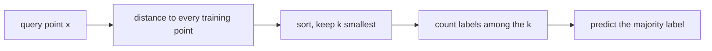

# K-Nearest Neighbors

> To classify a point, look at its closest neighbors and let them vote. No training, all memory.

**Type:** Build
**Languages:** Python
**Prerequisites:** Phase 01 (Linear Algebra: Norms and Distances), Phase 04 (ML Fundamentals: Cross-Validation, Feature Scaling and Encoding), Phase 06 Lesson 01 (Logistic Regression)
**Time:** ~60 minutes

## Learning Objectives

- Implement a vectorized k-nearest neighbors classifier in NumPy using the `||a||^2 + ||b||^2 - 2 a.b` distance trick
- Explain how `k` controls the bias-variance tradeoff and choose it with k-fold cross-validation
- Demonstrate why feature scaling is mandatory for distance-based models
- Measure the curse of dimensionality and explain why KNN degrades in high dimensions

## The Problem

Logistic regression assumes the boundary between classes is a straight line. Often it is not. Before you reach for a complex model, there is a simpler idea: points that are close in feature space probably share a label. A new flower whose petals look like the setosa petals you have seen is probably a setosa.

K-nearest neighbors (KNN) turns that idea into a classifier with zero training. It stores the training set and, at prediction time, finds the `k` closest examples and takes a majority vote. It can draw any boundary shape, it handles many classes natively, and it is the classic baseline for "is there any local structure in this data at all". It is also the engine behind recommendation lookups and vector search, where the hard part is finding neighbors fast.

## The Concept

### The algorithm



That is the whole model. "Fitting" is just storing `X_train` and `y_train`. All the cost moves to prediction: `O(n_train * d)` per query with brute force.

### Distances

Euclidean (L2) is the default:

```
d(a, b) = sqrt( sum_j (a_j - b_j)^2 )
```

Manhattan (L1) sums absolute differences and is less dominated by a single large coordinate:

```
d(a, b) = sum_j |a_j - b_j|
```

To compute all pairwise Euclidean distances without Python loops, expand the square:

```
||a - b||^2 = ||a||^2 + ||b||^2 - 2 a.b
```

The `a.b` part for all pairs is one matrix multiplication `A @ B.T`.

### Choosing k

```
k = 1         k = 15        k = n
jagged        smooth        constant
low bias      balanced      high bias
high variance               (always majority class)
```

With `k = 1` every training point is classified correctly (it is its own neighbor), so training accuracy is meaningless. Large `k` averages over far-away points and blurs the boundary. You pick `k` with cross-validation, and odd values avoid ties in binary problems.

### Weighted votes

A neighbor at distance 0.1 is more informative than one at 2.0. Distance weighting gives each neighbor a vote of `1 / d`:

```
score(class c) = sum over neighbors with label c of 1 / d_i
```

### Scaling

Distances add up raw coordinate differences. If one feature is measured in millimetres and another in metres, the millimetre feature dominates every distance and the others are ignored. Standardize each feature (zero mean, unit variance, statistics from the training set only) before KNN. This is not an optional tweak, it changes which points are neighbors.

### The curse of dimensionality

In high dimensions all points become roughly equally far apart. For uniform random points, the ratio of the nearest to the farthest distance creeps toward 1 as dimension grows. When every point is "about as near" as every other, "nearest neighbor" stops meaning anything. KNN works best with a moderate number of informative features; reduce dimensions first (Phase 09) if you have hundreds.

## Build It

### Step 1: Pairwise distances

```python
def pairwise_euclidean(A, B):
    squared = (A**2).sum(axis=1)[:, None] + (B**2).sum(axis=1)[None, :] - 2 * A @ B.T
    return np.sqrt(np.maximum(squared, 0.0))


def pairwise_manhattan(A, B):
    return np.abs(A[:, None, :] - B[None, :, :]).sum(axis=2)
```

The `np.maximum(..., 0)` guards against tiny negative values from floating-point cancellation. Manhattan uses broadcasting into a `(n_query, n_train, d)` array, fine for small data.

On Iris (150 flowers, 4 measurements, 3 species), the 5 nearest training points to the first test flower are all label 1, and so is the truth.

### Step 2: The classifier

```python
class KNNClassifierScratch:
    def __init__(self, k=5, metric="euclidean", weighted=False):
        self.k = k
        self.metric = metric
        self.weighted = weighted

    def fit(self, X, y):
        self.X_train = X
        self.y_train = y
        self.classes = np.unique(y)
        return self

    def distances(self, X):
        if self.metric == "manhattan":
            return pairwise_manhattan(X, self.X_train)
        return pairwise_euclidean(X, self.X_train)

    def predict(self, X):
        dist = self.distances(X)
        neighbor_idx = np.argsort(dist, axis=1, kind="stable")[:, : self.k]
        neighbor_labels = self.y_train[neighbor_idx]
        neighbor_dist = np.take_along_axis(dist, neighbor_idx, axis=1)
        if self.weighted:
            votes_weight = 1.0 / (neighbor_dist + 1e-9)
        else:
            votes_weight = np.ones_like(neighbor_dist)
        scores = np.zeros((X.shape[0], len(self.classes)))
        for class_position, label in enumerate(self.classes):
            scores[:, class_position] = (votes_weight * (neighbor_labels == label)).sum(axis=1)
        return self.classes[np.argmax(scores, axis=1)]
```

`fit` does nothing but remember. `predict` builds a `(n_query, n_classes)` vote table and takes the argmax.

### Step 3: Show that scaling matters

Multiply the first feature by 1000 (as if you switched units) and compare:

```python
X_train_big[:, 0] *= 1000
raw = KNNClassifierScratch(k=5).fit(X_train_big, y_train)
X_tr_s, X_te_s = standardize(X_train_big, X_test_big)
scaled = KNNClassifierScratch(k=5).fit(X_tr_s, y_train)
```

Unscaled accuracy drops to about 0.78 because sepal length (the least useful feature) now decides every distance. Standardized, it is back above 0.93.

### Step 4: Choose k with cross-validation

```python
def k_fold_accuracy(X, y, k, n_folds, seed):
    rng = np.random.default_rng(seed)
    folds = np.array_split(rng.permutation(len(y)), n_folds)
    scores = []
    for fold in folds:
        mask = np.ones(len(y), dtype=bool)
        mask[fold] = False
        X_tr, X_va = standardize(X[mask], X[fold])
        model = KNNClassifierScratch(k=k).fit(X_tr, y[mask])
        scores.append(accuracy(y[fold], model.predict(X_va)))
    return round(float(np.mean(scores)), 6)
```

Notice that standardization is fit inside each fold, so the validation fold never leaks into the scaling statistics. Accuracy stays flat around 0.97 for `k` from 1 to 11 and then falls sharply: at `k = 51` you are averaging over a third of the training set. Among tied scores the script keeps the largest `k` (11), the smoother boundary.

### Step 5: Watch distances concentrate

```python
for dim in [2, 10, 100, 1000]:
    points = rng.uniform(size=(500, dim))
    d = pairwise_euclidean(points[:1], points[1:])[0]
    print(f"  dim {dim:4d} | nearest/farthest distance ratio {d.min() / d.max():.3f}")
```

The ratio goes from about 0.015 in 2D to 0.90 in 1000D. In high dimensions your nearest neighbor is almost as far as your farthest.

## Use It

```python
from sklearn.neighbors import KNeighborsClassifier

sk_model = KNeighborsClassifier(n_neighbors=11).fit(X_tr_s, y_train)
sk_pred = sk_model.predict(X_te_s)
```

Predictions agree 100% with your implementation. Useful parameters:

- `weights="distance"` is the `1/d` voting you built
- `metric="manhattan"` or `p=1` switches to L1
- `algorithm="kd_tree"` or `"ball_tree"` builds a spatial index so each query does not scan every point; it helps in low dimensions and stops helping above roughly 20 features
- `KNeighborsRegressor` averages neighbor targets instead of voting

Wrap scaling and KNN in a `Pipeline` (Phase 10) so cross-validation refits the scaler per fold automatically. For millions of vectors, approximate nearest neighbor libraries such as FAISS trade a little accuracy for orders of magnitude in speed.

## Exercises

1. **Easy.** Compute training accuracy for `k = 1` and explain why it is always 1.0 (unless there are duplicate points with different labels).
2. **Medium.** Implement `KNNRegressorScratch` that predicts the mean (or distance-weighted mean) target of the `k` neighbors. Test it on `sklearn.datasets.load_diabetes` and compare against Ridge regression from Phase 05.
3. **Hard.** Add 50 columns of pure noise to Iris and rerun the cross-validation curve. How much does accuracy drop? Then implement a simple wrapper that drops one feature at a time and keeps the subset with the best CV score. How many noise columns survive?

## Key Terms

| Term | What people say | What it actually means |
|------|----------------|----------------------|
| K-nearest neighbors | "Ask the neighbors" | Predict by majority vote (or average) of the k closest training examples |
| Lazy learner | "No training" | A model that defers all computation to prediction time by storing the training data |
| Euclidean distance | "Straight-line distance" | Square root of the sum of squared coordinate differences (L2) |
| Manhattan distance | "City-block distance" | Sum of absolute coordinate differences (L1) |
| Distance weighting | "Closer counts more" | Each neighbor votes with weight `1/d` instead of 1 |
| Curse of dimensionality | "High-D is weird" | As dimension grows, distances concentrate and data becomes sparse, so locality loses meaning |
| KD-tree / Ball tree | "Fast neighbor search" | Spatial indexes that prune whole regions during neighbor search |
| Feature scaling | "Normalize first" | Putting features on comparable ranges so no single unit dominates the distance |

## Further Reading

- [An Introduction to Statistical Learning (ISLR)](https://www.statlearning.com/) - Chapters 2 and 4 use KNN to explain flexibility and the bias-variance tradeoff
- [StatQuest: K-nearest neighbors, Clearly Explained](https://www.youtube.com/watch?v=HVXime0nQeI) - short visual intuition for voting and choosing k
- [scikit-learn: Nearest Neighbors](https://scikit-learn.org/stable/modules/neighbors.html) - brute force vs KD-tree vs ball tree and when each wins
- [The Elements of Statistical Learning (ESL)](https://hastie.su.domains/ElemStatLearn/) - Section 2.5 on local methods in high dimensions
