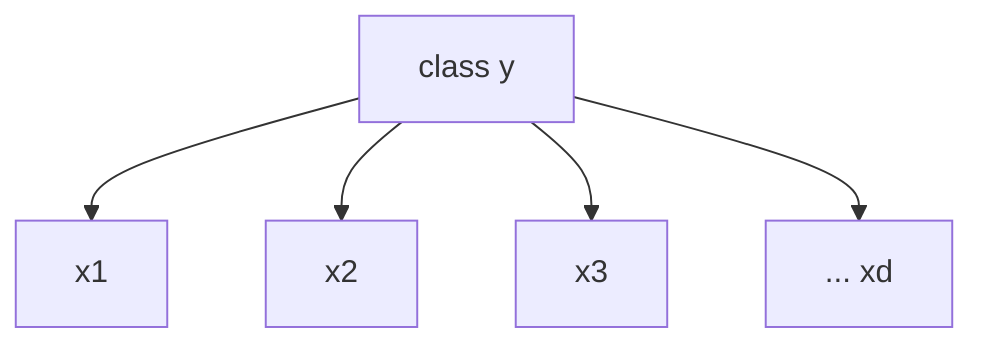

# Naive Bayes

> Assume every feature is independent given the class. The assumption is wrong, and the classifier works anyway.

**Type:** Build
**Languages:** Python
**Prerequisites:** Phase 03 (Probability and Statistics: Bayes Theorem, Random Variables and Distributions, Maximum Likelihood), Phase 06 Lesson 01 (Logistic Regression)
**Time:** ~60 minutes

## Learning Objectives

- Apply Bayes' theorem to classification and explain the conditional independence ("naive") assumption
- Implement Gaussian Naive Bayes for continuous features and Multinomial Naive Bayes for word counts in NumPy
- Explain why all computation happens in log space and how Laplace smoothing prevents zero probabilities
- Compare generative classifiers (Naive Bayes) with discriminative ones (logistic regression)

## The Problem

You need a spam filter. You have a few thousand labelled emails and a vocabulary of 50,000 words. Logistic regression would need to learn 50,000 weights by iterative optimization. You want something that trains in one pass, works with very little data, and scales to huge vocabularies.

Naive Bayes does this. Training is counting: how often each word appears in spam and in ham. Prediction is adding up a few logs. It was the first widely deployed spam filter and is still a strong baseline for text classification, especially when data is small.

## The Concept

### Bayes' theorem as a classifier

You want the class with the highest posterior probability given the features:

```
P(y | x) = P(x | y) P(y) / P(x)
```

- `P(y)` prior: how common the class is
- `P(x | y)` likelihood: how typical these features are for that class
- `P(x)` evidence: the same for every class, so you can ignore it when comparing

```
predict  argmax_y  P(y) * P(x | y)
```

This is a **generative** model: it models how each class generates data, then inverts with Bayes. Logistic regression is **discriminative**: it models `P(y | x)` directly.

### The naive assumption

`P(x | y)` for 13 or 50,000 features is a joint distribution you cannot estimate from limited data. Naive Bayes assumes features are independent given the class:

```
P(x_1, ..., x_d | y) = P(x_1 | y) * P(x_2 | y) * ... * P(x_d | y)
```



Each feature only depends on the class, not on the other features. "free" and "money" in spam are clearly correlated, so the assumption is false. The probabilities it outputs are therefore often overconfident, but the **ranking** of classes is frequently correct, and ranking is all you need for the argmax.

### Log space

Multiplying hundreds of probabilities below 1 underflows to 0.0 in floating point. Take logs and the product becomes a sum:

```
score(y) = log P(y) + sum_j log P(x_j | y)
```

To turn scores back into probabilities, subtract the max score before exponentiating (the log-sum-exp trick) so nothing overflows.

### Gaussian Naive Bayes

For continuous features, model each `P(x_j | y)` as a normal distribution with a per-class mean and variance:

```
log P(x_j | y) = -0.5 * log(2 pi var_jy) - (x_j - mean_jy)^2 / (2 var_jy)
```

Training: compute class means, class variances, and class frequencies. That is it.

### Multinomial Naive Bayes

For word counts, model each class as a bag of words with word probabilities `theta_wy`:

```
theta_wy = (count of word w in class y + alpha) / (total words in class y + alpha * V)
score(y) = log P(y) + sum_w count_w(x) * log theta_wy
```

The score is a dot product between the document's count vector and the class's log word probabilities, so prediction is one matrix multiplication.

### Laplace smoothing

If "lunch" never appeared in spam during training, `theta_lunch,spam = 0`, its log is `-inf`, and a single word vetoes the whole class. Adding `alpha` (usually 1) to every count keeps every probability positive. `alpha` is a hyperparameter; smaller values trust the observed counts more.

## Build It

### Step 1: Bayes rule by hand

30% of email is spam, 60% of spam contains "free", 5% of ham contains "free":

```
P(spam | free) = 0.6 * 0.3 / (0.6 * 0.3 + 0.05 * 0.7) = 0.837
```

One word moves you from 30% to 84%. Naive Bayes just repeats this for every feature.

### Step 2: Gaussian Naive Bayes

```python
class GaussianNBScratch:
    def __init__(self, var_smoothing=1e-9):
        self.var_smoothing = var_smoothing

    def fit(self, X, y):
        self.classes = np.unique(y)
        epsilon = self.var_smoothing * X.var(axis=0).max()
        self.means = np.array([X[y == c].mean(axis=0) for c in self.classes])
        self.variances = np.array([X[y == c].var(axis=0) + epsilon for c in self.classes])
        self.log_priors = np.log(np.array([np.mean(y == c) for c in self.classes]))
        return self

    def joint_log_likelihood(self, X):
        scores = []
        for mean, var, log_prior in zip(self.means, self.variances, self.log_priors):
            log_gauss = -0.5 * np.log(2 * np.pi * var) - (X - mean) ** 2 / (2 * var)
            scores.append(log_prior + log_gauss.sum(axis=1))
        return np.column_stack(scores)

    def predict_proba(self, X):
        jll = self.joint_log_likelihood(X)
        jll = jll - jll.max(axis=1, keepdims=True)
        probs = np.exp(jll)
        return probs / probs.sum(axis=1, keepdims=True)

    def predict(self, X):
        return self.classes[np.argmax(self.joint_log_likelihood(X), axis=1)]
```

The `epsilon` term is the same variance floor scikit-learn uses, so a feature with zero variance inside a class does not divide by zero. On the wine dataset (178 wines, 13 chemical measurements, 3 cultivars) this scores 100% on the 30% test split. Look at the printed posteriors: they are essentially 0 or 1. That overconfidence is the independence assumption at work, since 13 correlated features are counted as 13 independent pieces of evidence.

### Step 3: Why log space

```python
raw_product = np.prod(np.full(500, 0.01))
log_sum = np.sum(np.log(np.full(500, 0.01)))
```

The product is exactly `0.0` (underflow). The log sum is `-2302.59`, perfectly representable.

### Step 4: Multinomial Naive Bayes for text

```python
class MultinomialNBScratch:
    def __init__(self, alpha=1.0):
        self.alpha = alpha

    def fit(self, X, y):
        self.classes = np.unique(y)
        counts = np.array([X[y == c].sum(axis=0) for c in self.classes]) + self.alpha
        self.log_word_probs = np.log(counts / counts.sum(axis=1, keepdims=True))
        self.log_priors = np.log(np.array([np.mean(y == c) for c in self.classes]))
        return self

    def joint_log_likelihood(self, X):
        return X @ self.log_word_probs.T + self.log_priors

    def predict(self, X):
        return self.classes[np.argmax(self.joint_log_likelihood(X), axis=1)]
```

The script builds a tiny bag-of-words matrix from ten emails (five spam, five ham) with `build_vocabulary` and `bag_of_words`, then classifies four new messages. "free money offer" is spam, "report for the meeting" is ham.

### Step 5: Laplace smoothing

```python
no_smoothing = MultinomialNBScratch(alpha=1e-12).fit(X_text_train, train_labels)
lunch = vocabulary["lunch"]
print(np.exp(no_smoothing.log_word_probs[1, lunch]), np.exp(mnb.log_word_probs[1, lunch]))
```

Without smoothing, `P('lunch' | spam)` is `5e-14`, effectively zero. "claim free lunch" still comes out spam, but with `P(spam) = 1.0000000000`, absurd certainty from a three-word message. With `alpha = 1`, `P('lunch' | spam) = 0.02` and the posterior is a sensible 0.90.

## Use It

```python
from sklearn.naive_bayes import GaussianNB, MultinomialNB

sk_gnb = GaussianNB().fit(X_train, y_train)
sk_mnb = MultinomialNB(alpha=1.0).fit(X_text_train, train_labels)
```

The scratch Gaussian model matches scikit-learn's probabilities to about `1e-15`, and the multinomial predictions are identical. On real text you would build the count matrix with `sklearn.feature_extraction.text.CountVectorizer` (or `TfidfVectorizer`) and feed it straight into `MultinomialNB`; sparse matrices are supported, so a 50,000-word vocabulary is fine. Other variants:

- `BernoulliNB` models word presence/absence instead of counts
- `ComplementNB` estimates parameters from the complement of each class and is more robust with imbalanced text classes
- `CategoricalNB` handles categorical features directly

Do not trust Naive Bayes probabilities as calibrated. If you need real probabilities, wrap it in `CalibratedClassifierCV`.

## Exercises

1. **Easy.** Fit `GaussianNBScratch` on Iris and print the class means and variances. Which feature has the most different means across classes? Is it also the feature KNN found most useful?
2. **Medium.** Implement `BernoulliNBScratch`: binarize the count matrix and use `P(x_j | y) = theta_jy^x_j (1 - theta_jy)^(1 - x_j)`. Note that absent words now contribute to the score. Compare predictions with `MultinomialNBScratch` on the toy emails.
3. **Hard.** Load `sklearn.datasets.fetch_20newsgroups` for two categories, vectorize with `CountVectorizer`, and compare `MultinomialNB` with logistic regression for training set sizes of 20, 100, 500 and all documents. Plot test accuracy vs size. You should see Naive Bayes win with little data and logistic regression catch up later (Ng and Jordan, 2001).

## Key Terms

| Term | What people say | What it actually means |
|------|----------------|----------------------|
| Naive Bayes | "The spam filter algorithm" | A generative classifier using Bayes' theorem with features assumed independent given the class |
| Prior | "Base rate" | `P(y)`, the class frequency before seeing features |
| Likelihood | "How typical the features are" | `P(x \| y)`, the probability of the features under a class |
| Posterior | "The answer" | `P(y \| x)`, the class probability after seeing the features |
| Conditional independence | "The naive part" | Features are independent once you know the class: `P(x \| y) = prod P(x_j \| y)` |
| Generative model | "Models the data" | Learns `P(x \| y)` and `P(y)` and inverts with Bayes |
| Discriminative model | "Models the boundary" | Learns `P(y \| x)` directly, like logistic regression |
| Laplace smoothing | "Add-one" | Adding `alpha` to every count so unseen features never get probability zero |
| Log-sum-exp | "Stable softmax" | Subtract the max log score before exponentiating to avoid overflow |

## Further Reading

- [StatQuest: Naive Bayes, Clearly Explained](https://www.youtube.com/watch?v=O2L2Uv9pdDA) - the spam example with counts and smoothing
- [scikit-learn: Naive Bayes](https://scikit-learn.org/stable/modules/naive_bayes.html) - Gaussian, Multinomial, Complement, Bernoulli and Categorical variants
- [Ng and Jordan, On Discriminative vs. Generative Classifiers (NeurIPS 2001)](https://papers.nips.cc/paper/2001/hash/7b7a53e239400a13bd6be6c91c4f6c4e-Abstract.html) - why Naive Bayes wins with small data and logistic regression with large
- [Jurafsky and Martin, Speech and Language Processing, Chapter 4](https://web.stanford.edu/~jurafsky/slp3/) - Naive Bayes for text classification and sentiment
