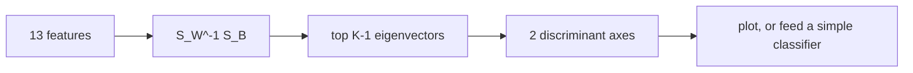

# LDA and QDA

> Model each class as a Gaussian cloud. Shared shape gives a straight boundary, separate shapes give a curved one.

**Type:** Build
**Languages:** Python
**Prerequisites:** Phase 01 (Linear Algebra: Matrix Multiplication, Linear Systems and Inverse, Determinant, Eigenvalues and Eigenvectors), Phase 03 (Probability and Statistics: Bayes Theorem), Phase 06 Lesson 03 (Naive Bayes)
**Time:** ~75 minutes

## Learning Objectives

- Derive Linear and Quadratic Discriminant Analysis from Bayes' theorem with multivariate Gaussian class densities
- Implement LDA (pooled covariance, linear discriminant functions) and QDA (per-class covariance, Mahalanobis distance) in NumPy
- Explain when the extra flexibility of QDA helps and when its extra parameters hurt
- Use LDA as a supervised dimensionality reduction that projects data onto at most `K - 1` axes

## The Problem

Gaussian Naive Bayes models each class as a Gaussian but throws away every correlation between features: it uses a diagonal covariance. In the wine data, alcohol and color intensity move together, and Naive Bayes counts them as two independent pieces of evidence.

What if you keep the full covariance matrix? You get two classic classifiers. **LDA** assumes all classes share one covariance and produces linear boundaries. **QDA** gives every class its own covariance and produces quadratic boundaries. Both have closed-form training (means and covariances, no gradient descent), both output probabilities, and LDA doubles as a dimensionality reduction method that is still used in biometrics, chemometrics and as a preprocessing step.

## The Concept

### Gaussian class densities

Assume each class `k` generates points from a multivariate normal:

```
P(x | y = k) = exp( -0.5 (x - mu_k)^T Sigma_k^-1 (x - mu_k) ) / sqrt( (2 pi)^d |Sigma_k| )
```

The term `(x - mu_k)^T Sigma_k^-1 (x - mu_k)` is the squared **Mahalanobis distance**: Euclidean distance after stretching space so the class cloud becomes a round ball. Bayes' theorem then says pick the class with the largest

```
delta_k(x) = log P(x | y = k) + log pi_k
```

### QDA: every class its own covariance

Drop the constant and you get the quadratic discriminant:

```
delta_k(x) = -0.5 log|Sigma_k| - 0.5 (x - mu_k)^T Sigma_k^-1 (x - mu_k) + log pi_k
```

The boundary `delta_1(x) = delta_2(x)` is quadratic in `x`: ellipses, parabolas, hyperbolas.

### LDA: one shared covariance

If every class has the same `Sigma`, the `log|Sigma|` term and the `x^T Sigma^-1 x` term are identical for every class and cancel when you compare classes. What is left is linear in `x`:

```
delta_k(x) = x^T Sigma^-1 mu_k - 0.5 mu_k^T Sigma^-1 mu_k + log pi_k
           = w_k^T x + b_k
```

The shared `Sigma` is the **pooled within-class covariance**: center each class at its own mean, stack all residuals, divide by `n - K`.

```
            Naive Bayes        LDA                 QDA
covariance  diagonal, per k    full, shared        full, per k
boundary    quadratic*         linear              quadratic
parameters  2Kd                Kd + d(d+1)/2       Kd + K d(d+1)/2
```

*Gaussian NB's boundary is quadratic but axis-aligned.

### Bias-variance view

QDA estimates `K` covariance matrices. With `d = 13` features that is 91 numbers per class, 273 total, versus 91 for LDA. With few samples per class QDA's estimates are noisy (high variance). LDA is more biased (wrong if shapes really differ) but much more stable. scikit-learn's `reg_param` for QDA and `shrinkage` for LDA interpolate between the extremes.

### LDA as projection (Fisher's view)

Fisher asked a different question: find the direction `w` that maximizes the spread between class means relative to the spread within classes:

```
J(w) = (w^T S_B w) / (w^T S_W w)
```

`S_B` is the between-class scatter of the class means, `S_W` the within-class scatter. The solutions are the top eigenvectors of `S_W^-1 S_B`. `S_B` has rank at most `K - 1`, so with 3 classes you get at most 2 useful axes, no matter how many features you start with.



Unlike PCA (Phase 09), which keeps directions of maximum total variance, LDA keeps directions that separate the labels.

## Build It

### Step 1: LDA

```python
class LDAScratch:
    def fit(self, X, y):
        self.classes = np.unique(y)
        n_samples, n_features = X.shape
        self.means = np.array([X[y == c].mean(axis=0) for c in self.classes])
        self.priors = np.array([np.mean(y == c) for c in self.classes])
        pooled = np.zeros((n_features, n_features))
        for c, mean in zip(self.classes, self.means):
            centered = X[y == c] - mean
            pooled += centered.T @ centered
        self.covariance = pooled / (n_samples - len(self.classes))
        precision = np.linalg.inv(self.covariance)
        self.coef = self.means @ precision
        self.intercept = -0.5 * np.sum(self.coef * self.means, axis=1) + np.log(self.priors)
        return self

    def decision_function(self, X):
        return X @ self.coef.T + self.intercept

    def predict(self, X):
        return self.classes[np.argmax(self.decision_function(X), axis=1)]
```

Row `k` of `self.coef` is `w_k = Sigma^-1 mu_k` (the covariance is symmetric, so `mu_k^T Sigma^-1` is the same vector). Training is two passes over the data and one matrix inverse. On the standardized wine data, LDA gets 100% on the test split.

### Step 2: QDA

```python
class QDAScratch:
    def __init__(self, reg=0.0):
        self.reg = reg

    def fit(self, X, y):
        self.classes = np.unique(y)
        n_features = X.shape[1]
        self.means, self.precisions, self.log_dets, self.log_priors = [], [], [], []
        for c in self.classes:
            Xc = X[y == c]
            mean = Xc.mean(axis=0)
            cov = np.cov(Xc, rowvar=False) + self.reg * np.eye(n_features)
            sign, log_det = np.linalg.slogdet(cov)
            self.means.append(mean)
            self.precisions.append(np.linalg.inv(cov))
            self.log_dets.append(log_det)
            self.log_priors.append(np.log(len(Xc) / len(X)))
        return self

    def decision_function(self, X):
        scores = []
        for mean, precision, log_det, log_prior in zip(
            self.means, self.precisions, self.log_dets, self.log_priors
        ):
            centered = X - mean
            mahalanobis = np.einsum("ij,jk,ik->i", centered, precision, centered)
            scores.append(-0.5 * log_det - 0.5 * mahalanobis + log_prior)
        return np.column_stack(scores)
```

`slogdet` returns the log-determinant directly, avoiding overflow from multiplying 13 eigenvalues. The `einsum` computes `c_i^T P c_i` for every row `i` at once. The `reg` term adds to the diagonal, which keeps the covariance invertible when a class has fewer samples than features.

### Step 3: Where QDA wins

```python
def make_curved_classes(n_per_class, seed):
    rng = np.random.default_rng(seed)
    tight = rng.multivariate_normal([0, 0], [[0.3, 0.0], [0.0, 0.3]], n_per_class)
    wide = rng.multivariate_normal([0.5, 0.5], [[4.0, 1.5], [1.5, 2.0]], n_per_class)
    ...
```

One class is a small round cloud, the other a wide tilted ellipse almost centered on it. No straight line separates a dot from the ring around it. LDA scores about 0.76, QDA about 0.91: its boundary is an ellipse around the tight class.

### Step 4: LDA as dimensionality reduction

```python
def projection_directions(self, n_components):
    overall_mean = self.means.T @ self.priors
    between = sum(
        p * np.outer(m - overall_mean, m - overall_mean) for p, m in zip(self.priors, self.means)
    )
    eigenvalues, eigenvectors = np.linalg.eig(np.linalg.inv(self.covariance) @ between)
    order = np.argsort(eigenvalues.real)[::-1]
    return eigenvectors.real[:, order[:n_components]], eigenvalues.real[order[:n_components]]
```

The matrix is not symmetric, so `eig` may return complex numbers with zero imaginary part; `.real` drops them. The two axes carry about 72% and 28% of the separation, and the three class centroids sit far apart on the 2D plane.

## Use It

```python
from sklearn.discriminant_analysis import LinearDiscriminantAnalysis, QuadraticDiscriminantAnalysis

sk_lda = LinearDiscriminantAnalysis(solver="lsqr").fit(X_train, y_train)
sk_qda = QuadraticDiscriminantAnalysis().fit(X_train, y_train)
reduced = LinearDiscriminantAnalysis(n_components=2).fit(X_train, y_train)
X_2d = reduced.transform(X_train)
```

Predictions agree 100% with your versions, and `explained_variance_ratio_` matches your eigenvalue shares `[0.721, 0.279]`. Practical notes:

- `solver="svd"` (default) never forms the covariance explicitly and is the most stable; `"lsqr"` or `"eigen"` are required for `shrinkage`
- `shrinkage="auto"` uses the Ledoit-Wolf estimate, a large win when features are many and samples few
- `QuadraticDiscriminantAnalysis(reg_param=0.1)` regularizes each class covariance toward the identity
- LDA with equal covariances and logistic regression produce the same functional form (linear log-odds); LDA is more efficient when the Gaussian assumption holds, logistic regression more robust when it does not

## Exercises

1. **Easy.** Fit `LDAScratch` and `GaussianNBScratch` (previous lesson) on the curved two-class data. Which does better, and why does Naive Bayes have an advantage over LDA here?
2. **Medium.** Train QDA on wine with only 10 training samples per class (fewer than 13 features). Show that the covariance is singular, then sweep `reg` in `[0.01, 0.1, 1.0]` and report test accuracy.
3. **Hard.** Implement LDA shrinkage: replace `Sigma` with `(1 - s) Sigma + s * (trace(Sigma)/d) I`. On a dataset with 50 features and 30 samples per class (generate it), plot test accuracy against `s` from 0 to 1 and compare your best `s` with `LinearDiscriminantAnalysis(solver="lsqr", shrinkage="auto")`.

## Key Terms

| Term | What people say | What it actually means |
|------|----------------|----------------------|
| LDA | "Linear discriminant" | Gaussian class densities with one shared covariance; gives linear boundaries |
| QDA | "Quadratic discriminant" | Gaussian class densities with a covariance per class; gives quadratic boundaries |
| Discriminant function | "Class score" | `delta_k(x)`, the log posterior up to a constant; predict the argmax |
| Pooled covariance | "Shared spread" | Within-class covariance computed from all classes' residuals, divided by `n - K` |
| Mahalanobis distance | "Covariance-aware distance" | `sqrt((x - mu)^T Sigma^-1 (x - mu))`, distance in units of the class's own spread |
| Fisher's criterion | "Separate means, tight classes" | Ratio of between-class to within-class scatter along a direction |
| Between-class scatter | "How far apart the means are" | `S_B = sum_k pi_k (mu_k - mu)(mu_k - mu)^T`, rank at most `K - 1` |
| Shrinkage | "Regularized covariance" | Blending the sample covariance with a simple target to reduce estimation variance |

## Further Reading

- [An Introduction to Statistical Learning (ISLR)](https://www.statlearning.com/) - Section 4.4 compares LDA, QDA, Naive Bayes and logistic regression
- [The Elements of Statistical Learning (ESL)](https://hastie.su.domains/ElemStatLearn/) - Section 4.3 derives LDA, QDA and reduced-rank (Fisher) LDA
- [StatQuest: Linear Discriminant Analysis (LDA) clearly explained](https://www.youtube.com/watch?v=azXCzI57Yfc) - visual intuition for the projection view
- [scikit-learn: Linear and Quadratic Discriminant Analysis](https://scikit-learn.org/stable/modules/lda_qda.html) - math, solvers and shrinkage
