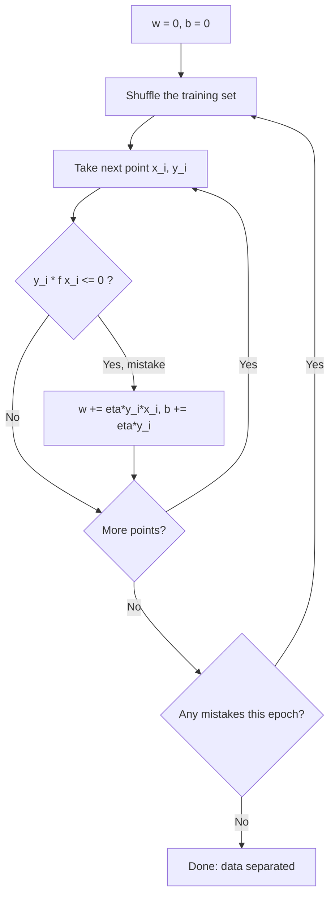

# The Perceptron

> Guess, check, and nudge the line toward every point you got wrong. That is the oldest learning algorithm there is.

**Type:** Build
**Languages:** Python
**Prerequisites:** Phase 01 (Linear Algebra), Phase 04 (ML Fundamentals), Phase 06 Lesson 01 (Logistic Regression)
**Time:** ~60 minutes

## Learning Objectives

- Implement the perceptron learning rule in NumPy and explain why each update moves the boundary toward the misclassified point
- State the perceptron convergence theorem and compute Novikoff's mistake bound for a dataset
- Explain why the plain perceptron never settles on non-separable data, and fix it with the averaged perceptron
- Show why a single perceptron cannot learn XOR, and how one extra feature makes it learnable

## The Problem

You want a classifier that splits two classes with a straight line (or a hyperplane in more dimensions). Logistic regression does this by minimizing a smooth loss with gradient descent. But there is an even simpler idea, invented by Frank Rosenblatt in 1957: look at one example at a time, and only change anything when you get it wrong.

The perceptron is worth learning for three reasons. It is the ancestor of every neural network: a neuron is a perceptron with a smoother activation. It is the simplest example of an online learner, one that updates from a stream of examples. And its failure modes (no convergence on overlapping data, no way to represent XOR) motivate both support vector machines and the kernel trick, which come next in this phase.

## The Concept

### The model

The perceptron is a linear classifier with labels in `{-1, +1}`:

```
f(x) = w . x + b
y_hat = +1 if f(x) >= 0 else -1
```

The boundary is the hyperplane `w . x + b = 0`. The vector `w` is perpendicular to it and points toward the positive side.

### The learning rule

A point `(x_i, y_i)` is classified correctly when `y_i * f(x_i) > 0`: the sign of the score matches the label. When it is not, you update:

```
w <- w + eta * y_i * x_i
b <- b + eta * y_i
```

Why does this help? After the update, the score on that same point becomes:

```
y_i * f_new(x_i) = y_i * f_old(x_i) + eta * (||x_i||^2 + 1)
```

The second term is always positive, so the score on the mistaken point moves toward the correct sign. The boundary rotates and shifts toward that point.



There is no loss function being minimized with a learning rate schedule. In fact, when you start from zero, `eta` only scales `w` and `b` together, so it does not change any prediction. Most implementations just use `eta = 1`.

### The convergence theorem

If the data is linearly separable, the perceptron stops after a finite number of mistakes. Novikoff (1962) proved the bound:

```
mistakes <= (R / gamma)^2
```

- `R` is the largest norm of any input (with the bias folded in as an extra constant feature)
- `gamma` is the margin: the distance from the separating hyperplane (unit-norm) to the closest point

The bound does not depend on the number of samples or the dimension. Wide margins mean few mistakes. Narrow margins mean many. If you plug in the margin of any separator you know (not necessarily the best one), you still get a valid, looser bound.

### When the data is not separable

If no hyperplane separates the classes, there is always some point that is wrong, so the perceptron updates forever. The weights keep jumping between solutions, and whichever one you stop at is somewhat random.

The **averaged perceptron** fixes this cheaply: keep a running sum of `w` and `b` after every example and return their average. The average is a stable boundary that behaves much like a large-margin classifier, and it usually generalizes better than the last iterate.

### The XOR wall

XOR places `+1` at `(0,1)` and `(1,0)`, and `-1` at `(0,0)` and `(1,1)`. No straight line separates them. Minsky and Papert pointed this out in 1969, and it slowed neural network research for over a decade.

```
x2
1 |  +      -
  |
0 |  -      +
  +-----------  x1
     0      1
```

The fix is to change the features, not the algorithm. Add `x3 = x1 * x2`. In 3-D the four points become separable, and the perceptron converges. Two ways to get there: stack perceptrons into layers (neural networks), or map inputs into a richer feature space implicitly (the kernel trick, Lesson 07).

## Build It

### Step 1: Generate separable data

Two Gaussian blobs centered at `(2, 2)` and `(-2, -2)`, labeled `+1` and `-1`.

```python
def make_blobs_2d(n_per_class, separation, seed):
    rng = np.random.default_rng(seed)
    positives = rng.normal(loc=[separation, separation], scale=1.0, size=(n_per_class, 2))
    negatives = rng.normal(loc=[-separation, -separation], scale=1.0, size=(n_per_class, 2))
    X = np.vstack([positives, negatives])
    y = np.concatenate([np.ones(n_per_class), -np.ones(n_per_class)])
    order = rng.permutation(len(y))
    return X[order], y[order]
```

### Step 2: The perceptron

The whole learning algorithm is the `if` inside the loop.

```python
class Perceptron:
    def fit(self, X, y):
        rng = np.random.default_rng(self.seed)
        self.weights = np.zeros(X.shape[1])
        self.bias = 0.0
        self.mistakes_per_epoch = []
        for _ in range(self.max_epochs):
            mistakes = 0
            for i in rng.permutation(len(y)):
                if y[i] * (X[i] @ self.weights + self.bias) <= 0:
                    self.weights += self.learning_rate * y[i] * X[i]
                    self.bias += self.learning_rate * y[i]
                    mistakes += 1
            self.mistakes_per_epoch.append(mistakes)
            if mistakes == 0:
                break
        return self

    def predict(self, X):
        return np.where(X @ self.weights + self.bias >= 0, 1.0, -1.0)
```

Note the `<= 0`: a point exactly on the boundary counts as a mistake. Without it, the first point would never trigger an update because `w = 0` gives a score of zero.

On the separable data the run prints something like:

```
Mistakes per epoch: [2, 1, 0]
Converged after 3 epochs
Train accuracy: 1.000
Test accuracy:  0.983
```

### Step 3: Check Novikoff's bound

```python
def novikoff_bound(X, y, weights, bias):
    augmented = np.hstack([X, np.ones((len(X), 1))])
    direction = np.append(weights, bias)
    direction = direction / np.linalg.norm(direction)
    radius = np.max(np.linalg.norm(augmented, axis=1))
    margin = np.min(y * (augmented @ direction))
    return radius, margin, (radius / margin) ** 2
```

You use the margin of the separator you just found, so the bound is loose (thousands) while the actual number of mistakes is tiny. The theorem is a worst case guarantee, not a prediction.

### Step 4: Overlapping classes and the averaged perceptron

Move the blobs closer (`separation=0.8`) so they overlap. The plain perceptron keeps making 20-30 mistakes per epoch forever. The averaged version accumulates every intermediate weight vector:

```python
class AveragedPerceptron(Perceptron):
    def fit(self, X, y):
        rng = np.random.default_rng(self.seed)
        weights = np.zeros(X.shape[1])
        bias = 0.0
        weights_sum = np.zeros(X.shape[1])
        bias_sum = 0.0
        steps = 0
        for _ in range(self.max_epochs):
            for i in rng.permutation(len(y)):
                if y[i] * (X[i] @ weights + bias) <= 0:
                    weights += self.learning_rate * y[i] * X[i]
                    bias += self.learning_rate * y[i]
                weights_sum += weights
                bias_sum += bias
                steps += 1
        self.weights = weights_sum / steps
        self.bias = bias_sum / steps
        return self
```

Typical output:

```
Plain perceptron test accuracy:    0.850
Averaged perceptron test accuracy: 0.900
```

### Step 5: XOR, and the feature that fixes it

```python
X_xor = np.array([[0.0, 0.0], [0.0, 1.0], [1.0, 0.0], [1.0, 1.0]])
y_xor = np.array([-1.0, 1.0, 1.0, -1.0])
xor_model = Perceptron(max_epochs=1000, seed=0).fit(X_xor, y_xor)

X_xor_lifted = np.hstack([X_xor, (X_xor[:, 0] * X_xor[:, 1])[:, None]])
lifted_model = Perceptron(max_epochs=1000, seed=0).fit(X_xor_lifted, y_xor)
```

After 1000 epochs the plain model still sits at 50% accuracy. With the product feature it reaches 100% in about ten epochs.

## Use It

scikit-learn ships a `Perceptron` that is the same algorithm wrapped in its SGD machinery (it is `SGDClassifier(loss="perceptron", learning_rate="constant", eta0=1, penalty=None)`).

```python
from sklearn.linear_model import Perceptron as SklearnPerceptron

sk_model = SklearnPerceptron(max_iter=100, random_state=0, tol=None)
sk_model.fit(X_train, y_train)
print(f"sklearn test accuracy (separable): {sk_model.score(X_test, y_test):.3f}")
```

It matches the from-scratch version on separable data (0.983). On overlapping data the exact number depends on shuffling and on where training stops, which is exactly the instability you saw in Step 4. In practice you rarely deploy a raw perceptron: logistic regression or a linear SVM gives you a well defined optimum. Use `SGDClassifier(loss="perceptron", average=True)` if you want the averaged variant in an online setting.

## Exercises

1. **Easy.** Change the learning rate to 0.01 and 100. Confirm that predictions and the number of mistakes are identical, and explain why (hint: start from `w = 0`).
2. **Medium.** Generate separable data with `separation` values from 1.0 to 3.0. For each, train the perceptron, record total mistakes, and compute the true margin using `sklearn.svm.SVC(kernel="linear", C=1e6)`. Plot mistakes against `(R/gamma)^2`. Is the bound ever violated?
3. **Hard.** Implement the **kernel perceptron**: instead of storing `w`, store a count `alpha_i` of how many times each training point caused an update, and predict with `sum_i alpha_i * y_i * k(x_i, x)`. Use the polynomial kernel `(x . z + 1)^2` and show it learns XOR without you adding the product feature by hand.

## Key Terms

| Term | What people say | What it actually means |
|------|----------------|----------------------|
| Perceptron | "The first neural network" | A linear classifier `sign(w . x + b)` trained by adding `y_i * x_i` to `w` whenever point `i` is misclassified |
| Mistake-driven update | "Only learn from errors" | Parameters change only when `y_i * f(x_i) <= 0`; correct points are ignored |
| Linear separability | "A line can split them" | There exists a hyperplane with every positive point on one side and every negative point on the other |
| Margin | "How much room there is" | Distance from the separating hyperplane to the closest training point |
| Novikoff bound | "Perceptron converges" | On separable data, the number of updates is at most `(R/gamma)^2`, independent of sample size |
| Averaged perceptron | "Smoothed perceptron" | Returns the average of all intermediate weight vectors instead of the last one; stable on non-separable data |
| Online learning | "Learn from a stream" | Updating the model one example at a time, without revisiting the whole dataset for each step |
| XOR problem | "Why perceptrons died in 1969" | A labeling of four points that no single hyperplane can separate; needs nonlinear features or more layers |

## Further Reading

- [Rosenblatt, The Perceptron: A Probabilistic Model for Information Storage (1958)](https://psycnet.apa.org/record/1959-09865-001) -- the original paper
- [Hal Daume III, A Course in Machine Learning, Chapter 4: The Perceptron](http://ciml.info/) -- clear treatment of the algorithm, the convergence proof, and the averaged perceptron
- [scikit-learn Perceptron documentation](https://scikit-learn.org/stable/modules/linear_model.html#perceptron) -- how the library implements it on top of SGD
- [3Blue1Brown, But what is a neural network?](https://www.youtube.com/watch?v=aircAruvnKk) -- shows how perceptron-like units stack into networks
