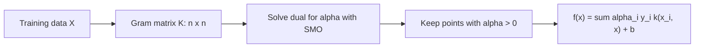

# The Kernel Trick

> Work in a space with millions of features without ever computing one of them.

**Type:** Build
**Languages:** Python
**Prerequisites:** Phase 01 (Linear Algebra), Phase 02 (Calculus and Optimization), Phase 06 Lesson 05 (Perceptron), Phase 06 Lesson 06 (Support Vector Machines)
**Time:** ~90 minutes

## Learning Objectives

- Explain why a kernel `k(x, z)` equals a dot product `phi(x) . phi(z)` in a feature space you never build, and verify it numerically
- Derive the SVM dual problem and see that the data only appears through dot products
- Implement a kernel SVM with the simplified SMO algorithm in NumPy, with linear, polynomial, and RBF kernels
- Tune the RBF `gamma` and `C` and recognize under- and overfitting in the support vector count

## The Problem

A linear SVM draws a hyperplane. On concentric circles or interleaving half-moons, every hyperplane fails: the best line gets about 50% on circles. In Lesson 05 you fixed XOR by adding a product feature `x1 * x2`. That works, but it does not scale. All degree-3 monomials of 100 features is about 177,000 features. All monomials of every degree is infinitely many.

The kernel trick lets you train a linear model in such a huge space at the cost of computing one number per pair of points. It turned SVMs into the dominant nonlinear classifier of the late 1990s and 2000s, and the same idea underlies Gaussian processes, kernel PCA, and kernel ridge regression.

## The Concept

### Feature maps

Lift every point with a map `phi`. For 2-D inputs and degree 2:

```
phi(x) = [1, sqrt(2) x1, sqrt(2) x2, x1^2, x2^2, sqrt(2) x1 x2]
```

A linear boundary in this 6-D space is a conic (circle, ellipse, parabola) in the original 2-D space. Now expand the dot product:

```
phi(x) . phi(z) = 1 + 2 x1 z1 + 2 x2 z2 + x1^2 z1^2 + x2^2 z2^2 + 2 x1 x2 z1 z2
                = (x . z + 1)^2
```

The right side costs one 2-D dot product, one add and one square. You get the 6-D dot product without building the 6-D vectors. That function `k(x, z) = (x . z + 1)^2` is a **kernel**.

### Common kernels

| Kernel | Formula | Feature space |
|--------|---------|---------------|
| Linear | `x . z` | the original features |
| Polynomial | `(x . z + c)^d` | all monomials up to degree `d` |
| RBF (Gaussian) | `exp(-gamma ||x - z||^2)` | infinite dimensional |

The RBF kernel is a similarity: 1 when the points coincide, near 0 when they are far apart. `gamma` sets how fast similarity decays. Mercer's theorem says any symmetric function whose Gram matrix `K[i, j] = k(x_i, x_j)` is positive semidefinite for every dataset is a dot product in some feature space.

### Why SVMs can use kernels: the dual

The soft-margin SVM from Lesson 06 has an equivalent dual problem (derived with Lagrange multipliers):

```
maximize    sum_i alpha_i - (1/2) sum_i sum_j alpha_i alpha_j y_i y_j (x_i . x_j)
subject to  0 <= alpha_i <= C,   sum_i alpha_i y_i = 0
```

and the decision function becomes:

```
f(x) = sum_i alpha_i y_i (x_i . x) + b
```

The data appears only inside dot products. Replace every `x_i . x_j` with `k(x_i, x_j)` and you are solving a linear SVM in the feature space of `k`, without ever computing `phi`. Points with `alpha_i > 0` are the support vectors; at prediction time you only sum over them.



### SMO: solving the dual two variables at a time

The constraint `sum alpha_i y_i = 0` means you cannot change one `alpha` alone. **Sequential Minimal Optimization** (Platt, 1998) changes two at a time, `alpha_i` and `alpha_j`, keeping their weighted sum fixed. That one-dimensional problem has a closed form:

```
E_k   = f(x_k) - y_k                         prediction error
eta   = 2 K_ij - K_ii - K_jj                  curvature (negative)
alpha_j_new = alpha_j - y_j (E_i - E_j) / eta
alpha_j_new = clip(alpha_j_new, L, H)          keep the box 0 <= alpha <= C
alpha_i_new = alpha_i + y_i y_j (alpha_j - alpha_j_new)
```

`L` and `H` come from the box and the equality constraint. Then the bias is recomputed from whichever alpha is strictly inside `(0, C)`. The **simplified SMO** (from Stanford CS229) picks `i` as any point that violates the KKT conditions and `j` at random, and stops after a few full passes with no change. It is slower than LIBSVM's heuristics but gives the same solution on small datasets.

### Gamma and C with RBF

- Small `gamma`: wide bumps, smooth boundary, close to linear. Can underfit.
- Large `gamma`: each support vector influences only its tiny neighborhood. The boundary wraps around individual points, and almost every point becomes a support vector. Overfits.
- `C` behaves as in Lesson 06. Tune `gamma` and `C` together on a log grid with cross-validation.

A support vector count close to the training set size is a red flag for overfitting.

## Build It

### Step 1: Verify the kernel identity

```python
def polynomial_kernel(A, B, degree=3, coef0=1.0):
    return (A @ B.T + coef0) ** degree


def rbf_kernel(A, B, gamma=1.0):
    squared_distances = (
        np.sum(A**2, axis=1)[:, None] + np.sum(B**2, axis=1)[None, :] - 2 * A @ B.T
    )
    return np.exp(-gamma * np.maximum(squared_distances, 0.0))


def explicit_degree2_features(X):
    x1, x2 = X[:, 0], X[:, 1]
    root2 = np.sqrt(2.0)
    return np.column_stack([np.ones(len(X)), root2 * x1, root2 * x2, x1**2, x2**2, root2 * x1 * x2])
```

```
phi(a).phi(b) in 6-D space: 1.137769
(a.b + 1)^2 in 2-D space:   1.137769
```

The RBF kernel computes all pairwise squared distances with the identity `||a - b||^2 = ||a||^2 + ||b||^2 - 2 a . b`, fully vectorized. The `np.maximum(..., 0)` guards against tiny negative values from floating point error.

### Step 2: Data no line can separate

```python
X_circles, labels_circles = make_circles(n_samples=200, noise=0.1, factor=0.4, random_state=0)
X_moons, labels_moons = make_moons(n_samples=200, noise=0.2, random_state=0)
```

Labels are mapped from `{0, 1}` to `{-1, +1}`, as the SVM formulas expect.

### Step 3: Simplified SMO

The Gram matrix is computed once. The core of the loop is the two-variable update:

```python
error_i = (alphas * y) @ K[:, i] + bias - y[i]
violates_kkt = (y[i] * error_i < -self.tolerance and alphas[i] < self.C) or (
    y[i] * error_i > self.tolerance and alphas[i] > 0
)
if not violates_kkt:
    continue
j = rng.integers(n - 1)
j = j + 1 if j >= i else j
error_j = (alphas * y) @ K[:, j] + bias - y[j]
alpha_i_old, alpha_j_old = alphas[i], alphas[j]
if y[i] != y[j]:
    low = max(0.0, alpha_j_old - alpha_i_old)
    high = min(self.C, self.C + alpha_j_old - alpha_i_old)
else:
    low = max(0.0, alpha_i_old + alpha_j_old - self.C)
    high = min(self.C, alpha_i_old + alpha_j_old)
eta = 2 * K[i, j] - K[i, i] - K[j, j]
alphas[j] = np.clip(alpha_j_old - y[j] * (error_i - error_j) / eta, low, high)
alphas[i] = alpha_i_old + y[i] * y[j] * (alpha_j_old - alphas[j])
```

After training you keep only the support vectors, and prediction is one kernel evaluation against them:

```python
def decision_function(self, X):
    K = self.kernel(X, self.support_vectors)
    return K @ (self.support_alphas * self.support_labels) + self.bias
```

Results with `C=1`:

```
circles  linear    support vectors: 137  test acc: 0.517
circles  poly d=3  support vectors:  20  test acc: 1.000
circles  rbf g=1   support vectors:  35  test acc: 1.000
moons    linear    support vectors:  54  test acc: 0.850
moons    poly d=3  support vectors:  42  test acc: 0.967
moons    rbf g=1   support vectors:  45  test acc: 0.983
```

Same algorithm, same code, only the kernel function changed. The linear kernel on circles is a coin flip and uses almost every point as a support vector. The polynomial kernel needs only 20.

### Step 4: Sweep gamma

On noisier moons (`noise=0.35`, 300 points, `C=10`):

```
gamma=   0.1  SVs:  81  train: 0.828  test: 0.842
gamma=   1.0  SVs:  60  train: 0.911  test: 0.892
gamma=  10.0  SVs:  93  train: 0.944  test: 0.833
gamma= 100.0  SVs: 163  train: 0.994  test: 0.758
```

Training accuracy climbs monotonically while test accuracy peaks at `gamma=1` and then falls. At `gamma=100`, 163 of 180 training points are support vectors: the model is memorizing.

## Use It

`sklearn.svm.SVC` wraps LIBSVM, which runs SMO with smarter working-set selection and kernel caching.

```python
from sklearn.svm import SVC

sk_kernels = {
    "linear": dict(kernel="linear"),
    "poly d=3": dict(kernel="poly", degree=3, coef0=1.0, gamma=1.0),
    "rbf g=1": dict(kernel="rbf", gamma=1.0),
}
sk_model = SVC(C=1.0, **sk_kernels["rbf g=1"]).fit(X_train, y_train)
```

```
circles  poly d=3  sklearn SVs:  20  test acc: 1.000  (scratch 1.000)
moons    linear    sklearn SVs:  52  test acc: 0.850  (scratch 0.850)
moons    rbf g=1   sklearn SVs:  45  test acc: 0.967  (scratch 0.983)
```

The support vector counts and accuracies match closely; small differences come from the convergence tolerance. Note that sklearn's polynomial kernel is `(gamma * x . z + coef0)^degree`, so set `gamma=1` to match the formula here. The default `gamma="scale"` uses `1 / (n_features * X.var())`, a sensible starting point when features are standardized.

Kernel SVMs need the `n x n` Gram matrix, so training cost grows between `O(n^2)` and `O(n^3)`. Beyond roughly 50,000 samples, use `LinearSVC` on approximate features (`sklearn.kernel_approximation.Nystroem` or `RBFSampler`) or switch to gradient boosting.

## Exercises

1. **Easy.** Compute the RBF Gram matrix on the training set and check with `np.linalg.eigvalsh` that all eigenvalues are non-negative (up to `1e-10`). Repeat with `k(x, z) = -||x - z||` and see the PSD property fail.
2. **Medium.** Run a grid over `C in [0.1, 1, 10, 100]` and `gamma in [0.01, 0.1, 1, 10, 100]` with 5-fold cross-validation using `GridSearchCV(SVC())`. Plot the mean CV accuracy as a heatmap and describe the diagonal ridge of good values.
3. **Hard.** Implement kernel ridge regression from scratch: `alpha = (K + lambda I)^-1 y`, `f(x) = k(x, X) @ alpha`. Fit `y = sin(x) + noise` with the RBF kernel and compare it with `sklearn.kernel_ridge.KernelRidge`. Note that this is the same trick applied to the ridge regression you built in Phase 05.

## Key Terms

| Term | What people say | What it actually means |
|------|----------------|----------------------|
| Kernel | "Similarity function" | A function `k(x, z)` equal to `phi(x) . phi(z)` for some feature map `phi` |
| Kernel trick | "Go nonlinear for free" | Replacing every dot product in an algorithm with a kernel, so it runs in the feature space without computing `phi` |
| Feature map | "Lifting the data" | The transformation `phi` into a higher-dimensional space where a linear model is applied |
| Gram matrix | "Kernel matrix" | The `n x n` matrix `K[i, j] = k(x_i, x_j)`; must be positive semidefinite for a valid kernel |
| RBF kernel | "Gaussian kernel" | `exp(-gamma ||x - z||^2)`; corresponds to an infinite-dimensional feature space |
| Dual problem | "The alpha formulation" | The SVM rewritten in terms of one multiplier per training point, where data appears only through dot products |
| SMO | "LIBSVM's solver" | Sequential Minimal Optimization: solve the dual by updating two alphas at a time in closed form |
| gamma | "Kernel width" | Inverse squared length-scale of the RBF kernel; large values give wiggly, overfit boundaries |

## Further Reading

- [Stanford CS229 Lecture Notes, Kernel Methods and SVMs](https://cs229.stanford.edu/main_notes.pdf) -- the dual derivation and kernel construction
- [Platt, Sequential Minimal Optimization (1998)](https://www.microsoft.com/en-us/research/publication/sequential-minimal-optimization-a-fast-algorithm-for-training-support-vector-machines/) -- the original SMO paper with full pseudocode
- [StatQuest, Support Vector Machines Part 3: The Radial (RBF) Kernel](https://www.youtube.com/watch?v=Qc5IyLW_hns) -- intuition for how RBF relates to an infinite feature space
- [scikit-learn User Guide, SVM Kernel functions](https://scikit-learn.org/stable/modules/svm.html#kernel-functions) -- exact kernel formulas and parameter meanings in SVC
