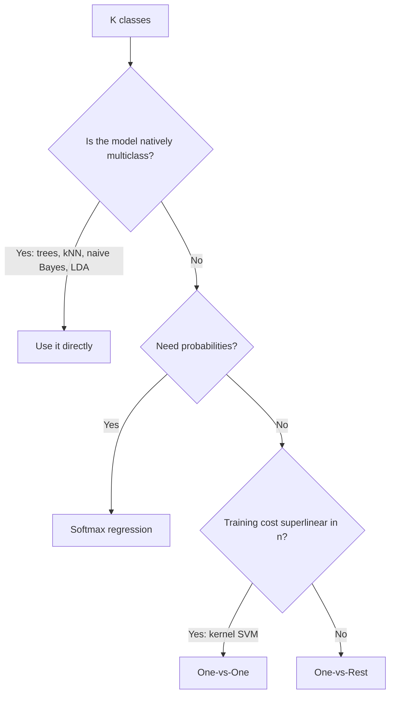

# Multiclass Strategies

> Binary classifiers answer yes or no. Three ways to make them answer "which one?".

**Type:** Build
**Languages:** Python
**Prerequisites:** Phase 04 (ML Fundamentals), Phase 06 Lesson 01 (Logistic Regression), Phase 06 Lesson 06 (Support Vector Machines)
**Time:** ~60 minutes

## Learning Objectives

- Build one-vs-rest and one-vs-one wrappers around a binary logistic regression and compare how many models each trains
- Implement softmax (multinomial logistic) regression with cross-entropy loss and derive its gradient
- Explain the trade-offs between the three strategies in training cost, calibration, and ambiguous regions
- Read a multiclass confusion matrix and map each strategy to its scikit-learn equivalent

## The Problem

Logistic regression, the perceptron, and SVMs as you built them all separate two classes. Most real problems have more: digits 0-9, ten product categories, three species of iris, four customer segments. You need a way to go from `K = 2` to arbitrary `K`.

There are two families of answers. **Reductions** keep the binary algorithm and combine several copies of it: one-vs-rest and one-vs-one. **Native multiclass** models change the model itself so it outputs `K` scores at once: softmax regression, naive Bayes, LDA, kNN and decision trees are all natively multiclass. Knowing which one your library is using under the hood explains differences in speed, probabilities, and accuracy.

## The Concept

### One-vs-Rest (OvR)

Train `K` binary classifiers. Classifier `k` sees class `k` as positive and everything else as negative. To predict, run all `K` and pick the one with the highest score.

```
class 0 vs {1,2,3}  -> score s0(x)
class 1 vs {0,2,3}  -> score s1(x)
class 2 vs {0,1,3}  -> score s2(x)
class 3 vs {0,1,2}  -> score s3(x)
prediction = argmax_k s_k(x)
```

- `K` models, each trained on all `n` samples.
- Each subproblem is imbalanced (one class against `K - 1`).
- The scores come from separately trained models, so they are not on a common scale. The argmax usually works, but the raw scores are not calibrated probabilities.

### One-vs-One (OvO)

Train one classifier for every pair of classes, using only the samples of those two classes. To predict, every pair votes, and the class with the most votes wins.

```
pairs for K = 4: (0,1) (0,2) (0,3) (1,2) (1,3) (2,3)  ->  K(K-1)/2 = 6 models
```

- `K(K-1)/2` models: 45 for `K = 10`, 4,950 for `K = 100`.
- Each model trains on about `2n/K` samples. For algorithms whose cost grows faster than linearly in `n` (kernel SVMs are roughly `O(n^2)`), many small problems are cheaper than a few big ones. That is why `sklearn.svm.SVC` uses OvO internally.
- Ties in the vote need a tie-breaking rule (sum of confidences, or lowest index).

### Softmax regression

Instead of `K` independent models, use one model with a weight matrix `W` of shape `(d, K)` that outputs `K` scores (logits) `z = x W + b`. The softmax function turns them into a probability distribution:

```
p_k = exp(z_k) / sum_j exp(z_j)
```

All `p_k` are positive and sum to 1. For `K = 2`, softmax reduces exactly to the sigmoid of the score difference, so logistic regression is a special case.

Train it by minimizing the cross-entropy (the negative log-likelihood of a categorical distribution, Phase 03):

```
L = -(1/n) sum_i sum_k Y_ik log p_ik       Y is one-hot
```

The gradient has the same form as binary logistic regression:

```
dL/dW = (1/n) X^T (P - Y)
dL/db = (1/n) sum_i (P_i - Y_i)
```

Before the first step all weights are zero, every class gets `p = 1/K`, and the loss is `log K` (1.386 for `K = 4`). That is a quick sanity check for any multiclass training loop.

Numerical detail: `exp(1000)` overflows. Subtract the row maximum from the logits before exponentiating. The result is unchanged because softmax is invariant to adding a constant to every logit.

### Choosing a strategy

| | OvR | OvO | Softmax |
|-|-----|-----|---------|
| Models | `K` | `K(K-1)/2` | 1 (with `K` outputs) |
| Samples per model | `n` | ~`2n/K` | `n` |
| Calibrated probabilities | no (renormalize) | no (votes) | yes |
| Typical use | linear models, any binary learner | kernel SVMs | logistic regression, neural nets |



## Build It

### Step 1: A 4-class dataset

```python
X, y = make_classification(
    n_samples=800, n_features=6, n_informative=4, n_redundant=0,
    n_classes=4, n_clusters_per_class=1, class_sep=1.2, random_state=0,
)
X_train, X_test, y_train, y_test = train_test_split(X, y, test_size=0.3, random_state=0, stratify=y)
scaler = StandardScaler().fit(X_train)
X_train, X_test = scaler.transform(X_train), scaler.transform(X_test)
```

### Step 2: The binary building block

A plain batch gradient descent logistic regression, as in Lesson 01. It exposes raw scores through `decision_function`.

```python
class BinaryLogistic:
    def fit(self, X, y01):
        self.weights = np.zeros(X.shape[1])
        self.bias = 0.0
        for _ in range(self.epochs):
            error = sigmoid(X @ self.weights + self.bias) - y01
            self.weights -= self.learning_rate * (X.T @ error) / len(y01)
            self.bias -= self.learning_rate * error.mean()
        return self

    def decision_function(self, X):
        return X @ self.weights + self.bias
```

### Step 3: One-vs-Rest

```python
class OneVsRest:
    def fit(self, X, y):
        self.classes = np.unique(y)
        self.models = [BinaryLogistic().fit(X, (y == c).astype(float)) for c in self.classes]
        return self

    def predict(self, X):
        scores = np.column_stack([model.decision_function(X) for model in self.models])
        return self.classes[np.argmax(scores, axis=1)]
```

### Step 4: One-vs-One

```python
class OneVsOne:
    def fit(self, X, y):
        self.classes = np.unique(y)
        self.pairs = []
        for class_a, class_b in combinations(self.classes, 2):
            mask = (y == class_a) | (y == class_b)
            model = BinaryLogistic().fit(X[mask], (y[mask] == class_a).astype(float))
            self.pairs.append((class_a, class_b, model))
        return self

    def predict(self, X):
        votes = np.zeros((len(X), len(self.classes)))
        index_of = {c: i for i, c in enumerate(self.classes)}
        for class_a, class_b, model in self.pairs:
            prefers_a = model.decision_function(X) >= 0
            votes[prefers_a, index_of[class_a]] += 1
            votes[~prefers_a, index_of[class_b]] += 1
        return self.classes[np.argmax(votes, axis=1)]
```

`np.argmax` breaks ties by taking the first class, a simple but deterministic rule.

### Step 5: Softmax regression

```python
def softmax(scores):
    shifted = scores - scores.max(axis=1, keepdims=True)
    exponentials = np.exp(shifted)
    return exponentials / exponentials.sum(axis=1, keepdims=True)


class SoftmaxRegression:
    def fit(self, X, y):
        self.classes = np.unique(y)
        n_samples, n_features = X.shape
        one_hot = (y[:, None] == self.classes[None, :]).astype(float)
        self.weights = np.zeros((n_features, len(self.classes)))
        self.bias = np.zeros(len(self.classes))
        for _ in range(self.epochs):
            probabilities = softmax(X @ self.weights + self.bias)
            self.loss_history.append(-np.mean(np.sum(one_hot * np.log(probabilities + 1e-12), axis=1)))
            error = probabilities - one_hot
            self.weights -= self.learning_rate * (X.T @ error) / n_samples
            self.bias -= self.learning_rate * error.mean(axis=0)
        return self
```

Results:

```
One-vs-Rest:  4 models, test accuracy 0.904
One-vs-One:   6 models, test accuracy 0.933
Softmax:      1 model,  test accuracy 0.917
Cross-entropy: start 1.386 -> end 0.360
Confusion matrix (rows = true, cols = predicted):
[[53  4  1  2]
 [ 3 57  1  0]
 [ 3  0 56  0]
 [ 2  0  4 54]]
```

The three strategies land within a few points of each other; differences of this size on 240 test points are mostly noise. The confusion matrix shows where errors concentrate: class 0 absorbs most of the confusion from the others.

## Use It

scikit-learn offers both meta-estimators and native multiclass models.

```python
from sklearn.linear_model import LogisticRegression
from sklearn.multiclass import OneVsOneClassifier, OneVsRestClassifier

base = LogisticRegression(max_iter=1000)
sk_ovr = OneVsRestClassifier(base).fit(X_train, y_train)
sk_ovo = OneVsOneClassifier(base).fit(X_train, y_train)
sk_softmax = LogisticRegression(max_iter=1000).fit(X_train, y_train)
```

```
OneVsRestClassifier: 4 models, test acc 0.908
OneVsOneClassifier:  6 models, test acc 0.929
LogisticRegression (multinomial): test acc 0.921
Agreement between scratch softmax and sklearn: 0.996
```

What each built-in estimator does by default:

- `LogisticRegression`: multinomial (softmax) loss for `K > 2` with the default `lbfgs` solver.
- `SVC`: one-vs-one internally; `decision_function_shape="ovr"` only reshapes the output.
- `LinearSVC`: one-vs-rest (or Crammer-Singer with `multi_class="crammer_singer"`).
- Trees, random forests, kNN, naive Bayes, LDA: natively multiclass.

For metrics, use `classification_report` for per-class precision and recall and `f1_score(average="macro")` when classes are imbalanced.

## Exercises

1. **Easy.** Turn the OvR scores into probabilities by applying the sigmoid to each binary score and dividing by their sum. Compare them with the softmax probabilities on the first ten test rows. Which are more confident?
2. **Medium.** Make the problem imbalanced (`weights=[0.7, 0.1, 0.1, 0.1]` in `make_classification`). Retrain all three strategies and compare overall accuracy with macro-averaged F1. Which strategy suffers most on the minority classes?
3. **Hard.** Implement the Crammer-Singer multiclass SVM: one weight vector per class, and the hinge loss `max(0, 1 + max_{k != y} w_k . x - w_y . x)`. Train it with subgradient descent as in Lesson 06 and compare it with `LinearSVC(multi_class="crammer_singer")`.

## Key Terms

| Term | What people say | What it actually means |
|------|----------------|----------------------|
| One-vs-Rest | "One classifier per class" | Train `K` binary models, class `k` against all others; predict with the highest score |
| One-vs-One | "All pairs" | Train `K(K-1)/2` binary models on pairs of classes; predict by majority vote |
| Softmax | "Normalized exponential" | `exp(z_k) / sum_j exp(z_j)`, mapping `K` real scores to a probability distribution |
| Softmax regression | "Multinomial logistic regression" | A linear model with `K` outputs trained with cross-entropy; generalizes logistic regression |
| Cross-entropy | "Log loss" | `-sum_k y_k log p_k`, the negative log-likelihood of the true class under the predicted distribution |
| Logits | "Raw scores" | The unnormalized outputs `z = x W + b` before softmax |
| Natively multiclass | "Handles K classes directly" | A model whose formulation produces `K` outputs without a binary reduction (trees, kNN, naive Bayes, softmax) |
| Confusion matrix | "Who gets mistaken for whom" | A `K x K` table counting true class (rows) against predicted class (columns) |

## Further Reading

- [scikit-learn User Guide, Multiclass and multioutput algorithms](https://scikit-learn.org/stable/modules/multiclass.html) -- which estimators use which strategy, and the meta-estimators
- [Bishop, Pattern Recognition and Machine Learning, Section 4.3.4](https://www.microsoft.com/en-us/research/publication/pattern-recognition-machine-learning/) -- derivation of multiclass logistic regression and its gradient
- [Rifkin and Klautau, In Defense of One-Vs-All Classification (JMLR 2004)](https://www.jmlr.org/papers/v5/rifkin04a.html) -- shows well-tuned OvR is as accurate as more complex schemes
- [Stanford CS231n, Linear Classification notes](https://cs231n.github.io/linear-classify/) -- softmax classifier, cross-entropy, and the numerical stability trick, compared with the multiclass SVM
