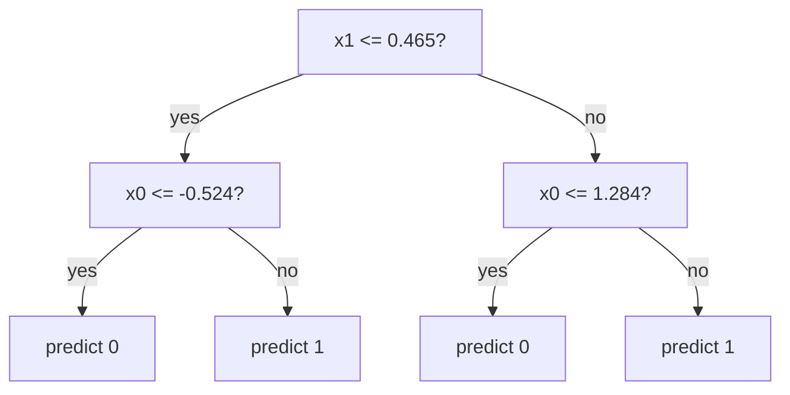

# Decision Trees

> A decision tree is a flowchart of yes/no questions that the data writes for you.

**Type:** Build
**Languages:** Python
**Prerequisites:** Phase 04 (ML Fundamentals), Phase 05 (Supervised Regression), Phase 06 (Supervised Classification)
**Time:** ~75 minutes

## Learning Objectives

- Explain how a decision tree partitions feature space into axis-aligned rectangles
- Implement the greedy CART split search: try every feature and every midpoint threshold, keep the one with the largest impurity decrease
- Build a recursive tree that works as a classifier (Gini, majority vote) and as a regressor (variance, mean)
- Use `max_depth` to trade off underfitting and overfitting, and verify your tree matches scikit-learn

## The Problem

Logistic regression and linear SVMs draw a single straight boundary. Real decisions rarely look like that. A loan officer thinks: "If income is below 30k, reject. Otherwise, if debt ratio is above 0.4, reject. Otherwise approve." That is a sequence of simple, axis-aligned questions, and the final boundary is a staircase, not a line.

You want a model that:

- Handles nonlinear boundaries without kernels or feature engineering
- Does not care about feature scale (no standardization needed)
- Produces rules a human can read and audit
- Works for both classification and regression with the same code

Decision trees do all four. They are also the building block of random forests and gradient boosting, which dominate tabular data competitions. Every ensemble lesson in this phase assumes you understand the single tree you build here.

## The Concept

### A tree is a set of nested questions

Each internal node asks "is feature j at most t?". Samples that answer yes go left, the rest go right. Each leaf stores a prediction.



Geometrically, every split cuts one region of feature space in two with a line parallel to an axis. A depth-d tree carves the plane into at most 2^d rectangles, and each rectangle gets one constant prediction.

```
x1 ^
   |  class 0   | class 1
   |            |
0.465 ----------+---------   (split on x1)
   | 0  |   class 1
   |    |
   +----+-------------------> x0
      -0.524
```

### Impurity: how mixed is a node?

To choose a split you need a score for "how mixed" a set of labels is. For classification, CART uses Gini impurity:

```
Gini(S) = 1 - sum_k p_k^2
```

where `p_k` is the fraction of samples in S with class k. A pure node (all one class) has Gini 0. A 50/50 binary node has Gini 0.5, the maximum for two classes. The next lesson compares Gini with entropy and other measures in depth; for now, Gini is enough.

For regression, the impurity is the variance of the targets in the node, which is the MSE you get by predicting the node mean:

```
Var(S) = (1/|S|) * sum_i (y_i - mean(S))^2
```

### Impurity decrease

A split sends `S` into `S_left` and `S_right`. The quality of the split is how much it reduces weighted impurity:

```
gain = I(S) - ( |S_left|/|S| * I(S_left) + |S_right|/|S| * I(S_right) )
```

Weighting by size matters: isolating one sample into a pure leaf is cheap and almost useless, so its contribution is scaled down.

### Greedy search over thresholds

For each feature, sort its unique values and try the midpoint between every consecutive pair as a threshold. With n samples and d features that is at most `d * (n - 1)` candidate splits per node. Pick the one with the largest gain. This is greedy: you never look ahead to see whether a worse split now would enable a better split later. Finding the globally optimal tree is NP-hard, so every practical library does this.

### Recursion and stopping

After the best split, recurse on each child. Stop and make a leaf when:

- the depth limit `max_depth` is reached
- the node has fewer than `min_samples_split` samples
- the node is already pure (impurity 0)
- no split has positive gain

Leaf values: majority class for classification, mean target for regression.

### Why depth controls overfitting

A tree with no depth limit keeps splitting until every leaf is pure. On noisy data that means one leaf per noisy point: 100% training accuracy and worse test accuracy. Depth (and other limits) are your regularization knobs. Lesson 03 covers pruning, which is a more principled way to choose the size.

## Build It

### Step 1: Impurity functions

```python
def gini(labels):
    if len(labels) == 0:
        return 0.0
    _, counts = np.unique(labels, return_counts=True)
    proportions = counts / counts.sum()
    return 1.0 - np.sum(proportions**2)


def variance(targets):
    if len(targets) == 0:
        return 0.0
    return float(np.var(targets))
```

`[0, 0, 0, 1]` has Gini `1 - (0.75^2 + 0.25^2) = 0.375`. The script prints this for three small nodes.

### Step 2: The best split

```python
def best_split(X, y, impurity):
    n_samples, n_features = X.shape
    parent_impurity = impurity(y)
    best = {"gain": 0.0, "feature": None, "threshold": None}
    for feature in range(n_features):
        values = np.unique(X[:, feature])
        thresholds = (values[:-1] + values[1:]) / 2
        for threshold in thresholds:
            left_mask = X[:, feature] <= threshold
            y_left, y_right = y[left_mask], y[~left_mask]
            weighted = (len(y_left) * impurity(y_left) + len(y_right) * impurity(y_right)) / n_samples
            gain = parent_impurity - weighted
            if gain > best["gain"]:
                best = {"gain": gain, "feature": feature, "threshold": threshold}
    return best
```

On the toy data `x = [2, 3, 10, 19, 20, 21]`, `y = [0, 0, 0, 1, 1, 1]`, the best threshold is 14.5, the midpoint between 10 and 19, with gain 0.5: the parent Gini drops from 0.5 to 0.

### Step 3: A recursive tree with pluggable impurity

The same class serves both tasks. You pass in the impurity function and the leaf rule.

```python
class Node:
    def __init__(self, feature=None, threshold=None, left=None, right=None, value=None):
        self.feature = feature
        self.threshold = threshold
        self.left = left
        self.right = right
        self.value = value

    def is_leaf(self):
        return self.value is not None


class DecisionTree:
    def __init__(self, impurity, leaf_value, max_depth=5, min_samples_split=2):
        self.impurity = impurity
        self.leaf_value = leaf_value
        self.max_depth = max_depth
        self.min_samples_split = min_samples_split
        self.root = None

    def fit(self, X, y):
        self.root = self.grow(X, y, depth=0)
        return self

    def grow(self, X, y, depth):
        if depth >= self.max_depth or len(y) < self.min_samples_split or self.impurity(y) == 0:
            return Node(value=self.leaf_value(y))
        split = best_split(X, y, self.impurity)
        if split["feature"] is None:
            return Node(value=self.leaf_value(y))
        left_mask = X[:, split["feature"]] <= split["threshold"]
        left = self.grow(X[left_mask], y[left_mask], depth + 1)
        right = self.grow(X[~left_mask], y[~left_mask], depth + 1)
        return Node(split["feature"], split["threshold"], left, right)

    def predict_one(self, x):
        node = self.root
        while not node.is_leaf():
            node = node.left if x[node.feature] <= node.threshold else node.right
        return node.value

    def predict(self, X):
        return np.array([self.predict_one(x) for x in X])
```

Then the two concrete models are one line each:

```python
class DecisionTreeClassifier(DecisionTree):
    def __init__(self, max_depth=5, min_samples_split=2):
        super().__init__(gini, majority_class, max_depth, min_samples_split)


class DecisionTreeRegressor(DecisionTree):
    def __init__(self, max_depth=5, min_samples_split=2):
        super().__init__(variance, mean_value, max_depth, min_samples_split)
```

### Step 4: Classification on two moons

```python
X, y = make_moons(n_samples=400, noise=0.25, random_state=42)
X_train, X_test, y_train, y_test = train_test_split(X, y, test_size=0.25, random_state=42)
for max_depth in [1, 3, 5, 10]:
    tree = DecisionTreeClassifier(max_depth=max_depth).fit(X_train, y_train)
```

Output:

```
max_depth= 1  leaves=  2  train_acc=0.817  test_acc=0.790
max_depth= 3  leaves=  7  train_acc=0.900  test_acc=0.870
max_depth= 5  leaves= 13  train_acc=0.963  test_acc=0.940
max_depth=10  leaves= 28  train_acc=1.000  test_acc=0.900
```

Depth 1 is a stump that underfits. Depth 10 memorizes the training set and loses four points of test accuracy. The `print_tree` method prints the depth-2 tree as nested `if/else` rules, which is exactly the flowchart at the top of this lesson.

### Step 5: Regression on a noisy sine

```
max_depth=1  leaves=  2  train_mse=0.1274  test_mse=0.1131
max_depth=2  leaves=  4  train_mse=0.0793  test_mse=0.0936
max_depth=4  leaves= 16  train_mse=0.0355  test_mse=0.0620
max_depth=8  leaves= 97  train_mse=0.0058  test_mse=0.0913
```

A regression tree approximates the sine with a step function. More depth means more, narrower steps. At depth 8 there are 97 leaves for 150 training points, and the steps start chasing noise.

## Use It

scikit-learn's `DecisionTreeClassifier` and `DecisionTreeRegressor` implement the same CART algorithm in optimized Cython.

```python
from sklearn.tree import DecisionTreeClassifier, DecisionTreeRegressor, export_text

theirs = DecisionTreeClassifier(max_depth=3, random_state=0).fit(X_train, y_train)
print(export_text(theirs, feature_names=["x0", "x1"], decimals=3))
```

With `max_depth=3`, your tree and sklearn's reach the same test accuracy (0.870) and agree on 100% of test predictions. The regressor gives the identical test MSE (0.0620). Small differences can appear in general because sklearn breaks ties between equally good splits by randomly permuting features, which is why `random_state` exists even for a single tree.

Things the library adds that you did not build: `min_samples_leaf`, `max_features` (used by random forests), `class_weight`, sample weights, `criterion="entropy"` or `"log_loss"`, cost-complexity pruning via `ccp_alpha`, and native missing-value handling.

## Exercises

1. (Easy) Add a `min_samples_leaf` parameter to `best_split` so any split that leaves fewer than k samples in a child is skipped. Compare test accuracy with k = 1, 5, 20 at `max_depth=10`.
2. (Medium) Add a `feature_importances_` attribute: for each feature, sum `n_node / n_total * gain` over every node that splits on it, then normalize to 1. Compare with sklearn's `feature_importances_`.
3. (Hard) Your split search re-scans the labels for every threshold, which is O(n^2) per feature. Rewrite it to sort once and sweep thresholds left to right while updating class counts incrementally, making it O(n log n). Time both versions on 5,000 samples.

## Key Terms

| Term | What people say | What it actually means |
|------|----------------|----------------------|
| Decision tree | "A flowchart model" | A model that recursively splits feature space with axis-aligned thresholds and predicts a constant in each resulting region |
| CART | "The standard tree algorithm" | Classification And Regression Trees: binary splits chosen greedily by impurity decrease (Breiman et al., 1984) |
| Split | "A question at a node" | A pair (feature j, threshold t) that sends samples with x_j <= t left and the rest right |
| Gini impurity | "How mixed a node is" | 1 - sum of squared class proportions; the probability two random draws from the node have different labels |
| Impurity decrease | "Information gain" | Parent impurity minus the size-weighted average impurity of the children |
| Leaf | "End of the path" | A node with no children that stores the prediction: majority class or mean target |
| Greedy | "Best split now" | Choosing each split to maximize immediate gain without lookahead; the global optimum is NP-hard |
| max_depth | "How tall the tree is" | The maximum number of splits from root to any leaf, the main capacity control for a single tree |

## Further Reading

- [An Introduction to Statistical Learning (ISLR), Chapter 8](https://www.statlearning.com/) -- tree-based methods, with clear figures of recursive binary splitting
- [scikit-learn User Guide: Decision Trees](https://scikit-learn.org/stable/modules/tree.html) -- the CART formulation sklearn uses, plus practical tips
- [StatQuest: Decision and Classification Trees, Clearly Explained](https://www.youtube.com/watch?v=_L39rN6gz7Y) -- visual walkthrough of Gini-based split selection
- Breiman, Friedman, Olshen, Stone, *Classification and Regression Trees* (1984) -- the original CART book
