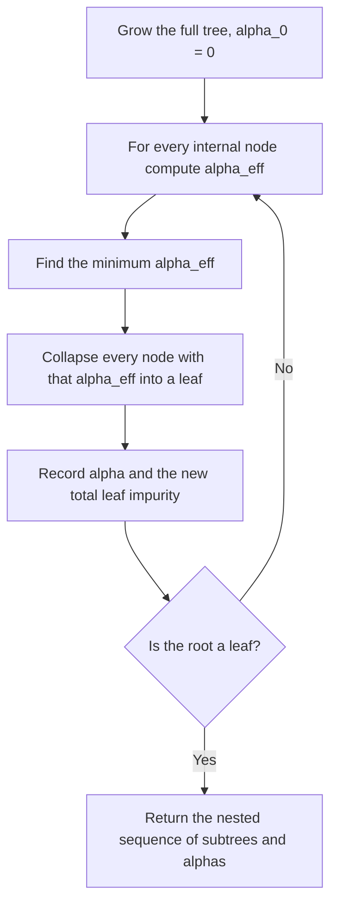

# Pruning

> Grow the tree too big on purpose, then cut back the branches that do not pay for themselves.

**Type:** Build
**Languages:** Python
**Prerequisites:** Phase 04 (ML Fundamentals: overfitting, cross-validation), Phase 07 Lessons 01-02 (Decision Trees, Entropy and Gini)
**Time:** ~75 minutes

## Learning Objectives

- Distinguish pre-pruning (stopping rules) from post-pruning (growing then cutting back) and explain the horizon problem that motivates post-pruning
- Derive the cost-complexity criterion `R_alpha(T) = R(T) + alpha * |leaves(T)|` and the effective alpha of an internal node
- Implement weakest-link pruning that produces the full sequence of nested subtrees and their alpha values
- Pick alpha with cross-validation and reproduce scikit-learn's `cost_complexity_pruning_path` exactly

## The Problem

A fully grown tree reaches 100% training accuracy by giving every awkward point its own leaf. You saw this in Lesson 01. The obvious fix is to stop growing early: cap the depth, require a minimum number of samples per leaf, or refuse splits with small gain. These are pre-pruning rules, and they work, but they have a blind spot.

Consider XOR. Splitting on x0 alone gives zero gain, and so does splitting on x1 alone. A rule like "stop if the best gain is below 0.01" stops at the root, even though one more level of splits would classify everything perfectly. A split that looks useless now can enable excellent splits below it. This is the horizon problem.

Post-pruning avoids it: grow the full tree first, so every useful interaction gets a chance to appear, then remove the subtrees that add complexity without enough benefit. The question is how to decide what "enough" means without hand-picking branches. Cost-complexity pruning answers it with one parameter, alpha.

## The Concept

### Pre-pruning knobs

| Parameter | Stops a split when |
|-----------|--------------------|
| `max_depth` | the node is already at this depth |
| `min_samples_split` | the node has fewer samples than this |
| `min_samples_leaf` | a child would have fewer samples than this |
| `min_impurity_decrease` | the weighted impurity decrease `(n_t / N) * gain` is below this |
| `max_leaf_nodes` | the tree already has this many leaves (best-first growth) |

They are cheap and effective, and ensembles (Lessons 04-07) rely on them. But each one is a heuristic decided before seeing the subtree below.

### Cost-complexity

Define the risk of a tree T as the size-weighted impurity of its leaves:

```
R(T) = sum over leaves t of (n_t / N) * impurity(t)
```

A bigger tree always has lower R(T) on the training data. So add a price per leaf:

```
R_alpha(T) = R(T) + alpha * |leaves(T)|
```

At alpha = 0 the full tree wins. As alpha grows, leaves get expensive and smaller trees win. At a large enough alpha, the single-node root wins. Breiman et al. proved that for each alpha there is a unique smallest subtree minimizing `R_alpha`, and that these optimal subtrees are nested: as alpha increases you only ever remove branches, never add them back.

### Effective alpha of a node

Take an internal node t with subtree `T_t`. If you collapse `T_t` into a single leaf, risk goes up from `R(T_t)` to `R(t)` and you remove `|leaves(T_t)| - 1` leaves. The two choices cost the same when:

```
R(t) + alpha = R(T_t) + alpha * |leaves(T_t)|

alpha_eff(t) = ( R(t) - R(T_t) ) / ( |leaves(T_t)| - 1 )
```

`alpha_eff(t)` is the impurity reduction the subtree buys per extra leaf. A small value means the subtree is a weak link.

### Weakest-link pruning



This yields a short list of breakpoints `0 = alpha_0 < alpha_1 < ... < alpha_m`. For any alpha in `[alpha_k, alpha_{k+1})` the optimal tree is the k-th subtree. You never need to search a continuous range; you only evaluate these candidates.

### Choosing alpha

Training error always favors alpha = 0, so you choose alpha by validation. Standard recipe:

1. Compute the alpha path on the training set.
2. For each fold of K-fold cross-validation, grow a full tree on the training part, prune it to each candidate alpha, and score it on the held-out part.
3. Pick the alpha with the best mean score (or the largest alpha within one standard error of the best, the "1-SE rule", for a simpler tree).
4. Prune the tree grown on all training data to that alpha.

## Build It

### Step 1: A tree that remembers its class counts

To prune you need each internal node's own impurity, not just the leaves'. Each `Node` stores class counts and a `pruned` flag; a pruned node acts as a leaf without deleting its children, so you can undo pruning.

```python
class Node:
    def __init__(self, counts, depth):
        self.counts = counts
        self.n_samples = int(counts.sum())
        self.depth = depth
        self.feature = None
        self.threshold = None
        self.left = None
        self.right = None
        self.pruned = False

    @property
    def impurity(self):
        proportions = self.counts / self.n_samples
        return 1.0 - float(np.sum(proportions**2))

    def is_leaf(self):
        return self.left is None or self.pruned
```

The split search is vectorized: sort each feature once, then cumulative sums of one-hot labels give the class counts on the left for every threshold at the same time. `n * gini = n - sum_k c_k^2 / n`, so the whole scan is a few NumPy operations per feature instead of a Python loop per threshold.

```python
order = np.argsort(X[:, feature], kind="stable")
sorted_values = X[order, feature]
left_counts = np.cumsum(y_onehot[order], axis=0)[:-1]
right_counts = parent_counts - left_counts
left_n = np.arange(1, n_samples)
right_n = n_samples - left_n
valid = (sorted_values[:-1] < sorted_values[1:]) & (left_n >= min_samples_leaf) & (right_n >= min_samples_leaf)
left_score = left_n - np.sum(left_counts**2, axis=1) / left_n
right_score = right_n - np.sum(right_counts**2, axis=1) / right_n
gains = np.where(valid, (parent_score - left_score - right_score) / n_samples, -np.inf)
```

On the breast cancer training set (398 samples, 30 features) the full tree has 16 leaves, train accuracy 1.000, and test accuracy 0.918.

### Step 2: Pre-pruning

The same class accepts `max_depth`, `min_samples_leaf`, and `min_impurity_decrease`:

```
max_depth=2                  leaves=  4  train_acc=0.942  test_acc=0.906
max_depth=4                  leaves= 12  train_acc=0.990  test_acc=0.912
min_samples_leaf=10          leaves=  8  train_acc=0.967  test_acc=0.912
min_impurity_decrease=0.01   leaves=  5  train_acc=0.972  test_acc=0.918
```

With 5 leaves instead of 16, `min_impurity_decrease=0.01` matches the full tree's test accuracy.

### Step 3: Weakest-link pruning path

```python
def node_risk(self, node):
    return node.n_samples / self.n_total * node.impurity

def pruning_path(self):
    self.reset_pruning()
    alphas = [0.0]
    impurities = [self.total_leaf_impurity()]
    while not self.root.is_leaf():
        weakest_links = []
        for node in self.nodes():
            if node.is_leaf():
                continue
            subtree_risk, subtree_leaves = self.subtree_risk_and_leaves(node)
            effective_alpha = (self.node_risk(node) - subtree_risk) / (subtree_leaves - 1)
            weakest_links.append((effective_alpha, node))
        smallest = min(alpha for alpha, _ in weakest_links)
        for alpha, node in weakest_links:
            if alpha <= smallest + 1e-12:
                node.pruned = True
        alphas.append(max(smallest, alphas[-1]))
        impurities.append(self.total_leaf_impurity())
    self.reset_pruning()
    return np.array(alphas), np.array(impurities)
```

The `max` keeps the sequence non-decreasing: after a collapse, an ancestor's effective alpha can drop below the previous breakpoint, and it should be pruned at that breakpoint. `prune(ccp_alpha)` runs the same loop but stops once the smallest effective alpha exceeds `ccp_alpha`.

```
   alpha  leaf impurity  leaves  test_acc
 0.00000         0.0000      16     0.918
 0.00249         0.0050      14     0.918
 ...
 0.00899         0.0516       5     0.918
 0.01959         0.0712       4     0.901
 0.02655         0.1236       2     0.889
 0.34354         0.4672       1     0.626
```

Total leaf impurity rises with alpha, the number of leaves falls, and the last alpha collapses the tree to the root. Some steps remove several leaves at once (10 to 7) because collapsing an internal node removes its whole subtree.

### Step 4: Cross-validate alpha

```python
def cross_validated_alpha(X, y, candidate_alphas, n_splits=5):
    folds = StratifiedKFold(n_splits=n_splits, shuffle=True, random_state=0)
    scores = np.zeros(len(candidate_alphas))
    for train_index, valid_index in folds.split(X, y):
        tree = PrunableTree().fit(X[train_index], y[train_index])
        for i, alpha in enumerate(candidate_alphas):
            tree.prune(alpha)
            scores[i] += accuracy(y[valid_index], tree.predict(X[valid_index])) / n_splits
    return scores
```

CV picks alpha = 0.01959, a 4-leaf tree. Its test accuracy (0.901) is slightly below the full tree (0.918), a difference of 3 samples out of 171. This is normal: cross-validation estimates the best alpha on average, and a single small test set is noisy. What you gain is a tree with a quarter of the leaves whose rules a person can read in seconds, with an accuracy estimate (0.925 CV) that is more trustworthy than one test split.

## Use It

scikit-learn computes the same path:

```python
from sklearn.tree import DecisionTreeClassifier

path = DecisionTreeClassifier(random_state=0).cost_complexity_pruning_path(X_train, y_train)
path.ccp_alphas
path.impurities
sklearn_alpha = float(path.ccp_alphas[int(np.argmax(cv_scores))])
pruned = DecisionTreeClassifier(random_state=0, ccp_alpha=sklearn_alpha).fit(X_train, y_train)
```

```
ours    alphas: [0.0, 0.00249, 0.0025, 0.00419, 0.0049, 0.00492, 0.00879, 0.00899, 0.01959, 0.02586, 0.02655, 0.34354]
sklearn alphas: [0.0, 0.00249, 0.0025, 0.00419, 0.0049, 0.00492, 0.00879, 0.00899, 0.01959, 0.02586, 0.02655, 0.34354]
max |difference| = 1.21e-16
```

The paths match to machine precision, and sklearn pruned at the CV-chosen breakpoint gives the same 4-leaf tree with the same test accuracy (0.901). One subtlety: sklearn prunes a node when its effective alpha is at most `ccp_alpha`, so passing a value rounded slightly below a breakpoint keeps one more split. Pass values taken straight from `path.ccp_alphas`, as the script does.

The usual production pattern is `GridSearchCV(DecisionTreeClassifier(), {"ccp_alpha": path.ccp_alphas})`. In ensembles you rarely prune: random forests grow deep trees on purpose and rely on averaging, and boosting uses shallow trees controlled by `max_depth` or `max_leaf_nodes`.

## Exercises

1. (Easy) Build the XOR dataset (four clusters at the corners of a square, labels by quadrant). Show that `min_impurity_decrease=0.05` stops at the root, while growing fully and then pruning with a small alpha gives a perfect 4-leaf tree.
2. (Medium) Implement the 1-SE rule: record the standard deviation of the fold scores in `cross_validated_alpha`, and choose the largest alpha whose mean score is within one standard error of the best. Compare tree size and test accuracy with the plain best-alpha choice.
3. (Hard) Implement reduced-error pruning: hold out 25% of the training data, then bottom-up replace any internal node with a leaf if that does not decrease accuracy on the held-out set. Compare its final tree with cost-complexity pruning on three datasets.

## Key Terms

| Term | What people say | What it actually means |
|------|----------------|----------------------|
| Pre-pruning | "Early stopping for trees" | Refusing to split a node based on a rule like max depth, minimum samples, or minimum gain |
| Post-pruning | "Cutting back the tree" | Growing a large tree first, then replacing subtrees with leaves when they do not justify their complexity |
| Horizon problem | "Short-sighted stopping" | A split with little immediate gain can enable very good splits below it, which stopping rules never see |
| Cost-complexity | "Penalized tree risk" | R_alpha(T) = R(T) + alpha * number of leaves, trading training impurity against tree size |
| Effective alpha | "Weakest link strength" | (R(t) - R(T_t)) / (leaves(T_t) - 1), the per-leaf impurity reduction bought by keeping node t's subtree |
| Weakest-link pruning | "Minimal cost-complexity pruning" | Repeatedly collapsing the node with the smallest effective alpha, yielding a nested sequence of subtrees |
| ccp_alpha | "The sklearn pruning knob" | The complexity price per leaf; sklearn prunes every node whose effective alpha does not exceed it |
| 1-SE rule | "Prefer the simpler model" | Pick the simplest model whose CV score is within one standard error of the best |

## Further Reading

- [scikit-learn: Post pruning decision trees with cost complexity pruning](https://scikit-learn.org/stable/auto_examples/tree/plot_cost_complexity_pruning.html) -- the canonical example of `cost_complexity_pruning_path`
- [An Introduction to Statistical Learning (ISLR), Section 8.1](https://www.statlearning.com/) -- tree pruning with cross-validation, Algorithm 8.1
- Breiman, Friedman, Olshen, Stone, *Classification and Regression Trees* (1984), Chapter 3 -- the original weakest-link pruning proofs
- [StatQuest: How to Prune Regression Trees, Clearly Explained](https://www.youtube.com/watch?v=D0efHEJsfHo) -- visual walkthrough of cost-complexity pruning
