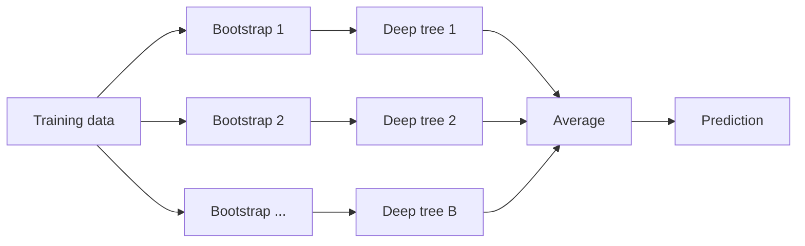

# Bagging

> One deep tree is a nervous expert. A hundred trees trained on resampled data, averaged, are a calm committee.

**Type:** Build
**Languages:** Python
**Prerequisites:** Phase 03 (Probability and Statistics: variance, sampling), Phase 04 (ML Fundamentals: bias-variance), Phase 07 Lessons 01-03 (Decision Trees, Entropy and Gini, Pruning)
**Time:** ~75 minutes

## Learning Objectives

- Explain why averaging many high-variance models reduces variance, and why correlation between them limits the gain
- Implement bootstrap sampling and show that each bootstrap sample contains about 63.2% of the unique rows
- Build a bagging ensemble of decision trees for classification and regression, with out-of-bag (OOB) error estimation
- Measure bias and variance empirically and show that bagging cuts variance while leaving bias nearly unchanged

## The Problem

Deep decision trees have low bias: they can fit almost any shape. They also have very high variance: change a few training points and the top split can move, which reshuffles the entire tree below it. In Lesson 01 you saw a depth-10 tree hit 100% training accuracy and lose test accuracy. Pruning (Lesson 03) trades some of that variance for bias by making the tree smaller.

There is another option that keeps the low bias. If you had many independent training sets, you could train one deep tree on each and average their predictions. The noise each tree memorized would be different, so it would cancel out, while the real signal, which every tree captures, would remain.

You do not have many training sets. You have one. Bagging (bootstrap aggregating, Breiman 1996) fakes the others by resampling.

## The Concept

### Averaging reduces variance

Suppose you have B models whose predictions at a point are random variables with variance `sigma^2` and pairwise correlation `rho`. The variance of their average is:

```
Var(average) = rho * sigma^2 + (1 - rho) / B * sigma^2
```

- If the models are independent (`rho = 0`), variance falls as `sigma^2 / B`: 100 models, 100 times less variance.
- If they are perfectly correlated (`rho = 1`), averaging does nothing.
- In between, the second term vanishes as B grows, and you are left with the floor `rho * sigma^2`.

Bias does not change: the average of models with the same expected prediction has that same expected prediction. So averaging helps exactly the models that suffer from variance, not bias. That is why you bag deep trees, not stumps.

### The bootstrap

To get B different training sets from one dataset of size n, draw n rows with replacement, B times. Each draw is a bootstrap sample (Phase 03 used the same idea to estimate confidence intervals).

The probability that a given row is never chosen in n draws is:

```
(1 - 1/n)^n  ->  1/e  ~ 0.368   as n grows
```

So each bootstrap sample contains about 63.2% of the unique rows, some of them several times, and leaves out about 36.8%.

```
original:   [ a  b  c  d  e  f  g  h ]
bootstrap 1:[ a  a  c  d  d  f  h  h ]   out-of-bag: b e g
bootstrap 2:[ b  c  c  e  f  g  g  g ]   out-of-bag: a d h
bootstrap 3:[ a  b  d  e  e  e  f  h ]   out-of-bag: c g
```

### Aggregation



- Regression: average the predicted values.
- Classification: either majority vote of the predicted labels (hard voting) or average the predicted class probabilities and take the argmax (soft voting). scikit-learn uses soft voting when the base estimator has `predict_proba`.

### Out-of-bag error: free validation

Every row is out-of-bag for about 37% of the trees. Those trees never saw it, so their averaged prediction on that row is an honest held-out prediction. Collect these for every row and you get the OOB estimate of test error without a separate validation set and without cross-validation.

```
For each training row i:
    trees_i = trees whose bootstrap did not contain i
    oob_prediction_i = average of trees_i predictions on x_i
OOB error = error(y, oob_prediction)
```

The OOB estimate uses roughly B/3 trees per row instead of B, so it is slightly pessimistic for small B. With 100 or more trees it tracks the test error closely.

### When bagging helps

| Base model | Variance | Bagging effect |
|------------|----------|----------------|
| Deep decision tree | High | Large improvement |
| Stump (depth 1) | Low | Little improvement; bias dominates |
| k-NN with large k, linear regression | Low | Almost none |
| k-NN with k = 1 | Medium | Small; bootstraps change the neighbors only a little |

Bagging is the parent of random forests (next lesson), which add a trick to lower `rho`.

## Build It

### Step 1: One tree for regression and classification

The tree is the vectorized CART from Lesson 03, generalized: it fits a target matrix `Y` and minimizes the summed squared error across its columns. For regression `Y` is one column. For classification `Y` is one-hot, and then:

```
sum_k sum_i (y_ik - p_k)^2 = n * sum_k p_k (1 - p_k) = n * Gini
```

so the same code grows Gini trees, and each leaf stores class proportions, which is exactly what soft voting needs.

```python
left_sum = np.cumsum(sorted_Y, axis=0)[:-1]
left_sq = np.cumsum(sorted_Y**2, axis=0)[:-1]
left_sse = np.sum(left_sq - left_sum**2 / left_n[:, None], axis=1)
right_sum = parent_sum - left_sum
right_sse = np.sum((total_sq - left_sq) - right_sum**2 / right_n[:, None], axis=1)
gains = np.where(valid, parent_sse - left_sse - right_sse, -np.inf)
```

Prediction routes whole arrays of row indices down the tree instead of looping row by row:

```python
def fill(self, node, X, rows, output):
    if node.left is None:
        output[rows] = node.value
        return
    goes_left = X[rows, node.feature] <= node.threshold
    self.fill(node.left, X, rows[goes_left], output)
    self.fill(node.right, X, rows[~goes_left], output)
```

### Step 2: The bootstrap

```python
def bootstrap_indices(n_samples, rng):
    return rng.integers(0, n_samples, n_samples)
```

```
n=    10  mean unique fraction=0.657
n=   100  mean unique fraction=0.637
n= 10000  mean unique fraction=0.632
limit 1 - 1/e = 0.632
```

### Step 3: The bagging ensemble with OOB tracking

```python
class Bagging:
    def __init__(self, n_estimators=50, max_depth=None, random_state=0):
        self.n_estimators = n_estimators
        self.max_depth = max_depth
        self.random_state = random_state

    def fit(self, X, Y):
        rng = np.random.default_rng(self.random_state)
        n_samples = len(X)
        self.trees = []
        oob_sum = np.zeros(Y.shape)
        oob_count = np.zeros(n_samples)
        for _ in range(self.n_estimators):
            indices = bootstrap_indices(n_samples, rng)
            tree = Tree(max_depth=self.max_depth).fit(X[indices], Y[indices])
            self.trees.append(tree)
            out_of_bag = np.setdiff1d(np.arange(n_samples), indices)
            oob_sum[out_of_bag] += tree.predict(X[out_of_bag])
            oob_count[out_of_bag] += 1
        covered = oob_count > 0
        self.oob_prediction = np.full(Y.shape, np.nan)
        self.oob_prediction[covered] = oob_sum[covered] / oob_count[covered, None]
        return self

    def predict(self, X, n_trees=None):
        trees = self.trees[: n_trees or len(self.trees)]
        return np.mean([tree.predict(X) for tree in trees], axis=0)
```

### Step 4: Measure bias and variance

Draw 20 independent training sets of 100 points from `y = sin(2x) + 0.5x + noise` (noise standard deviation 0.4). Fit each model on each set, predict on a fixed grid, and decompose:

```
bias^2   = mean over grid of (average prediction - true function)^2
variance = mean over grid of variance of predictions across the 20 training sets
```

```
single deep tree         bias^2=0.0082  variance=0.1586  sum=0.1668
single stump (depth 1)   bias^2=0.1663  variance=0.0416  sum=0.2079
bagged deep trees (30)   bias^2=0.0038  variance=0.0760  sum=0.0798
bagged stumps (30)       bias^2=0.1556  variance=0.0208  sum=0.1764
```

The deep tree's variance (0.159) is almost exactly the noise variance (0.16): it memorizes every noisy point. Bagging halves it and keeps bias tiny, so total error drops from 0.167 to 0.080. Bagging stumps also halves their variance, but their error is dominated by bias, which bagging cannot fix. The variance floor matches the formula: the bootstrap trees share most of their data, so `rho` is about 0.46: solving `0.0760 = 0.1586 * (rho + (1 - rho) / 30)` gives that value.

### Step 5: Classification and OOB accuracy

On two moons with noise 0.3 (420 train, 180 test):

```
single deep tree       test_acc=0.878
bagging with   1 trees  test_acc=0.872
bagging with   5 trees  test_acc=0.894
bagging with  10 trees  test_acc=0.900
bagging with  25 trees  test_acc=0.906
bagging with  50 trees  test_acc=0.906
bagging with 100 trees  test_acc=0.906
OOB accuracy (100 trees)  = 0.900
```

A single bootstrap tree is slightly worse than a tree on the full data (it sees only 63% of the rows). The gain comes from aggregation, and it saturates after a few dozen trees. Adding trees never causes overfitting; it only stops helping. The OOB accuracy (0.900) is about one test sample away from the real test accuracy (0.906), computed without touching the test set.

## Use It

```python
from sklearn.ensemble import BaggingClassifier, BaggingRegressor
from sklearn.tree import DecisionTreeClassifier

bagger = BaggingClassifier(
    estimator=DecisionTreeClassifier(), n_estimators=100, oob_score=True, random_state=0
).fit(X_train, y_train)
bagger.score(X_test, y_test)
bagger.oob_score_
```

```
sklearn single tree    test_acc=0.894
sklearn bagging        test_acc=0.906  oob_acc=0.895
regression test_mse: sklearn tree=0.3578  sklearn bagging=0.2470  our bagging=0.2438  noise floor=0.1600
```

The library gets the same test accuracy and a matching OOB estimate. On the regression task, bagging cuts test MSE from 0.358 to about 0.245 (yours and sklearn's agree), against an irreducible noise floor of 0.16.

`BaggingClassifier` wraps any estimator and adds options you did not build: `max_samples` (bootstrap size smaller than n), `bootstrap=False` (pasting: sampling without replacement), `max_features` (random subspaces: each model sees a random subset of columns), and `n_jobs` to train trees in parallel, since bagged models are independent. For trees specifically you will almost always use `RandomForestClassifier` instead, which is the next lesson.

## Exercises

1. (Easy) Plot OOB accuracy and test accuracy against the number of trees from 1 to 200 for your `Bagging` class. At which point do they converge?
2. (Medium) Implement hard voting (majority of predicted labels) and compare it with your soft voting on the moons data. Then bag 1-nearest-neighbor classifiers and compare the improvement with bagged trees.
3. (Hard) Estimate `rho`, the average correlation between the predictions of two bagged trees on the grid in Step 4. Plug `rho` and the single-tree variance into the variance formula and check that it predicts the bagged variance you measured for B = 5, 30, and 100.

## Key Terms

| Term | What people say | What it actually means |
|------|----------------|----------------------|
| Bagging | "Averaging bootstrapped models" | Bootstrap aggregating: train one model per bootstrap sample and average their predictions |
| Bootstrap sample | "Resample with replacement" | n rows drawn with replacement from n rows; contains about 63.2% of the unique rows |
| Out-of-bag (OOB) | "The rows a tree did not see" | Training rows absent from a model's bootstrap sample, about 36.8% per model |
| OOB score | "Free validation" | Accuracy or R^2 computed using, for each row, only the models that did not train on it |
| Soft voting | "Average probabilities" | Averaging predicted class probabilities and taking the argmax |
| Hard voting | "Majority vote" | Predicting the most common predicted label among the models |
| Variance reduction | "Averaging cancels noise" | Var of an average of B models with correlation rho is rho*sigma^2 + (1 - rho)*sigma^2 / B |
| Pasting | "Bagging without replacement" | Training each model on a random subset drawn without replacement |

## Further Reading

- Leo Breiman, "Bagging Predictors", *Machine Learning* 24 (1996) -- the original paper
- [An Introduction to Statistical Learning (ISLR), Section 8.2.1](https://www.statlearning.com/) -- bagging and out-of-bag error estimation
- [scikit-learn User Guide: Bagging meta-estimator](https://scikit-learn.org/stable/modules/ensemble.html#bagging) -- `BaggingClassifier`, pasting, random subspaces and patches
- [StatQuest: Bootstrapping Main Ideas](https://www.youtube.com/watch?v=Xz0x-8-cgaQ) -- a short visual explanation of resampling with replacement
