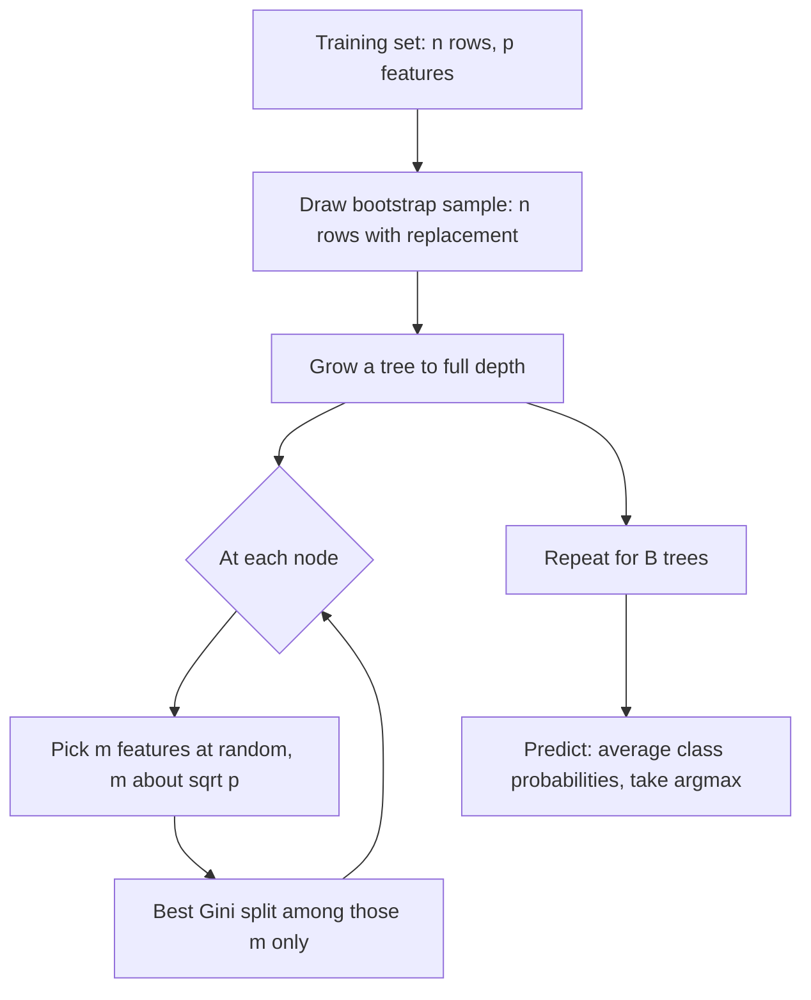

# Random Forests

> Many deep trees, each trained on a different bootstrap sample and allowed to look at only a few features per split, vote together. The randomness is the point.

**Type:** Build
**Languages:** Python
**Prerequisites:** Phase 04 (ML Fundamentals: bias-variance, cross-validation), Phase 07 Lessons 01-04 (Decision Trees, Entropy and Gini, Pruning, Bagging)
**Time:** ~75 minutes

## Learning Objectives

- Explain why averaging only reduces variance when the averaged models are not strongly correlated
- Implement a random forest from scratch: bootstrap samples, per-split feature subsampling, and probability averaging
- Compute out-of-bag (OOB) accuracy as a free validation estimate and impurity-based feature importances
- Tune `n_estimators`, `max_features` and depth in scikit-learn's `RandomForestClassifier` with sensible defaults

## The Problem

A single fully grown decision tree has low bias and very high variance. Change a handful of training rows and the root split can flip, which reshapes the whole tree. In the previous lesson you fixed part of this with bagging: train many trees on bootstrap samples and average them.

Bagging hits a ceiling. If one feature is much stronger than the rest, almost every bagged tree picks it at the root, then the same second feature, and so on. The trees end up looking alike and make the same mistakes. Averaging 100 copies of nearly the same tree is barely better than one tree.

Random forests (Breiman, 2001) add one more source of randomness: at every split, a tree may only choose among a random subset of the features. Strong features are hidden from some splits, so other features get a chance, and the trees disagree more. That disagreement is what makes the average better. Random forests are still one of the strongest "default" models for tabular data: almost no tuning, no feature scaling, and robust to irrelevant features.

## The Concept

### Why decorrelation matters

Suppose you average B models, each with variance $\sigma^2$, and every pair has correlation $\rho$. The variance of the average is:

```
Var(average) = rho * sigma^2 + (1 - rho) / B * sigma^2
```

As B grows, the second term vanishes, but the first does not. With $\rho = 0.9$, no number of trees can bring the variance below $0.9 \sigma^2$. The only way to push the floor down is to make $\rho$ smaller. Bagging lowers $\rho$ a little (different rows). Feature subsampling lowers it a lot (different features).

The price is that each individual tree gets slightly worse, because it is sometimes forced to split on a weaker feature. The bias goes up a bit, the variance of the ensemble goes down a lot.

### The algorithm



Key settings:

| Setting | Typical value | Effect |
|---|---|---|
| `max_features` (m) | sqrt(p) for classification, p/3 or 1.0 for regression | Smaller m means less correlated, individually weaker trees |
| `n_estimators` (B) | 100-500 | More trees never overfit; the error just plateaus |
| `max_depth` / `min_samples_leaf` | None / 1 | Trees are grown deep; averaging handles their variance |

Note that `max_features = p` is exactly bagging. A random forest is bagging plus one line of code.

### Out-of-bag evaluation

A bootstrap sample of size n leaves out about $(1 - 1/n)^n \approx e^{-1} \approx 36.8\%$ of the rows. Those rows are "out of bag" for that tree. For each training row, collect the votes only from trees that did not see it. The accuracy of those votes is the OOB score, an almost free estimate of test accuracy that needs no separate validation set.

```
row i:  tree 1 (in bag)  tree 2 (OOB) -> vote   tree 3 (OOB) -> vote   tree 4 (in bag) ...
        OOB prediction for row i = average of the votes from trees 2, 3, ...
```

### Impurity-based feature importance

Every time a tree splits on feature j, the Gini impurity drops. Weight that drop by the number of samples at the node and add it to feature j's total. Normalize per tree, then average across trees. This is the "mean decrease in impurity" (MDI) importance that scikit-learn exposes as `feature_importances_`.

MDI is computed on training data, so it is biased toward features with many unique values (continuous features, IDs). Treat it as a quick ranking; for decisions, use permutation importance on held-out data (Phase 10).

## Build It

### Step 1: A tree that can subsample features

The tree from Lesson 01 needs one change: `best_split` only looks at `max_features` randomly chosen columns. The split search is vectorized with cumulative class counts, so each candidate feature costs one sort.

```python
def best_split(self, X, y):
    n_samples = len(y)
    parent_impurity = gini(np.bincount(y, minlength=self.n_classes))
    k = self.max_features or self.n_features
    candidate_features = self.rng.choice(self.n_features, size=k, replace=False)
    one_hot = np.eye(self.n_classes)[y]
    n_left = np.arange(1, n_samples)
    n_right = n_samples - n_left
    best = (None, None, 0.0)
    for feature in candidate_features:
        order = np.argsort(X[:, feature])
        sorted_values = X[order, feature]
        left_counts = np.cumsum(one_hot[order], axis=0)[:-1]
        right_counts = left_counts[-1] + one_hot[order][-1] - left_counts
        gini_left = 1.0 - np.sum((left_counts / n_left[:, None]) ** 2, axis=1)
        gini_right = 1.0 - np.sum((right_counts / n_right[:, None]) ** 2, axis=1)
        gain = parent_impurity - (n_left * gini_left + n_right * gini_right) / n_samples
        valid = (sorted_values[:-1] < sorted_values[1:])
        valid &= (n_left >= self.min_samples_leaf) & (n_right >= self.min_samples_leaf)
        if not valid.any():
            continue
        gain = np.where(valid, gain, -np.inf)
        i = int(np.argmax(gain))
        if gain[i] > best[2]:
            threshold = (sorted_values[i] + sorted_values[i + 1]) / 2
            best = (feature, threshold, gain[i])
    return best
```

When `grow` accepts a split, it also records `gain * len(y)` for that feature, which becomes the MDI importance.

### Step 2: The forest

```python
def fit(self, X, y):
    n_samples, n_features = X.shape
    self.n_classes = int(y.max()) + 1
    k = self.resolve_max_features(n_features)
    self.trees = []
    self.in_bag_masks = []
    for _ in range(self.n_trees):
        indices = self.rng.integers(0, n_samples, size=n_samples)
        in_bag = np.zeros(n_samples, dtype=bool)
        in_bag[indices] = True
        tree = RandomizedTree(max_depth=self.max_depth, max_features=k, rng=self.rng)
        tree.fit(X[indices], y[indices], self.n_classes)
        self.trees.append(tree)
        self.in_bag_masks.append(in_bag)
    self.compute_oob_score(X, y)
    self.feature_importances_ = np.mean([t.feature_importances_ for t in self.trees], axis=0)
    return self

def predict_proba(self, X):
    return np.mean([tree.predict_proba(X) for tree in self.trees], axis=0)
```

Averaging probabilities ("soft voting") is what scikit-learn does. It is smoother than counting hard votes.

### Step 3: Out-of-bag score

```python
def compute_oob_score(self, X, y):
    votes = np.zeros((len(y), self.n_classes))
    for tree, in_bag in zip(self.trees, self.in_bag_masks):
        out_of_bag = ~in_bag
        votes[out_of_bag] += tree.predict_proba(X[out_of_bag])
    has_vote = votes.sum(axis=1) > 0
    self.oob_score_ = np.mean(votes[has_vote].argmax(axis=1) == y[has_vote])
```

### Step 4: Measure decorrelation

The script trains two ensembles with the same number of trees on a 30-feature problem: `max_features=None` (bagging) and `max_features="sqrt"` (random forest). It then measures the average pairwise correlation of the trees' predicted probabilities on the test set:

```python
def average_pairwise_correlation(prediction_matrix):
    correlation = np.corrcoef(prediction_matrix)
    upper = correlation[np.triu_indices_from(correlation, k=1)]
    return np.nanmean(upper)
```

Run it:

```bash
uv run python phases/07-trees-and-ensembles/05-random-forests/code/main.py
```

Typical output:

```
single tree test accuracy: 0.729
bagging (all features)   test acc=0.821  oob acc=0.805  tree corr=0.286
random forest (sqrt)     test acc=0.825  oob acc=0.807  tree corr=0.173
trees=  1  test acc=0.646
trees= 10  test acc=0.783
trees= 60  test acc=0.825
```

Three things to read from this:

1. One deep tree scores about 0.73. Any ensemble adds about 9 points.
2. Feature subsampling cuts the tree-to-tree correlation from about 0.29 to 0.17, and the ensemble ends up at least as good even though each tree is weaker (a single random-forest tree scores 0.65, worse than the full tree).
3. The OOB accuracy lands within a couple of points of the test accuracy, without using the test set.

The gap between bagging and a random forest grows when a few features dominate and many are correlated; on some datasets it is small. That is normal, and `max_features` is the knob worth tuning.

## Use It

```python
from sklearn.ensemble import RandomForestClassifier

forest = RandomForestClassifier(
    n_estimators=200,
    max_features="sqrt",
    oob_score=True,
    n_jobs=-1,
    random_state=0,
).fit(X_train, y_train)

print(forest.score(X_test, y_test))
print(forest.oob_score_)
print(forest.feature_importances_)
```

The script prints our top-6 features next to scikit-learn's. The two strongest features agree, and the rest overlap heavily; small differences come from randomness and from MDI being noisy on correlated features.

Practical notes:

- `n_jobs=-1` trains trees in parallel. Trees are independent, so forests scale almost linearly with cores.
- `RandomForestRegressor` averages leaf means instead of class probabilities; its default `max_features` is 1.0 (all features), and values like 0.33 often help.
- `ExtraTreesClassifier` goes one step further and also randomizes thresholds. It is faster and sometimes even less correlated.
- `class_weight="balanced_subsample"` reweights classes inside each bootstrap sample for imbalanced data.
- Forests do not extrapolate: a regression forest can never predict outside the range of training targets.

## Exercises

1. **Easy.** Train our `RandomForest` with `max_features` in {1, 3, 5, 15, 30}. Plot test accuracy and average tree correlation against m. Where is the sweet spot?
2. **Medium.** Implement permutation importance: for each feature, shuffle its column in the test set and measure the accuracy drop. Compare the ranking with MDI. Add a random noise column with many unique values and see which method is fooled.
3. **Hard.** Turn `RandomizedTree` into a regressor (variance reduction instead of Gini, leaf mean instead of class probabilities) and build `RandomForestRegressor`. Verify on `make_friedman1` that it beats a single tree and that predictions never exceed the training target range.

## Key Terms

| Term | What people say | What it actually means |
|------|----------------|----------------------|
| Random forest | "Lots of trees voting" | Bagged deep trees where each split only considers a random subset of features, averaged together |
| Feature subsampling | "Random features" | At every node, choose m of p features at random and search splits only among them |
| Decorrelation | "Make the trees different" | Lowering the correlation rho between trees, which lowers the variance floor rho * sigma^2 of the average |
| `max_features` | "mtry" | The number m of candidate features per split; sqrt(p) is the classification default |
| Out-of-bag (OOB) | "Free validation" | For each row, predicting with only the trees whose bootstrap sample excluded it (about 37% of trees) |
| Soft voting | "Average the probabilities" | Averaging predicted class probabilities across trees and taking the argmax |
| MDI importance | "Feature importance" | Total weighted impurity decrease caused by splits on a feature, averaged across trees |
| Permutation importance | "Shuffle test" | The drop in a held-out metric when one feature's values are randomly permuted |

## Further Reading

- [Breiman, L. (2001). Random Forests. Machine Learning 45, 5-32](https://link.springer.com/article/10.1023/A:1010933404324) -- the original paper, including the correlation/strength analysis and OOB estimates
- [The Elements of Statistical Learning, Chapter 15](https://hastie.su.domains/ElemStatLearn/) -- derivation of the rho * sigma^2 variance formula and discussion of `mtry`
- [scikit-learn User Guide: Forests of randomized trees](https://scikit-learn.org/stable/modules/ensemble.html#forests-of-randomized-trees) -- parameters, ExtraTrees, and the caveats of impurity-based importance
- [StatQuest: Random Forests Part 1 - Building, Using and Evaluating](https://www.youtube.com/watch?v=J4Wdy0Wc_xQ) -- a visual walk-through of bootstrapping, feature subsampling, and OOB error
