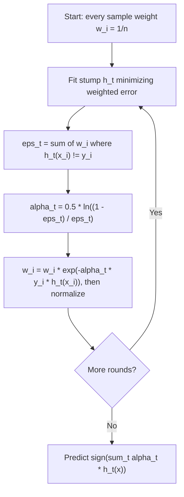

# AdaBoost

> Train a weak model, find what it got wrong, make those examples louder, train again. Add up the votes.

**Type:** Build
**Languages:** Python
**Prerequisites:** Phase 04 (ML Fundamentals: overfitting, bias-variance), Phase 07 Lessons 01-05 (Decision Trees through Random Forests)
**Time:** ~75 minutes

## Learning Objectives

- Describe the difference between bagging (parallel, variance reduction) and boosting (sequential, bias reduction)
- Implement discrete AdaBoost with weighted decision stumps from scratch, including the alpha and reweighting formulas
- Explain AdaBoost as greedy minimization of the exponential loss and why that makes it sensitive to label noise
- Use scikit-learn's `AdaBoostClassifier` and choose the base estimator depth, `n_estimators` and `learning_rate`

## The Problem

A decision stump (a tree with one split) is a terrible classifier on most problems. On the dataset in this lesson, the best single stump gets 44.5% test error, barely better than a coin flip. Random forests would not help: averaging many high-bias stumps still gives a high-bias model, because averaging only reduces variance.

You need a way to reduce bias by combining weak learners. The 1990s question was: if you can always find a rule that is slightly better than chance, can you combine such rules into an arbitrarily accurate one? Freund and Schapire answered yes with AdaBoost (1995), which won the Godel Prize and was the go-to "off-the-shelf" classifier for a decade. It is also the conceptual bridge to gradient boosting, which you build in the next lesson.

## The Concept

### Bagging vs boosting

```
Bagging / random forest                Boosting
-----------------------                --------
trees trained independently            learners trained one after another
each on a bootstrap sample             each on reweighted data
deep, low-bias, high-variance trees    shallow, high-bias learners (stumps)
average reduces VARIANCE               weighted sum reduces BIAS
more trees never hurts                 too many rounds can overfit noisy data
```

### The algorithm (discrete AdaBoost, labels in {-1, +1})



Read the formulas slowly:

- `eps_t` is the weighted error. The learner only has to beat 0.5.
- `alpha_t` is the learner's vote. If `eps_t = 0.5`, alpha is 0 (useless). If `eps_t = 0.1`, alpha is about 1.1. Better learners shout louder.
- `y_i * h_t(x_i)` is +1 when correct and -1 when wrong. Correct samples are multiplied by `exp(-alpha)` (shrink), wrong ones by `exp(+alpha)` (grow). After normalizing, the misclassified samples carry exactly half of the total weight, so the next stump is forced to focus on them.

### Why it works: exponential loss

Define the ensemble score $F(x) = \sum_t \alpha_t h_t(x)$ and the margin $y F(x)$. A positive margin means correct; a large positive margin means confidently correct. AdaBoost is exactly forward stagewise minimization of the exponential loss

```
L(F) = sum_i exp(-y_i * F(x_i))
```

At each round you add one term $\alpha h$ that reduces L as much as possible. Solving for the best $\alpha$ given $h$ gives the `0.5 * ln((1 - eps)/eps)` formula, and the sample weights are just $\exp(-y_i F(x_i))$, the current loss of each point. This view (Friedman, Hastie and Tibshirani, 2000) is what led to gradient boosting: swap the exponential loss for any differentiable loss.

The training error is bounded by $\prod_t 2\sqrt{\epsilon_t(1-\epsilon_t)}$, which shrinks exponentially as long as each stump beats chance by some margin. Training error goes to zero fast.

### The weak spot: noise and outliers

The exponential loss grows without limit for negative margins. A mislabeled point can never be fit correctly, so its weight keeps growing until it dominates the training set and later stumps chase it. With noisy labels, AdaBoost overfits after enough rounds. Fixes: fewer rounds (early stopping), a `learning_rate` below 1 (shrinkage), or a more robust loss (log-loss, which is what gradient boosting for classification uses).

## Build It

### Step 1: A stump that respects sample weights

For each feature, sort the values and compute cumulative weights of positives and negatives. A stump either predicts -1 on the left and +1 on the right (`polarity = +1`) or the reverse. Its weighted error at every cut position comes from the cumulative sums, no inner loop needed.

```python
class WeightedStump:
    def fit(self, X, y, sample_weight):
        n_samples, n_features = X.shape
        best_error = np.inf
        for feature in range(n_features):
            order = np.argsort(X[:, feature])
            sorted_values = X[order, feature]
            sorted_labels = y[order]
            sorted_weights = sample_weight[order]
            positive_weight_left = np.concatenate(([0.0], np.cumsum(sorted_weights * (sorted_labels == 1))))
            negative_weight_left = np.concatenate(([0.0], np.cumsum(sorted_weights * (sorted_labels == -1))))
            total_positive = positive_weight_left[-1]
            total_negative = negative_weight_left[-1]
            error_left_negative = positive_weight_left + (total_negative - negative_weight_left)
            error_left_positive = negative_weight_left + (total_positive - positive_weight_left)
            boundaries = np.concatenate(([True], sorted_values[:-1] < sorted_values[1:], [True]))
            for polarity, errors in ((1, error_left_negative), (-1, error_left_positive)):
                masked = np.where(boundaries, errors, np.inf)
                i = int(np.argmin(masked))
                if masked[i] < best_error:
                    best_error = masked[i]
                    ...
        self.weighted_error = best_error / sample_weight.sum()
        return self

    def predict(self, X):
        right_side = X[:, self.feature] > self.threshold
        return np.where(right_side, self.polarity, -self.polarity)
```

### Step 2: The boosting loop

```python
def fit(self, X, y, X_eval=None, y_eval=None):
    n_samples = len(y)
    weights = np.full(n_samples, 1.0 / n_samples)
    self.stumps, self.alphas = [], []
    for _ in range(self.n_rounds):
        stump = WeightedStump().fit(X, y, weights)
        error = np.clip(stump.weighted_error, 1e-10, 1 - 1e-10)
        if error >= 0.5:
            break
        alpha = 0.5 * np.log((1 - error) / error)
        predictions = stump.predict(X)
        weights = weights * np.exp(-alpha * y * predictions)
        weights = weights / weights.sum()
        self.stumps.append(stump)
        self.alphas.append(alpha)
    return self

def decision_function(self, X):
    return sum(alpha * stump.predict(X) for alpha, stump in zip(self.alphas, self.stumps))
```

The full script also tracks train and test error after every round.

### Step 3: Run it on a problem stumps cannot solve

The dataset is `make_hastie_10_2`: ten Gaussian features, and the label is +1 when $\sum_j x_j^2 > 9.34$. The boundary is a sphere, which no single axis-aligned split can describe.

```bash
uv run python phases/07-trees-and-ensembles/06-adaboost/code/main.py
```

```
stump test error: 0.445
rounds=  1  train err=0.439  test err=0.445
rounds= 10  train err=0.376  test err=0.389
rounds= 50  train err=0.195  test err=0.224
rounds=100  train err=0.142  test err=0.193
rounds=300  train err=0.071  test err=0.131
first alphas: [0.122, 0.091, 0.122, 0.094, 0.121]
```

Each stump is weak (alpha around 0.1 means weighted error around 0.44), yet 300 of them cut the test error from 44.5% to 13%.

### Step 4: Look at the weights

```
mean |margin| of all points:          0.052
mean |margin| of 200 heaviest points: 0.010
weight held by heaviest 10% of rows:  0.262
```

The heaviest points are the ones sitting closest to the decision boundary (smallest margin). A tenth of the rows holds a quarter of the weight. This is AdaBoost "focusing on the hard cases".

### Step 5: Add label noise

The script flips 20% of the training labels of a separate dataset and evaluates on clean test labels:

```
label noise=0%   best test err=0.062 at round 210  final test err=0.075
label noise=20%  best test err=0.098 at round 6    final test err=0.173
```

Without noise, error keeps improving for hundreds of rounds. With noise, the best model appears after a few rounds and then the stumps start chasing the flipped labels. Early stopping on a validation set is not optional when your labels are noisy.

## Use It

```python
from sklearn.ensemble import AdaBoostClassifier
from sklearn.tree import DecisionTreeClassifier

stumps = AdaBoostClassifier(
    estimator=DecisionTreeClassifier(max_depth=1),
    n_estimators=300,
    learning_rate=1.0,
    random_state=0,
).fit(X_train, y_train)

deeper = AdaBoostClassifier(
    estimator=DecisionTreeClassifier(max_depth=3),
    n_estimators=300,
    learning_rate=0.5,
    random_state=0,
).fit(X_train, y_train)
```

```
ours test error:    0.131
sklearn test error: 0.129
sklearn depth-3 trees, lr=0.5 test error: 0.105
```

The from-scratch version matches scikit-learn to within tie-breaking. Recent scikit-learn versions implement SAMME, the multiclass generalization: $\alpha_t = \ln((1-\epsilon_t)/\epsilon_t) + \ln(K-1)$ with K classes. For K = 2 that is twice our alpha, which scales all votes equally and gives the same predictions.

Practical guidance:

- Depth 1-3 trees are the usual base learners. Deeper trees reduce bias per round but overfit sooner.
- `learning_rate` multiplies each alpha. Smaller values need more estimators but generalize better; tune them together.
- Use `staged_predict` to get the predictions after every round and pick `n_estimators` on a validation set.
- In practice, gradient boosting (next lessons) has replaced AdaBoost for most tabular problems, mainly because log-loss is more robust to noise. AdaBoost is still worth knowing: it is the clearest example of boosting, and it shows up in classic computer vision (Viola-Jones face detection).

## Exercises

1. **Easy.** Plot `model.train_curve` and `model.eval_curve` against the round number on `make_hastie_10_2`. Does test error keep dropping after training error flattens? (AdaBoost often keeps improving the margin even after training error is low.)
2. **Medium.** Add a `learning_rate` parameter that multiplies alpha. Compare learning rates 1.0, 0.5 and 0.1 on the 20%-noise dataset. How does the best round and the best test error change?
3. **Hard.** Implement SAMME for K classes: use a weighted multiclass stump (predict the weighted-majority class on each side), set $\alpha = \ln((1-\epsilon)/\epsilon) + \ln(K-1)$, and predict with the class that gets the largest total alpha. Test it on `load_iris` or `load_wine` and compare with `AdaBoostClassifier`.

## Key Terms

| Term | What people say | What it actually means |
|------|----------------|----------------------|
| Boosting | "Learn from mistakes" | Fitting learners sequentially, each one focusing on what the current ensemble gets wrong, to reduce bias |
| Weak learner | "Slightly better than random" | A model whose weighted error is below 0.5 for any weighting; usually a stump or a shallow tree |
| Decision stump | "One-split tree" | A depth-1 tree: one feature, one threshold, one prediction per side |
| Sample weights | "Importance of each row" | Nonnegative numbers summing to 1 that the learner uses to compute its weighted error |
| Alpha | "Learner's vote" | 0.5 * ln((1 - eps)/eps); the weight of a learner in the final sum, larger for more accurate learners |
| Margin | "Confidence of a prediction" | y * F(x); positive when correct, larger when the ensemble is more confident |
| Exponential loss | "AdaBoost's hidden objective" | sum of exp(-y F(x)); AdaBoost greedily minimizes it one learner at a time |
| SAMME | "Multiclass AdaBoost" | The K-class extension that adds ln(K-1) to alpha so learners only need to beat 1/K accuracy |

## Further Reading

- [Freund and Schapire (1997). A Decision-Theoretic Generalization of On-Line Learning and an Application to Boosting](https://www.sciencedirect.com/science/article/pii/S002200009791504X) -- the original AdaBoost paper
- [Friedman, Hastie and Tibshirani (2000). Additive Logistic Regression: A Statistical View of Boosting](https://projecteuclid.org/journals/annals-of-statistics/volume-28/issue-2/Additive-logistic-regression--a-statistical-view-of-boosting/10.1214/aos/1016218223.full) -- shows AdaBoost minimizes exponential loss
- [The Elements of Statistical Learning, Chapter 10](https://hastie.su.domains/ElemStatLearn/) -- boosting, exponential loss, and robustness of loss functions
- [StatQuest: AdaBoost, Clearly Explained](https://www.youtube.com/watch?v=LsK-xG1cLYA) -- a visual walk-through of stumps, amounts of say, and reweighting
