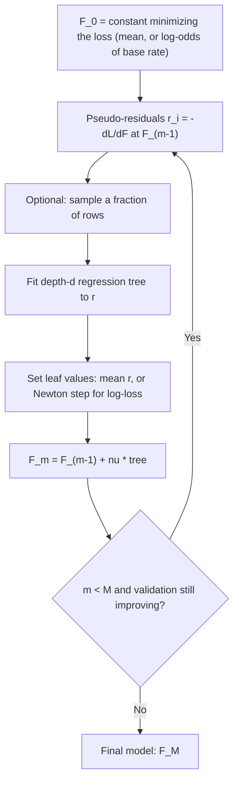

# Gradient Boosting

> Fit a small tree to what the model still gets wrong, add a fraction of it, repeat. That is gradient descent where each step is a tree.

**Type:** Build
**Languages:** Python
**Prerequisites:** Phase 02 (Calculus and Optimization: gradients, gradient descent, learning rate), Phase 06 (Supervised Classification: logistic regression, log-loss), Phase 07 Lessons 01-06
**Time:** ~90 minutes

## Learning Objectives

- Derive gradient boosting as gradient descent in function space and identify pseudo-residuals as the negative gradient of the loss
- Implement gradient boosting from scratch for squared error (regression) and log-loss (binary classification), including Newton-step leaf values
- Measure the effect of shrinkage (learning rate), number of trees, tree depth and row subsampling on test error
- Use scikit-learn's `GradientBoostingRegressor` and `GradientBoostingClassifier`, including built-in early stopping

## The Problem

AdaBoost showed that adding weak learners one at a time can build a strong model, but it is tied to one loss (exponential) and one task (classification). Real problems need more: regression with squared or absolute error, classification with calibrated probabilities, ranking, quantiles, Poisson counts.

Friedman (2001) generalized boosting to any differentiable loss with a single idea: at every round, fit a regression tree to the negative gradient of the loss with respect to the current predictions. This is gradient boosting, and with its descendants (XGBoost, LightGBM, CatBoost, HistGradientBoosting) it is the model that wins most tabular machine learning competitions and runs in a large share of production ranking, pricing and risk systems.

## The Concept

### Boosting on residuals

Start with the simplest case: squared error regression.

```
F_0(x) = mean(y)                          start with a constant
r_i    = y_i - F_0(x_i)                   residuals: what is still unexplained
h_1    = small tree fit to (x_i, r_i)     learn the pattern in the residuals
F_1(x) = F_0(x) + nu * h_1(x)             add a fraction nu of it
r_i    = y_i - F_1(x_i)                   new residuals ... repeat
```

Each tree only needs to model what the previous ones missed. Depth-3 trees are enough because the ensemble is a sum: tree 1 captures the main effect, tree 2 refines it, and so on.

### Why "gradient"

For squared loss $L = \frac{1}{2}(y - F)^2$, the derivative with respect to the prediction is $\partial L / \partial F = -(y - F)$. So the residual is exactly the negative gradient. Fitting a tree to residuals is taking a gradient descent step, where the "parameters" are the predictions $F(x_i)$ themselves and the tree generalizes that step to unseen x.

This works for any loss. Compute the pseudo-residuals

```
r_i = - dL(y_i, F(x_i)) / dF(x_i)
```

fit a regression tree to them, and add it with step size nu.

| Loss | L(y, F) | Pseudo-residual r = -dL/dF |
|---|---|---|
| Squared error | (y - F)^2 / 2 | y - F |
| Absolute error | abs(y - F) | sign(y - F) |
| Log-loss (y in {0,1}, F = log-odds) | -y F + log(1 + e^F) | y - sigmoid(F) |

For classification, F is the log-odds, and the pseudo-residual `y - p` is the same quantity you saw in the logistic regression gradient in Phase 06.

### Leaf values: a Newton step

The tree's splits are chosen by fitting r with squared error. For log-loss, Friedman then replaces each leaf's value with a one-step Newton estimate instead of the mean residual:

```
leaf value = sum(r_i) / sum(p_i * (1 - p_i))       over the samples in the leaf
```

The denominator is the sum of second derivatives (the Hessian) of log-loss. Points where the model is already confident (p near 0 or 1) have small Hessians, so the step is larger where it is safe. This "gradient over Hessian" idea is the core of XGBoost and LightGBM in the next lesson.

### The algorithm



### The knobs

- **Learning rate (nu, shrinkage).** Smaller steps need more trees but generalize better. Typical: 0.05-0.1.
- **Number of trees (M).** Unlike random forests, boosting can overfit with too many trees. Choose M with early stopping on a validation set.
- **Tree depth.** Depth controls interaction order: depth 1 gives an additive model, depth 3 allows three-way interactions. Typical: 3-8.
- **Subsample.** Fitting each tree on a random fraction (e.g. 0.5-0.8) of rows, without replacement, adds randomness that reduces variance and speeds training. This is "stochastic gradient boosting".

## Build It

### Step 1: A regression tree with fast split search

For squared error, the best split maximizes $S_L^2 / n_L + S_R^2 / n_R$, where $S$ is the sum of targets on each side. That is equivalent to minimizing the sum of squared errors, and it only needs a cumulative sum.

```python
def best_split(self, X, target, indices):
    n = len(indices)
    best_feature, best_threshold, best_score = None, None, -np.inf
    total_sum = target[indices].sum()
    n_left = np.arange(1, n)
    n_right = n - n_left
    for feature in range(X.shape[1]):
        order = indices[np.argsort(X[indices, feature])]
        values = X[order, feature]
        left_sum = np.cumsum(target[order])[:-1]
        right_sum = total_sum - left_sum
        score = left_sum ** 2 / n_left + right_sum ** 2 / n_right
        valid = (values[:-1] < values[1:]) & (n_left >= self.min_samples_leaf) & (n_right >= self.min_samples_leaf)
        if not valid.any():
            continue
        score = np.where(valid, score, -np.inf)
        i = int(np.argmax(score))
        if score[i] > best_score:
            best_feature, best_threshold, best_score = feature, (values[i] + values[i + 1]) / 2, score[i]
    return best_feature, best_threshold
```

Each node also stores the indices of its training rows, so leaf values can be recomputed later.

### Step 2: Three rounds by hand

```python
prediction = np.full(len(y_train), y_train.mean())
for round_number in range(1, 4):
    residual = y_train - prediction
    tree = RegressionTree(max_depth=3).fit(X_train, residual)
    prediction += 0.5 * tree.predict(X_train)
```

On `make_friedman1` (a nonlinear target $10\sin(\pi x_1 x_2) + 20(x_3 - 0.5)^2 + 10 x_4 + 5 x_5$ plus noise):

```
round 0: predict the mean 14.074  train MSE=25.893
round 1: fit tree to residuals   train MSE=13.393
round 2: fit tree to residuals   train MSE=9.028
round 3: fit tree to residuals   train MSE=6.504
```

### Step 3: The general model

Only two functions depend on the loss: the pseudo-residuals and the leaf update.

```python
def negative_gradient(self, y, score):
    if self.loss == "squared":
        return y - score
    return y - sigmoid(score)

def update_leaves(self, tree, y, score, residual):
    if self.loss == "squared":
        return
    probability = sigmoid(score)
    hessian = probability * (1 - probability)
    for leaf in tree.leaves():
        rows = leaf["indices"]
        leaf["value"] = residual[rows].sum() / (hessian[rows].sum() + 1e-12)

def fit(self, X, y, X_eval=None, y_eval=None):
    self.base_score = self.initial_score(y)
    score = np.full(len(y), self.base_score)
    for _ in range(self.n_estimators):
        residual = self.negative_gradient(y, score)
        n_rows = max(1, int(self.subsample * len(y)))
        rows = self.rng.choice(len(y), size=n_rows, replace=False) if self.subsample < 1 else np.arange(len(y))
        tree = RegressionTree(max_depth=self.max_depth).fit(X[rows], residual[rows])
        self.update_leaves(tree, y[rows], score[rows], residual[rows])
        self.trees.append(tree)
        score += self.learning_rate * tree.predict(X)
    return self
```

For log-loss, `initial_score` returns the log-odds of the positive rate, the best constant under that loss.

### Step 4: Run the experiments

```bash
uv run python phases/07-trees-and-ensembles/07-gradient-boosting/code/main.py
```

```
variance of y_test (MSE of predicting the mean): 27.336
lr=1.0  best test MSE=4.612 at tree  23  after 200 trees=5.873
lr=0.3  best test MSE=2.589 at tree 148  after 200 trees=2.604
lr=0.1  best test MSE=2.414 at tree 200  after 200 trees=2.414
subsample=1.0  test MSE after 200 trees=2.414
subsample=0.5  test MSE after 200 trees=1.906
```

With `lr=1.0` the model overfits after about 20 trees and gets worse. With `lr=0.1` it is still improving at tree 200 and ends far lower. Subsampling half the rows per tree reduces the error further on this dataset.

The log-loss classifier starts from the base-rate log-odds and drives test log-loss from 0.654 (one tree) to 0.283 (150 trees), at 87.6% accuracy.

## Use It

```python
from sklearn.ensemble import GradientBoostingRegressor, GradientBoostingClassifier

reg = GradientBoostingRegressor(
    n_estimators=200, learning_rate=0.1, max_depth=3, min_samples_leaf=5, random_state=0,
).fit(X_train, y_train)

clf = GradientBoostingClassifier(
    n_estimators=150, learning_rate=0.1, max_depth=3, min_samples_leaf=5, random_state=0,
).fit(Xc_train, yc_train)

early = GradientBoostingRegressor(
    n_estimators=2000, learning_rate=0.1, max_depth=3,
    validation_fraction=0.2, n_iter_no_change=20, random_state=0,
).fit(X_train, y_train)
print(early.n_estimators_)
```

```
regression test MSE   ours=2.414  sklearn=2.414
classification acc    ours=0.876  sklearn=0.882
early stopping kept 169 of 2000 trees, test MSE=2.631
```

The regression result matches scikit-learn to three decimals: same algorithm, same split criterion, same initial value. The classifier differs slightly because scikit-learn uses Friedman's MSE split criterion and different tie-breaking.

Practical notes:

- `GradientBoostingRegressor(loss="huber")` or `loss="absolute_error"` is robust to outliers; `loss="quantile", alpha=0.9` predicts the 90th percentile.
- `n_iter_no_change` holds out `validation_fraction` of the training data and stops when the score stops improving. Set `n_estimators` high and let it decide.
- `staged_predict` returns predictions after every tree, useful for plotting the learning curve.
- The classic implementation sorts every feature at every node. On more than tens of thousands of rows, use `HistGradientBoostingRegressor/Classifier`, XGBoost or LightGBM (next lesson), which bin features into histograms and are 10-100x faster.

## Exercises

1. **Easy.** Train with `max_depth` in {1, 2, 3, 5, 8} at `lr=0.1`. Which depth gives the lowest test MSE on Friedman #1? Why does depth 1 do worse on a target with an $x_1 x_2$ interaction?
2. **Medium.** Add `loss="absolute"` to `GradientBoosting`: pseudo-residuals are `sign(y - F)`, the initial score is the median, and each leaf value should be the median of `y - F` in that leaf. Add 5% huge outliers to `y_train` and compare squared vs absolute loss on clean test data.
3. **Hard.** Extend the classifier to K classes: keep K score vectors, use softmax probabilities, fit one tree per class per round to `y_k - p_k`, and use the Newton leaf value $\frac{K-1}{K} \frac{\sum r}{\sum p(1-p)}$. Compare with `GradientBoostingClassifier` on `load_wine`.

## Key Terms

| Term | What people say | What it actually means |
|------|----------------|----------------------|
| Gradient boosting | "Trees fixing each other's mistakes" | Forward stagewise additive model where each tree is fit to the negative gradient of the loss at the current predictions |
| Pseudo-residuals | "Residuals" | r_i = -dL/dF(x_i); equals y - F for squared error and y - p for log-loss |
| Function space | "Gradient descent on predictions" | Treating the vector of predictions F(x_i) as the parameters being optimized |
| Shrinkage | "Learning rate" | Multiplying each tree by nu < 1 so each step is small; trades more trees for better generalization |
| Stochastic gradient boosting | "Subsample" | Fitting each tree on a random fraction of rows drawn without replacement |
| Newton step | "Gradient over Hessian" | Leaf value sum(g)/sum(h) using first and second derivatives of the loss, used for log-loss and by XGBoost |
| Early stopping | "Stop when validation stops improving" | Choosing the number of trees by monitoring a held-out score during training |
| Base score | "Initial prediction" | The constant F_0 that minimizes the loss: mean of y, or log-odds of the positive rate |

## Further Reading

- [Friedman, J. (2001). Greedy Function Approximation: A Gradient Boosting Machine. Annals of Statistics 29(5)](https://projecteuclid.org/journals/annals-of-statistics/volume-29/issue-5/Greedy-function-approximation-A-gradient-boosting-machine/10.1214/aos/1013203451.full) -- the original paper
- [The Elements of Statistical Learning, Chapter 10](https://hastie.su.domains/ElemStatLearn/) -- boosting as stagewise additive modeling, loss functions, and regularization
- [scikit-learn User Guide: Gradient-boosted trees](https://scikit-learn.org/stable/modules/ensemble.html#gradient-boosted-trees) -- losses, shrinkage, subsampling, early stopping
- [StatQuest: Gradient Boost Part 1-4](https://www.youtube.com/watch?v=3CC4N4z3GJc) -- regression and classification walk-throughs with every number worked out
