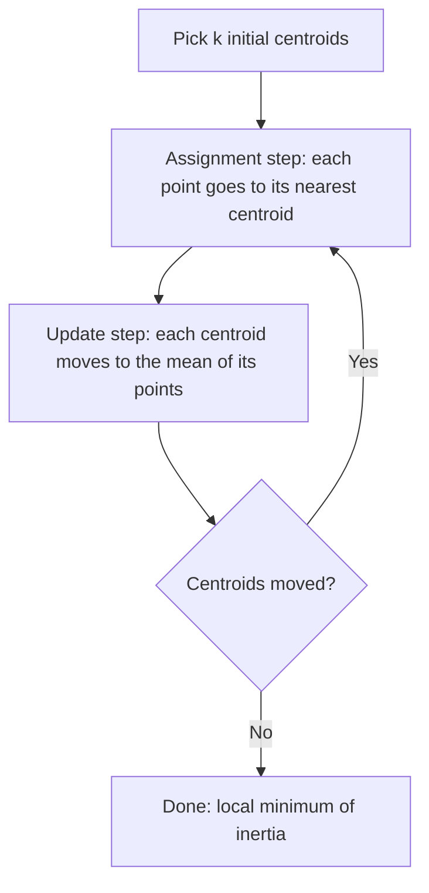

# K-Means

> K-means finds groups by repeating two dumb steps until nothing changes: assign every point to its nearest center, then move every center to the mean of its points.

**Type:** Build
**Languages:** Python
**Prerequisites:** Phase 01 (Linear Algebra: Norms & Distances), Phase 02 (Calculus and Optimization: Gradient Descent), Phase 04 (ML Fundamentals: Feature Scaling & Encoding)
**Time:** ~60 minutes

## Learning Objectives

- Explain the k-means objective (inertia) and why Lloyd's algorithm never increases it
- Implement k-means from scratch in NumPy with vectorized distance computation
- Show that k-means converges to a local minimum that depends on the initial centroids
- Reproduce your results with scikit-learn's `KMeans` and compare inertia and labels

## The Problem

Every algorithm you have built so far had labels. Someone told you which emails were spam, which houses sold for how much. Most data in the real world has no labels. You have a table of customers with spend, visit frequency and basket size, and the marketing team asks: "what kinds of customers do we have?"

Nobody can tell you the answer in advance. You need an algorithm that looks at the geometry of the data and proposes groups of points that are close to each other and far from the rest. That is clustering, and k-means is the first algorithm everyone reaches for because it is fast, simple, and works surprisingly often.

It also fails in very specific, predictable ways. Understanding the objective it optimizes tells you exactly when to trust it.

## The Concept

### The Objective

You choose a number of clusters `k`. K-means looks for `k` centers `mu_1 ... mu_k` and an assignment of each point to one center that minimizes the total squared distance from points to their centers:

```
inertia = sum over clusters j  sum over points x in cluster j  ||x - mu_j||^2
```

This is also called the within-cluster sum of squares (WCSS). Small inertia means points sit close to their center. Note that inertia always decreases as you add more clusters; with `k = n` every point is its own center and inertia is zero. Inertia alone cannot pick `k` (the next lesson deals with that).

### Lloyd's Algorithm

Minimizing inertia exactly is NP-hard. Lloyd's algorithm is a coordinate descent that alternates between the two sets of unknowns:



Why each step helps:

- **Assignment step.** With centers fixed, the best choice for each point is the nearest center. Any other choice would add more squared distance.
- **Update step.** With assignments fixed, the point that minimizes `sum ||x - mu||^2` over a set of points is their mean. Set the derivative `-2 * sum(x - mu)` to zero and you get `mu = mean(x)`.

Neither step can increase inertia, and there is a finite number of possible assignments, so the algorithm always terminates. It terminates at a local minimum, not necessarily the global one.

### A Picture of One Iteration

```
  before update                 after update

   x x                            x x
  x  *  x      o o               x  *  x     o o
   x x   +    o  o                x x      o +o
              o o                            o o
  * = centroid A                centroid B (+) moved
  + = centroid B, too far left  to the mean of the o's
```

### What K-Means Assumes

Because the objective is squared Euclidean distance to a single center, k-means implicitly assumes clusters that are:

- roughly spherical (equal spread in every direction),
- of similar size and density,
- separable by straight boundaries (the Voronoi cells of the centroids).

Elongated, nested or crescent-shaped clusters break these assumptions. So do features on wildly different scales: a feature measured in dollars will dominate one measured in years. Standardize first (Phase 04, Feature Scaling).

### Cost

Each iteration computes the distance from `n` points to `k` centers in `d` dimensions: `O(n * k * d)`. That is linear in the data, which is why k-means scales to millions of rows.

## Build It

### Step 1: Generate data with known groups

```python
def make_blobs(n_per_cluster, centers, spread, seed):
    rng = np.random.default_rng(seed)
    points = []
    labels = []
    for label, center in enumerate(centers):
        points.append(center + spread * rng.standard_normal((n_per_cluster, len(center))))
        labels.append(np.full(n_per_cluster, label))
    return np.vstack(points), np.concatenate(labels)


true_centers = np.array([[0.0, 0.0], [6.0, 1.0], [3.0, 6.0]])
X, y_true = make_blobs(100, true_centers, 1.0, seed=42)
```

You keep `y_true` only to grade the result afterwards. The algorithm never sees it.

### Step 2: Vectorized distances and assignment

Broadcasting `(n, 1, d) - (1, k, d)` gives an `(n, k, d)` array of differences. Summing squares over the last axis gives every point-to-centroid squared distance at once.

```python
def squared_distances(X, centroids):
    diff = X[:, None, :] - centroids[None, :, :]
    return np.sum(diff**2, axis=2)


def assign_clusters(X, centroids):
    return np.argmin(squared_distances(X, centroids), axis=1)
```

### Step 3: Update centroids and measure inertia

An empty cluster has no mean. The simple fix here is to leave that centroid where it was.

```python
def update_centroids(X, labels, old_centroids):
    new_centroids = old_centroids.copy()
    for k in range(len(old_centroids)):
        members = X[labels == k]
        if len(members) > 0:
            new_centroids[k] = members.mean(axis=0)
    return new_centroids


def inertia(X, labels, centroids):
    return float(np.sum((X - centroids[labels]) ** 2))
```

### Step 4: The full loop

Initialization picks `k` random data points as starting centroids. The loop stops when centroids stop moving.

```python
class KMeans:
    def __init__(self, n_clusters, max_iter=100, tol=1e-6, seed=0):
        self.n_clusters = n_clusters
        self.max_iter = max_iter
        self.tol = tol
        self.seed = seed
        self.history = []

    def fit(self, X):
        rng = np.random.default_rng(self.seed)
        start_indices = rng.choice(len(X), self.n_clusters, replace=False)
        centroids = X[start_indices].copy()
        for iteration in range(self.max_iter):
            labels = assign_clusters(X, centroids)
            new_centroids = update_centroids(X, labels, centroids)
            self.history.append(inertia(X, labels, new_centroids))
            shift = np.sum((new_centroids - centroids) ** 2)
            centroids = new_centroids
            if shift < self.tol:
                break
        self.centroids = centroids
        self.labels = assign_clusters(X, centroids)
        self.inertia = inertia(X, self.labels, centroids)
        self.n_iter = iteration + 1
        return self

    def predict(self, X):
        return assign_clusters(X, self.centroids)
```

Running it prints a monotonically decreasing inertia:

```
  Iteration  1 | inertia:   691.512
  Iteration  2 | inertia:   566.527
  Iteration  3 | inertia:   563.655
  Iteration  4 | inertia:   563.655
Converged in 4 iterations, final inertia 563.655
Adjusted Rand Index vs truth: 0.9900
```

The Adjusted Rand Index (ARI) compares the found grouping with the true one, ignoring label names: 1.0 is a perfect match, 0 is chance. You will build it yourself in the cluster evaluation lesson.

### Step 5: Watch initialization matter

```python
for seed in range(6):
    run = KMeans(n_clusters=3, seed=seed).fit(X)
    print(f"  seed {seed} | iterations {run.n_iter:2d} | inertia {run.inertia:9.3f}")
```

```
  seed 3 | iterations  4 | inertia   563.655
  seed 4 | iterations  6 | inertia  2386.370
```

Seed 4 happens to pick all three starting centroids from the same blob (the top one). The run ends with that blob split in half and the other two blobs merged under a single centroid, and Lloyd's algorithm has no way to escape: every step is locally optimal. Inertia is four times worse. This is why real implementations run several initializations and keep the best, and why the next lesson introduces k-means++.

## Use It

```python
from sklearn.cluster import KMeans as SklearnKMeans
from sklearn.metrics import adjusted_rand_score

sk_model = SklearnKMeans(n_clusters=3, init="random", n_init=10, random_state=0).fit(X)
print(f"Inertia: {sk_model.inertia_:.3f} (from scratch: {model.inertia:.3f})")
print(f"Agreement with from-scratch labels (ARI): {adjusted_rand_score(model.labels, sk_model.labels_):.4f}")
```

```
Inertia: 563.655 (from scratch: 563.655)
Agreement with from-scratch labels (ARI): 1.0000
```

`n_init=10` runs ten random initializations and keeps the lowest inertia, which hides the seed-4 failure. The default in scikit-learn is `init="k-means++"`, a smarter seeding you will build next. Useful attributes: `cluster_centers_`, `labels_`, `inertia_`, `n_iter_`. For very large data, `MiniBatchKMeans` updates centroids from small random batches.

## Exercises

1. **Easy.** Multiply the second feature of `X` by 50 and rerun k-means without scaling. How does the ARI change? Then standardize the features and run again.
2. **Medium.** Add a `n_init` parameter to your `KMeans` class that runs several seeds and keeps the model with the lowest inertia. Verify that `n_init=10` always reaches 563.655 on this data.
3. **Hard.** Generate two concentric rings (`sklearn.datasets.make_circles(noise=0.05, factor=0.4)`) and run k-means with `k=2`. Explain, in terms of the inertia objective, why it cuts the rings in half instead of separating inner from outer. Then cluster on the feature `r = sqrt(x^2 + y^2)` instead.

## Key Terms

| Term | What people say | What it actually means |
|------|----------------|----------------------|
| Clustering | "Group similar things" | Partitioning unlabeled points so that points in the same group are closer to each other than to points in other groups |
| Centroid | "The center of a cluster" | The mean of all points assigned to a cluster; the point minimizing the sum of squared distances to them |
| Inertia / WCSS | "How tight the clusters are" | Sum of squared distances from every point to its assigned centroid; the quantity k-means minimizes |
| Lloyd's algorithm | "Standard k-means" | Alternate assigning points to the nearest centroid and recomputing centroids as means until assignments stop changing |
| Local minimum | "Stuck in a bad solution" | A configuration where neither step improves inertia, though a different configuration has lower inertia |
| Voronoi cell | "The region a centroid owns" | The set of all locations closer to one centroid than to any other; k-means boundaries are always straight lines between them |

## Further Reading

- [scikit-learn User Guide: K-means](https://scikit-learn.org/stable/modules/clustering.html#k-means) -- the algorithm, its assumptions, and MiniBatchKMeans
- [StatQuest: K-means clustering](https://www.youtube.com/watch?v=4b5d3muPQmA) -- a visual walkthrough of the assignment and update steps
- [An Introduction to Statistical Learning (ISLR), Chapter 12](https://www.statlearning.com/) -- unsupervised learning, k-means and hierarchical clustering with a clear proof that the objective decreases
- [Lloyd, "Least squares quantization in PCM" (1982)](https://ieeexplore.ieee.org/document/1056489) -- the original paper behind the algorithm
