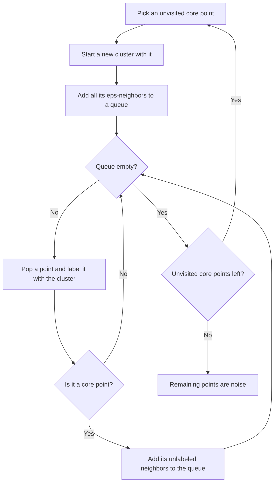

# DBSCAN

> A cluster is a region where points are packed densely; everything else is noise. No k, no centers, any shape.

**Type:** Build
**Languages:** Python
**Prerequisites:** Phase 08 Lesson 01 (K-Means), Phase 08 Lesson 03 (Hierarchical Clustering), Phase 06 (Supervised Classification: K-Nearest Neighbors)
**Time:** ~60 minutes

## Learning Objectives

- Define core, border and noise points in terms of `eps` and `min_samples`
- Implement DBSCAN from scratch as a breadth-first expansion over core points
- Choose `eps` from the k-distance curve and explain what happens when it is too small or too large
- Recognize the varying-density failure mode and use HDBSCAN as the fix

## The Problem

K-means and Ward linkage both assume compact, blob-shaped clusters, and both force every point into some cluster. Real data violates both. GPS traces form winding roads. Fraudulent transactions are scattered, isolated points that should not belong to any group. Sensor readings contain glitches.

You want an algorithm that:

- finds clusters of arbitrary shape,
- figures out the number of clusters on its own,
- explicitly labels points that do not belong anywhere as noise.

DBSCAN (Density-Based Spatial Clustering of Applications with Noise, Ester et al. 1996) does all three with two parameters and one idea: clusters are connected regions of high density.

## The Concept

### Neighborhoods and Point Types

Pick a radius `eps` and a count `min_samples`. The `eps`-neighborhood of a point is every point within distance `eps` of it, including itself.

- **Core point:** its neighborhood contains at least `min_samples` points. It sits inside a dense region.
- **Border point:** not core, but inside the neighborhood of some core point. It sits on the edge of a dense region.
- **Noise point:** neither. It is isolated.

```
          eps
       <------>
   .   o  o  o              C = core (>= 5 points within eps)
     o  C  C  o   B         B = border (near a core point, few neighbors)
   o  C  C  C  o            N = noise (no core point nearby)
     o  C  C  o
                      N
```

### Growing Clusters

Two points belong to the same cluster if you can walk from one to the other through a chain of core points, each within `eps` of the next ("density-connected"). The algorithm:



Only core points expand the cluster. Border points join a cluster but do not pull in their own neighbors; this stops clusters from leaking across sparse gaps. A border point within reach of two clusters goes to whichever reaches it first, so border assignment depends on data order. Core points and noise do not.

### Choosing eps: the k-distance Curve

For every point, compute the distance to its `(min_samples - 1)`-th nearest other point. That is the smallest `eps` at which the point would become core. Sort these distances. Points inside clusters have small values; outliers have large ones. The curve is flat and then bends sharply upward. Pick `eps` near the bend.

A common default for `min_samples` is `2 * n_features` (at least 4 or 5). Larger values make the algorithm more conservative and label more points as noise.

### The Weakness: One Density for Everything

A single `eps` defines a single density threshold. If one cluster is tight and another is diffuse, any `eps` small enough to separate nearby tight clusters turns the diffuse one into noise, and any `eps` large enough to capture the diffuse one merges the tight ones. HDBSCAN fixes this by effectively running DBSCAN at every `eps`, building a hierarchy of clusters, and keeping the ones that persist over the widest range of densities.

## Build It

### Step 1: Neighborhoods and core points

```python
def pairwise_distances(X):
    return np.sqrt(np.sum((X[:, None, :] - X[None, :, :]) ** 2, axis=2))
```

The full distance matrix is fine for a few thousand points. Production implementations use a KD-tree or ball tree for the neighborhood queries instead.

### Step 2: Breadth-first expansion

```python
NOISE = -1
UNVISITED = -2


class DBSCAN:
    def __init__(self, eps, min_samples):
        self.eps = eps
        self.min_samples = min_samples

    def fit(self, X):
        distances = pairwise_distances(X)
        neighborhoods = [np.flatnonzero(row <= self.eps) for row in distances]
        is_core = np.array([len(hood) >= self.min_samples for hood in neighborhoods])
        labels = np.full(len(X), UNVISITED)
        cluster_id = 0
        for point in range(len(X)):
            if labels[point] != UNVISITED or not is_core[point]:
                continue
            labels[point] = cluster_id
            queue = deque([point])
            while queue:
                current = queue.popleft()
                if not is_core[current]:
                    continue
                for neighbor in neighborhoods[current]:
                    if labels[neighbor] == UNVISITED or labels[neighbor] == NOISE:
                        if labels[neighbor] == UNVISITED:
                            queue.append(neighbor)
                        labels[neighbor] = cluster_id
            cluster_id += 1
        labels[labels == UNVISITED] = NOISE
        self.labels_ = labels
        self.core_sample_mask_ = is_core
        self.n_clusters_ = cluster_id
        return self
```

Only core points seed clusters, and only core points push neighbors onto the queue. Whatever is never reached stays noise.

### Step 3: The k-distance curve

```python
def k_distance(X, k):
    distances = np.sort(pairwise_distances(X), axis=1)
    return np.sort(distances[:, k - 1])
```

Each sorted row starts with the point itself at distance 0, so column `k - 1` is the distance to the `(k-1)`-th other point. The data is two moons (300 points) plus 20 uniform outliers:

```
   50th percentile of 5-NN distance: 0.080
   90th percentile of 5-NN distance: 0.126
   95th percentile of 5-NN distance: 0.174
   98th percentile of 5-NN distance: 0.421
  100th percentile of 5-NN distance: 1.085
```

The curve is nearly flat up to the 90th-95th percentile and then shoots up. That is where the moon points end and the outliers begin, so `eps = 0.15` is a good choice.

### Step 4: Sweep eps

```
  eps=0.05               | clusters 10 | noise 263 | ARI vs truth 0.009
  eps=0.15               | clusters  2 | noise  17 | ARI vs truth 0.987
  eps=0.4                | clusters  1 | noise   6 | ARI vs truth 0.000
  With eps=0.15: 15/20 injected outliers labelled as noise, 296 core points
  k-means (k=2)          | clusters  2 | noise   0 | ARI vs truth 0.221
```

- Too small: almost nothing is core, the moons shatter into fragments and most points become noise.
- About right: both moons recovered, 15 of the 20 outliers flagged. The other 5 landed close enough to a moon to be legitimately part of it.
- Too large: the neighborhoods bridge the gap between the moons and everything merges into one cluster.

K-means, for contrast, cuts the moons with a straight line.

### Step 5: Varying density

Two tight blobs 0.7 apart (std 0.1) and one diffuse blob (std 1.0) far away. Counts per true group are `[dense left, dense right, sparse]`:

```
  DBSCAN eps=0.1: noise: [3, 4, 100] | cluster 0: [97, 0, 0] | cluster 1: [0, 96, 0]
  DBSCAN eps=0.5: noise: [0, 0, 12] | cluster 0: [100, 100, 1] | cluster 1: [0, 0, 75] | ...
```

With `eps = 0.1` the tight blobs are separate but the whole diffuse blob is noise. With `eps = 0.5` the diffuse blob is (partly) found but the two tight blobs merge. No single `eps` is right.

## Use It

```python
from sklearn.cluster import DBSCAN, HDBSCAN

sk_model = DBSCAN(eps=0.15, min_samples=5).fit(X)
hdbscan_labels = HDBSCAN(min_cluster_size=15, copy=True).fit_predict(X_density)
```

```
  sklearn eps=0.15       | clusters  2 | noise  17 | ARI vs truth 0.987
  Same core points: True | same noise points: True | ARI between label sets: 1.000
  sklearn HDBSCAN: noise: [1, 2, 2] | cluster 0: [0, 0, 98] | cluster 1: [99, 0, 0] | cluster 2: [0, 98, 0]
```

Scikit-learn's `DBSCAN` matches yours exactly: same core points, same noise. It exposes `core_sample_indices_` and `labels_` (noise is `-1`), and accepts any `metric`, including `"precomputed"` and `"haversine"` for latitude/longitude data.

`HDBSCAN` (in scikit-learn since 1.3) replaces `eps` with `min_cluster_size`, a parameter that is much easier to set ("I don't care about groups smaller than 15 points"). It finds all three blobs of different densities. Reach for HDBSCAN first on real data; use DBSCAN when you know the density scale and want a simple, fast, explainable rule.

DBSCAN has no `predict` method: it does not define a model you can apply to new points. To assign a new point, check whether it lies within `eps` of a core point.

## Exercises

1. **Easy.** Rerun with `min_samples` of 3, 10 and 20 at `eps = 0.15`. How do the number of core points and noise points change?
2. **Medium.** Write `predict(X_new)` for your class: a new point gets the label of the nearest core point if it lies within `eps` of it, otherwise noise. Test it on a grid of points around the moons.
3. **Hard.** Replace the `O(n^2)` distance matrix with `scipy.spatial.cKDTree.query_ball_point` and cluster 50,000 points from `make_moons`. Compare runtime with the matrix version on 3,000 points and extrapolate.

## Key Terms

| Term | What people say | What it actually means |
|------|----------------|----------------------|
| eps | "The radius" | Maximum distance for two points to count as neighbors |
| min_samples | "Minimum density" | Number of points (including itself) a neighborhood must contain for its center to be a core point |
| Core point | "Inside a cluster" | A point with at least min_samples points in its eps-neighborhood |
| Border point | "On the edge" | A non-core point within eps of a core point; it joins a cluster but does not expand it |
| Noise point | "Outlier" | A point that is neither core nor within eps of any core point; labelled -1 |
| Density-connected | "Reachable through the crowd" | Two points linked by a chain of core points, each within eps of the next |
| HDBSCAN | "DBSCAN without eps" | Hierarchical DBSCAN: builds clusters across all density levels and keeps the most persistent ones |

## Further Reading

- [Ester et al., "A Density-Based Algorithm for Discovering Clusters" (KDD 1996)](https://www.aaai.org/Papers/KDD/1996/KDD96-037.pdf) -- the original DBSCAN paper
- [Schubert et al., "DBSCAN Revisited, Revisited" (2017)](https://dl.acm.org/doi/10.1145/3068335) -- practical advice on choosing parameters and common misconceptions
- [scikit-learn User Guide: DBSCAN and HDBSCAN](https://scikit-learn.org/stable/modules/clustering.html#dbscan) -- API details and a comparison of clustering algorithms on toy datasets
- [StatQuest: Clustering with DBSCAN, Clearly Explained](https://www.youtube.com/watch?v=RDZUdRSDOok) -- visual walkthrough of core, border and noise points
