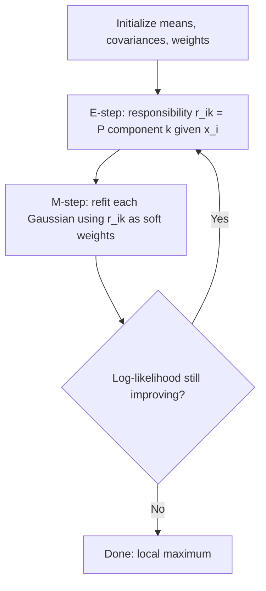

# Gaussian Mixtures and EM

> K-means with uncertainty and ellipses: every cluster is a Gaussian, every point belongs to every cluster with some probability.

**Type:** Build
**Languages:** Python
**Prerequisites:** Phase 08 Lesson 01 (K-Means), Phase 03 (Probability and Statistics: Maximum Likelihood, Random Variables & Distributions), Phase 01 (Linear Algebra: Eigenvalues & Eigenvectors)
**Time:** ~90 minutes

## Learning Objectives

- Write down a Gaussian mixture model and its log-likelihood
- Derive and implement the E-step (responsibilities) and M-step (weighted means, covariances, weights) from scratch
- Explain why EM increases the likelihood every iteration and why it still needs multiple restarts
- Choose the number of components with BIC and reproduce the fit with scikit-learn's `GaussianMixture`

## The Problem

K-means gives every point exactly one label and draws straight boundaries between spherical clusters. Two things go wrong in practice:

1. **Shape.** Real clusters are often elongated and tilted: height versus weight, income versus spending. K-means slices them with the wrong boundaries because it only measures plain Euclidean distance to a center.
2. **Certainty.** A point halfway between two clusters gets assigned with full confidence to one of them. For a customer segment that may be fine; for a medical subtype it is not. You want "70% type A, 30% type B".

A Gaussian mixture model (GMM) fixes both: each cluster is a full Gaussian with its own covariance (ellipse), and the model outputs a probability of membership for each point. You fit it with the Expectation-Maximization (EM) algorithm, which turns out to be k-means with soft assignments.

## The Concept

### The Model

Assume each point was generated by first picking a component `k` with probability `pi_k`, then drawing from a Gaussian with mean `mu_k` and covariance `Sigma_k`:

```
p(x) = sum_k  pi_k * N(x | mu_k, Sigma_k)          with sum_k pi_k = 1
```

The multivariate normal density in `d` dimensions:

```
log N(x | mu, Sigma) = -1/2 [ d log(2 pi) + log det(Sigma) + (x - mu)^T Sigma^-1 (x - mu) ]
```

The last term is the squared Mahalanobis distance: distance measured in units of the cluster's own spread along each direction. This is why a GMM can follow tilted ellipses.

### Why Not Just Maximize the Likelihood Directly?

The log-likelihood of the data is:

```
L = sum_i log( sum_k pi_k N(x_i | mu_k, Sigma_k) )
```

The sum inside the log couples all components together; setting derivatives to zero gives no closed form. But if you knew which component generated each point, the problem would split into `K` separate Gaussian fits, each with a trivial closed form (sample mean, sample covariance). EM exploits this.

### Expectation-Maximization



**E-step.** With the current parameters, compute how responsible each component is for each point (Bayes' theorem):

```
r_ik = pi_k N(x_i | mu_k, Sigma_k) / sum_j pi_j N(x_i | mu_j, Sigma_j)
```

**M-step.** Treat `r_ik` as fractional membership and refit:

```
N_k     = sum_i r_ik                                   (effective number of points)
pi_k    = N_k / n
mu_k    = (1 / N_k) sum_i r_ik x_i
Sigma_k = (1 / N_k) sum_i r_ik (x_i - mu_k)(x_i - mu_k)^T
```

Each iteration provably does not decrease the log-likelihood. Like k-means, EM converges to a local maximum that depends on initialization, so you run several starts.

### K-Means Is a Special Case

Fix every covariance to `sigma^2 I`, every weight to `1/K`, and let `sigma -> 0`. Responsibilities become 0 or 1 (the nearest mean takes everything), and the M-step reduces to computing means. That is exactly Lloyd's algorithm.

### Numerical Care

Densities in high dimensions underflow to 0. Work in log space and normalize with the log-sum-exp trick: `log sum exp(a_k) = m + log sum exp(a_k - m)` with `m = max a_k`. Also add a small value to the covariance diagonal (`reg_covar`); otherwise a component that collapses onto one point gets a singular covariance and infinite likelihood.

### Choosing the Number of Components: BIC

Unlike k-means, a GMM is a probability model, so you can use model-selection criteria that trade likelihood against the number of parameters:

```
BIC = -2 log L + p log n
p   = K * (d + d(d+1)/2) + (K - 1)      for full covariances
```

Lower BIC is better. The `p log n` penalty stops you from adding components that only buy a tiny likelihood gain.

## Build It

### Step 1: Data that k-means gets wrong

Two long, crossing, tilted clusters plus one small round one:

```python
specs = [
    (np.array([0.0, 0.0]), np.array([[4.0, 3.6], [3.6, 4.0]]), 250),
    (np.array([4.0, -1.0]), np.array([[4.0, -3.6], [-3.6, 4.0]]), 250),
    (np.array([7.0, 4.0]), np.array([[0.3, 0.0], [0.0, 0.3]]), 100),
]
```

### Step 2: Log-density and log-sum-exp

```python
def log_gaussian(X, mean, cov):
    d = X.shape[1]
    cholesky = np.linalg.cholesky(cov)
    solved = np.linalg.solve(cholesky, (X - mean).T)
    mahalanobis_sq = np.sum(solved**2, axis=0)
    log_det = 2 * np.sum(np.log(np.diag(cholesky)))
    return -0.5 * (d * np.log(2 * np.pi) + log_det + mahalanobis_sq)


def logsumexp(values, axis):
    peak = np.max(values, axis=axis, keepdims=True)
    return np.squeeze(peak, axis=axis) + np.log(np.sum(np.exp(values - peak), axis=axis))
```

With `Sigma = L L^T` (Cholesky), `(x-mu)^T Sigma^-1 (x-mu) = ||L^-1 (x-mu)||^2` and `log det Sigma = 2 sum log diag(L)`. No explicit inverse needed.

### Step 3: E-step and M-step

```python
    def e_step(self, X):
        weighted = self.weighted_log_probs(X)
        log_norm = logsumexp(weighted, axis=1)
        responsibilities = np.exp(weighted - log_norm[:, None])
        return responsibilities, float(np.mean(log_norm))

    def m_step(self, X, responsibilities):
        n, d = X.shape
        effective_counts = responsibilities.sum(axis=0)
        self.weights = effective_counts / n
        self.means = (responsibilities.T @ X) / effective_counts[:, None]
        for k in range(self.n_components):
            centered = X - self.means[k]
            weighted_cov = (responsibilities[:, k, None] * centered).T @ centered / effective_counts[k]
            self.covariances[k] = weighted_cov + self.reg_covar * np.eye(d)
```

`weighted_log_probs` returns an `(n, K)` matrix of `log pi_k + log N(x_i | mu_k, Sigma_k)`. The row-wise log-sum-exp of that matrix is each point's log-likelihood, so the E-step gives you the convergence criterion for free.

### Step 4: The loop and BIC

```python
    def fit(self, X):
        self.initialize(X)
        previous = -np.inf
        for _ in range(self.max_iter):
            responsibilities, mean_log_likelihood = self.e_step(X)
            self.log_likelihoods.append(mean_log_likelihood)
            if mean_log_likelihood - previous < self.tol:
                break
            previous = mean_log_likelihood
            self.m_step(X, responsibilities)
        return self

    def bic(self, X):
        n, d = X.shape
        n_parameters = self.n_components * (d + d * (d + 1) / 2) + self.n_components - 1
        total_log_likelihood = np.sum(logsumexp(self.weighted_log_probs(X), axis=1))
        return -2 * total_log_likelihood + n_parameters * np.log(n)
```

Initialization uses random data points as means, the global covariance for every component, and equal weights. `best_of` runs five seeds and keeps the highest likelihood.

### Step 5: Results

```
  iteration   0 | mean log-likelihood -5.49099
  iteration   1 | mean log-likelihood -4.74690
  iteration  10 | mean log-likelihood -4.20991
  converged after 23 iterations at -3.98563
  weight 0.408 | mean [ 0.09,  0.06] | cov [[ 3.18,  3.03], [ 3.03,  3.53]]
  weight 0.423 | mean [ 4.20, -1.19] | cov [[ 4.17, -3.73], [-3.73,  4.27]]
  weight 0.168 | mean [ 7.04,  3.91] | cov [[ 0.33, -0.02], [-0.02,  0.30]]

  ARI GMM (from scratch): 0.866
  ARI k-means:            0.612
  Points with max membership probability < 0.9: 111 (where the clusters cross)
```

The log-likelihood rises every iteration. The fitted covariances recover the tilts (positive and negative correlation) and the small round cluster. K-means, blind to shape, scores much worse. The 111 uncertain points are exactly where the two ellipses overlap: the model is telling you it cannot be sure, which is information k-means throws away.

BIC across component counts:

```
  components 2 | BIC    5275.1
  components 3 | BIC    4891.5
  components 4 | BIC    4914.7
```

The minimum is at 3, the true number.

## Use It

```python
from sklearn.mixture import GaussianMixture

sk_model = GaussianMixture(n_components=3, covariance_type="full", n_init=5, random_state=0).fit(X)
```

```
  mean log-likelihood: sklearn -3.98563 | from scratch -3.98563
  BIC: sklearn 4891.5 | from scratch 4891.5
  ARI between label sets: 1.000
```

Identical likelihood and BIC. Things scikit-learn adds:

- `covariance_type`: `"full"` (any ellipse), `"tied"` (all components share one ellipse), `"diag"` (axis-aligned ellipses), `"spherical"` (circles, closest to k-means). Fewer parameters means more stable fits in high dimensions.
- `init_params="kmeans"` by default: it runs k-means first and starts EM from those clusters, which converges faster and more reliably than random means.
- `predict_proba`, `score_samples` (per-point log density, useful for anomaly detection in Phase 09), `sample` (generate new data), `aic` and `bic`.
- `BayesianGaussianMixture` puts a prior on the weights and can switch off unneeded components automatically.

## Exercises

1. **Easy.** Fit with `covariance_type` set to `"spherical"`, `"diag"`, `"tied"` and `"full"`. Compare BIC and ARI. Which assumption hurts the most on this data, and why?
2. **Medium.** Implement the k-means special case: fix all covariances to `sigma^2 I` with small `sigma` and equal weights, update only the means, and show that the result matches your k-means from Lesson 01.
3. **Hard.** Add a `score_samples` method to your class (the per-point log-likelihood, i.e. the row-wise log-sum-exp from the E-step) and use it to flag the 2% lowest-density points as anomalies. Add 15 uniform outliers to the data and measure how many you catch.

## Key Terms

| Term | What people say | What it actually means |
|------|----------------|----------------------|
| Gaussian mixture model | "Soft k-means" | A density p(x) = sum_k pi_k N(x; mu_k, Sigma_k): a weighted sum of Gaussians, one per cluster |
| Responsibility | "Soft label" | r_ik = posterior probability that component k generated point i, given current parameters |
| EM algorithm | "Guess labels, refit, repeat" | Alternating E-step (compute responsibilities) and M-step (maximize expected log-likelihood) that never decreases the likelihood |
| Mixing weight | "Cluster size" | pi_k, the prior probability of component k; the fractions sum to one |
| Mahalanobis distance | "Distance that knows the shape" | sqrt((x - mu)^T Sigma^-1 (x - mu)): Euclidean distance after whitening by the covariance |
| BIC | "Penalized likelihood" | -2 log L + p log n; lower is better; balances fit against the number of parameters |
| Log-sum-exp trick | "Stable softmax denominator" | Computing log sum exp(a) as m + log sum exp(a - m) with m = max(a) to avoid underflow and overflow |

## Further Reading

- [Bishop, Pattern Recognition and Machine Learning, Chapter 9](https://www.microsoft.com/en-us/research/people/cmbishop/prml-book/) -- the canonical derivation of EM for Gaussian mixtures and its link to k-means (free PDF)
- [scikit-learn User Guide: Gaussian mixture models](https://scikit-learn.org/stable/modules/mixture.html) -- covariance types, BIC selection and the variational Bayesian mixture
- [StatQuest: Gaussian Mixture Models / EM](https://www.youtube.com/watch?v=iQoXFmbXRJA) -- intuitive explanation of the E and M steps
- [Dempster, Laird and Rubin, "Maximum Likelihood from Incomplete Data via the EM Algorithm" (1977)](https://www.jstor.org/stable/2984875) -- the paper that named and generalized EM
