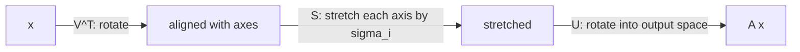

# Singular Value Decomposition

> Every matrix is a rotation, a stretch, and another rotation. SVD tells you which.

**Type:** Build
**Languages:** Python
**Prerequisites:** Phase 01 (Linear Algebra: matrices as transformations, eigenvalues & eigenvectors), Phase 09 Lesson 01 (PCA)
**Time:** ~75 minutes

## Learning Objectives

- State the SVD `A = U S V^T` and explain what U, S and V mean geometrically
- Compute singular values and vectors from scratch with power iteration and deflation
- Build the best rank-k approximation of a matrix and use it to compress an image
- Show that PCA is an SVD of the centered data and use SVD to find latent factors in a ratings matrix

## The Problem

Eigen-decomposition only works for square matrices, and only nicely for symmetric ones. Real data matrices are rectangular: 10,000 users by 500 movies, 64 by 64 pixel images, documents by words. You still want to ask the same questions: what are the dominant patterns, how many of them matter, and how can you store the matrix with fewer numbers?

The singular value decomposition answers all of these for any matrix. It is the workhorse behind PCA in sklearn, latent semantic analysis in text, classic recommender systems, least-squares solvers, and image compression.

## The Concept

### The decomposition

Any real `m x n` matrix `A` can be written as:

```
A = U S V^T

U: m x m, orthonormal columns (left singular vectors)
S: m x n, diagonal, sigma_1 >= sigma_2 >= ... >= 0 (singular values)
V: n x n, orthonormal columns (right singular vectors)
```

Read it right to left as a transformation of a vector `x`:



The unit sphere becomes an ellipsoid. The singular values are the lengths of its semi-axes, `V` holds the input directions that map onto them, and `U` holds where they land.

### Connection to eigenvalues

```
A^T A = V S^T S V^T       eigenvectors of A^T A are the columns of V
A A^T = U S S^T U^T       eigenvectors of A A^T are the columns of U
sigma_i = sqrt(eigenvalue_i of A^T A)
```

So the right singular vectors of a centered data matrix are exactly the eigenvectors of its covariance `X_c^T X_c / (n - 1)`, and:

```
variance along PC i = sigma_i^2 / (n - 1)
```

That is PCA. Libraries prefer the SVD route because forming `X^T X` squares the condition number and loses precision.

### A sum of rank-one pieces

The SVD can also be written as a sum of outer products:

```
A = sigma_1 u_1 v_1^T + sigma_2 u_2 v_2^T + ... + sigma_r u_r v_r^T
```

Each term is a rank-one "pattern" weighted by its singular value. Truncate the sum after `k` terms and you get `A_k`. The Eckart-Young theorem says no rank-`k` matrix is closer to `A` in Frobenius norm:

```
||A - A_k||_F^2 = sigma_{k+1}^2 + ... + sigma_r^2
```

Storing `A_k` takes `k (m + n + 1)` numbers instead of `m n`.

### Power iteration

To find the top singular pair without a library, notice that repeatedly applying `A^T A` to a random vector amplifies the direction with the largest eigenvalue:

```
v <- A^T A v,  then normalize
after convergence: sigma = ||A v||,  u = A v / sigma
```

Convergence speed depends on the gap `sigma_1 / sigma_2`. To get the next pair, subtract the found component (deflation) and repeat:

```
A <- A - sigma u v^T
```

## Build It

### Step 1: SVD by power iteration and deflation

```python
def power_iteration(A, n_iterations, rng):
    v = rng.normal(size=A.shape[1])
    v /= np.linalg.norm(v)
    for _ in range(n_iterations):
        v = A.T @ (A @ v)
        v /= np.linalg.norm(v)
    sigma = np.linalg.norm(A @ v)
    u = A @ v / sigma
    return sigma, u, v


def svd_from_scratch(A, rank, n_iterations=500, seed=0):
    rng = np.random.default_rng(seed)
    residual = A.astype(float).copy()
    singular_values, left_vectors, right_vectors = [], [], []
    for _ in range(rank):
        sigma, u, v = power_iteration(residual, n_iterations, rng)
        singular_values.append(sigma)
        left_vectors.append(u)
        right_vectors.append(v)
        residual = residual - sigma * np.outer(u, v)
    return np.array(left_vectors).T, np.array(singular_values), np.array(right_vectors)
```

On a 4 x 3 matrix:

```
Singular values (scratch): [5.486101 3.455019 2.228349]
Singular values (numpy):   [5.486101 3.455019 2.228349]
Reconstruction error ||A - U S Vt||: 1.15e-15
U^T U close to identity: True
```

### Step 2: Low-rank image compression

Build a 64 x 64 synthetic image (smooth waves plus a disk plus noise), then keep only the top `k` components:

```python
def low_rank_approximation(U, S, Vt, k):
    return U[:, :k] @ np.diag(S[:k]) @ Vt[:k, :]
```

```
  rank  1: relative error=0.4648  energy kept=0.7840  numbers stored=  129 / 4096
  rank  2: relative error=0.1907  energy kept=0.9636  numbers stored=  258 / 4096
  rank  5: relative error=0.0899  energy kept=0.9919  numbers stored=  645 / 4096
  rank 10: relative error=0.0515  energy kept=0.9973  numbers stored= 1290 / 4096
  rank 20: relative error=0.0321  energy kept=0.9990  numbers stored= 2580 / 4096
```

"Energy" is `sum(sigma_i^2)` for the kept components divided by the total. Rank 5 keeps 99% of the energy with 16% of the storage. The last few percent of error is mostly the random noise, which has no low-rank structure; this is why truncated SVD also works as a denoiser.

### Step 3: PCA through SVD

```python
X_centered = X - X.mean(axis=0)
U_x, S_x, Vt_x = np.linalg.svd(X_centered, full_matrices=False)
variance_from_svd = S_x ** 2 / (X.shape[0] - 1)
eigenvalues = np.sort(np.linalg.eigvalsh(np.cov(X_centered, rowvar=False)))[::-1]
```

```
Variance from singular values: [11.2281  2.838   0.0105  0.0098  0.0095  0.0078]
Eigenvalues of covariance:     [11.2281  2.838   0.0105  0.0098  0.0095  0.0078]
```

The data was generated from 2 latent variables mixed into 6 features plus small noise, and the spectrum shows exactly 2 large values.

### Step 4: Latent factors in a ratings matrix

Six users rate six movies, three sci-fi and three romance. Center the matrix and take a rank-2 SVD:

```
Top singular values: [7.579 2.529]
  factor 1 loading for Alien     : +0.452
  factor 1 loading for Matrix    : +0.398
  factor 1 loading for Terminator: +0.275
  factor 1 loading for Notebook  : -0.402
  factor 1 loading for Titanic   : -0.439
  factor 1 loading for Amelie    : -0.455
  user ana    factor 1 score: +4.156
  ...
  user fay    factor 1 score: -1.311
```

Nobody told the algorithm about genres. Factor 1 separates sci-fi from romance by itself, and each user's score says which side they lean to. This is the idea behind matrix-factorization recommenders: predict a missing rating from the dot product of a user vector and a movie vector.

## Use It

```python
U_np, S_np, Vt_np = np.linalg.svd(A, full_matrices=False)

from sklearn.decomposition import TruncatedSVD
truncated = TruncatedSVD(n_components=2, random_state=0).fit(ratings_centered)
print(truncated.singular_values_)
```

```
numpy U matches scratch U (up to sign): True
TruncatedSVD singular values: [7.579 2.529]
```

- `np.linalg.svd(A, full_matrices=False)` gives the thin SVD; use it unless you need the full square U.
- `scipy.sparse.linalg.svds` computes a few singular triplets of a large sparse matrix.
- `TruncatedSVD` does not center the data, so it works on sparse matrices (TF-IDF, one-hot). On text this is called latent semantic analysis.
- `np.linalg.lstsq` and `np.linalg.pinv` use SVD under the hood to solve least squares robustly.

## Exercises

1. **Easy.** Verify the Eckart-Young identity numerically: for the synthetic image, compare `||A - A_k||_F^2` with the sum of the squared discarded singular values for k = 1..10.
2. **Medium.** Load a real grayscale image (for example `scipy.datasets.face(gray=True)` if available, or any image read with matplotlib), compress it with ranks 5, 20, 50 and 100 and plot the results with the compression ratio in each title.
3. **Hard.** Hide 20% of the entries of the ratings matrix. Implement iterative SVD imputation: fill missing values with column means, take a rank-2 SVD, replace only the missing entries with the reconstruction, and repeat until convergence. Report the RMSE on the hidden entries.

## Key Terms

| Term | What people say | What it actually means |
|------|----------------|----------------------|
| Singular value | "How important a component is" | The non-negative stretch factor sigma_i on the i-th axis; the square root of an eigenvalue of A^T A |
| Left singular vectors | "The U matrix" | Orthonormal output directions; eigenvectors of A A^T |
| Right singular vectors | "The V matrix" | Orthonormal input directions; eigenvectors of A^T A, equal to principal components for centered data |
| Thin SVD | "Economy SVD" | Keeping only the first min(m, n) columns of U and V |
| Truncated SVD | "Low-rank approximation" | Keeping only the top k singular triplets; the best rank-k approximation in Frobenius norm |
| Power iteration | "Multiply until it converges" | Repeated multiplication by A^T A and normalization, which converges to the top singular vector |
| Deflation | "Peel off a component" | Subtracting sigma u v^T so the next power iteration finds the next singular pair |
| Latent factor | "Hidden taste dimension" | A singular direction that explains a shared pattern across rows and columns of a data matrix |

## Further Reading

- [Gilbert Strang, Introduction to Linear Algebra, chapter 7](https://math.mit.edu/~gs/linearalgebra/) -- the SVD and its geometry from the best-known linear algebra teacher
- [Steve Brunton, Singular Value Decomposition (YouTube series)](https://www.youtube.com/watch?v=gXbThCXjZFM) -- intuitive lectures covering image compression and PCA via SVD
- [We Recommend a Singular Value Decomposition (AMS feature column)](https://www.ams.org/publicoutreach/feature-column/fcarc-svd) -- short, geometric explanation with the Netflix prize as motivation
- [scikit-learn TruncatedSVD documentation](https://scikit-learn.org/stable/modules/decomposition.html#truncated-singular-value-decomposition-and-latent-semantic-analysis) -- LSA and sparse use cases
