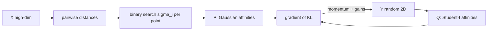

# t-SNE

> Keep neighbors together, let everything else go. A map built for eyes, not for distances.

**Type:** Build
**Languages:** Python
**Prerequisites:** Phase 02 (Calculus and Optimization: gradient descent, sgd & momentum), Phase 03 (Probability and Statistics: random variables & distributions), Phase 09 Lesson 01 (PCA)
**Time:** ~90 minutes

## Learning Objectives

- Explain how t-SNE turns distances into neighbor probabilities and why it uses a Student-t kernel in the low-dimensional map
- Implement perplexity calibration with binary search and the exact t-SNE gradient in NumPy
- Compare t-SNE with PCA using k-NN accuracy and trustworthiness in the embedding
- Recognize what a t-SNE plot does not show: cluster sizes, distances between clusters, and density

## The Problem

PCA is linear. It finds the flat plane that keeps the most variance, which is great when the interesting structure is linear. Handwritten digits are not like that. A "3" and an "8" differ by a few curved strokes, and the 64 pixel features lie on a twisted, curved surface. Project the digits with PCA and the classes overlap into a smudge.

You want a 2D map where points that are neighbors in 64 dimensions stay neighbors in 2D, even if that means bending, tearing and stretching the space. That is t-SNE (t-distributed Stochastic Neighbor Embedding, van der Maaten and Hinton, 2008). It is the method behind most of the "beautiful cluster plots" you have seen of MNIST, word embeddings and single-cell RNA data.

## The Concept

### Step A: high-dimensional similarities

For each point `i`, put a Gaussian on it and ask: if `i` picked a neighbor with probability proportional to that Gaussian, how likely is `j`?

```
p_{j|i} = exp(-||x_i - x_j||^2 / (2 sigma_i^2)) / sum_{k != i} exp(-||x_i - x_k||^2 / (2 sigma_i^2))
```

Each point gets its own `sigma_i`. In dense regions it is small, in sparse regions it is large, so every point has roughly the same effective number of neighbors. You set that number with **perplexity**:

```
Perp(P_i) = 2^{H(P_i)}   where H is the Shannon entropy in bits
```

A binary search on `sigma_i` (or on `beta_i = 1 / (2 sigma_i^2)`) hits the target perplexity. Typical values: 5 to 50.

The conditional probabilities are then symmetrized:

```
p_ij = (p_{j|i} + p_{i|j}) / (2n)
```

### Step B: low-dimensional similarities

In the 2D map, use a Student-t distribution with one degree of freedom (a Cauchy kernel):

```
q_ij = (1 + ||y_i - y_j||^2)^-1 / sum_{k != l} (1 + ||y_k - y_l||^2)^-1
```

Why heavy tails? In 64 dimensions a point can have many neighbors at moderate distance; in 2D there is not enough room for all of them. This is the **crowding problem**. The heavy tail lets moderately distant points sit far apart in the map without paying a large cost, which opens up clean gaps between clusters.

### Step C: match the two

Minimize the Kullback-Leibler divergence:

```
KL(P || Q) = sum_{i != j} p_ij log(p_ij / q_ij)
```

KL is asymmetric. Putting true neighbors (large `p_ij`) far apart (small `q_ij`) costs a lot. Putting non-neighbors close costs little. That is why t-SNE preserves local structure and ignores global structure.

The gradient has a neat form:

```
dC/dy_i = 4 * sum_j (p_ij - q_ij) * (1 + ||y_i - y_j||^2)^-1 * (y_i - y_j)
```

Read it as springs: `p_ij` pulls neighbors together, `q_ij` pushes everything apart.



### Optimization tricks

- **Early exaggeration:** multiply `P` by about 12 for the first iterations. Clusters form tight blobs first, then spread out.
- **Momentum:** 0.5 at first, 0.8 later (Phase 02, sgd & momentum).
- **Gains:** per-coordinate adaptive step sizes that grow when the gradient keeps pointing the same way.

### How to read a t-SNE plot

- Neighbors are meaningful. Cluster membership is usually meaningful.
- Cluster sizes are not: t-SNE equalizes density, so a tight cluster and a diffuse one may look the same size.
- Distances between clusters are mostly not meaningful.
- Different perplexities and seeds give different pictures. Run more than one.
- t-SNE has no `transform` for new points. It is for visualization, not as a feature extractor.

## Build It

The data: 400 random digits from `sklearn.datasets.load_digits`, pixel values scaled to [0, 1]. Exact t-SNE is O(n^2) per iteration, which is fine at this size.

### Step 1: Perplexity calibration

```python
def conditional_probabilities_for_row(distances_row, beta):
    logits = -distances_row * beta
    logits -= logits.max()
    weights = np.exp(logits)
    probabilities = weights / weights.sum()
    entropy = -np.sum(probabilities * np.log(probabilities + 1e-12))
    return probabilities, entropy
```

The binary search compares the entropy (in nats) with `log(perplexity)`. If the entropy is too high the distribution is too flat, so `beta` goes up (sigma goes down):

```python
if gap > 0:
    beta_low = beta
    beta = beta * 2 if beta_high == np.inf else (beta + beta_high) / 2
else:
    beta_high = beta
    beta = (beta + beta_low) / 2
```

```
sigma per point: min=0.485  median=0.701  max=0.917
```

Sigma varies by almost a factor of two across points. A single global bandwidth would give isolated points no neighbors at all.

### Step 2: Optimize the embedding

```python
def student_t_affinities(Y):
    inverse_kernel = 1.0 / (1.0 + squared_distances(Y))
    np.fill_diagonal(inverse_kernel, 0.0)
    Q = inverse_kernel / inverse_kernel.sum()
    return np.maximum(Q, 1e-12), inverse_kernel


for iteration in range(n_iterations):
    exaggeration = 12.0 if iteration < 100 else 1.0
    momentum = 0.5 if iteration < 100 else 0.8
    Q, inverse_kernel = student_t_affinities(Y)
    attraction_minus_repulsion = (exaggeration * P - Q) * inverse_kernel
    gradient = 4 * (np.diag(attraction_minus_repulsion.sum(axis=1)) - attraction_minus_repulsion) @ Y
    same_sign = np.sign(gradient) == np.sign(velocity)
    gains = np.where(same_sign, gains * 0.8, gains + 0.2)
    gains = np.maximum(gains, 0.01)
    velocity = momentum * velocity - learning_rate * gains * gradient
    Y = Y + velocity
    Y = Y - Y.mean(axis=0)
```

The line `(diag(row sums) - M) @ Y` is the vectorized form of `sum_j M_ij (y_i - y_j)`.

```
  iter   0 | KL(P||Q) = 2.5139
  iter 100 | KL(P||Q) = 2.9568
  iter 200 | KL(P||Q) = 1.7827
  iter 300 | KL(P||Q) = 0.8310
  iter 400 | KL(P||Q) = 0.5421
  iter 499 | KL(P||Q) = 0.4688
```

KL goes up during early exaggeration (the map is optimizing a different, exaggerated objective), then drops steadily once exaggeration is switched off.

### Step 3: Compare with PCA

Two numbers measure how good a 2D map is:

- **5-NN accuracy:** cross-validated accuracy of a k-NN classifier trained on the 2D coordinates. High means same-digit points are neighbors.
- **Trustworthiness:** in [0, 1], penalizes points that are neighbors in 2D but were not neighbors in the original space.

```
5-NN accuracy in 2D  | PCA: 0.635  t-SNE (scratch): 0.950
Trustworthiness k=10 | PCA: 0.825  t-SNE (scratch): 0.981
```

### Step 4: Perplexity changes the picture

```
  perplexity= 5: 5-NN accuracy=0.922  trustworthiness=0.942
  perplexity=50: 5-NN accuracy=0.882  trustworthiness=0.942
```

Low perplexity focuses on very local structure and tends to fragment clusters; high perplexity blends nearby clusters. These runs use only 300 iterations, so they are also less converged than the main run.

## Use It

```python
from sklearn.manifold import TSNE

Y_sklearn = TSNE(n_components=2, perplexity=30.0, init="pca", random_state=0).fit_transform(X)
```

```
sklearn t-SNE | 5-NN accuracy=0.953  trustworthiness=0.984
```

The script also saves `tsne_vs_pca.png` next to itself with the three embeddings colored by digit.

sklearn uses the Barnes-Hut approximation (O(n log n)) by default, which scales to tens of thousands of points. `init="pca"` makes runs more stable and keeps a bit more global structure than random initialization. For hundreds of thousands of points, look at openTSNE (FFT-accelerated) or UMAP (next lesson).

A good habit: run PCA to around 50 dimensions first, then t-SNE on the result. It removes noise and speeds up the distance computations.

## Exercises

1. **Easy.** Remove early exaggeration (set it to 1.0 for all iterations) and compare the final KL and the 5-NN accuracy. Look at the saved plot: what changes?
2. **Medium.** Run sklearn TSNE on the full 1797 digits with perplexity 5, 30 and 100 and three different seeds each. Which conclusions about the data are stable across all nine plots, and which change?
3. **Hard.** Replace the Student-t kernel in your scratch implementation with a Gaussian kernel in 2D (this is the original SNE). Derive the new gradient, implement it, and show the crowding problem: the clusters should collapse into the center with much less separation.

## Key Terms

| Term | What people say | What it actually means |
|------|----------------|----------------------|
| t-SNE | "The cluster plot algorithm" | A nonlinear embedding that minimizes KL divergence between Gaussian neighbor probabilities in high dimension and Student-t probabilities in low dimension |
| Perplexity | "Number of neighbors" | 2 raised to the entropy of a point's neighbor distribution; a smooth measure of its effective neighborhood size |
| Crowding problem | "Not enough room in 2D" | Moderately distant high-dimensional neighbors cannot all fit at moderate distance in 2D, so clusters get squashed together |
| Early exaggeration | "Make clusters form first" | Multiplying P by a constant early in training so attractive forces dominate |
| KL divergence | "Distance between distributions" | sum p log(p / q); asymmetric, so missing true neighbors is penalized much more than false neighbors |
| Trustworthiness | "Are the 2D neighbors real?" | A score in [0, 1] that penalizes points appearing as neighbors in the embedding but not in the original space |
| Barnes-Hut | "Fast t-SNE" | A tree-based approximation of the repulsive forces that reduces cost from O(n^2) to O(n log n) |

## Further Reading

- [Visualizing Data using t-SNE (van der Maaten and Hinton, 2008)](https://www.jmlr.org/papers/v9/vandermaaten08a.html) -- the original paper, including the gradient derivation and optimization tricks
- [How to Use t-SNE Effectively (Distill)](https://distill.pub/2016/misread-tsne/) -- interactive article on perplexity, cluster sizes and distances
- [StatQuest: t-SNE, Clearly Explained](https://www.youtube.com/watch?v=NEaUSP4YerM) -- visual explanation of the similarity matrices
- [scikit-learn Manifold learning guide](https://scikit-learn.org/stable/modules/manifold.html#t-distributed-stochastic-neighbor-embedding-t-sne) -- practical parameters and comparison with other manifold methods
