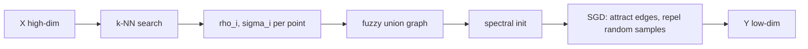

# UMAP Intuition

> Build a fuzzy neighbor graph, then lay it out with springs. Same goal as t-SNE, different machinery.

**Type:** Learn
**Languages:** Python
**Prerequisites:** Phase 06 (Supervised Classification: k-nearest neighbors), Phase 09 Lesson 01 (PCA), Phase 09 Lesson 03 (t-SNE)
**Time:** ~60 minutes

## Learning Objectives

- Describe the two stages of UMAP: a weighted k-NN graph in high dimension and a force-directed layout in low dimension
- Implement a simplified UMAP (fuzzy graph, curve fitting, attraction plus negative sampling) in NumPy
- Explain what `n_neighbors` and `min_dist` control and how they trade local for global structure
- Compare UMAP-style embeddings with PCA and t-SNE using trustworthiness and a global-structure score

## The Problem

t-SNE makes beautiful maps but has practical limits: the classic version is slow on large data, it has no natural way to embed new points, and people often stretch its plots to answer global questions they cannot answer. UMAP (Uniform Manifold Approximation and Projection, McInnes, Healy and Melville, 2018) became the popular alternative. It is fast, scales to millions of points, supports `transform` on new data, and can embed into more than 2 or 3 dimensions as a preprocessing step for clustering.

The UMAP paper is written in the language of topology (fuzzy simplicial sets, Riemannian manifolds), which hides how simple the algorithm is in practice. This lesson strips it down to the mechanics. You will build a small UMAP-like method with NumPy and sklearn helpers, without installing the `umap-learn` package, and compare it with what you already know.

## The Concept

### Stage 1: a fuzzy k-NN graph

For each point `i`, find its `k` nearest neighbors. Then turn distances into edge weights:

```
w(i -> j) = exp(-(d(i, j) - rho_i) / sigma_i)

rho_i   = distance from i to its nearest neighbor
sigma_i = chosen so that sum_j w(i -> j) = log2(k)
```

Two ideas hide in this formula:

- **Local connectivity (`rho_i`):** subtracting the nearest-neighbor distance guarantees every point is connected to at least one neighbor with weight 1. Isolated points are never orphaned.
- **Local scale (`sigma_i`):** like t-SNE's per-point bandwidth, it adapts to density. The target `log2(k)` plays the role of perplexity.

The directed weights are combined with a fuzzy union (probabilistic OR):

```
w_ij = w(i -> j) + w(j -> i) - w(i -> j) * w(j -> i)
```

Compare with t-SNE: t-SNE uses all pairs and normalizes probabilities to sum to one. UMAP only keeps `k` neighbors per point and never normalizes, which is a large part of why it is fast.

### Stage 2: a low-dimensional similarity curve

In the embedding, the similarity between two points at distance `d` is:

```
q(d) = 1 / (1 + a * d^(2b))
```

With `a = 1, b = 1` this is exactly t-SNE's Student-t kernel. UMAP fits `a` and `b` so that the curve is about 1 for `d < min_dist` and decays exponentially after. `min_dist` sets how tightly points may pack: small values give dense clumps, large values give spread-out blobs.

### Stage 3: cross-entropy and negative sampling

UMAP minimizes a fuzzy cross-entropy between graph weights `w` and embedding similarities `q`:

```
CE = sum_edges [ w * log(w / q) + (1 - w) * log((1 - w) / (1 - q)) ]
```

The first term attracts graph neighbors. The second repels non-neighbors. There are O(n^2) non-neighbor pairs, so UMAP does not compute them all: for each sampled edge it picks a few random points and pushes them away. This is **negative sampling**, the same trick used in word2vec.



### Initialization matters

UMAP initializes the layout with a spectral embedding of the graph (the eigenvectors of its Laplacian). This gives a sensible global arrangement before any optimization. Research has shown (Kobak and Linderman, 2021) that much of UMAP's reputation for "better global structure than t-SNE" comes from this initialization: t-SNE with PCA initialization preserves global structure about as well.

### UMAP vs t-SNE at a glance

| Aspect | t-SNE | UMAP |
|--------|-------|------|
| High-dim similarities | Gaussian, all pairs, normalized | Exponential, k neighbors, unnormalized |
| Low-dim kernel | 1 / (1 + d^2) | 1 / (1 + a d^(2b)) |
| Loss | KL divergence | Fuzzy cross-entropy (attraction + repulsion) |
| Repulsion | All pairs (or Barnes-Hut) | Negative sampling |
| New points | No transform | `transform` supported |
| Main knobs | perplexity | n_neighbors, min_dist |

## Build It

The data: 1000 digits from `load_digits`, scaled to [0, 1].

### Step 1: The fuzzy graph

```python
def fuzzy_simplicial_graph(X, n_neighbors):
    knn_distances, knn_indices = knn_graph(X, n_neighbors)
    rhos, sigmas = smooth_knn_sigmas(knn_distances)
    n = X.shape[0]
    weights = np.exp(-np.maximum(knn_distances - rhos[:, None], 0.0) / sigmas[:, None])
    directed = np.zeros((n, n))
    directed[np.repeat(np.arange(n), n_neighbors), knn_indices.ravel()] = weights.ravel()
    return directed + directed.T - directed * directed.T
```

`smooth_knn_sigmas` is a binary search on `sigma_i` until the row sums equal `log2(k)`, the same pattern as the perplexity search in the t-SNE lesson.

```
Points: 1000  edges with weight > 0: 10079
Edge weight quantiles (25/50/75%): [0.115 0.197 0.405]
Share of edge weight connecting same digit: 0.944
```

About 10 edges per point instead of a dense 1000 x 1000 matrix, and 94% of the edge weight already connects digits of the same class. The graph does most of the work; the layout only has to draw it.

### Step 2: Fit the curve parameters

```python
def fit_curve_parameters(min_dist, spread=1.0):
    distances = np.linspace(0, spread * 3, 300)
    target = np.where(distances < min_dist, 1.0, np.exp(-(distances - min_dist) / spread))
    curve = lambda d, a, b: 1.0 / (1.0 + a * d ** (2 * b))
    (a, b), _ = curve_fit(curve, distances, target)
    return a, b
```

```
  min_dist=0.01: a=1.896  b=0.801
  min_dist=0.1 : a=1.577  b=0.895
  min_dist=0.5 : a=0.583  b=1.334
```

`min_dist=0.1` gives `a = 1.58, b = 0.90`, the same defaults the real library ends up with.

### Step 3: Layout with attraction and negative sampling

Each epoch samples every edge with probability equal to its weight, pulls its endpoints together, and pushes each head away from 5 random points. The step size decays linearly.

```python
attract = (-2 * a * b * dist_sq ** (b - 1)) / (1 + a * dist_sq ** b)
step = np.clip(attract[:, None] * diff, -4, 4) * alpha
np.add.at(Y, h, step)
np.add.at(Y, t, -step)

repel = (2 * b) / (dist_sq_neg * (1 + a * dist_sq_neg ** b))
step_neg = np.clip(repel[:, None] * diff_neg, -4, 4) * alpha
np.add.at(Y, h_neg, step_neg)
```

These are the gradients of the two cross-entropy terms with respect to the squared distance, clipped to 4 as in the reference implementation. The real library updates points one edge at a time with numba; this version updates all sampled edges of an epoch at once with `np.add.at`, which is simpler and close enough to show the behavior.

### Step 4: Local vs global structure

Two scores for each embedding: trustworthiness at k = 15 (local) and the Spearman correlation between distances of the ten digit centroids in 64D and in 2D (global).

```
method                  5-NN acc  trust@15  centroid rho
PCA                        0.611     0.827         0.834
tiny UMAP (scratch)        0.983     0.980         0.567
t-SNE (sklearn)            0.982     0.988         0.835
```

Read this carefully:

- Both neighbor methods crush PCA on local structure.
- PCA keeps the global arrangement of class centroids well, because it is a linear projection.
- Here t-SNE with PCA initialization keeps global structure better than this tiny UMAP. Global structure is not a property of "UMAP vs t-SNE"; it depends on initialization, `n_neighbors` and how far the optimization moves points.

### Step 5: n_neighbors trades local for global

```
  n_neighbors= 5: trust@15=0.970  centroid rho=0.364
  n_neighbors=50: trust@15=0.978  centroid rho=0.678
```

Small `n_neighbors` sees only tiny neighborhoods, so clusters float freely relative to each other. Larger values connect more of the graph and keep more of the big picture.

## Use It

The real library is `umap-learn`. It is not a dependency of this course, but the API mirrors sklearn:

```python
import umap

reducer = umap.UMAP(n_neighbors=15, min_dist=0.1, n_components=2, random_state=0)
embedding = reducer.fit_transform(X)
new_embedding = reducer.transform(X_new)
```

Practical guidance:

- `n_neighbors` 5-15 for fine structure, 30-100 for the big picture.
- `min_dist` 0.0 when you want to cluster the embedding afterwards (for example with DBSCAN from Phase 08), 0.1-0.5 for visualization.
- `n_components` can be 5-50 when UMAP is a preprocessing step rather than a plot.
- `metric="cosine"` for text or embedding vectors.
- Within sklearn, the closest tools are `sklearn.manifold.TSNE`, `SpectralEmbedding` (UMAP's initializer) and `Isomap`.

The same interpretation warnings as t-SNE apply: cluster sizes and inter-cluster distances in a UMAP plot are not reliable measurements.

## Exercises

1. **Easy.** Initialize the tiny UMAP layout with random points instead of the spectral embedding and compare trustworthiness and centroid correlation with the spectral version.
2. **Medium.** Implement `transform` for new points: for each new point, find its k nearest training points, compute the fuzzy weights, place it at the weighted average of their embedding coordinates, and run a few epochs moving only the new points. Test on a held-out 20% of the digits.
3. **Hard.** Run sklearn TSNE with `init="random"` and `init="pca"` and your tiny UMAP with random and spectral initialization, five seeds each. Report mean and standard deviation of the centroid correlation for all four settings. What does this say about where global structure comes from?

## Key Terms

| Term | What people say | What it actually means |
|------|----------------|----------------------|
| UMAP | "Faster, better t-SNE" | A nonlinear embedding that lays out a weighted k-NN graph by minimizing fuzzy cross-entropy with negative sampling |
| Fuzzy simplicial set | "The UMAP graph" | In practice, a symmetric k-NN graph whose edge weights are membership strengths between 0 and 1 |
| Local connectivity | "Every point has a neighbor" | Subtracting rho_i so each point's nearest neighbor gets weight 1 |
| n_neighbors | "Local vs global knob" | The k in the k-NN graph; larger values capture broader structure |
| min_dist | "How tight clusters are" | The distance below which the low-dimensional similarity curve stays near 1 |
| Negative sampling | "Repel a few random points" | Approximating the repulsive term of the loss with a few random non-neighbors per edge |
| Spectral initialization | "Smart starting layout" | Starting from the bottom eigenvectors of the graph Laplacian, which preserves coarse global structure |

## Further Reading

- [UMAP: Uniform Manifold Approximation and Projection (McInnes et al., 2018)](https://arxiv.org/abs/1802.03426) -- the original paper, with the topological motivation and computational details
- [How UMAP Works (umap-learn documentation)](https://umap-learn.readthedocs.io/en/latest/how_umap_works.html) -- the author's intuitive explanation with pictures
- [Understanding UMAP (Coenen and Pearce, Google PAIR)](https://pair-code.github.io/understanding-umap/) -- interactive comparison of UMAP and t-SNE parameters
- [Initialization is critical for preserving global data structure in both t-SNE and UMAP (Kobak and Linderman, 2021)](https://www.nature.com/articles/s41587-020-00809-z) -- short paper showing that initialization, not the algorithm, drives global structure
