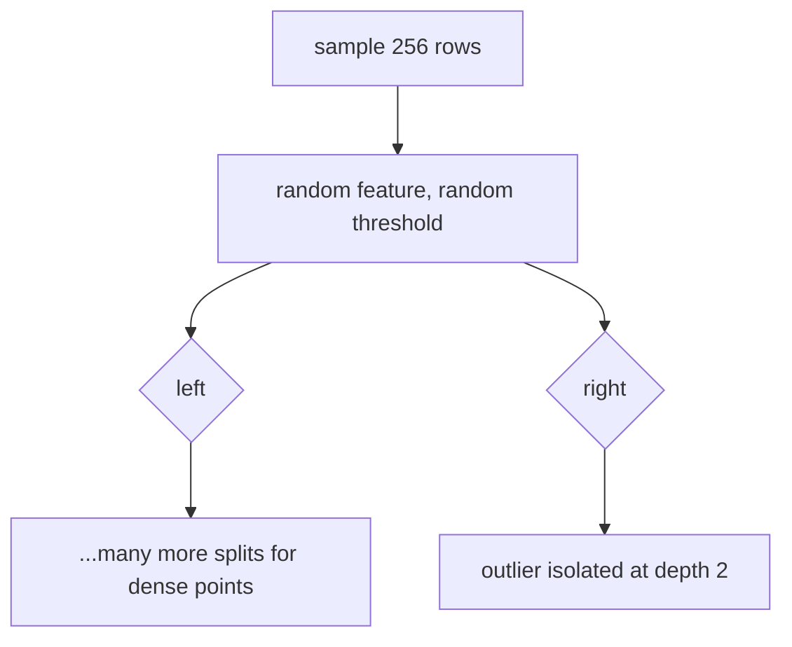

# Anomaly Detection

> Normal points are hard to isolate. Anomalies fall out after a few random cuts.

**Type:** Build
**Languages:** Python
**Prerequisites:** Phase 03 (Probability and Statistics: expectation & variance, random variables & distributions), Phase 04 (ML Fundamentals: metrics), Phase 07 (Trees and Ensembles: decision trees, random forests)
**Time:** ~75 minutes

## Learning Objectives

- Detect univariate outliers with the z-score and the robust (median/MAD) z-score, and explain masking
- Implement an isolation forest from scratch: random trees, path lengths and the normalized anomaly score
- Evaluate detectors without a fixed threshold using ROC AUC, and set a threshold from an expected contamination rate
- Know when to reach for statistical rules, isolation forests or other sklearn detectors

## The Problem

A payment API normally answers in 120 ms. One night some requests take 400 ms. A credit card that buys coffee every morning suddenly buys three laptops in another country. A sensor on a production line drifts. You rarely have labels for these events, they are rare, and they rarely look like each other. You cannot train a normal classifier on them.

Anomaly detection flips the question: instead of learning what an anomaly looks like, learn what normal looks like and flag what does not fit. This lesson builds the two tools you will use most: a statistical rule for single features, and an isolation forest for many features at once.

## The Concept

### The z-score

For a single feature with mean `mu` and standard deviation `sigma`:

```
z = (x - mu) / sigma
```

Under a normal distribution, `|z| > 3` happens about 0.3% of the time. Flag those points.

The catch: `mu` and `sigma` are computed from data that includes the outliers. A few huge values inflate `sigma`, which shrinks every z-score, which hides the outliers. This is called **masking**.

### The robust z-score

Replace the mean with the median and the standard deviation with the median absolute deviation (MAD):

```
MAD       = median(|x - median(x)|)
robust_z  = 0.6745 * (x - median(x)) / MAD
```

The constant `0.6745` makes MAD comparable to `sigma` for normal data. The median and MAD have a 50% breakdown point: up to half the data can be garbage before they move a lot. The usual cutoff is `|robust_z| > 3.5` (Iglewicz and Hoaglin).

### Why one feature is not enough

```
   x2
    |      ooooo                       Point A has a normal x1 and a
    |     ooooooo         A            normal x2, so per-feature z-scores
    |      ooooo                       say it is fine. But no normal point
    |                  ooooo           sits at that combination.
    |                 ooooooo
    +------------------------------ x1
```

Anomalies often live in combinations of features. You need a multivariate method.

### Isolation forest

Liu, Ting and Zhou (2008) had a simple idea: anomalies are few and different, so they are easy to separate.

Build a tree by choosing a random feature and a random split value between its min and max, and recurse until every point is alone. A point in a dense cluster needs many cuts before it is isolated. An outlier in empty space is often cut off in the first two or three.



Average the depth over many random trees, each built on a small random subsample (256 rows by default; subsampling reduces swamping and masking).

### Normalizing the path length

Depth depends on sample size, so it is normalized by `c(n)`, the average path length of an unsuccessful search in a binary search tree with `n` points:

```
c(n) = 2 H(n - 1) - 2 (n - 1) / n,     H(i) ~ ln(i) + 0.5772
score(x) = 2 ^ (-E[h(x)] / c(n))
```

- Score near 1: isolated much faster than average, very likely an anomaly.
- Score around 0.5 or below: behaves like the rest of the data.

Trees are capped at depth `ceil(log2(n))`. Below that depth, the remaining points are all "normal enough", and `c(size)` is added to estimate the depth they would have needed.

### Choosing a threshold

Detectors output a score, not a decision. Two common ways to decide:

- **Contamination:** if you expect about 5% anomalies, flag the top 5% of scores.
- **Labelled sample:** if you have a few labels, pick the threshold that gives an acceptable precision/recall trade-off (Phase 04, metrics). ROC AUC compares detectors independently of the threshold.

## Build It

### Step 1: z-score vs robust z-score

200 latency readings around 120 ms plus 8 spikes around 400 ms.

```python
def z_scores(values):
    return (values - values.mean()) / values.std()


def robust_z_scores(values):
    median = np.median(values)
    mad = np.median(np.abs(values - median))
    return 0.6745 * (values - median) / mad
```

```
Mean=130.2  std=55.6  median=120.3
Flagged with |z| > 3:        8
Flagged with |robust z| > 3.5: 8
z-score of first spike: 4.86  robust z: 30.32
With 30 spikes (13% contamination): |z|>3 flags 0, robust flags 30
```

With 8 spikes both work, but the 8 spikes already pushed `sigma` from about 10 to 55. With 30 spikes the standard z-score flags nothing at all: complete masking. The robust version still flags all 30.

### Step 2: Isolation trees

```python
class IsolationTree:
    def fit(self, X, depth=0):
        self.size = X.shape[0]
        self.depth = depth
        is_constant = np.all(X.max(axis=0) == X.min(axis=0))
        if depth >= self.height_limit or self.size <= 1 or is_constant:
            self.is_leaf = True
            return self
        self.is_leaf = False
        spread = X.max(axis=0) - X.min(axis=0)
        candidate_features = np.flatnonzero(spread > 0)
        self.feature = self.rng.choice(candidate_features)
        low, high = X[:, self.feature].min(), X[:, self.feature].max()
        self.threshold = self.rng.uniform(low, high)
        goes_left = X[:, self.feature] < self.threshold
        self.left = IsolationTree(self.height_limit, self.rng).fit(X[goes_left], depth + 1)
        self.right = IsolationTree(self.height_limit, self.rng).fit(X[~goes_left], depth + 1)
        return self

    def path_length(self, x):
        node = self
        while not node.is_leaf:
            node = node.left if x[node.feature] < node.threshold else node.right
        return node.depth + average_path_length(node.size)
```

The forest builds 100 trees on random subsamples of 256 rows and averages path lengths:

```python
def score(self, X):
    mean_depth = np.array([np.mean([tree.path_length(x) for tree in self.trees]) for x in X])
    return 2.0 ** (-mean_depth / average_path_length(self.sample_size_))
```

The dataset: two Gaussian clusters (900 normal points), 30 points scattered uniformly over a wide box, and 10 points in a tight little group between the clusters (40 anomalies total).

```
c(256) = 10.245 expected depth of an unsuccessful BST search
Mean anomaly score  inliers: 0.438  outliers: 0.621
```

### Step 3: Compare detectors with ROC AUC

```
Max |z| across features   AUC: 0.670
Isolation forest (scratch) AUC: 0.968
```

Per-feature z-scores miss the points between the clusters and any scattered point whose coordinates are individually typical. The isolation forest sees the empty regions directly.

### Step 4: Threshold from contamination

```
Threshold at top 5%: score >= 0.549
Flagged 47  precision=0.532  recall=0.625
```

The ranking is excellent (AUC 0.97), but a hard threshold still mislabels some points. None of the 10 points in the tight group between the clusters is flagged: their scores sit around 0.51-0.54, just below the threshold, because they are close to each other and take more cuts to isolate. The other misses are uniformly scattered points that happened to land inside or near a cluster, which are not really anomalous anyway. Small dense groups of anomalies are the classic weak spot of isolation forests.

## Use It

```python
from sklearn.ensemble import IsolationForest

sk_forest = IsolationForest(n_estimators=100, max_samples=256, contamination=0.05, random_state=0).fit(X)
sk_scores = -sk_forest.score_samples(X)
sk_flagged = sk_forest.predict(X) == -1
```

```
sklearn AUC: 0.964
sklearn flagged 47  precision=0.511
Correlation between scratch and sklearn scores: 0.986
```

Notes on the sklearn API:

- `score_samples` returns the negated paper score (lower is more abnormal), so negate it to rank anomalies first.
- `predict` returns `-1` for anomalies and `1` for inliers, using the threshold implied by `contamination`.
- `decision_function` is `score_samples` shifted so that 0 is the threshold.

Other detectors in sklearn worth knowing: `LocalOutlierFactor` (density compared with neighbors, good for clusters of different densities), `OneClassSVM` (a boundary around normal data, Phase 06 kernel trick), and `EllipticEnvelope` (a robust Gaussian fit, a multivariate robust z-score). For time series, apply the robust z-score to residuals after removing trend and seasonality.

## Exercises

1. **Easy.** Change the robust z cutoff from 3.5 to 2.5 and 5.0 on the latency data with 30 spikes. How many normal readings get flagged at 2.5?
2. **Medium.** Vary `sample_size` (32, 64, 256, all rows) in your isolation forest and plot AUC on the dataset. Explain why small subsamples can help with the tight group between clusters.
3. **Hard.** Implement the Mahalanobis distance detector: `d^2 = (x - mu)^T Sigma^-1 (x - mu)` using a covariance fitted per cluster (use k-means from Phase 08 to assign clusters). Compare its AUC with the isolation forest and with `EllipticEnvelope` on the same data.

## Key Terms

| Term | What people say | What it actually means |
|------|----------------|----------------------|
| Anomaly / outlier | "A weird point" | An observation unlikely under the process that generated most of the data |
| z-score | "How many standard deviations away" | (x - mean) / std for one feature |
| MAD | "Robust standard deviation" | Median of absolute deviations from the median; scaled by 1/0.6745 to match sigma for normal data |
| Masking | "Outliers hiding each other" | Outliers inflating the mean and std so much that none of them crosses the threshold |
| Isolation forest | "Random trees for outliers" | An ensemble of random-split trees where anomaly score grows as average isolation depth shrinks |
| Path length | "How deep the point goes" | Number of splits needed to isolate a point in a tree, plus c(size) at depth-limited leaves |
| Contamination | "Expected outlier rate" | The assumed fraction of anomalies, used to turn scores into a threshold |
| Swamping | "Normal points flagged" | Normal points near anomalies being labelled anomalous; reduced by subsampling |

## Further Reading

- [Isolation Forest (Liu, Ting and Zhou, ICDM 2008)](https://ieeexplore.ieee.org/document/4781136) -- the original paper with the path-length normalization
- [scikit-learn: Novelty and Outlier Detection](https://scikit-learn.org/stable/modules/outlier_detection.html) -- comparison of IsolationForest, LOF, OneClassSVM and EllipticEnvelope
- [NIST/SEMATECH e-Handbook: Detection of Outliers](https://www.itl.nist.gov/div898/handbook/eda/section3/eda35h.htm) -- statistical outlier tests and the modified z-score
- [Outlier Analysis (Charu Aggarwal)](https://link.springer.com/book/10.1007/978-3-319-47578-3) -- the standard textbook covering statistical, proximity and ensemble methods
