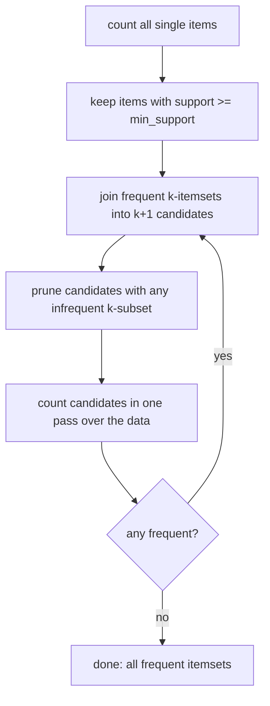

# Association Rules

> People who buy bread buy butter. Apriori finds every rule like that, without checking every combination.

**Type:** Build
**Languages:** Python
**Prerequisites:** Phase 00 (Python Foundations: data structures, pandas), Phase 03 (Probability and Statistics: probability basics, bayes theorem)
**Time:** ~60 minutes

## Learning Objectives

- Define support, confidence and lift and compute them for any rule `X -> Y`
- Implement the Apriori algorithm from scratch, using the downward-closure property to prune candidates
- Generate association rules from frequent itemsets and rank them by lift
- Recognize misleading rules: high confidence driven by a popular consequent, and redundant rules

## The Problem

A grocery store has two thousand receipts. The manager asks: which products are bought together, so we can place them near each other, bundle them, or recommend one when someone picks the other?

With 15 products there are `2^15 = 32,768` possible itemsets. With a real store of 10,000 products there are more itemsets than atoms in the universe. You cannot count them all. You need a way to count only the combinations that could possibly be frequent, and then a way to tell real associations apart from coincidences.

This is market basket analysis, one of the oldest data-mining problems. The same tools work for co-occurring symptoms, web pages visited in the same session, or software packages installed together.

## The Concept

### Transactions and itemsets

Each transaction is a set of items. An itemset is any set of items, for example `{bread, butter}`.

```
T1: {bread, butter, jam, water}
T2: {milk, cereal, tea}
T3: {bread, water, eggs}
...
```

### Three numbers

For a rule `X -> Y` (if a basket contains X, it also contains Y), with X and Y disjoint itemsets:

```
support(X)      = fraction of transactions containing X
support(X -> Y) = support(X union Y)
confidence      = support(X union Y) / support(X)        = P(Y | X)
lift            = confidence / support(Y)                 = P(Y | X) / P(Y)
```

- **Support** says how common the pattern is. Rare patterns are not actionable and are statistically unreliable.
- **Confidence** is a conditional probability. It looks like the right measure, but it ignores how popular Y already is.
- **Lift** compares confidence with the baseline. `lift = 1` means X and Y are independent, `lift > 1` means X makes Y more likely, `lift < 1` means less likely.

A classic trap: if 60% of all baskets contain water, then almost any rule `something -> water` has confidence near 0.6, even though "something" tells you nothing. Its lift is about 1.

### The Apriori principle

If an itemset is frequent, all its subsets are frequent. Equivalently (downward closure):

```
If {bread, jam} is infrequent, then {bread, jam, X} is infrequent for every X.
```

So you build itemsets level by level and only extend the survivors:



### From itemsets to rules

For each frequent itemset `S` with at least two items, try every non-empty proper subset `X` as the antecedent and `S - X` as the consequent. The supports of `S`, `X` and `S - X` are already known because every subset of a frequent itemset is frequent. Keep rules above a minimum confidence, then sort by lift.

## Build It

The data: 2000 synthetic baskets. Built-in patterns: bread often comes with butter and jam, diapers sometimes come with beer, milk with cereal. Water is in 60% of baskets at random, and every basket gets 1-3 random filler items.

### Step 1: Count support for candidates

```python
def support_counts(baskets, candidates):
    counts = {candidate: 0 for candidate in candidates}
    for basket in baskets:
        for candidate in candidates:
            if candidate <= basket:
                counts[candidate] += 1
    return counts
```

Using `frozenset` for baskets and itemsets makes `candidate <= basket` a subset test and lets itemsets be dictionary keys.

### Step 2: Generate and prune candidates

```python
def generate_candidates(frequent_previous, size):
    candidates = set()
    previous_list = list(frequent_previous)
    for i in range(len(previous_list)):
        for j in range(i + 1, len(previous_list)):
            union = previous_list[i] | previous_list[j]
            if len(union) != size:
                continue
            all_subsets_frequent = all(frozenset(subset) in frequent_previous for subset in combinations(union, size - 1))
            if all_subsets_frequent:
                candidates.add(union)
    return candidates
```

Two frequent `(k-1)`-itemsets that share `k-2` items produce a `k`-candidate. The pruning line is the Apriori principle in code.

### Step 3: The Apriori loop

```python
def apriori(baskets, min_support):
    n = len(baskets)
    items = {item for basket in baskets for item in basket}
    candidates = {frozenset([item]) for item in items}
    frequent = {}
    size = 1
    while candidates:
        counts = support_counts(baskets, candidates)
        level = {itemset: count / n for itemset, count in counts.items() if count / n >= min_support}
        frequent.update(level)
        size += 1
        candidates = generate_candidates(set(level), size)
    return frequent
```

```
  size 1:  15 candidates ->  15 frequent
  size 2: 105 candidates ->  38 frequent
  size 3:  41 candidates ->   6 frequent
  0.229  ['bread', 'butter']
  0.218  ['cereal', 'water']
  0.194  ['cereal', 'milk']
  0.186  ['bread', 'water']
  0.184  ['milk', 'water']
  0.174  ['bread', 'jam']
```

Without pruning there would be `C(15, 3) = 455` size-3 candidates. Apriori counted only 41. The savings grow explosively with more items.

Notice `{cereal, water}` is the second most frequent pair. That is not an association, it is two popular items. Support alone cannot tell you that.

### Step 4: Rules ranked by lift

```python
confidence = itemset_support / frequent[antecedent]
lift = confidence / frequent[consequent]
```

```
       antecedent    consequent  support  confidence   lift
0    bread, water        butter    0.134       0.718  3.138
2    bread, water           jam    0.102       0.544  3.128
4   bread, cereal        butter    0.085       0.697  3.042
5             jam         bread    0.174       1.000  2.981
8           bread        butter    0.229       0.683  2.981
9          butter         bread    0.229       1.000  2.981
```

The real patterns rise to the top: butter and jam never appear without bread (confidence 1.0), and bread triples the chance of butter (lift 2.98). The rules with water in the antecedent are **redundant**: `bread, water -> butter` has almost the same lift as `bread -> butter`. Adding water changes nothing meaningful; its slightly higher lift is sampling noise. Real tools filter such rules by requiring that a longer rule beats all its simpler versions.

### Step 5: Why lift matters

```
Rules with confidence >= 0.5 but lift near 1 (no real association): 18
       antecedent consequent  support  confidence   lift
27         coffee      water    0.151       0.618  1.051
28         apples      water    0.150       0.613  1.043
29  beer, diapers      water    0.081       0.607  1.033
```

Eighteen rules pass the confidence filter but carry no information. `coffee -> water` has 62% confidence only because 59% of all baskets contain water. Always report lift (or a similar measure such as leverage or conviction) next to confidence.

## Use It

A one-hot DataFrame (one boolean column per item) is the standard input format for library implementations, and it makes individual supports a one-liner:

```python
one_hot = pd.DataFrame([[item in basket for item in all_items] for basket in baskets], columns=all_items)
triple_support = (one_hot["bread"] & one_hot["butter"] & one_hot["jam"]).mean()
```

```
support(bread, butter, jam) via pandas: 0.116  via apriori: 0.116
```

scikit-learn does not include association rules. The common library is `mlxtend` (not a dependency of this course):

```python
from mlxtend.frequent_patterns import apriori, fpgrowth, association_rules

frequent = fpgrowth(one_hot, min_support=0.08, use_colnames=True)
rules = association_rules(frequent, metric="lift", min_threshold=1.2)
```

FP-Growth produces the same itemsets as Apriori but compresses the transactions into a prefix tree and avoids candidate generation, which is much faster on large data. Spark MLlib also has a distributed `FPGrowth` for very large transaction logs.

## Exercises

1. **Easy.** Lower `min_support` to 0.03. How many frequent itemsets of each size do you get now, and does the `diapers -> beer` rule appear? Report its confidence and lift.
2. **Medium.** Add leverage (`support(X union Y) - support(X) support(Y)`) and conviction (`(1 - support(Y)) / (1 - confidence)`) to the rule table. Which rules does conviction rank differently from lift?
3. **Hard.** Implement a redundancy filter: drop a rule `X -> Y` if some rule `X' -> Y` with `X'` a strict subset of `X` has lift at least as high minus 0.1. Apply it and show the shorter, cleaner rule table. Then time your Apriori on 20,000 baskets with 50 items and compare with a brute-force count of all pairs and triples.

## Key Terms

| Term | What people say | What it actually means |
|------|----------------|----------------------|
| Itemset | "A combination of products" | A set of items; a k-itemset has k items |
| Support | "How often it happens" | Fraction of transactions containing the itemset |
| Confidence | "How reliable the rule is" | support(X union Y) / support(X), the conditional probability P(Y given X) |
| Lift | "How much X boosts Y" | confidence / support(Y); 1 means independence |
| Apriori principle | "Downward closure" | Every subset of a frequent itemset is frequent, so supersets of infrequent itemsets can be skipped |
| Candidate generation | "Building the next level" | Joining frequent k-itemsets into k+1 itemsets and pruning those with infrequent subsets |
| Redundant rule | "Same rule with extra items" | A rule whose antecedent adds items without raising lift over a simpler rule |
| FP-Growth | "Faster Apriori" | A frequent-itemset algorithm that compresses transactions into a prefix tree and avoids candidate generation |

## Further Reading

- [Fast Algorithms for Mining Association Rules (Agrawal and Srikant, VLDB 1994)](https://www.vldb.org/conf/1994/P487.PDF) -- the original Apriori paper
- [Introduction to Data Mining (Tan, Steinbach, Karpatne, Kumar), chapter 5](https://www-users.cse.umn.edu/~kumar001/dmbook/index.php) -- association analysis with clear examples of support, confidence and lift
- [Mining of Massive Datasets (Leskovec, Rajaraman, Ullman), chapter 6](http://www.mmds.org/) -- frequent itemsets at scale, free online
- [mlxtend association rules user guide](https://rasbt.github.io/mlxtend/user_guide/frequent_patterns/association_rules/) -- practical reference for Apriori, FP-Growth and rule metrics in Python
