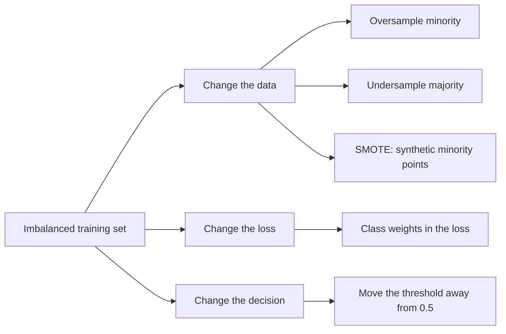

# Imbalanced Data

> When 95% of your data says "no", a model that always says "no" is 95% accurate and 100% useless.

**Type:** Build
**Languages:** Python
**Prerequisites:** Phase 04 (ML Fundamentals: Metrics), Phase 06 (Supervised Classification: Logistic Regression, k-Nearest Neighbors)
**Time:** ~60 minutes

## Learning Objectives

- Explain why accuracy is misleading on imbalanced data and pick precision, recall, F1 or average precision instead
- Implement class weighting, random over/undersampling and SMOTE from scratch in NumPy
- Tune the decision threshold of a probabilistic classifier and compare it with resampling
- Reproduce the same ideas with scikit-learn's `class_weight="balanced"` and `average_precision_score`

## The Problem

Fraud detection, disease screening, machine failure, churn: in most real classification problems the interesting class is rare. One transaction in a thousand is fraud. Five patients in a hundred have the condition.

Train a standard classifier on that data and it learns that the cheapest way to reduce the loss is to mostly ignore the minority class. Each minority example contributes as much to the loss as each majority example, and there are twenty times fewer of them. The result looks great on a dashboard (97% accuracy) and misses half the cases you actually care about.

You need two things: metrics that do not lie about the rare class, and techniques that push the model to pay attention to it.

## The Concept

### Why accuracy fails

With 5% positives, the constant classifier `predict 0` scores:

```
accuracy  = 0.95
precision = undefined (no positives predicted) -> 0
recall    = 0 / 30 = 0.0
```

Accuracy rewards the majority class. Use metrics built from the confusion matrix that focus on the positive class:

```
precision = TP / (TP + FP)     "of the alarms I raised, how many were real?"
recall    = TP / (TP + FN)     "of the real cases, how many did I catch?"
F1        = 2 * P * R / (P + R)
```

Average precision (area under the precision-recall curve) summarizes ranking quality across all thresholds. Unlike ROC-AUC it is sensitive to the base rate, which makes it the better summary for rare positives.

### Three families of fixes



**Class weights.** Multiply each sample's loss by a weight. The "balanced" heuristic gives each class the same total weight:

```
weight_c = n_samples / (n_classes * count_c)
```

With 1330 negatives and 70 positives, each positive weighs 10.0 and each negative weighs 0.53.

**Random oversampling.** Duplicate minority rows until the classes are equal. Same effect as class weights in expectation, but the duplicates make overfitting easier for flexible models.

**Random undersampling.** Throw away majority rows. Fast, but you discard information.

**SMOTE** (Synthetic Minority Over-sampling Technique). For each synthetic point, pick a minority sample, pick one of its k nearest minority neighbors, and place a new point at a random position on the segment between them:

```
x_new = x_i + gap * (x_neighbor - x_i),   gap ~ Uniform(0, 1)
```

```
   minority points:   o         o
                        \     /
                         * * *       <- synthetic points on segments
                        /
                      o
```

**Threshold moving.** A logistic regression outputs probabilities. Nothing forces you to cut at 0.5. Lowering the threshold trades precision for recall. Choose it on training or validation data, never on the test set.

### The key insight

Weighting, resampling and SMOTE all shift the model's probabilities upward for the minority class. That mostly has the same effect as lowering the threshold. They are not magic: they move you along the precision-recall trade-off. Decide which point on that curve your application needs (missing a fraud vs annoying a customer) and pick the threshold accordingly.

## Build It

### Step 1: An imbalanced dataset and a stratified split

Two Gaussian blobs, 1900 negatives and 100 positives. The split keeps the 5% ratio in both train and test.

```python
def make_imbalanced_data(n_majority=1900, n_minority=100, seed=0):
    rng = np.random.default_rng(seed)
    X_majority = rng.normal(loc=[0.0, 0.0], scale=1.0, size=(n_majority, 2))
    X_minority = rng.normal(loc=[1.8, 1.8], scale=0.8, size=(n_minority, 2))
    X = np.vstack([X_majority, X_minority])
    y = np.concatenate([np.zeros(n_majority, dtype=int), np.ones(n_minority, dtype=int)])
    order = rng.permutation(len(y))
    return X[order], y[order]
```

### Step 2: Logistic regression that accepts sample weights

The gradient of the weighted log loss is the ordinary gradient with each residual multiplied by its weight.

```python
class WeightedLogisticRegression:
    def fit(self, X, y, sample_weight=None):
        n_samples, n_features = X.shape
        if sample_weight is None:
            sample_weight = np.ones(n_samples)
        weights_normalized = sample_weight / sample_weight.sum()
        self.w = np.zeros(n_features)
        self.b = 0.0
        for _ in range(self.epochs):
            p = self.predict_proba(X)
            error = (p - y) * weights_normalized
            self.w -= self.learning_rate * (X.T @ error)
            self.b -= self.learning_rate * error.sum()
        return self


def balanced_class_weights(y):
    classes, counts = np.unique(y, return_counts=True)
    weight_per_class = len(y) / (len(classes) * counts)
    return weight_per_class[np.searchsorted(classes, y)]
```

### Step 3: Resampling and SMOTE

```python
def random_oversample(X, y, seed=0):
    rng = np.random.default_rng(seed)
    minority_idx = np.flatnonzero(y == 1)
    n_needed = np.sum(y == 0) - len(minority_idx)
    extra = rng.choice(minority_idx, size=n_needed, replace=True)
    return np.vstack([X, X[extra]]), np.concatenate([y, y[extra]])


def smote(X, y, k_neighbors=5, seed=0):
    rng = np.random.default_rng(seed)
    X_minority = X[y == 1]
    n_needed = np.sum(y == 0) - len(X_minority)
    distances = np.linalg.norm(X_minority[:, None, :] - X_minority[None, :, :], axis=2)
    np.fill_diagonal(distances, np.inf)
    neighbors = np.argsort(distances, axis=1)[:, :k_neighbors]
    base = rng.integers(0, len(X_minority), size=n_needed)
    chosen_neighbor = neighbors[base, rng.integers(0, k_neighbors, size=n_needed)]
    gap = rng.random((n_needed, 1))
    synthetic = X_minority[base] + gap * (X_minority[chosen_neighbor] - X_minority[base])
    return np.vstack([X, synthetic]), np.concatenate([y, np.ones(n_needed, dtype=int)])
```

Resampling is applied to the training set only. Oversampling before the split leaks copies of test rows into training.

### Step 4: Threshold tuning

```python
def best_f1_threshold(y_true, scores):
    best_threshold, best_f1 = 0.5, -1.0
    for threshold in np.linspace(0.05, 0.95, 91):
        tp, fp, fn, _ = confusion_counts(y_true, (scores >= threshold).astype(int))
        f1 = 2 * tp / (2 * tp + fp + fn) if tp else 0.0
        if f1 > best_f1:
            best_threshold, best_f1 = threshold, f1
    return best_threshold, best_f1
```

### Step 5: Compare

Running `code/main.py` prints:

```
always predict 0         acc=0.950 precision=0.000 recall=0.000 f1=0.000
plain logistic           acc=0.973 precision=0.850 recall=0.567 f1=0.680
class weights            acc=0.920 precision=0.382 recall=0.967 f1=0.547
random oversample        acc=0.923 precision=0.392 recall=0.967 f1=0.558
random undersample       acc=0.912 precision=0.358 recall=0.967 f1=0.523
SMOTE                    acc=0.923 precision=0.392 recall=0.967 f1=0.558
plain + tuned threshold  acc=0.973 precision=0.733 recall=0.733 f1=0.733
```

Read it carefully. The baseline is 95% accurate and catches nothing. Every rebalancing method lifts recall from 0.57 to 0.97 at the cost of precision. On this easy, linearly separable problem, they all land at nearly the same point because they all do the same thing to a linear model: shift the intercept. Tuning the threshold of the plain model gives the best F1. If recall is what matters (screening), the balanced models are what you want. There is no universal winner; there is a trade-off you choose.

## Use It

scikit-learn builds class weighting into most classifiers:

```python
from sklearn.linear_model import LogisticRegression
from sklearn.metrics import average_precision_score, f1_score, precision_score, recall_score

for name, class_weight in [("sklearn plain", None), ("sklearn balanced", "balanced")]:
    model = LogisticRegression(class_weight=class_weight).fit(X_train, y_train)
    y_pred = model.predict(X_test)
    print(name, precision_score(y_test, y_pred), recall_score(y_test, y_pred), f1_score(y_test, y_pred))

scores = LogisticRegression().fit(X_train, y_train).predict_proba(X_test)[:, 1]
print(average_precision_score(y_test, scores))
```

```
sklearn plain            precision=0.792 recall=0.633 f1=0.704
sklearn balanced         precision=0.403 recall=0.967 f1=0.569
sklearn average_precision_score: 0.838
```

The numbers match the from-scratch version closely (sklearn adds L2 regularization and runs a proper solver to convergence). For SMOTE and its variants, the `imbalanced-learn` package provides `SMOTE`, `RandomUnderSampler` and a pipeline that applies resampling only during `fit`. Tree ensembles such as `RandomForestClassifier` and `HistGradientBoostingClassifier` also accept `class_weight`. Since scikit-learn 1.5, `TunedThresholdClassifierCV` picks the decision threshold with cross-validation for you.

## Exercises

1. **Easy.** Change the imbalance to 1% positives (`n_minority=20`). Which method degrades most? Does the "always predict 0" baseline look even better on accuracy?
2. **Medium.** Implement a precision-recall curve from scratch (precision and recall at every threshold) and plot it for the plain and the class-weighted models. Confirm that their curves nearly overlap, which shows weighting mostly moves the operating point.
3. **Hard.** Replace logistic regression with a k-nearest neighbors classifier (k=1) and repeat the comparison. Show that random oversampling and SMOTE now give different results, and explain why duplicates and interpolated points behave differently for a local model.

## Key Terms

| Term | What people say | What it actually means |
|------|----------------|----------------------|
| Class imbalance | "The rare class problem" | One class is far less frequent than another, so the loss and accuracy are dominated by the majority |
| Precision | "How many alarms are real" | TP / (TP + FP): the fraction of predicted positives that are actually positive |
| Recall | "How many cases we catch" | TP / (TP + FN): the fraction of actual positives the model detects |
| Average precision | "PR-AUC" | Mean precision at the rank of each true positive; a threshold-free summary of the precision-recall curve |
| Class weights | "Make mistakes on the rare class cost more" | Per-sample multipliers in the loss, usually n / (n_classes * count_c) |
| SMOTE | "Synthetic oversampling" | Creates new minority points by interpolating between a minority sample and one of its k nearest minority neighbors |
| Threshold moving | "Change the cut-off" | Classify as positive when the predicted probability exceeds a value other than 0.5, chosen on validation data |

## Further Reading

- [Chawla et al., SMOTE: Synthetic Minority Over-sampling Technique (JAIR 2002)](https://www.jair.org/index.php/jair/article/view/10302) -- the original SMOTE paper
- [imbalanced-learn user guide](https://imbalanced-learn.org/stable/user_guide.html) -- over/undersampling methods and how to use them safely inside pipelines
- [scikit-learn: Tuning the decision threshold](https://scikit-learn.org/stable/modules/classification_threshold.html) -- `TunedThresholdClassifierCV` and why 0.5 is rarely the right cut-off
- [Saito and Rehmsmeier, The Precision-Recall Plot Is More Informative than the ROC Plot (PLOS ONE 2015)](https://journals.plos.org/plosone/article?id=10.1371/journal.pone.0118432) -- why PR curves beat ROC on imbalanced data
