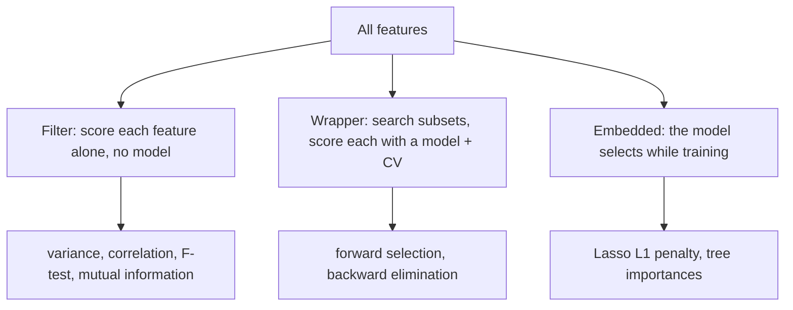

# Feature Selection

> Every feature you keep is a feature you must collect, clean, monitor and explain. Keep only the ones that pay rent.

**Type:** Build
**Languages:** Python
**Prerequisites:** Phase 04 (ML Fundamentals: Cross-Validation, Overfitting & Regularization), Phase 05 (Supervised Regression: Linear Regression Closed Form, Lasso & Elastic Net)
**Time:** ~60 minutes

## Learning Objectives

- Distinguish filter, wrapper and embedded feature selection and name the trade-offs of each
- Implement a variance filter, a correlation/F-statistic ranking, forward selection and backward elimination from scratch
- Explain why univariate filters keep redundant features and wrappers do not
- Use `VarianceThreshold`, `SelectKBest`, `SequentialFeatureSelector` and Lasso in scikit-learn

## The Problem

Real datasets arrive with dozens or thousands of columns: raw sensor channels, one-hot encoded categories, every field a database happens to store. Most of them are noise, near-constants, or copies of each other.

Extra features hurt you in three ways. They give the model more ways to overfit (more parameters, same data). They cost money: each feature has to be computed in production and can break or drift. And they make the model harder to explain. Dropping a useless feature is one of the few changes that improves accuracy, speed and interpretability at the same time.

The question is how to decide which features are useless without fooling yourself.

## The Concept

### Three families



| Family | Cost | Sees interactions and redundancy? | Risk |
|--------|------|-----------------------------------|------|
| Filter | One pass over the data | No | Keeps duplicates, misses features useful only in combination |
| Wrapper | Many model fits (k^2 for forward selection) | Yes | Slow; can overfit the CV score with many features |
| Embedded | One model fit | Partly | Tied to one model family |

### Filters

**Variance threshold.** A feature that never changes cannot help. Drop features whose variance is below a small threshold.

**Correlation and the F-test.** For regression, score feature j by its Pearson correlation with y. The F-statistic used by `f_regression` is a monotone function of it:

```
r_j = cov(x_j, y) / (std(x_j) * std(y))
F_j = r_j^2 / (1 - r_j^2) * (n - 2)
```

Filters score each feature alone. If `copy_s0` is almost identical to `s0`, both get high scores, and a "top 4" filter happily keeps both.

### Wrappers

**Forward selection.** Start empty. At each step, try adding every remaining feature, keep the one that most improves the cross-validated score. Stop when the gain is negligible.

```
selected = {}
repeat:
    for each candidate j not in selected:
        score_j = CV_score(model, selected + {j})
    add argmax_j score_j
until improvement < tolerance
```

**Backward elimination.** Start with everything; at each step drop the feature whose removal hurts least (or helps most).

Because each candidate is evaluated together with the features already chosen, a redundant copy adds almost nothing and is picked late or not at all.

### Embedded: Lasso

Lasso adds `alpha * sum |w_j|` to the squared error. The L1 penalty drives some coefficients to exactly zero, so the fitted model is its own feature selector. Larger alpha means fewer features.

### The key insight

Feature selection is part of the model. If you select features using the whole dataset and then cross-validate, the CV score is optimistically biased, because the selection already saw the validation folds. Selection must happen inside each training fold, which is exactly what pipelines (lesson 04) are for.

## Build It

### Step 1: Data with a known answer

Four true signals with decreasing coefficients, one redundant copy of `s0`, five pure noise columns and a near-constant column.

```python
def make_data(n_samples=300, seed=0):
    rng = np.random.default_rng(seed)
    signal = rng.normal(size=(n_samples, 4))
    redundant = signal[:, [0]] * 0.9 + rng.normal(scale=0.3, size=(n_samples, 1))
    noise = rng.normal(size=(n_samples, 5))
    constant = np.full((n_samples, 1), 3.0) + rng.normal(scale=1e-4, size=(n_samples, 1))
    X = np.hstack([signal, redundant, noise, constant])
    true_coefs = np.array([3.0, -2.0, 1.5, 0.5])
    y = signal @ true_coefs + rng.normal(scale=1.0, size=n_samples)
    names = ["s0", "s1", "s2", "s3", "copy_s0", "n0", "n1", "n2", "n3", "n4", "const"]
    return X, y, names
```

### Step 2: Filters

```python
def variance_filter(X, threshold=1e-3):
    return np.flatnonzero(X.var(axis=0) > threshold)


def correlation_scores(X, y):
    X_centered = X - X.mean(axis=0)
    y_centered = y - y.mean()
    numerator = X_centered.T @ y_centered
    denominator = np.sqrt((X_centered**2).sum(axis=0) * (y_centered**2).sum()) + 1e-12
    return numerator / denominator


def f_statistic(correlations, n_samples):
    r_squared = correlations**2
    return r_squared / (1 - r_squared) * (n_samples - 2)
```

The variance filter removes `const`. The ranking puts `copy_s0` second, ahead of the true signals `s1`, `s2` and `s3`:

```
   1. s0       r=+0.764 F=   416.6
   2. copy_s0  r=+0.706 F=   295.7
   3. s1       r=-0.429 F=    67.1
   4. s2       r=+0.409 F=    59.9
   5. s3       r=+0.125 F=     4.7
```

### Step 3: A cross-validated scorer

```python
def cv_r2(X, y, n_folds=5):
    folds = kfold_indices(len(y), n_folds)
    scores = []
    for fold in folds:
        train_mask = np.ones(len(y), dtype=bool)
        train_mask[fold] = False
        coefs = fit_least_squares(X[train_mask], y[train_mask])
        y_pred = predict_least_squares(coefs, X[fold])
        ss_res = np.sum((y[fold] - y_pred) ** 2)
        ss_tot = np.sum((y[fold] - y[fold].mean()) ** 2)
        scores.append(1 - ss_res / ss_tot)
    return float(np.mean(scores))
```

### Step 4: Forward selection and backward elimination

```python
def forward_selection(X, y, candidate_idx, max_features):
    selected = []
    history = []
    remaining = list(candidate_idx)
    while remaining and len(selected) < max_features:
        trial_scores = [(cv_r2(X[:, selected + [j]], y), j) for j in remaining]
        best_score, best_feature = max(trial_scores)
        selected.append(best_feature)
        remaining.remove(best_feature)
        history.append((best_feature, best_score))
    return selected, history


def backward_elimination(X, y, candidate_idx, min_features):
    selected = list(candidate_idx)
    history = [(None, cv_r2(X[:, selected], y))]
    while len(selected) > min_features:
        trial_scores = [(cv_r2(X[:, [f for f in selected if f != j]], y), j) for j in selected]
        best_score, worst_feature = max(trial_scores)
        selected.remove(worst_feature)
        history.append((worst_feature, best_score))
    return selected, history
```

Forward selection output:

```
  add s0       -> cv R^2 = 0.5628
  add s1       -> cv R^2 = 0.7613
  add s2       -> cv R^2 = 0.9216
  add s3       -> cv R^2 = 0.9340
  add copy_s0  -> cv R^2 = 0.9344
  add n3       -> cv R^2 = 0.9346
  add n2       -> cv R^2 = 0.9344
```

The four true signals come first. After that, gains are in the fourth decimal: noise. A sensible stopping rule (for example "stop when the gain is below 0.001") selects exactly `s0..s3`. Backward elimination reaches the same set from the other side: it drops the noise features first, and removing `s3` is the first step that costs real accuracy.

## Use It

```python
from sklearn.feature_selection import SelectKBest, SequentialFeatureSelector, VarianceThreshold, f_regression
from sklearn.linear_model import Lasso, LassoCV, LinearRegression

variance_selector = VarianceThreshold(threshold=1e-3).fit(X)
X_kept = variance_selector.transform(X)

kbest = SelectKBest(score_func=f_regression, k=4).fit(X_kept, y)

sfs = SequentialFeatureSelector(LinearRegression(), n_features_to_select=4, direction="forward", cv=5)
sfs.fit(X_kept, y)

lasso = LassoCV(cv=5, random_state=0).fit(X_kept, y)
strong_lasso = Lasso(alpha=0.1).fit(X_kept, y)
```

```
SelectKBest(f_regression, k=4): ['s0', 's1', 's2', 'copy_s0']
max |F_scratch - F_sklearn|: 1.1e-12
SequentialFeatureSelector(forward, 4): ['s0', 's1', 's2', 's3']
Lasso(alpha=0.1) keeps: ['s0', 's1', 's2', 's3', 'n4']
```

Your F-statistics match `f_regression` to machine precision. `SelectKBest` falls into the redundancy trap and drops `s3`; the wrapper does not. `LassoCV` picks a tiny alpha (it optimizes prediction, not sparsity) and keeps small nonzero weights everywhere; with `alpha=0.1` Lasso zeroes out `copy_s0` and nearly all noise. `SequentialFeatureSelector` also accepts `n_features_to_select="auto"` with a `tol`, which is the stopping rule from Step 4. For classification, swap `f_regression` for `f_classif` or `mutual_info_classif`, and see `SelectFromModel` to select by any model's coefficients or importances.

## Exercises

1. **Easy.** Add a stopping tolerance to `forward_selection` so it stops when the CV gain is below 0.001. Confirm that it returns exactly the four true signals.
2. **Medium.** Show selection bias: generate 50 noise features and a pure-noise target, pick the 5 features most correlated with y on the full data, then cross-validate a linear model on them. Compare against doing the selection inside each training fold. Explain the gap.
3. **Hard.** Implement mutual information between a feature and the target by binning both into 10 quantile bins and computing `sum p(a,b) log(p(a,b) / (p(a) p(b)))`. Add `y += 2 * n0**2` to the data and show that mutual information detects `n0` while correlation does not.

## Key Terms

| Term | What people say | What it actually means |
|------|----------------|----------------------|
| Filter method | "Rank features by a statistic" | Score each feature independently of any model (variance, correlation, F-test, mutual information) |
| Wrapper method | "Search subsets with the model" | Evaluate feature subsets by training the model and measuring a cross-validated score |
| Embedded method | "The model picks its features" | Selection happens during training, e.g. L1 penalties zeroing coefficients |
| Forward selection | "Add the best one at a time" | Greedy search that adds the feature giving the largest CV improvement until gains stop |
| Backward elimination | "Remove the worst one at a time" | Greedy search that starts with all features and removes the least useful one each step |
| Redundant feature | "A copy of another column" | A feature that is informative alone but adds nothing given another feature already in the model |
| Selection bias | "Peeking during selection" | Optimistic validation scores caused by choosing features on data that is later used for evaluation |

## Further Reading

- [scikit-learn: Feature selection](https://scikit-learn.org/stable/modules/feature_selection.html) -- every selector in sklearn with examples
- [Guyon and Elisseeff, An Introduction to Variable and Feature Selection (JMLR 2003)](https://www.jmlr.org/papers/v3/guyon03a.html) -- the classic survey of filter, wrapper and embedded methods
- [An Introduction to Statistical Learning (ISLR)](https://www.statlearning.com/) -- chapter 6 covers subset selection, ridge and lasso
- [The Elements of Statistical Learning](https://hastie.su.domains/ElemStatLearn/) -- section 7.10.2 shows the "wrong way" to cross-validate with feature selection
