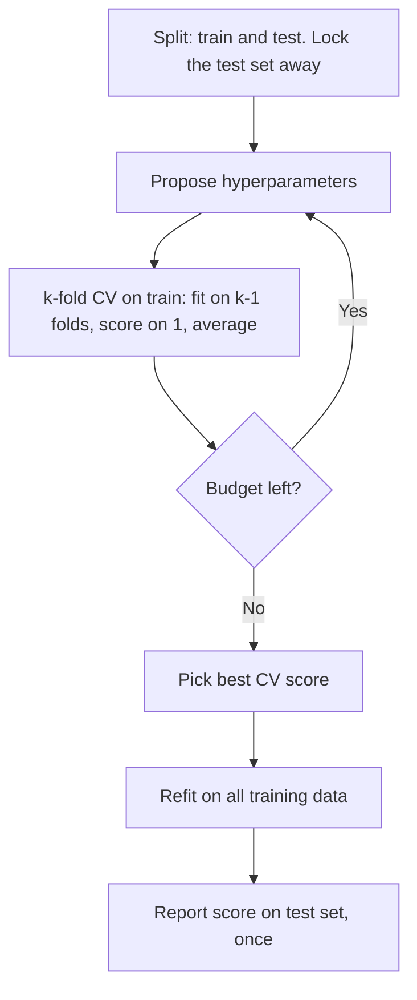

# Hyperparameter Tuning

> Parameters are learned from data. Hyperparameters are chosen by you, and choosing them is itself a learning problem.

**Type:** Build
**Languages:** Python
**Prerequisites:** Phase 04 (ML Fundamentals: Train Validation Test, Cross-Validation, Bias-Variance), Phase 06 (Supervised Classification: Kernel Trick)
**Time:** ~60 minutes

## Learning Objectives

- Separate model parameters from hyperparameters and explain why hyperparameters need validation data
- Implement grid search and random search with k-fold cross-validation from scratch
- Explain why random search with log-uniform sampling usually beats grid search for the same budget
- Use `GridSearchCV` and `RandomizedSearchCV` and keep a held-out test set honest

## The Problem

Almost every model has knobs that training does not set: the regularization strength of ridge regression, k in k-nearest neighbors, the depth of a tree, the learning rate of gradient boosting, the bandwidth of an RBF kernel. Set them badly and the same algorithm goes from excellent to useless.

In this lesson the model is RBF kernel ridge regression with two hyperparameters. Here is what three hand-picked settings give on the same data:

```
alpha=0.0001, gamma=100    cv R^2 = -2.3570
alpha=10, gamma=0.01       cv R^2 = +0.0706
alpha=0.1, gamma=1         cv R^2 = +0.8149
```

The first wildly overfits, the second underfits, the third works. You need a systematic, reproducible way to find the third without peeking at the test set.

## The Concept

### Parameters vs hyperparameters

| | Set by | Example |
|-|--------|---------|
| Parameter | The training algorithm, minimizing training loss | Ridge weights, tree split thresholds, kernel ridge dual coefficients |
| Hyperparameter | You, before training | alpha, gamma, max_depth, k, learning rate |

You cannot pick hyperparameters by training loss: the most flexible setting always wins on training data. You need held-out data, and since a single split is noisy, you use k-fold cross-validation.

### The tuning loop



### Grid search

Pick a list of values for each hyperparameter and try every combination. With 6 values each for 2 hyperparameters you get 36 configurations, times 5 folds = 180 fits. The cost grows exponentially with the number of hyperparameters.

### Random search

Sample each hyperparameter independently from a distribution. Bergstra and Bengio (2012) showed why this tends to win: usually only one or two hyperparameters matter much. With a 6x6 grid you test only 6 distinct values of the important one; with 36 random trials you test 36 distinct values.

```
  grid (9 trials)          random (9 trials)
  gamma ^                  gamma ^
        | x   x   x              |   x     x
        | x   x   x              | x    x
        | x   x   x              |    x      x  x
        +----------> alpha       |  x    x
                                 +----------> alpha
  3 distinct alphas         9 distinct alphas
```

### Log scale

Regularization strengths and kernel widths act multiplicatively: the difference between 0.001 and 0.01 matters as much as between 1 and 10. Search them on a log scale (`np.logspace` for grids, log-uniform for random search):

```
value = 10 ** Uniform(log10(low), log10(high))
```

### The key insight

The best CV score is itself an optimistic estimate: you picked the maximum of many noisy numbers. That is why the final test set must stay untouched until the very end. If you need an unbiased estimate of the whole tuning procedure without a separate test set, use nested cross-validation (an outer CV loop around the inner search).

## Build It

### Step 1: The model

Kernel ridge regression with an RBF kernel. `gamma` controls how local the kernel is; `alpha` is the ridge penalty. Training is one linear solve.

```
K_ij = exp(-gamma * ||x_i - x_j||^2)
dual_coef = (K + alpha * I)^(-1) y
y_hat(x) = sum_i K(x, x_i) * dual_coef_i
```

```python
class RBFKernelRidge:
    def __init__(self, alpha=1.0, gamma=1.0):
        self.alpha = alpha
        self.gamma = gamma

    def kernel(self, A, B):
        squared_distances = np.sum(A**2, axis=1)[:, None] + np.sum(B**2, axis=1)[None, :] - 2 * A @ B.T
        return np.exp(-self.gamma * squared_distances)

    def fit(self, X, y):
        self.X_train = X
        K = self.kernel(X, X)
        self.dual_coef = np.linalg.solve(K + self.alpha * np.eye(len(X)), y)
        return self

    def predict(self, X):
        return self.kernel(X, self.X_train) @ self.dual_coef
```

### Step 2: Fixed folds and a CV scorer

The folds are built once and reused for every configuration, so differences in score come from the hyperparameters, not from different splits.

```python
def make_folds(n_samples, n_folds=5, seed=0):
    order = np.random.default_rng(seed).permutation(n_samples)
    folds = []
    for test_idx in np.array_split(order, n_folds):
        train_idx = np.setdiff1d(order, test_idx)
        folds.append((train_idx, test_idx))
    return folds


def cross_val_score(params, X, y, folds):
    scores = []
    for train_idx, test_idx in folds:
        model = RBFKernelRidge(**params).fit(X[train_idx], y[train_idx])
        scores.append(r2_score(y[test_idx], model.predict(X[test_idx])))
    return float(np.mean(scores))
```

### Step 3: Grid search

```python
def grid_search(param_grid, X, y, folds):
    names = list(param_grid)
    results = []
    for values in itertools.product(*(param_grid[name] for name in names)):
        params = dict(zip(names, values))
        results.append((cross_val_score(params, X, y, folds), params))
    return max(results, key=lambda item: item[0]), results
```

The CV table shows the landscape. Large gamma with tiny alpha overfits catastrophically; small gamma underfits. There is a ridge of good values around gamma between 0.1 and 10:

```
               1e-02    1e-01    1e+00    1e+01    1e+02    1e+03
     1e-04     0.270    0.815    0.806    0.655   -2.357   -8.677
     1e-01     0.112    0.466    0.815    0.798    0.712    0.456
     1e+01     0.071    0.204    0.679    0.625    0.334    0.118
  best: alpha=0.0001, gamma=0.1 cv R^2 = 0.8152
```

### Step 4: Random search

```python
def random_search(param_ranges, n_trials, X, y, folds, seed=0):
    rng = np.random.default_rng(seed)
    results = []
    for _ in range(n_trials):
        params = {
            name: float(10 ** rng.uniform(np.log10(low), np.log10(high)))
            for name, (low, high) in param_ranges.items()
        }
        results.append((cross_val_score(params, X, y, folds), params))
    return max(results, key=lambda item: item[0]), results
```

```
  best-so-far after trials 1, 5, 10, 20, 36: [0.7747, 0.7747, 0.8088, 0.8187, 0.8187]
  best: alpha=0.04234, gamma=0.3558 cv R^2 = 0.8187
```

With the same budget of 36 configurations, random search finds a slightly better CV score, at a gamma value the grid never tried.

### Step 5: The test set, once

```
  grid    test R^2 = 0.8045
  random  test R^2 = 0.7956
```

The "better" random search configuration is slightly worse on the test set. The CV difference (0.815 vs 0.819) was smaller than the noise. Many configurations are near-optimal; the job of tuning is to avoid the bad regions, not to chase the fourth decimal.

## Use It

```python
from scipy.stats import loguniform
from sklearn.kernel_ridge import KernelRidge
from sklearn.model_selection import GridSearchCV, RandomizedSearchCV

grid = GridSearchCV(KernelRidge(kernel="rbf"), param_grid, cv=folds, scoring="r2").fit(X_train, y_train)

randomized = RandomizedSearchCV(
    KernelRidge(kernel="rbf"),
    {"alpha": loguniform(1e-4, 10.0), "gamma": loguniform(1e-2, 1e3)},
    n_iter=36,
    cv=folds,
    scoring="r2",
    random_state=0,
).fit(X_train, y_train)
print(randomized.score(X_test, y_test))
```

```
  GridSearchCV best: alpha=0.0001, gamma=0.1 cv R^2 = 0.8152
  matches scratch grid: True
  RandomizedSearchCV best: alpha=0.003777, gamma=0.6585 cv R^2 = 0.8133
  refit model test R^2 = 0.8034
```

Passing the same `folds` list as `cv` makes `GridSearchCV` reproduce your grid exactly. Both search objects refit the best configuration on the full training set (`refit=True`), so you can call `predict` and `score` directly. For larger budgets, look at `HalvingGridSearchCV` / `HalvingRandomSearchCV` (successive halving: try many configurations on a little data, keep the best fraction, give them more) and at Bayesian optimization libraries such as Optuna, which pick the next configuration based on previous results.

## Exercises

1. **Easy.** Rerun random search with 5 different seeds and print the best CV score for each. How much does the "best" score vary just from the random proposals?
2. **Medium.** Implement nested cross-validation: an outer 5-fold loop where each outer training set runs your `grid_search` with its own inner folds, and the outer fold scores the refit winner. Compare the nested estimate with the inner best CV score.
3. **Hard.** Implement successive halving: sample 27 random configurations, score them with 2-fold CV on 60 samples, keep the best third, rescore on 120 samples, keep the best third, and score the final 3 on all 180. Compare the total number of kernel solves and the final result with plain random search.

## Key Terms

| Term | What people say | What it actually means |
|------|----------------|----------------------|
| Hyperparameter | "A setting of the model" | A value fixed before training that controls model capacity or the optimizer, chosen by validation, not by training loss |
| Grid search | "Try every combination" | Exhaustive evaluation of the Cartesian product of candidate values, scored by cross-validation |
| Random search | "Try random combinations" | Sample configurations from distributions; covers more distinct values of each hyperparameter for the same budget |
| Log-uniform | "Search on a log scale" | Sampling so that each order of magnitude is equally likely; right for scale-like hyperparameters |
| Refit | "Retrain the winner" | After the search, train the best configuration on the full training set |
| Nested CV | "CV around the CV" | Outer folds estimate the performance of the whole tuning procedure; inner folds do the tuning |
| Successive halving | "Tournament for configs" | Evaluate many configurations cheaply, keep the best fraction, and give survivors more resources |

## Further Reading

- [Bergstra and Bengio, Random Search for Hyper-Parameter Optimization (JMLR 2012)](https://www.jmlr.org/papers/v13/bergstra12a.html) -- the paper that made random search the default
- [scikit-learn: Tuning the hyper-parameters of an estimator](https://scikit-learn.org/stable/modules/grid_search.html) -- GridSearchCV, RandomizedSearchCV and successive halving
- [Cawley and Talbot, On Over-fitting in Model Selection (JMLR 2010)](https://www.jmlr.org/papers/v11/cawley10a.html) -- why the best CV score is optimistic and how nested CV helps
- [Optuna documentation](https://optuna.readthedocs.io/) -- a widely used library for Bayesian-style hyperparameter optimization
