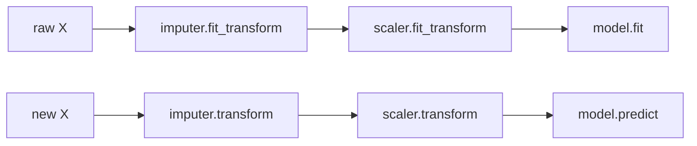

# Scikit-learn Pipelines

> A model is not the estimator. A model is every step from raw columns to prediction, fit together and validated together.

**Type:** Build
**Languages:** Python
**Prerequisites:** Phase 04 (ML Fundamentals: Cross-Validation, Feature Scaling & Encoding), Phase 06 (Supervised Classification: Logistic Regression), Phase 10 lesson 02 (Feature Selection)
**Time:** ~60 minutes

## Learning Objectives

- Explain data leakage from preprocessing and demonstrate it on pure-noise data
- Build minimal `Pipeline` and column-splitting transformers from scratch with a `fit` / `transform` / `predict` contract
- Handle mixed numeric and categorical columns with missing values in one object
- Use `Pipeline`, `ColumnTransformer`, `SimpleImputer`, `OneHotEncoder` and `cross_val_score` together

## The Problem

A real model needs preprocessing: impute missing values, scale numbers, one-hot encode categories, maybe select features. The tempting way is to run these steps once on the whole dataset and then cross-validate the classifier.

That is wrong, and it can be spectacularly wrong. Every preprocessing step with a `fit` learns something from the data: a mean, a standard deviation, a list of categories, which features correlate with y. If it learns from rows that later serve as validation data, information about the validation labels leaks into training. Your CV score goes up and your production score does not.

In this lesson you will make a classifier that scores 81% cross-validated accuracy on data where the true accuracy is 50%, and then fix it.

The second problem is plumbing. At prediction time a new row arrives as raw columns. You must apply exactly the same transformations with exactly the same learned statistics. Doing that by hand across notebooks and services is where production bugs live.

## The Concept

### The transformer contract

Every step follows the same interface:

```
fit(X, y)      learn statistics from training data only
transform(X)   apply them to any data (train, validation, production)
predict(X)     only for the final estimator
```

A pipeline chains them. `fit` runs fit-then-transform through each step and fits the last one; `predict` runs transform through each step and predicts with the last one.



Because the whole pipeline is one object with `fit` and `predict`, cross-validation refits every step on each training fold. Leakage becomes impossible by construction.

### Column-wise preprocessing

Tabular data mixes types. Numeric columns need imputation and scaling; categorical columns need one-hot encoding. A column transformer routes subsets of columns to different sub-pipelines and concatenates their outputs side by side:

```
          +-- [age, income] --> impute mean --> standardize --+
raw df ---|                                                   |--> hstack --> model
          +-- [city] ---------> one-hot ----------------------+
```

### How bad can leakage be?

Take 100 samples, 2000 features of pure Gaussian noise, and random labels. Pick the 20 features most correlated with y using all 100 rows. With 2000 candidates, some will correlate with y by chance, and they do so on every row, including future validation rows. Then cross-validate: the classifier reports roughly 80% accuracy on noise. Put the selection inside the pipeline and the score drops to the truthful 50%.

### The key insight

Anything that looks at data is part of training. If a step has a `fit`, it belongs inside the pipeline, and the pipeline belongs inside the cross-validation loop. Scaling leakage is usually small; selection, target encoding and oversampling leakage can be huge.

## Build It

### Step 1: Transformers

```python
class MeanImputer:
    def fit(self, X, y=None):
        self.means = np.nanmean(X, axis=0)
        return self

    def transform(self, X):
        return np.where(np.isnan(X), self.means, X)


class Standardizer:
    def fit(self, X, y=None):
        self.mean = X.mean(axis=0)
        self.std = X.std(axis=0) + 1e-12
        return self

    def transform(self, X):
        return (X - self.mean) / self.std


class OneHot:
    def fit(self, X, y=None):
        self.categories = [np.unique(X[:, j]) for j in range(X.shape[1])]
        return self

    def transform(self, X):
        blocks = [(X[:, [j]] == cats[None, :]).astype(float) for j, cats in enumerate(self.categories)]
        return np.hstack(blocks)
```

A category not seen during `fit` produces an all-zero block instead of crashing, which is what `OneHotEncoder(handle_unknown="ignore")` does.

### Step 2: Pipeline and column splitter

```python
class Pipeline:
    def __init__(self, steps):
        self.steps = steps

    def fit(self, X, y):
        for _, transformer in self.steps[:-1]:
            X = transformer.fit(X, y).transform(X)
        self.steps[-1][1].fit(X, y)
        return self

    def transform(self, X):
        for _, transformer in self.steps:
            X = transformer.transform(X)
        return X

    def predict(self, X):
        for _, transformer in self.steps[:-1]:
            X = transformer.transform(X)
        return self.steps[-1][1].predict(X)


class ColumnSplitter:
    def __init__(self, branches):
        self.branches = branches

    def fit(self, df, y=None):
        for _, transformer, columns in self.branches:
            transformer.fit(df[columns].to_numpy(), y)
        return self

    def transform(self, df):
        return np.hstack([transformer.transform(df[columns].to_numpy()) for _, transformer, columns in self.branches])
```

A pipeline of transformers is itself a transformer, so pipelines nest.

### Step 3: Leakage on pure noise

`TopKCorrelation` keeps the k features most correlated with y. `cv_accuracy` takes a factory so each fold gets fresh, unfitted objects.

```python
leaky_selector = TopKCorrelation(k=20).fit(X_noise, y_noise)
X_leaky = leaky_selector.transform(X_noise)
leaky_score = cv_accuracy(lambda: Pipeline([("scale", Standardizer()), ("model", LogisticModel())]), X_leaky, y_noise, folds)

honest_score = cv_accuracy(
    lambda: Pipeline([("select", TopKCorrelation(k=20)), ("scale", Standardizer()), ("model", LogisticModel())]),
    X_noise,
    y_noise,
    folds,
)
```

```
  select on ALL data, then CV:     accuracy = 0.810  <- leakage
  select INSIDE pipeline, CV:      accuracy = 0.480  <- honest
```

Same model, same data, same folds. The only difference is where `fit` of the selector ran.

### Step 4: Mixed types with missing values

```python
preprocess = ColumnSplitter(
    [
        ("numeric", Pipeline([("impute", MeanImputer()), ("scale", Standardizer())]), ["age", "income"]),
        ("categorical", OneHot(), ["city"]),
    ]
)
model = Pipeline([("preprocess", preprocess), ("model", LogisticModel())])
```

The dataset has 400 customers with `age`, `income` (15% missing) and `city`. The pipeline takes the raw DataFrame, both in CV and for new customers with missing income:

```
  scratch pipeline 5-fold accuracy: 0.748
  predictions for two new customers: [0 1]
```

## Use It

```python
from sklearn.compose import ColumnTransformer
from sklearn.impute import SimpleImputer
from sklearn.linear_model import LogisticRegression
from sklearn.model_selection import cross_val_score
from sklearn.pipeline import Pipeline
from sklearn.preprocessing import OneHotEncoder, StandardScaler

preprocess = ColumnTransformer(
    [
        ("numeric", Pipeline([("impute", SimpleImputer(strategy="mean")), ("scale", StandardScaler())]), ["age", "income"]),
        ("categorical", OneHotEncoder(handle_unknown="ignore"), ["city"]),
    ]
)
model = Pipeline([("preprocess", preprocess), ("model", LogisticRegression())])
print(cross_val_score(model, df, y, cv=folds).mean())
```

```
  sklearn Pipeline + cross_val_score: accuracy = 0.520     (noise data, selection inside)
  sklearn pipeline 5-fold accuracy: 0.743
  learned imputation mean for income: 50190.7
  scratch imputation mean for income: 50190.7
```

The learned statistics match exactly; the accuracies differ slightly because sklearn's logistic regression uses a different regularization and solver. Useful details:

- `model.named_steps["preprocess"].named_transformers_["numeric"]` reaches any fitted step.
- Hyperparameters of inner steps are addressed with double underscores, e.g. `GridSearchCV(model, {"model__C": [0.1, 1, 10]})`. The search then tunes preprocessing and model together without leakage.
- `make_pipeline` and `make_column_transformer` build the same objects with automatic step names.
- `joblib.dump(model, "model.joblib")` saves the whole fitted pipeline, so production loads one object that accepts raw columns.

## Exercises

1. **Easy.** Move the `Standardizer` outside the CV loop in Part 2 (fit it on all rows first). How much does the CV accuracy change? Why is scaling leakage much smaller than selection leakage?
2. **Medium.** Add a `MedianImputer` and a `MostFrequentImputer` for categorical columns, and inject missing values into `city`. Make the categorical branch a pipeline of imputer plus one-hot.
3. **Hard.** Implement `get_params` / `set_params` with the `step__param` naming convention for your `Pipeline`, then write a grid search over `model__l2` and `preprocess__numeric__impute` strategy using your own CV loop.

## Key Terms

| Term | What people say | What it actually means |
|------|----------------|----------------------|
| Data leakage | "The model saw the answers" | Information from validation or test rows influencing training, producing optimistic scores |
| Transformer | "A preprocessing step" | An object with `fit` (learn statistics from training data) and `transform` (apply them to any data) |
| Pipeline | "Chained steps" | A sequence of transformers ending in an estimator, fit and applied as one object |
| ColumnTransformer | "Different steps per column" | Routes column subsets through separate transformers and concatenates the results |
| fit_transform | "Fit and apply in one go" | Learn from X and transform X; only ever called on training data |
| handle_unknown | "Unseen categories" | What an encoder does with a category not seen during fit: error, or encode as all zeros |
| step__param | "Double underscore names" | How sklearn addresses a hyperparameter of a step inside a pipeline |

## Further Reading

- [scikit-learn: Pipelines and composite estimators](https://scikit-learn.org/stable/modules/compose.html) -- Pipeline, ColumnTransformer, FeatureUnion and nested parameters
- [scikit-learn: Common pitfalls and recommended practices](https://scikit-learn.org/stable/common_pitfalls.html) -- data leakage and inconsistent preprocessing with examples
- [Kaufman et al., Leakage in Data Mining: Formulation, Detection, and Avoidance (KDD 2011)](https://dl.acm.org/doi/10.1145/2020408.2020496) -- a taxonomy of leakage in real projects
- [Hands-On Machine Learning with Scikit-Learn, Keras, and TensorFlow (Geron)](https://www.oreilly.com/library/view/hands-on-machine-learning/9781098125967/) -- chapter 2 builds a full preprocessing pipeline on housing data
