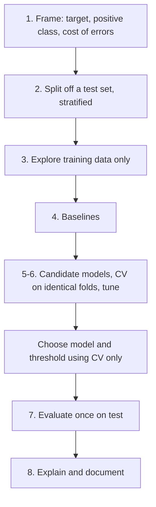

# End-to-End Project

> Algorithms are 20% of a machine learning project. The other 80% is framing, splitting, validating and being honest about what you measured.

**Type:** Build
**Languages:** Python
**Prerequisites:** All of Phase 10 (Practical ML), Phase 04 (ML Fundamentals), Phase 06 (Supervised Classification: Logistic Regression), Phase 07 (Trees and Ensembles: Random Forests, Gradient Boosting)
**Time:** ~90 minutes

## Learning Objectives

- Run a complete classification project in a fixed order: frame, split, explore, baseline, model, tune, evaluate once, explain
- Translate an asymmetric business cost into a metric and a decision threshold
- Compare a from-scratch model with library models on identical folds
- Report final results on an untouched test set together with a confusion matrix and feature importances

## The Problem

You are given the Wisconsin breast cancer dataset (bundled with scikit-learn, no download): 569 tumors described by 30 numeric measurements of cell nuclei, each labeled benign or malignant. The task: build a classifier that flags malignant tumors for further review.

Everything from the previous lessons appears here: the metric must reflect that classes and costs are unequal (lesson 01), features are highly redundant (lesson 02), hyperparameters need tuning (lesson 03), preprocessing must live inside the CV loop (lesson 04), and someone will ask what the model looks at (lesson 05).

The goal is not the highest number. The goal is a number you can defend.

## The Concept

### The project loop



### Framing decides everything

`load_breast_cancer` encodes malignant as 0 and benign as 1. sklearn's `precision_score` and `recall_score` treat label 1 as positive, so if you do not flip the target, "recall" measures how many benign tumors you found. Make the class you care about the positive class:

```
y_malignant = (data.target == 0)
```

Then write down the costs. A false negative (missed cancer) means delayed treatment. A false positive means an extra biopsy. That asymmetry says: optimize a ranking metric (ROC-AUC) to choose the model, then pick a threshold that delivers very high recall, and report the precision you pay for it.

### Rules of the test set

- Split it off first, stratified so it has the same class ratio.
- Do not look at it during exploration, feature engineering, model comparison, tuning or threshold choice.
- Use it once at the end. If you go back and change things after seeing test results, it is no longer a test set.

Every decision before step 7 uses cross-validation on the training set, with the same folds for every candidate so differences come from the models, not the splits.

### Choosing a threshold without the test set

Out-of-fold predictions give you an honest probability for every training row: each row is predicted by a model that did not see it. Choose the threshold on those probabilities.

```
for each fold k:
    fit on the other folds
    predict probabilities for fold k
threshold = highest value whose out-of-fold recall >= 98%
```

### The key insight

When several models score within one standard deviation of each other in CV, choose the simplest one. On this dataset, a scaled logistic regression matches random forests and gradient boosting. It is faster, easier to explain, and its probabilities are better calibrated, which matters when you move the threshold.

## Build It

### Step 1-3: Frame, split, explore

```python
X_train, X_test, y_train, y_test = train_test_split(X, y, test_size=0.2, stratify=y, random_state=0)
spreads = X_train.std(axis=0)
correlations = np.corrcoef(X_train, rowvar=False)
upper = np.triu(np.abs(correlations), k=1)
```

```
positive class = malignant: 212 (37.3%)
train 455 / test 114; test is not touched until step 7
feature std ranges from 0.0028 (fractal dimension error) to 567.3 (worst area)
feature pairs with |corr| > 0.95: 15 -> strong redundancy
```

Five orders of magnitude between feature scales: scaling is required. Fifteen near-duplicate pairs (radius, perimeter and area are almost functions of each other): expect importances to be shared across correlated features.

### Step 4: Baseline

```
always predict benign: accuracy=0.626 recall=0.000
```

Any model must beat 62.6% accuracy and, more importantly, must have non-trivial recall.

### Step 5: A from-scratch model with stratified folds

Scaling statistics are computed inside `fit`, so the model is its own leak-free pipeline.

```python
class ScratchScaledLogistic:
    def fit(self, X, y):
        self.mean = X.mean(axis=0)
        self.std = X.std(axis=0) + 1e-12
        Z = (X - self.mean) / self.std
        self.w = np.zeros(Z.shape[1])
        self.b = 0.0
        for _ in range(self.epochs):
            p = 1.0 / (1.0 + np.exp(-(Z @ self.w + self.b)))
            error = p - y
            self.w -= self.learning_rate * (Z.T @ error / len(y) + self.l2 * self.w)
            self.b -= self.learning_rate * error.mean()
        return self


def stratified_folds(y, n_folds=5, seed=0):
    rng = np.random.default_rng(seed)
    fold_of = np.empty(len(y), dtype=int)
    for label in np.unique(y):
        idx = np.flatnonzero(y == label)
        rng.shuffle(idx)
        fold_of[idx] = np.arange(len(idx)) % n_folds
    return [(np.flatnonzero(fold_of != k), np.flatnonzero(fold_of == k)) for k in range(n_folds)]
```

```
  scratch logistic l2=0.0    cv accuracy=0.978 cv recall=0.965
  scratch logistic l2=0.01   cv accuracy=0.978 cv recall=0.953
  scratch logistic l2=0.1    cv accuracy=0.956 cv recall=0.888
  scratch logistic l2=1.0    cv accuracy=0.925 cv recall=0.812
```

Small penalties tie; a fixed number of gradient descent epochs already acts as a mild regularizer (early stopping). Strong penalties hurt recall first.

### Step 6: Library candidates on the same folds, then a threshold

```python
candidates = {
    "logistic (sklearn)": make_pipeline(StandardScaler(), LogisticRegression(max_iter=1000)),
    "random forest": RandomForestClassifier(n_estimators=200, random_state=0, n_jobs=1),
    "hist gradient boosting": HistGradientBoostingClassifier(random_state=0),
}
for name, candidate in candidates.items():
    scores = cross_val_score(candidate, X_train, y_train, cv=cv, scoring="roc_auc")
```

```
  logistic (sklearn)       cv ROC-AUC = 0.9944 +/- 0.0065
  random forest            cv ROC-AUC = 0.9926 +/- 0.0091
  hist gradient boosting   cv ROC-AUC = 0.9915 +/- 0.0079
  tuned logistic: C=0.1 cv ROC-AUC = 0.9955
  threshold for >= 98% out-of-fold recall: 0.21
```

All three are within one standard deviation. Logistic regression wins on simplicity. `GridSearchCV` tunes its `C`, and out-of-fold probabilities pick the threshold:

```python
def lowest_threshold_for_recall(y_true, probabilities, target_recall):
    for threshold in np.round(np.arange(0.95, 0.04, -0.01), 2):
        if recall_at(y_true, (probabilities >= threshold).astype(int)) >= target_recall:
            return float(threshold)
    return 0.05
```

### Step 7: Test once

```
  scratch logistic @0.50   acc=0.947 precision=0.950 recall=0.905 | TP=38 FP=2 FN=4 TN=70
  sklearn logistic @0.50   acc=0.974 precision=0.976 recall=0.952 | TP=40 FP=1 FN=2 TN=71
  sklearn logistic @0.21   acc=0.895 precision=0.788 recall=0.976 | TP=41 FP=11 FN=1 TN=61
  test ROC-AUC = 0.9917
```

At threshold 0.21 the model misses 1 of 42 malignant tumors instead of 2, at the cost of 10 extra false alarms. Accuracy drops, and that is the right decision given the costs you wrote down in step 1. This trade-off, stated in counts a clinician can understand, is the real deliverable. Note that with only 42 positives in the test set, one tumor moves recall by 2.4 points: report uncertainty, not just the point estimate.

### Step 8: Explain

```
  worst texture            drop in ROC-AUC = 0.0078
  mean texture             drop in ROC-AUC = 0.0048
  worst radius             drop in ROC-AUC = 0.0035
```

Individual importances are tiny because radius, perimeter and area carry the same information: shuffle one and the model leans on the others. Group correlated features before drawing conclusions.

## Use It

The whole tuned model is a single object, so shipping it is one line:

```python
import joblib

joblib.dump(final_model, "breast_cancer_model.joblib")
loaded = joblib.load("breast_cancer_model.joblib")
probabilities = loaded.predict_proba(new_rows)[:, 1]
flags = probabilities >= 0.21
```

Store the threshold, the sklearn version, the training data snapshot and the CV and test metrics next to the model file. A model card (intended use, data, metrics, limits) turns these notes into documentation. In production, monitor the input distributions and the rate of positive flags; a change in either is your first sign of drift. sklearn 1.5+ can also wrap the threshold choice into the model with `FixedThresholdClassifier` or `TunedThresholdClassifierCV`.

## Exercises

1. **Easy.** Change the recall target to 95% and 100%. How do the threshold and the number of false positives on the test set change?
2. **Medium.** Drop features so that no pair has |corr| > 0.95 (keep one per group), rerun the comparison, and check whether CV ROC-AUC changes and whether permutation importances become easier to read.
3. **Hard.** Bootstrap the test set 1000 times and compute 95% confidence intervals for recall and precision at the chosen threshold. Then use repeated stratified CV (5 folds x 10 repeats) to decide whether logistic regression is really better than random forest or the difference is noise.

## Key Terms

| Term | What people say | What it actually means |
|------|----------------|----------------------|
| Problem framing | "Defining the task" | Choosing the target, the positive class, the unit of prediction and the cost of each error type before modeling |
| Stratified split | "Keep the class ratio" | Splitting so each part has the same class proportions as the full dataset |
| Baseline | "The dumb model" | The simplest reasonable predictor; every real model must beat it to justify its complexity |
| Out-of-fold prediction | "Honest training predictions" | The prediction for each training row from the CV model that did not see it |
| Operating threshold | "The cut-off" | The probability above which you raise a flag, chosen from costs on validation data |
| Model card | "Docs for the model" | A short document describing intended use, data, metrics, threshold and known limitations |
| Data drift | "The world changed" | A shift in the input distribution or the relationship to the target after deployment |

## Further Reading

- [Hands-On Machine Learning with Scikit-Learn, Keras, and TensorFlow (Geron)](https://www.oreilly.com/library/view/hands-on-machine-learning/9781098125967/) -- chapter 2 is a full end-to-end project with the same structure
- [Rules of Machine Learning (Martin Zinkevich, Google)](https://developers.google.com/machine-learning/guides/rules-of-ml) -- practical engineering advice from production ML
- [Mitchell et al., Model Cards for Model Reporting (FAT* 2019)](https://arxiv.org/abs/1810.03993) -- the template for documenting a shipped model
- [scikit-learn: Breast cancer wisconsin dataset](https://scikit-learn.org/stable/datasets/toy_dataset.html#breast-cancer-dataset) -- description of the features and labels used here
